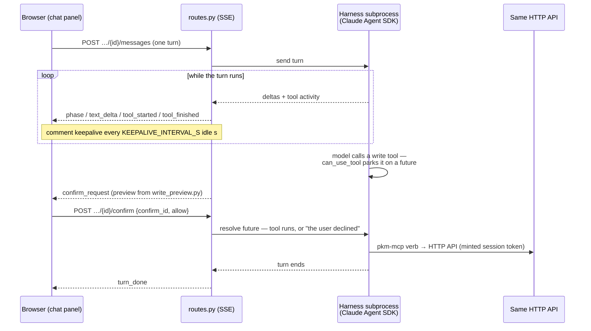
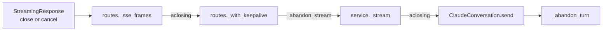

# Embedded assistant (`pkm/assistant/`)

The in-app LLM assistant is a server-side agent harness behind the app's only
SSE endpoints (`/api/assistant/*`, behind the same `require_auth`). The harness
has no built-in tools, only the `pkm-mcp` verbs that `policy.py` names
([cli-and-mcp.md](cli-and-mcp.md#the-mcp-tool-surface)), which loop back into
this same server over HTTP. Assistant writes therefore get the same validation,
conflict handling, journalling and broadcasts as any client. The routes are in
[backend.md](backend.md#http-api-reference), and the chat panel is in
[frontend.md](frontend.md#the-assistant-panel). Design spec:
[`docs/superpowers/specs/2026-07-26-pkm-wn2s-assistant-design.md`](../superpowers/specs/2026-07-26-pkm-wn2s-assistant-design.md);
threat model: [`docs/SECURITY.md`](../SECURITY.md). Failures are indexed by
symptom in [troubleshooting.md](../troubleshooting.md).

| File | Pattern | Role |
|---|---|---|
| `events.py` | Core | The event union routes and the web UI speak, plus `encode_sse()`. Nothing engine-specific leaks upward |
| `policy.py` | Core | The tool gate (`READ_TOOLS` auto-allowed, `WRITE_TOOLS` confirm-gated, `MCP_ONLY_TOOLS` never offered), `MODELS`, `available_models()`, `default_model()`, `WRITE_PREVIEW_FIELDS` (which arguments of each write are targets and which are content), the system prompt |
| `write_preview.py` | Core | `build_write_preview()`: the approval card's content for a write, or a `Refusal`; `write_target_uids()` and `delete_target_uids()`: the blocks the shell reads for it |
| `target_reader.py` | Shell | `preview_write()`: reads those blocks through a `BlockReader` (`db_block_reader()` in production) and builds the card |
| `preview_keys_dump.py` | Shell | Writes `web/src/assistant/previewKeys.gen.ts`, the keys each card action may carry ([generated artifacts](backend.md#generated-artifacts-and-parity-fixtures)) |
| `engine.py` | Core | `AgentEngine` / `ConversationHandle` protocols: the seam the test double plugs into. `send()` is an async generator because the caller closes it |
| `harness_env.py` | Core | `resolve_harness_env()`: requested model and available key → the SDK alias and the subprocess env |
| `service.py` | Shell | `AssistantService`, the in-memory conversation registry: a cap (`max_conversations`), a lazy idle reap (`idle_ttl`), a 409 for a second concurrent turn; `close_all()` on app shutdown |
| `claude_engine.py` | Shell | `ClaudeEngine`, the Claude Agent SDK adapter and only engine |
| `routes.py` | Shell | The HTTP/SSE endpoints. An engine failure mid-stream is an in-band `error` event, not a broken response |

Conversations live in memory only, with no history table. The engine is
injected into `create_app(config, assistant_engine=...)`.

One turn with a confirmed write:

## The write approval card

The card is the only thing between a prompt-injected model and a write to the
notes, so it shows what the tool will receive. It offers Allow only to a
user who has had the chance to read all of it.

| Rule | Reason |
|---|---|
| Targets come first, in full, and are never clipped | A long value in front of a `uid` or `title` would hide which block or page is written |
| A key the tool's FastMCP argument model does not declare is a `Refusal` (for `batch`, anything beside `commands`) | The tool drops such a key, so a card row for it could only be a decoy beside the real target, such as a lookalike `uid` |
| A declared field `WRITE_PREVIEW_FIELDS` does not name still shows as a target | A new argument is shown, never hidden; a test fails when a tool or batch params model gains an unclassified field |
| `build_write_preview()` validates with the tool's own FastMCP argument model and, for `batch`, the schema `apply_batch` applies; input they reject is a `Refusal` | FastMCP coerces arguments (`"yes"` becomes true, `"null"` becomes None, a JSON string becomes a list), so the card must show the coerced value. `test_preview_matches_what_the_tool_receives` pins the parity |
| Content values (`text`, `items`) reach the card whole; one over `CONTENT_LIMIT_CHARS`, or a target string over `TARGET_LIMIT_CHARS`, is a `Refusal` | `[show]` must be able to reveal every character approved. A target has no server-side bound, and a multi-MB value would freeze the tab |
| Any exception inside `build_write_preview()` is a `Refusal`, logged with its type only | Raised out of `can_use_tool`, it would reach the SDK as a control error rather than a reason; its message can quote the attacker's input |
| `ClaudeConversation.can_use_tool` denies a `Refusal` without a confirm | The user cannot approve what the tool would not run as shown |
| An op carries warnings for an `allow_merge` rename, a `((uid))` or `{{alias}}` parent, and a batch `update` or `move` uid | The target rows alone can mislead. An alias parent overrides the op's `page`; a uid that names no block sends the text, or a note, to today's daily note. The wording follows `plan_save`, `plan_batch` and `ops_core.classify_skip` |
| The tool functions are imported from `pkm.mcp.tools`, not `pkm.mcp.server` | Building the server's `FastMCP` configures the root logger |
| The card's labels (keys, action) and warnings are escaped by `parseWritePreview`; values are quoted by `quoteValue`, and a target's newlines are escaped too | A value cannot close a quote or start a line that reads as another argument. `writePreview.ts` owns the character classes |
| Every value `<bdi>` and every warning line has `dir="ltr"` | A value that starts with an RTL letter otherwise renders reversed beside the same title quoted in a warning |
| `parseWritePreview` gives each action only the keys, `current` state and count that `PREVIEW_KEYS` gives its label, each key once. Anything else leaves Deny only | Any other row could only be a decoy beside the real target. `previewKeys.gen.ts` is generated from `WRITE_PREVIEW_FIELDS`, `CURRENT_TEXT_ENTRIES` and `SUBTREE_DELETE_ENTRIES`, so it cannot drift; a `Map` cannot match `__proto__` |
| `batch_aliases` (`pkm.batch`, run by `validate_batch` and `plan_batch`) refuses a reused `as`, and an alias used before or by the command that makes it | A reused name sends later references to the newer block. With one creator per name, the card can name that write by number |

The browser keeps confirms in a queue. The head stays until its POST settles,
so a second `confirm_request` never swaps the card under the cursor. The hook
owns `sentDecision`, set when it posts, and after a failed post the card
offers a retry of that same decision only: the server may already hold it.

Allow arms after `ALLOW_ARM_MS`, and only once markers before the first op and
after the last have each been in view. The ops scroll in a region inside the
scrolling transcript, so a short window can hide a target while Allow shows;
`IntersectionObserver` reports against the viewport, which clips through every
scrolling ancestor. Without `IntersectionObserver` Allow never arms; Deny
still works. Until both markers are seen, `confirmHint` says which way the
unseen one lies: in a very short window the transcript can scroll the end
marker past its top, and "scroll to the end" would point the wrong way.

### Bounds

| Limit | Of | Past it | Reason |
|---|---|---|---|
| `MAX_PREVIEW_OPS` (= `MAX_OPS_PER_BATCH`) | a batch's commands | a `Refusal` | `apply_batch` sends one `/api/ops` batch of at most `MAX_OPS_PER_BATCH` ops, and each command plans at least one, so a longer batch could never apply |
| `PREVIEW_LIMIT_CHARS` | the card's target strings, content, warnings, and current page, excerpt, alias and count | a `Refusal` | The tab must render the card before the user can approve it. It counts code points, not bytes on the wire |
| `REFUSAL_LIMIT_CHARS` | a `Refusal`'s message | cut, ending `… (N characters)` | A refusal reaches the model and the log on every retry. It backstops `pkm.echo.echo`, which quotes and clips each echoed value at `ECHO_LIMIT_CHARS` |

### The blocks a write changes

Each op in `CURRENT_TEXT_ENTRIES` carries a `current` block, so the user sees
what an update, move or delete acts on, not only its uid:

| `current.state` | When | The card shows |
|---|---|---|
| `found` | a row has the uid | `current page` (`currently on page` for a move, whose own `page` reads `to page`), then the text's first `CURRENT_EXCERPT_CHARS` code points, with `(first N of M characters)` and `…` when clipped. A delete adds `and N blocks under it`, counted in the store as read |
| `missing` | no row has the uid, or it is malformed (never sent to SQL) | `no block has this uid`; the warnings say where the write goes instead |
| `created` | a batch `{{alias}}` | `none yet (write N above creates it as "a")` |

| Rule | Reason |
|---|---|
| `preview_write` reads the blocks on the server, in a thread, from one deep copy of the tool input, just before the `confirm_request`. The web fetches nothing | The tool writes the server's database, so that is the text to show. A web fetch would add a route, a loading state and a race with Allow arming |
| `db_block_reader` reads texts, pages, delete counts and parents' ancestors in one read transaction. A failed read, or a block whose page row is missing, is a `Refusal`, never an absent entry | An absent uid is what the card shows as `missing`, so it must mean only "no row" |
| The excerpt is a clip with `text_length` beside it, never a silent cut. `parseWritePreview` accepts only the server's exact clip (`CURRENT_EXCERPT_CHARS` is in `previewKeys.gen.ts`) | A block can hold a million characters, and "first N of M" must be the clip the server made |
| `_moved_into_delete` refuses a batch delete, naming both writes, when an earlier write moves an existing block into its subtree, directly, through an `as` alias or under a descendant. A move it cannot place (a `## Heading` parent, a parent uid with no row, a cycle) is refused too. It places parents by the ancestors read for `ancestor_uids` | The count is of the store before the batch runs, so a block moved in would go uncounted. No batch needs to move a block where it then deletes it. `pkm batch` is unchecked: its user wrote the batch |
| A delete's count is one walk of `_DESCENDANTS_SQL` per target | Its cost is the sizes of nested targets' subtrees times their depth. Real outlines count in milliseconds, but a chain at `MAX_OUTLINE_DEPTH` over tens of thousands of blocks holds the card back for seconds |

A card is a snapshot taken when its `confirm_request` was built, so a queued
card can predate a write the user allows on the card ahead of it. Each
successful Allow post adds one to every queued card's `allowedAhead`, and a
card with a `found` or `missing` block then shows `.assistant-confirm-stale`.
Known limit: a card the server read before an Allow but which arrives after
it starts at 0, so the marker misses it; the window is the SSE latency.
A re-read would mean serializing confirms on the server, losing the queue's
"1 of 2".

## Conversation registry

| Rule | Reason |
|---|---|
| Admission (reap, cap check, eviction, `engine.create_conversation()`) runs under one `asyncio.Lock`, bounded by `CREATE_TIMEOUT_S`; nothing else takes it | Two concurrent `create()` calls would both see free capacity; a wedged spawn fails one request instead of every later one |
| Teardown of a reaped or evicted conversation runs after the lock is released | The registry pop already enforces the cap, so a hung `close()` blocks only its own request |

A closed tab, a navigation and the Stop button all end the same way:
Starlette closes or cancels the response body, and each layer closes the next
explicitly rather than leaving it to the async-generator finalizer.

The teardown rules:

- Each step runs through `_wait_out`, outside Starlette's cancel scope, capped
  by `TEARDOWN_TIMEOUT_S`. Past that bound the entry stays busy, a later turn
  on it gets a 409, and `close_all()` takes it at shutdown.
- `_abandon_stream` logs rather than raises, because it unwinds inside a
  `GeneratorExit`.
- `_abandon_turn` declines every parked confirm before it awaits
  `interrupt()`: a harness parked in `can_use_tool` cannot acknowledge an
  interrupt until it has its decision.
- **An unacknowledged interrupt retires the conversation.** If `interrupt()`
  times out (`INTERRUPT_TIMEOUT_S`), raises or is cancelled,
  `ClaudeConversation.healthy` goes `False`, because the subprocess may still
  be running the abandoned turn. `AssistantService._stream()` then drops the
  entry, and the next `send()` for that id raises `UnknownConversationError`.

## Harness confinement

What `claude_engine.py` fixes before and around each harness subprocess:

| Concern | Mechanism | Rule |
|---|---|---|
| Tool surface | One SDK subprocess per conversation, `tools=[]` plus one MCP server running `python -m pkm.mcp.server --tools` with the names in `READ_TOOLS` and `WRITE_TOOLS`, and `strict_mcp_config=True` (`--strict-mcp-config`) | `ENABLE_TOOL_SEARCH=false` must accompany `tools=[]`, or the MCP tools are deferred behind a ToolSearch tool. `setting_sources=[]` still loads the account's claude.ai connectors. Strict config keeps all their tools from the model, reads included, where only `can_use_tool` would guard them |
| Host files | `MCP_ONLY_TOOLS` (`upload_asset`) is left out of `--tools`, and `classify_tool` calls it `unknown`, so a call is denied without a card | `upload_asset` reads a host path as the service account. The service runs in `app/server`, so `../../data/config.json` is the secret config. The assistant has no files of its own to upload |
| Provider routing | `resolve_harness_env()` keys on `policy.ZAI_MODELS`, not a `glm` literal | `glm` sets `ANTHROPIC_BASE_URL` (`ZAI_BASE_URL`) and `ANTHROPIC_AUTH_TOKEN` in the subprocess env and asks for `ZAI_SDK_MODEL`, an alias z.ai maps to its plan default, so no GLM version name is in the code |
| Model resolution | Claude models go to the SDK as aliases; the `claude` binary bundled in `claude-agent-sdk` maps them to ids | A new Claude model arrives only through an SDK upgrade, which is why `server/pyproject.toml` exempts the SDK from the uv cooldown |
| Auth | A fresh session token (`auth_core.sign_session`) in a 0600 temp config file per conversation, passed as `PKM_CLI_CONFIG` | The file is deleted on close. The token is visible in the subprocess env; accepted for a single-user deployment |
| Transactional startup | `create_conversation()` cleans up through `ClaudeConversation.close()` on any exit but success | The config-file unlink is in a `finally`, because `except Exception` misses `BaseException` |
| Credentials | The SDK uses the machine's Claude subscription login ([deploy/README.md](../../deploy/README.md#assistant-prerequisites)) | No `ANTHROPIC_API_KEY` in the service environment |

Without a z.ai key ([configuration](backend.md#configuration-and-entrypoints)),
`available_models()` drops `glm`, `create()` rejects it with a 400, and the
engine refuses it before writing the credential file.

## Keepalives and the stall watchdog

A turn can write nothing for minutes: long reasoning, a large tool payload,
or a confirm parked on the user. `routes._with_keepalive()` sends a comment
frame (`events.SSE_COMMENT`) every `KEEPALIVE_INTERVAL_S` idle seconds. That
keeps NAT and proxies from dropping the connection, and the write detects a
client that vanished without a clean close. Thinking content is not streamed;
`TurnMapper.map` turns each `content_block_start` into a `phase` event
("reasoning", "preparing `<tool>`", "replying") for the panel's busy line.

The stall watchdog treats total SDK silence as a dead network, since real
reasoning emits a steady stream of events. After `STALL_TIMEOUT_S` with no
SDK message, the pump interrupts the harness, with the same bounded wait and
`healthy` verdict as `_abandon_turn`, then reports an in-band `error`. The
interrupt goes first because the error ends the consumer's loop and would
cancel it. The deadline is suspended while a confirm is parked, because that
silence is the user's. The client's own guard is in
[frontend.md](frontend.md#the-assistant-panel).

## Testing

No real LLM runs in CI. `tests/fake_engine.py`, a scripted `AgentEngine`,
drives the service and route tests and the Playwright e2e
(`tests/e2e_serve.py` always wires it in).
