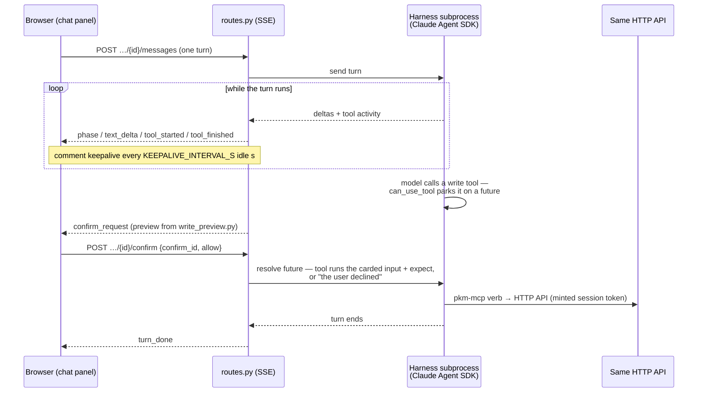
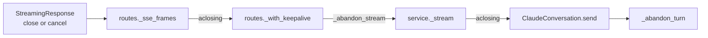
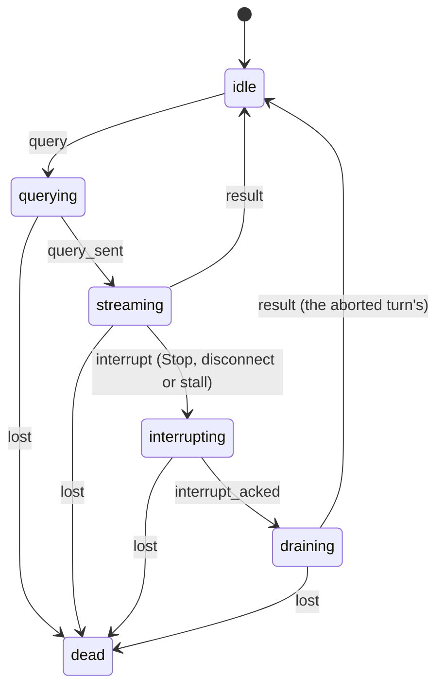

# Embedded assistant (`pkm/assistant/`)

The in-app LLM assistant is a server-side agent harness behind the app's only
SSE endpoints (`/api/assistant/*`, behind the same `require_auth`). The harness
has no built-in tools, only the `pkm-mcp` verbs that `policy.py` names
([cli-and-mcp.md](cli-and-mcp.md#the-mcp-tool-surface)), which loop back into
this same server over HTTP. Assistant writes therefore get the same validation,
conflict handling, journalling and broadcasts as any client. The routes are in
[backend.md](backend.md#http-api-reference), and the chat panel is in
[frontend.md](frontend.md#the-assistant-panel). Design spec:
[`docs/superpowers/specs/2026-07-26-pkm-wn2s-assistant-design.md`](../superpowers/specs/2026-07-26-pkm-wn2s-assistant-design.md);
threat model: [`docs/SECURITY.md`](../SECURITY.md).

| File | Pattern | Role |
|---|---|---|
| `events.py` | Core | The event union routes and the web UI speak, plus `encode_sse()` and `tool_error_reason()`. Nothing engine-specific leaks upward. The web's copy is generated from it ([the stream contract](#the-stream-contract)) |
| `policy.py` | Core | The tool gate (`READ_TOOLS` auto-allowed, `WRITE_TOOLS` confirm-gated, `MCP_ONLY_TOOLS` never offered), `MODELS`, `available_models()`, `default_model()`, `WRITE_PREVIEW_FIELDS` (which arguments of each write are targets and which are content), the system prompt |
| `write_preview.py` | Core | `check_write()`: validates a write once, into a `CheckedWrite` or a `Refusal`; `build_write_preview()`: the approval card's content from it, or a `Refusal`; `target_uids()` and `ancestor_uids()`: the blocks the shell reads for it; `approved_input()`: the input Allow runs |
| `target_reader.py` | Shell | `preview_write()`: reads those blocks through a `BlockReader` (`db_block_reader()` in production) and builds the card and the input Allow runs (an `Approval`) |
| `wire_dump.py` | Shell | Writes `web/src/assistant/previewKeys.gen.ts` (the keys each card action may carry) and `events.gen.ts` (the event union) ([generated artifacts](backend.md#generated-artifacts-and-parity-fixtures)) |
| `engine.py` | Core | `AgentEngine` / `ConversationHandle` protocols: the seam the test double plugs into. `send()` is an async generator because the caller closes it |
| `harness_env.py` | Core | `resolve_harness_env()`: requested model and available key → the SDK alias and the subprocess env |
| `turn_phase.py` | Core | `TurnPhase` and `_MOVES`: where a conversation's harness is in its turn, and what moves it on ([the turn phase](#the-turn-phase)) |
| `service.py` | Shell | `AssistantService`, the in-memory conversation registry: a cap (`max_conversations`), a lazy idle reap (`idle_ttl`), a 409 for a second concurrent turn; `close_all()` on app shutdown |
| `claude_engine.py` | Shell | `ClaudeEngine`, the Claude Agent SDK adapter and only engine |
| `routes.py` | Shell | The HTTP/SSE endpoints. An engine failure mid-stream is an in-band `error` event, not a broken response |

Conversations live in memory only, with no history table. The engine is
injected into `create_app(config, assistant_engine=...)`.

One turn with a confirmed write:

## The write approval card

The card is the only thing between a prompt-injected model and a write to the
notes, so it shows what the tool will receive. It offers Allow only to a
user who has had the chance to read all of it.

| Rule | Reason |
|---|---|
| Targets come first, and targets and content values reach the card whole; [Bounds](#bounds) refuses a card too large to render | A long value ahead of a `uid` or `title` would hide which block or page is written |
| A key the tool's FastMCP argument model does not declare is a `Refusal` (for `batch`, anything beside `commands`) | The tool drops such a key, so its row could only be a decoy beside the real target |
| A declared field `WRITE_PREVIEW_FIELDS` does not name still shows as a target | A new argument is shown, never hidden (`test_every_tool_field_is_classified`) |
| `check_write()` validates with the tool's own FastMCP argument model and, for `batch`, the schema `apply_batch` applies; input they reject is a `Refusal` | FastMCP coerces arguments, so the card must show the coerced value. `test_preview_matches_what_the_tool_receives` pins the parity |
| Any exception inside `check_write()` or `build_write_preview()` is a `Refusal`, logged with its type only | Raised out of `can_use_tool`, it would reach the SDK as a control error rather than a reason |
| `ClaudeConversation.can_use_tool` denies a `Refusal` without a confirm | The user cannot approve what the tool would not run as shown |
| Allow applies only while every block the card shows keeps the text it showed; for a delete, the same blocks under it with the same texts. Where a block sits is not checked | The card shows text, so that is what Allow must still match |
| Allow returns `approved_input` (the card's input plus an `expect` entry per block) as `updated_input`. The tool posts it as `OpBatch.expect`, which `routes_ops.post_ops` checks ([the write path](write-path.md)) | The browser sends only `confirm_id` and a boolean, and the model never sees `updated_input`, so neither can forge or drop a hash |
| `check_write()` refuses input carrying a `GATE_FIELDS` key (`expect`), whatever its value | A model's own `expect` could carry stale hashes or `[]`. The key stays in the tool's schema, because the CLI refuses an Allow whose `updated_input` fails that schema |
| `ClaudeEngine` starts `pkm-mcp` with `--require-expect`: `update_block` and `batch` then refuse a call with no `expect` key | An SDK or CLI that dropped `updated_input` fails closed. External `pkm-mcp` callers run without the flag |
| An op carries warnings for an `allow_merge` rename, a `((uid))` or `{{alias}}` parent, and a batch `update` or `move` uid | An alias parent overrides the op's `page`, and a uid that names no block sends the text, or a note, to today's daily note. The wording follows `plan_save`, `plan_batch` and `ops_core.classify_skip` |
| `parseWritePreview` (`writePreview.ts`) escapes labels and warnings; `quoteValue` quotes values, escaping a target's newlines | A value cannot close a quote or start a line that reads as another argument |
| Every value `<bdi>` and every warning line has `dir="ltr"` | A value that starts with an RTL letter otherwise renders reversed beside the same title quoted in a warning |
| `parseWritePreview` gives each action only the keys, `current` state and count that `PREVIEW_KEYS` gives its label, each once, and requires a boolean `writes_in_flight`. Anything else leaves Deny only | `previewKeys.gen.ts` is generated from `WRITE_PREVIEW_FIELDS`, `CURRENT_TEXT_ENTRIES` and `SUBTREE_DELETE_ENTRIES`, so it cannot drift. A `Map` cannot match `__proto__` |
| `batch_aliases` (`pkm.batch`, run by `validate_batch` and `plan_batch`) refuses a reused `as`, and an alias used before or by the command that makes it | With one creator per name, the card can name that write by number |

The browser keeps confirms in a queue whose head stays until its POST
settles, so a second `confirm_request` never swaps the card under the cursor.
After a failed POST the card offers a retry of that same answer only
(`answerFailed`), because the server may already hold it.

Allow arms after `ALLOW_ARM_MS`, and only once markers before the first op and
after the last have each been in view. The ops scroll in a region inside the
scrolling transcript, so a short window can hide a target while Allow shows;
`IntersectionObserver` reports against the viewport, which clips through every
scrolling ancestor. Without `IntersectionObserver` Allow never arms; Deny
still works. Until both markers are seen, `confirmHint` says which way the
unseen one lies.

### Bounds

Each limit's reason is in its comment in `write_preview.py`. A write past one
is a `Refusal`:

| Limit | Of |
|---|---|
| `TARGET_LIMIT_CHARS` | a target string, or a `found` block's page title |
| `CONTENT_LIMIT_CHARS` | one content value |
| `MAX_PREVIEW_OPS` (= `MAX_OPS_PER_BATCH`) | a batch's commands |
| `PREVIEW_LIMIT_CHARS` | everything the card holds at once (`_card_size`), in code points |

`REFUSAL_LIMIT_CHARS` cuts a refusal's own message, ending
`… (N characters)`, behind `pkm.echo.echo`'s clip of each quoted value.

### The blocks a write changes

Each op in `CURRENT_TEXT_ENTRIES` carries a `current` block, so the user sees
what an update, move or delete acts on, not only its uid:

| `current.state` | When | The card shows | Allow requires (`expect`) |
|---|---|---|---|
| `found` | a row has the uid | `current page` (`currently on page` for a move, whose own `page` reads `to page`), then the text's first `CURRENT_EXCERPT_CHARS` code points, with `(first N of M characters)` and `…` when clipped. A delete adds `and N blocks under it`, counted in the store as read | `text`: the `text_hash` of the whole text, never the excerpt. A delete: `subtree`, the `subtree_hash` of the block and all under it, so a child added beneath refuses too |
| `missing` | no row has the uid, or it is malformed (never sent to SQL) | `no block has this uid`; for a batch update or move, the warnings say where the write goes instead | `absent`: a block with the uid at Allow, such as a synced offline create, refuses. A malformed uid expects nothing, because `ops_core.impossible_uid_reason` refuses its batch with 400 |
| `created` | a batch `{{alias}}` | `none yet (write N above creates it as "a")` | nothing: the batch creates it |

A uid that a batch both deletes and updates or moves gets the one `subtree`
entry, whichever op comes first.

| Rule | Reason |
|---|---|
| `preview_write` reads the blocks on the server, in a thread, for the checked call, just before the `confirm_request`. The web fetches nothing | The tool writes the server's database, so that is the text to show. A web fetch would add a route, a loading state and a race with Allow arming |
| `check_write` runs once, before any read; the uids read, the card and `approved_input` all come from its `CheckedWrite`. Its refusal wording and the `could not be read` case are in `preview_write`'s docstring | A refusal reads nothing, and a caller's later change to its dict cannot reach what Allow runs |
| `db_block_reader` reads everything in one read transaction. A failed read, or a block whose page row is missing, is a `Refusal`, never an absent entry | An absent uid is what the card shows as `missing`, so it must mean only "no row" |
| The excerpt is a clip with `text_length` beside it. `parseWritePreview` accepts only the server's exact clip (`CURRENT_EXCERPT_CHARS` is in `previewKeys.gen.ts`) | "first N of M" must be the clip the server made |
| `_moved_into_delete` refuses a batch delete when an earlier write moves an existing block into its subtree, or a move it cannot place. It places parents by the ancestors read for `ancestor_uids` | The count is of the store before the batch runs, so a block moved in would go uncounted. `pkm batch` is unchecked: its user wrote the batch |
| A delete's count and subtree hash come from one walk of `ops_apply.subtree_rows` per target, the walk the server's `expect` check runs | Two walks could disagree on a corrupted parent chain. The cost, nested targets' subtree sizes times their depth, reaches seconds only for a chain at `MAX_OUTLINE_DEPTH` over tens of thousands of blocks |

A card is a snapshot taken when its `confirm_request` was built, so a write
the user allows on another card, the turn's own or a stopped or errored
turn's, can land after it. The two sides mark that case together:

| Side | What it records |
|---|---|
| server, `ClaudeConversation.can_use_tool` | stamps `writes_in_flight` when another write could land after the read: a confirm waited on the user, or an allowed write was still running, as the read started; or a confirm parked or a write was allowed during it |
| server, `_pump` and `send` | an allowed write stops running when its tool result arrives (`finished_tool_ids`), or when a turn finishes (`TurnDone`), the only end for one without a `tool_use_id`. A stopped or errored turn does not finish, so its running writes stamp the next turn's cards |
| web, `chatMachine.ts` | `allowedAhead` counts the Allows posted since the last finished turn (`turn_done`) or new conversation, before the card is answered, before it arrived or while it waited |
| web, `ConfirmCard` | a stamped card with a `found` or `missing` block and `allowedAhead` above zero shows `.assistant-confirm-stale` |

**A card is never silently stale from the assistant's own writes.** The
queue answers cards in order, so such a write was waiting, running or parked
by the end of the card's read. `test_claude_engine.py` pins each case.

Edits from outside the turn, such as the editor beside the panel, get no
marker. Allow refuses them instead: 412, and nothing is written. The tool
line shows the failure ([below](#a-writes-result)), and a retry builds a
fresh card. An `update_block` on a block deleted meanwhile fails on
`edit_block`'s own 404 before the check runs.

### The stream contract

`web/src/assistant/events.gen.ts` holds the web's `AssistantEvent` union and
`EVENT_TYPES`, generated by `wire_dump.py events` from `events.py`'s
dataclasses and `EVENT_NAMES`. `confirm_request.preview` is typed as parsed
(`WritePreview | null`), so a malformed preview still yields a card.

| Rule | Reason |
|---|---|
| A field with a server-side default is optional in the generated union, and the web parser keeps a frame's unknown keys, except in `confirm_request`, which `sse.ts` rebuilds from `confirm_id` and a strictly parsed preview (`parseWritePreview`) | A PWA keeps its cached bundle across a deploy, so an older bundle runs against a newer server and the reverse. A field a later server drops is one the web must already treat as absent |

### A write's result

The panel's tool line is decided by `ToolFinished`, never by the model's
reply, which can report a refused write as done.

| Result of a write | `ToolFinished` | Panel line |
|---|---|---|
| succeeded | neither field set | `✓` |
| a `batch` that skipped some ops (its result starts `warning:`) | `warning=<first line>`: a skip is a successful result, so neither `error` nor `declined` is set | `⚠` and the warning |
| the user declined the card | `declined=True` | `Declined`, no glyph |
| Stop while the card is parked | `declined=True`: Stop answers the card with a decline (`_decline_pending`) | `Declined`, no glyph |
| allowed then errored, or refused before a card (a `Refusal`) | `error=<reason>` | `✗` and `Failed: <reason>` |
| a read tool's error | neither field set | `✓`, no failure mark: reads fail while the model probes |
| no result reaches the web: the turn stopped as it arrived, the harness was lost, or a New chat or reload | no event | `…` stays |

- The truth is `ToolResultBlock.is_error`, observed by `TurnMapper` as the
  SDK stream passes. The CLI marks a deny `is_error` like a failure, so the
  server tells them apart by the card answer it gave (`_declined`).
- `TurnMapper` pairs a result with its call by `tool_use_id`, through maps the
  conversation owns (`_tool_names`, `_declined`), because a stopped turn's
  write reports during the drain, after its mapper's turn has ended.
- `tool_error_reason` strips the CLI's, FastMCP's and `ApiError`'s wrappers
  from the reason. The reason can echo model-chosen input, so it is clipped
  server-side (`TOOL_ERROR_LIMIT_CHARS`) and the panel renders it as text,
  as it does `warning`.

## Conversation registry

| Rule | Reason |
|---|---|
| Admission (reap, cap check, eviction, `engine.create_conversation()`) runs under one `asyncio.Lock`, bounded by `CREATE_TIMEOUT_S`; nothing else takes it | Two concurrent `create()` calls would both see free capacity; a wedged spawn fails one request instead of every later one |
| Teardown of a reaped or evicted conversation runs after the lock is released | The registry pop already enforces the cap, so a hung `close()` blocks only its own request |

A closed tab, a navigation, New chat and Stop's fallback abort
([frontend.md § The chat machine](frontend.md#the-chat-machine)) all end the
same way: Starlette closes or cancels the response body, and each layer
closes the next explicitly rather than leaving it to the async-generator
finalizer. The Stop button itself takes another path: `POST …/stop`
([the turn phase](#the-turn-phase)).

The teardown rules:

- Each step runs through `_wait_out`, outside Starlette's cancel scope, capped
  by `TEARDOWN_TIMEOUT_S`. Past that bound the entry stays busy, a later turn
  on it gets a 409, and `close_all()` takes it at shutdown.
- `_abandon_stream` logs rather than raises, because it unwinds inside a
  `GeneratorExit`.
- `_abandon_turn` declines every parked confirm before it asks the pump to
  stop the turn: a harness parked in `can_use_tool` cannot acknowledge an
  interrupt until it has its decision. It then waits for the pump, bounded
  by `INTERRUPT_TIMEOUT_S` + `DRAIN_TIMEOUT_S`.

### The turn phase

`ClaudeConversation` keeps one `TurnPhase` (`turn_phase.py`, a pure
`next_phase` table) for where its harness is in a turn. Any move the table
lacks is `dead`, and `close()` moves `lost` from any phase:

`lost` is a query that fails or is cancelled, an interrupt that times out
(`INTERRUPT_TIMEOUT_S`), raises or is cancelled, a drain that times out
(`DRAIN_TIMEOUT_S`), or a stream that raises or ends before its result.

**The aborted turn's result is drained before the conversation takes
another turn.** The CLI writes the aborted turn's `ResultMessage`
(`terminal_reason` `aborted_*`) after it acknowledges the interrupt. The SDK
buffers it, so a result nobody reads makes every later reply land one turn
behind. The pump keeps reading after the ack until that result, bounded
by `DRAIN_TIMEOUT_S`. The drained messages still update the tool maps and
`_running_writes`, but their events reach no consumer.

The pump is the only sender of an interrupt (`_stop_turn`, the one caller of
`_interrupt`). A Stop or a dropped consumer is a request it hears in its
read wait (`_request_stop`); the stall watchdog is its own read timing out.

| Rule | Reason |
|---|---|
| A turn sends one interrupt at most: `_stop_turn` acts only in `streaming`. `test_assistant_turn_phase.py` pins the orders a Stop, a stall and a disconnect can meet in | A second ack would find the phase `draining`, and the table makes that `dead` |
| `send()` moves `query` before it awaits `query()`. A cancellation there makes the phase `dead` | The prompt may already have reached the harness, and a turn nobody reads would be read by the next one as its own |
| A stop reaches the turn the service has reserved, started or not: `send()` mints the turn's stop request when called, and `AssistantService.send()` calls it as it sets `busy`. A turn stopped before its first step sends no prompt and yields only `TurnStopped` | The stop POST can be handled before the response body starts. A stop after its turn has ended reaches nothing, since each turn has its own request |
| A read that settled in the same pass as a Stop is handled first, so a turn that finished as the Stop landed ends on its own `TurnDone` | No interrupt goes to an idle CLI. An idle CLI acknowledges an interrupt with no result, so a drain would wait out its bound |
| The user's Stop (`POST …/stop`, `stop_turn()`) answers at once. The stream then ends with `TurnStopped` (`turn_stopped`) once the drain has read the aborted result, or the harness is lost. A stall's interrupt that came first ends it with the stall's `error` instead | Once the pump hears the stop this takes at most `INTERRUPT_TIMEOUT_S` + `DRAIN_TIMEOUT_S`. A stop heard while the prompt is still being written waits on `query()`, which has no bound; there only the web's fallback ([frontend.md § The chat machine](frontend.md#the-chat-machine)) bounds the panel. The entry's `busy` flag clears a few loop passes after `TurnStopped` is written |
| A write that reaches `can_use_tool` while its turn is being stopped, or after its consumer has gone, is declined without a card. `send()` declines any confirm still parked before it clears the queue | A parked card would hold the harness where it cannot acknowledge the interrupt. A dropped `ConfirmRequest` would leave its future parked, which also suspends the stall watchdog |
| A `dead` phase retires the conversation: `AssistantService._stream()` checks `healthy` when the turn ends, and `send()` refuses a `dead` harness without querying it | The subprocess may still be running the turn, or is gone. The next `send()` for that id raises `UnknownConversationError`, a 404 the panel answers by re-creating the conversation ([frontend.md § The chat machine](frontend.md#the-chat-machine)). A stream that ended gets an in-band `error`, or the consumer would wait forever |

## Harness confinement

What `claude_engine.py` fixes before and around each harness subprocess:

| Concern | Mechanism | Rule |
|---|---|---|
| Tool surface | One SDK subprocess per conversation, `tools=[]` plus one MCP server running `python -m pkm.mcp.server --tools` with the names in `READ_TOOLS` and `WRITE_TOOLS`, and `strict_mcp_config=True` | `ENABLE_TOOL_SEARCH=false` must accompany `tools=[]`. Strict config keeps the account's claude.ai connectors from the model, which `setting_sources=[]` does not |
| Tool result size | `harness_env.py` sets `MAX_MCP_OUTPUT_TOKENS` to `MCP_OUTPUT_TOKENS` and passes `--max-chars MCP_MAX_CHARS` to pkm-mcp ([cli-and-mcp.md](cli-and-mcp.md#the-mcp-tool-surface)) | Claude Code saves a result past either of its two gates to a file the assistant cannot open. The comment on `MCP_OUTPUT_TOKENS` derives both bounds; `test_assistant_harness_env.py` pins them |
| Host files | `MCP_ONLY_TOOLS` (`upload_asset`) is left out of `--tools`, and `classify_tool` calls it `unknown`, so a call is denied without a card | `upload_asset` reads a host path as the service account. The service runs in `app/server`, so `../../data/config.json` is the secret config |
| Provider routing | `resolve_harness_env()` keys on `policy.ZAI_MODELS`, not a `glm` literal | `glm` sets `ANTHROPIC_BASE_URL` (`ZAI_BASE_URL`) and `ANTHROPIC_AUTH_TOKEN` and asks for `ZAI_SDK_MODEL`, an alias z.ai maps to its plan default |
| Model resolution | Claude models go to the SDK as aliases; the `claude` binary bundled in `claude-agent-sdk` maps them to ids | A new Claude model arrives only through an SDK upgrade, which is why `server/pyproject.toml` exempts the SDK from the uv cooldown |
| Environment | `cli_path` is a per-conversation launcher (`harness_env.launcher_script`) that execs the CLI with only the names in `harness_env_names()`. `pkm-mcp` runs under `/usr/bin/env -i` with only `PKM_CLI_CONFIG` (`mcp_server_config`) | The SDK merges `os.environ` under `options.env` and cannot remove a variable, and the CLI hands its environment to MCP servers, so the allow-list has to sit in the launcher. `pkm-mcp` ignores `PKM_URL` once `PKM_CLI_CONFIG` is set (`load_mcp_config`; [cli.md](../cli.md)) |
| Auth | A fresh session token (`auth_core.sign_session`) in a 0600 temp config file per conversation, passed as `PKM_CLI_CONFIG` | The file is deleted on close. The environment carries only the file's path; the token is in the file |
| Transactional startup | `create_conversation()` cleans up through `ClaudeConversation.close()` on any exit but success | The launcher is removed with the config file, even on a second cancellation |
| Credentials | The SDK uses the machine's Claude subscription login ([deploy/README.md](../../deploy/README.md#assistant-prerequisites)) | No `ANTHROPIC_API_KEY` in the service environment |

A variable the CLI needs must be added to `HOST_ENV`. The SDK-drift test
catches one the SDK starts setting, but nothing catches a CLI need, so check
with a live start.

Without a z.ai key ([configuration](backend.md#configuration-and-entrypoints)),
`available_models()` drops `glm`, `create()` rejects it with a 400, and the
engine refuses it before writing the credential file.

## Keepalives and the stall watchdog

A turn can write nothing for minutes: long reasoning, a large tool payload,
or a confirm parked on the user. `routes._with_keepalive()` sends a comment
frame (`events.SSE_COMMENT`) every `KEEPALIVE_INTERVAL_S` idle seconds. That
keeps NAT and proxies from dropping the connection, and the write detects a
client that vanished without a clean close. Thinking content is not streamed;
`TurnMapper.map` turns each `content_block_start` into a `phase` event
("reasoning", "preparing `<tool>`", "replying") for the panel's busy line.

The SDK's model request has no first-token timeout, so the stall watchdog
treats `STALL_TIMEOUT_S` of total SDK silence as a dead network; real
reasoning emits a steady stream of events. The pump then interrupts the
harness and drains the aborted result as Stop does
([the turn phase](#the-turn-phase)), and only then reports an in-band
`error`, which ends the consumer's loop and cancels the pump. The deadline is
suspended while a confirm is parked, because that silence is the user's. The
client's own guard is in [frontend.md](frontend.md#the-assistant-panel).

## Testing

No real LLM runs in CI. `tests/fake_engine.py`, a scripted `AgentEngine`,
drives the service and route tests and the Playwright e2e
(`tests/e2e_serve.py` always wires it in).
`tests/fake_sdk_client.py` stands in for `ClaudeSDKClient` under the real
`ClaudeEngine`. Its `interrupt()` ends an open turn as the bundled CLI does,
writing the aborted `ResultMessage` after the ack, so a test that stops a
turn and sends again sees what production sees.
