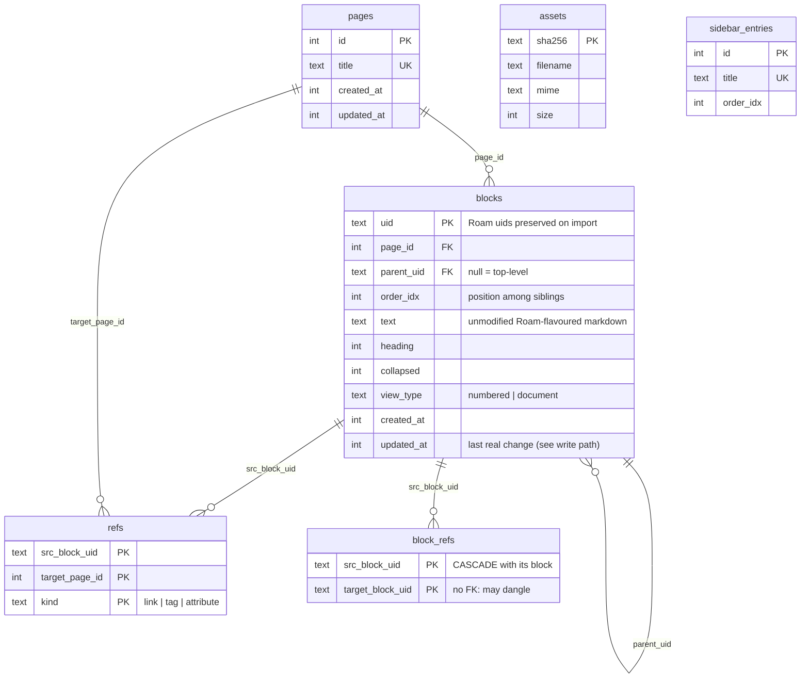
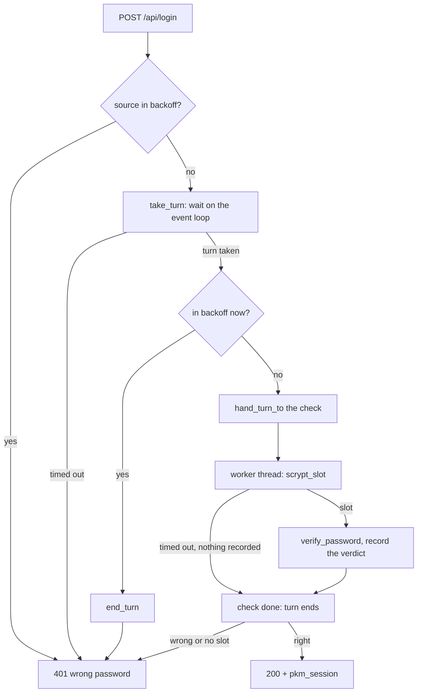

# Backend architecture (server/ + HTTP API)

A Python 3.12+ FastAPI application over a single SQLite file, and the sole
authority for the graph. Block-graph mutations flow through `POST /api/ops`;
other writes use dedicated routes. Refs and full-text indexes are re-derived
in the same transaction, and a trigger-based change journal feeds the sync
protocol. There is no ORM and no migration framework: raw `sqlite3` with
replayable DDL.

[overview.md](overview.md) has the system picture. Siblings own the write
path from `POST /api/ops` to the post-commit nudge
([write-path.md](write-path.md)), the sync protocol
([sync-and-offline.md](sync-and-offline.md)), the CLI and MCP server
([cli-and-mcp.md](cli-and-mcp.md)), import, export and backup
([import-export-and-backup.md](import-export-and-backup.md)), the assistant
([assistant.md](assistant.md)), and assets, local documents and GoodLinks copies
([files-and-assets.md](files-and-assets.md)). Failures are indexed by symptom
in [troubleshooting.md](../troubleshooting.md).

## Module map

Everything lives under `server/src/pkm/`. Each runtime file declares its
[FCIS pattern](overview.md#functional-core--imperative-shell) near the top.

```
pkm/
├── contracts/           Core   the wire contract; imports neither the server nor the client
│   ├── ops.py                  op models, OpBatch, UID_RE, text_hash, new_uid, id brands
│   ├── responses.py            response models
│   ├── titles.py               title brands: RawTitle → NormalizedTitle → CanonicalTitle
│   ├── brands.py               brand(): the x-brand schema marker
│   ├── strict.py               StrictModel, the base of every model
│   ├── text.py                 WellFormedModel: lone surrogates become U+FFFD
│   ├── int64.py                Int64, the bound on int path and query parameters
│   ├── tag_chars.py            TAG_WORD_RANGES, the generated tag word class
│   └── daily.py                date <-> "July 8th, 2026" titles
├── database.py          Shell  Db, the typed connection
├── db_sidecars.py, db_swap.py   Core / Shell  fold, then refuse, a database swap beside a held -wal/-shm
├── rows.py              Core   Row: one typed key per name a query may return
├── brand_registry.py    Core   brand NAMES, MINT_SITES, COLUMN_KEYS, SHAPES
├── schema.py            Core   BASE_DDL (replicated to clients) + SERVER_DDL
├── refs.py              Core   the ref grammar and title normalisation
├── todo.py              Core   {{TODO}}/{{DONE}} markers, mirrored by grammar/todo.ts
├── rename.py, unlink.py Core   rename and page-delete rewrites of block text
├── text_limits.py       Core   the length and `[[` nesting limits on block text
├── title_migration_core.py Core   title migration planner (the transactional shell is `server/title_migration.py`)
├── planning.py, batch.py, render.py   Core   shared by the CLI, MCP and client
├── *_dump.py            Shell  generated-artifact writers
├── parity_corpus.py     Core   the parity dumps' corpora and shape tally
├── server/                     the FastAPI app (below)
├── client/, cli/, mcp/         PkmClient, `pkm` and `pkm-mcp`
├── assistant/, describe/       embedded assistant; image-description queue
└── importer/, export/, backup/ Roam import, markdown export, nightly backup and restore

server/
├── app.py               Shell  create_app(config): init_db(), routers, 422 handler, SPA
├── config.py, setup.py  Shell  Config from config.json; setup writes it
├── db.py                Shell  init_db() at startup, open_db() per request, migrations
├── db_core.py           Core   sqlite_too_old: the SQLite version the server needs
├── wholepath.py         Shell  the {name:wholepath} DOTALL route convertor
├── path_params.py       Core   route dependencies parsing branded path parameters
├── clock.py             Shell  now_ms, the routes' clock dependency
├── auth.py, auth_core.py  Shell / Core  login, require_auth; scrypt and tokens
├── throttle.py, throttle_core.py  Shell / Core  LoginThrottle; backoff policy
├── auth_gate_core.py, auth_gate.py  Core / Shell  which requests are public, the body caps; AuthGateMiddleware
├── http_protocol.py     Shell  DeadlineH11Protocol: closes a connection whose request head is late or whose client stops reading
├── origin_core.py, origin_guard.py  Core / Shell  allowed origins; OriginGuardMiddleware
├── security_headers.py  Shell  middleware adding fixed security headers
├── routes_*.py          Shell  the HTTP surface
├── sidebar_core.py      Core   sidebar order and reorder checks
├── ops_core.py          Core   judges, skips, contexts, effects; plan_op(), classify_skip
├── replay_core.py       Core   the rewrite replay: walk, steps, budget charges, classify_text_edit
├── ops_hash.py          Core   the hashes that bind a batch_id to one payload
├── ops_expect.py        Core   which `expect` entry no longer holds
├── conflict_notes.py    Core   the text of conflict headers and skip notes
├── ops_apply.py         Shell  apply_batch: read context, plan, execute effects
├── store.py             Shell  page create, delete, rename, merge; never commits
├── sync_meta.py         Shell  flag and generation; read_title, title_reader
├── sync_core.py         Core   change-feed windows and hydration order
├── ws.py, notify.py     Shell  WebSocket Hub; post-commit nudges
└── tempfile_response.py Shell  CleanupFileResponse: cleanup runs even on a send error
```

`cli`, `mcp`, `client` and `server` depend on `contracts`, which imports
neither side; `tests/test_client_contracts.py` fails on an import that
crosses back. The assistant and describe routes live outside `pkm/server/`;
`app.py` mounts them.

`pkm/planning.py` plans a write on the CLI, MCP and client side, as ops to
post. The server's planner is `ops_core.plan_op`, which turns one received op
and its context into effects ([Planning](write-path.md#planning)).

## Database

One SQLite file, `pkm.sqlite3`, in the data directory. `init_db()` sets WAL
mode and applies the schema once at startup, never per request, because both
take locks that conflict with another connection's open write transaction.
Each request gets a fresh `Db` from `open_db()`, with `foreign_keys=ON`,
`recursive_triggers=ON` and `BUSY_TIMEOUT_MS`.

The server requires SQLite 3.43 or newer (`db_core.MIN_SQLITE_VERSION`), and
`init_db()` refuses to start on an older library, naming both versions. The
replay charge sizes rewrite rows with `octet_length`, which 3.43 added and
which reads a value's size from the record header without loading its text.

An `IN (...)` list built from a set the data can grow without bound (a page's
block uids, a block's referrers, a `((ref))` set) goes through
`sync_core.chunk_ids`, because SQLite refuses a statement that binds more
variables than its limit and the route would answer 500. The offline shim
(`replica/localApi/`) meets the same limit in the wasm build. It binds such a
set whole as one JSON array, `IN (SELECT value FROM json_each(?))`, which
needs one variable at any size and keeps one statement per read.

### Schema

`schema.py` holds two DDL blocks. `BASE_DDL` is the data model, **replicated
verbatim to browser clients** through `baseSchema.gen.ts`. `SERVER_DDL` holds
the sync machinery and never leaves the server.



Block text is the only durable data: `refs`, `block_refs` and the FTS5
tables are rebuilt from it. `blocks_fts` and `pages_fts` are external-content
tables kept in step by triggers. `blocks_fts` is keyed by implicit rowid, so
`VACUUM` would break it.

| Server-only table | Holds | Written by |
|---|---|---|
| `changes` | The append-only journal: `seq`, `kind`, `entity_id`, `deleted`, `page_id` | Triggers on `blocks`, `pages` and `sidebar_entries`, so a new write path is journalled automatically; also `JournalBlock` ([Missing targets](write-path.md#missing-targets)) |
| `applied_batches` | Each batch's request hash and stored ack | `post_ops` |
| `block_rewrites` | What a rename, merge, title migration or page delete did to one block's text, replayed over a stale edit ([Conflicts](write-path.md#conflicts)). Pruned after `BLOCK_REWRITE_RETENTION_MS` | `store.insert_block_rewrites` only, for `store._record_block_rewrite` (rename, merge, title migration), `store._record_delete_rewrite` (page delete), `ops_apply._execute` on a `RecordRewrite` that `ops_core.rewrite_effects` plans |
| `page_deletions` | Each user-deleted page's title and the journal head after it ([Stale batches](write-path.md#stale-batches)). Pruned on the same window | `store.delete_page_unlinking` only |
| `conflict_headers` | Today's conflict header per block; a new header deletes other days' rows | `ops_apply._execute` |
| `sync_meta` | `db_generation` (a rebuilt or restored database gets a new one and clients rebootstrap) and the `plain_space_title_canonicalization` flag | startup, title migration apply, `pkm.backup.restore` |

Cascade deletes are journalled only because `recursive_triggers=ON`.
`changes.page_id` is set only on a block tombstone: by `blocks_chg_ad`, the
page the deleted block was on; by `JournalBlock`, the page a diverted create
was placed on. It is never shipped and has no index, since every journal
insert would pay for one.

| `block_rewrites.kind` | `old_title` | `new_title` |
|---|---|---|
| `retitle` | the old title | the new title |
| `unlink` | the deleted page's title | empty |
| `inline` | the target block's uid | the text copied in place of `((uid))` |

### Schema migrations and legacy data

New tables and indexes are replayable `IF NOT EXISTS` statements. New columns
are guarded `PRAGMA` checks in `db._ensure_schema_migrations`. Replicas
rebootstrap on a schema-hash change. Startup never runs the
[title migration](#title-integrity-and-one-time-activation).

| Legacy shape | Handled by |
|---|---|
| `blocks.heading` 0, Roam's "no heading", from older imports | `Row.heading` is `StoredHeadingLevel`, so the row check admits it; `rows.heading_level` and `StoredHeading` read it as `None`, so the wire never carries it. A SQL `NULLIF` would cost VM steps on every block row |
| NULL `blocks.created_at` from old imports | `db._backfill_created_at`, through the update trigger so replicas get it |
| blocks from before `block_refs` was maintained | `db._backfill_block_refs`, once, behind a `sync_meta` marker |
| a journal without `changes.page_id` | `db._ensure_changes_page_id`; old rows stay NULL |
| `block_rewrites` rows without `kind` | the column default, `retitle` |
| `applied_batches` rows holding the strict `batch_request_hash` | `post_ops` accepts either that or `batch_replay_hash` |
| acks stored before `seq` or `skipped` | replayed through `OpsAck` as `seq: null` (unknown) and `skipped: []` |
| asset links with an unencoded filename | `/assets/{sha256}/{filename}` ignores the name segment |

### Breadcrumbs and recursive traversal

`routes_pages.py::_fetch_ancestors` builds the breadcrumb trail behind
`GET /api/block/{uid}` and every backlink group. Its recursive CTE holds
`uid` alone and joins with `UNION`, which queues a row only once. So each
distinct ancestor is read once, however many starts share it, and a parent
cycle in a hand-edited database ends the walk. `tree.ancestor_trails` then
rebuilds each trail root first, stopping at the first uid already on it.
**The ancestor walk must not carry a per-row path string.** One row per
start and ancestor, each copying an `O(depth)` string, makes the backlinks
of a deep chain cost `O(depth³)`.

A backlinks payload sends each ancestor's text once. Each `BacklinkGroup`
lists its ancestors' texts in `ancestor_texts`, and each item names its
trail, root first, as positions in that list (`ancestors`). Texts on every
item would repeat a deep chain's shared ancestors about `depth²/2` times,
so a few MB stored became hundreds of MB per read. An ancestor is always
on its item's page, so a per-group list holds each once. Both fields are
left out when empty. The web shows each ancestor's full text and the
linked-references filter reads its refs, so an excerpt is no substitute.
`groups.showBacklinkGroups` resolves a batch to texts on arrival, since
positions mean nothing outside their group. `GET /api/block/{uid}` has one
trail and keeps it as texts in `breadcrumbs`.

Every `BacklinkItem` still carries `breadcrumbs`, for tabs running a bundle
built before `ancestors`. Such a bundle reads it off every item and throws
to the root error screen when it is missing. It holds
`STALE_BUNDLE_CRUMB` (`…`) where the item has a trail and nothing
otherwise, never the texts.

The single-chain walks carry `path` as `,uid,uid,…,` and keep a row only
while `instr(c.path, ',' || b.uid || ',') = 0`, so a cycle stops at the
repeat. `ops_apply._unvisited` is the one place that test is spelled.
`UID_RE` admits no comma, so the test is exact. Each walk has a
replica mirror; change a pair together. None caps depth, so a chain deeper
than `MAX_OUTLINE_DEPTH` from before the cap reads whole.

| Walk | Server | Replica mirror | Cycle guard |
|---|---|---|---|
| Ancestors with text, for breadcrumbs and backlink groups | `routes_pages._fetch_ancestors` | `localApi/tree.ts::fetchAncestors` | `UNION` |
| One block's parent chain, for a move's cycle check and the assistant card's ancestors | `ops_apply.parent_chain` | `localOps.ts::parentChain` | path string |
| One block's subtree, deepest first, for delete, re-paging and journalling | `ops_apply._subtree_deepest_first` | `localOps.ts::subtreeUids` | path string |

## Typed boundaries

### Typed database access

Feature code holds a `Db` (`pkm/database.py`), never a `sqlite3.Connection`.
`select` and `select_one` return `Row` dicts; `execute` and `executemany`
take writes only and return `WriteResult`. `table_columns`, `trigger_sql` and
`backup_to` bypass the row check. `raw` exists for tests and tooling, and the
`raw-sqlite` lint rule rejects it elsewhere.

`Row` (`pkm/rows.py`) is a `TypedDict` with one key per name a query may
return, typed with its brand (`uid: BlockUid`) or `Literal` domain. A key
keeps one meaning and one nullability everywhere, so a column that differs
from the key of its name is read under an alias:

| Column | Row key |
|---|---|
| `pages.id` / `sidebar_entries.id` | `page_id` / `sidebar_entry_id` |
| `sidebar_entries.order_idx` | `sidebar_order_idx` |
| `kind` of `refs`, `block_rewrites`, `changes` | `ref_kind`, `rewrite_kind`, `change_kind` |
| `block_rewrites.old_title` / `new_title` | `rewrite_old_text` / `rewrite_new_text` |
| `changes.page_id` (nullable) | `change_page_id` |
| a computed value | the query's alias (`COUNT(*) AS n`) |

`brand_registry.COLUMN_KEYS` lists the aliases and `SHAPES` each brand's
regex; `CLIENT_KEYS` and `CLIENT_LITERALS` cover the replica's own tables.
With `PKM_ROW_CHECK=1`, `select` checks each row with `row_problems` and
raises `RowCheckError` on an unregistered column, a NULL in a non-null key, a
wrong type, a value outside a `Literal` or a brand-shape failure. Tests, e2e
and the proptest sync server turn it on; `perfcheck` turns it off. Fix a
`RowCheckError` in the query (alias, `COALESCE`) or the data, never by
loosening `row_problems`. A key admits every value its column stores,
[legacy ones](#schema-migrations-and-legacy-data) included. `Row` is not a
wire type: handlers copy keys into a response model.

### Wire models and brands

Every JSON handler returns a model from `contracts/responses.py`, and
`test_routes_models` rejects a bare `dict`. The web's types are generated
from these models, and `PkmClient` validates every response against them.

- **Closed sets** are `Literal`s, not `str`/`int`. They reach OpenAPI as an
  `enum`, and `pnpm gen-types` makes each a TS union.
- **Brands.** `brand()` (`contracts/brands.py`) tags a `NewType` with an
  `x-brand` schema marker, which gen-types turns into the web brand of the
  same name ([frontend.md § Brands](frontend.md#brands)). Call it in
  its own statement after the `NewType` line: pyrefly stops treating a
  wrapped `NewType` call as a type. A subtype inherits its parent's marker,
  so each needs its own `brand()`.
- **Strict models.** Every model inherits `StrictModel`, so pyrefly checks
  constructor arguments, brands included, and pydantic never coerces `"1"`
  to an int. Outside the checker: input decoded by `model_validate` at
  runtime, the perf fixture's `TypeAdapter(BlockOp)`, FastAPI form bodies and
  the MCP library's argument models.

The [brand lint](checks.md#brand-rules) enforces both;
`brand_registry.MINT_SITES` lists where each brand may be minted.
A path parameter whose brand has a parser (`BlockUid`, `Sha256Hex`,
`GoodlinksId`) comes from its dependency in `path_params.py`, so a handler
only receives the checked brand. A malformed segment keeps its
brand's status: 422 for a uid, 404 for a sha256 or a GoodLinks id.

| Brand | Base | Declared in | Note |
|---|---|---|---|
| `Sha256Hex`, `ClientId`, `BatchId`, `BlockUid` | `str` | `contracts/ops.py` | |
| `PageId`, `SyncSeq` | `int` | `contracts/ops.py` | |
| `SidebarEntryId` | `int` | `contracts/ops.py` | `sidebar_entries.id`, its own key, not a `PageId` |
| `OrderIdx` | `int` | `contracts/ops.py` | A sparse sibling key, not a position |
| `SidebarOrderIdx` | `int` | `contracts/ops.py` | The web reorders the sidebar by array position, so it never meets block order code |
| `ConversationId`, `ConfirmId` | `str` | `contracts/responses.py` | |
| `GoodlinksId` | `str` | `goodlinks.py` | |
| `RawTitle` | `str` | `contracts/titles.py` | Unchecked text; `as_raw_title` is the general mint |
| `NormalizedTitle` | `RawTitle` | `contracts/titles.py` | From `refs.normalize_title` or `canonicalize_title` |
| `CanonicalTitle` | `NormalizedTitle` | `contracts/titles.py` | The stored spelling of `pages.title` |

`canonicalize_title` takes `plain_space` as an argument rather than reading
the flag, so it returns only a `NormalizedTitle`. A `CanonicalTitle` comes
from `sync_meta.read_title` / `title_reader`, which read the live flag;
`refs.target_canonical_title`, which the title migration uses to plan
against the post-activation state; or `refs.canonical_daily_title`, canonical
under either flag. `store.fetch_page`, the rename, merge and sidebar helpers,
`query.py`'s `plan_sql` and the migration inventory take `CanonicalTitle`,
so pyrefly flags a title that skipped a mint. It cannot see an `Any` value or
raw SQL.

## Ref grammar

`refs.py` owns the grammar (`[[links]]`, `#tags`, `attr::`, `((refs))`,
`{{embeds}}`), and `web/src/grammar/scan.ts` mirrors it.

| Rule | Python | TS | Pinned by |
|---|---|---|---|
| Code hides refs; in one left-to-right pass, whichever of a closed fence or an inline span starts first wins | `strip_code` | `scanCode` | `ref_grammar.json` |
| Three backticks followed by an ASCII word character (`[A-Za-z0-9_]`) open a fence rather than close one | `_WORD_CHAR` | `WORD_CHAR_RE` | `ref_grammar.json` |
| A link, `#[[tag]]` or attribute whose title as written holds a backtick is no ref; an enclosing run goes with it | `holds_backtick` | `holdsBacktick` | `ref_grammar.json` |
| A title blank once normalised is no ref | `is_blank_title` | `isBlankRefTitle` | `refs_parity.json`, `title_parity.json` |
| A title with a `.`, `..` or empty `/` segment is no ref, so `#work/` typed on the way to `#work/notes` is never refused | `has_unreachable_segment` | `hasUnreachableSegment` | `title_parity.json` |
| An indented `Title::` is an attribute, its span anchored on the title | `attribute_title_span` | `scanGrammar` | `scan.test.ts` (`"  Key:: v"` at offset 2) |
| The `((uid))` shape, which `UID_RE` and the `BlockUid` brand shape are built from | `BLOCK_REF_TOKEN` | `UID_TOKEN` | `scan.test.ts`, `test_rows_vocabulary.py` |
| How deep `[[` runs nest: the height of the run tree over the code-stripped text | `link_nesting_depth` | `linkNestingDepth` | `text_limits_parity.json` |
| A `#tag` name is a run of `_`, `/`, `.`, `-` and the word characters in `TAG_WORD_RANGES` | `_TAG_NAME` | `TAG_CHARS_RE` | `ref_grammar.json`, `test_tag_chars_artifact.py` |

The backtick check reads the original text, because `strip_code()` has
blanked code to spaces. Both scanners stay linear: a failed fence-closer
search retires the fence rule for the rest of the text. The fence-closer word
test is ASCII on both sides. A Unicode class follows each runtime's Unicode
table, and Python's lags a browser's, so the two would hide different text as
code and disagree on a block's refs and nesting depth. A tag name cannot be
ASCII, or `#café` would stop being a tag. Its word class is instead one frozen
table, `contracts/tag_chars.py` (CPython 3.12's `\w`, Unicode
`TAG_CHARS_UNICODE_VERSION`), which both sides compile. A Python or browser
upgrade therefore changes no tag. Moving the table to a newer Unicode is a
deliberate regeneration.

`rename.py` and `unlink.py` keep no copy of the grammar. They locate refs
through `strip_code`, `bracket_spans`, `tag_spans` and `attribute_title_span`,
so they cannot find a ref the index missed or splice over code. `rename.py`
adds which span wins when refs nest and how to spell the replacement. A
replaced span hides every ref inside it: an outer `[[run]]` its nested runs,
and a leading attribute the `#tags` in its name (`#a b::` is the attribute
`#a b` and the tag `a`). `spans.splice` assumes no two spans overlap. Its
`normalize` argument maps a spelling in the text onto a replacement key.
Rename, merge and their replay pass `rename.spelled_or_canonical`: a spelling
that is itself a key, else its canonical form under the live flag. Matched
byte for byte, `[[ Old ]]` would survive a rename under plain-space
canonicalisation, and the reindex would recreate `Old`.

Writes refuse a text whose runs nest past `MAX_LINK_NESTING`
([text limits](write-path.md#work-bounds-under-the-write-lock)). `link_nesting_depth` counts every run, ref or
not, and `#[[` like `[[`. Brackets in code, an unclosed `[[`, a stray `]]`
and a run whose title holds a backtick do not count. The title guard
(`ops_core.find_op_title_violation`) cannot stand in for it: it judges only
runs that are refs, and a run whose title has an unreachable segment
(`[[a//...`) is none. Runs inside a `{{query: …}}` or
`{{pdf: …}}` body count too, though the web renders that body without
tokenizing it. That only over-counts, and a change to it must change
`linkNestingDepth` with it, because `text_limits_parity.json` pins the two
equal.

Rows stored before the limit can nest far deeper. Every walk over
`BracketSpan.children` therefore keeps its own stack, as `bracket_spans`,
`rename._rewrite_range` and `unlink._unlink_range` do. A recursive one fails
past the recursion limit, and the page such a block links could then not be
renamed or deleted.

## Title integrity and one-time activation

`refs.canonicalize_title` has two layers. The durable
`plain_space_title_canonicalization` flag selects the second:

| Layer | Runs | Does |
|---|---|---|
| fold (`normalize_title`) | always | every run of `TITLE_WHITESPACE` becomes one U+0020; if that changed anything, edge U+0020 goes too, else the title comes back byte for byte |
| plain-space strip | flag active | strips edge U+0020 whatever the fold did, so a canonical title is its words joined by single spaces |

The flag is inactive on any database neither imported nor migrated, since
only the title migration sets it and every import runs that migration.
There a title with nothing to fold keeps its single-space edge padding
(` A `), so legacy rows still resolve.

`contracts/titles.TITLE_WHITESPACE` is the whitespace set, written out
rather than taken from either language. Python's `\s` adds U+001C-U+001F
and JS's adds U+FEFF and drops U+0085, so either would split a page between
server and replica. The web gets the list
[generated](#generated-artifacts-and-parity-fixtures). Blankness keeps
Python's `strip()` (`is_blank_title`, mirrored by `stripLikePython`), and
after the fold the edge strip is `strip(" ")`, never `strip()`.

**A title that arrives as a lookup key goes through `sync_meta.read_title`
before it meets `pages.title` or `sidebar_entries.title`.** Both are exact
matches, so a raw title the rules would change misses its page. The entry
points are a `{title:wholepath}` route parameter, the `page` filter on
`/api/todos` and `/api/changed`, a `[[Page]]` operand in `{{query}}`
(`query_exec.parse_canonical_query`) and the `POST /api/sidebar` title.

The `wholepath` convertor (`server/wholepath.py`) replaces Starlette's `path`
on title and file-path routes and the SPA fallback. `path` stops before a
final newline, so `Foo%20%0A` would arrive as `Foo `. `test_title_routes_props.py`
checks every title-taking route and CLI verb against generated spellings;
its route list comes from OpenAPI, so a new title route fails until covered.
The web's sidebar form sends input untrimmed, because `trim()`'s set is not
`TITLE_WHITESPACE` and the flag decides edge U+0020.

Every creation path funnels through `store.get_or_create_page()`. Daily pages
(`daily.py`) are auto-created on read and cannot be renamed.
`ops_apply._broadcast_op()` echoes the stored title in place of the caller's
`page_title`, so replicas receive the authoritative spelling.

Activation is an operator action: `pkm migrate-titles`, then
`pkm migrate-titles --apply DIGEST`
([docs/cli.md](../cli.md#one-time-title-canonicalization)).
`pkm/title_migration_core.py` groups pages whose titles share a
`target_canonical_title`, picks a survivor and reports `all_space` or
`forbidden_syntax` blockers. It also lists `sidebar_retitles`: every sidebar
entry the target rule changes that no group already moves. Replacement
values are opaque (`rename.rewrite_title_refs_map()` never rescans one), and
the digest covers the whole relevant snapshot.
`audit_title_migration()` runs in a read transaction it always rolls back.
Apply takes that `audit_digest`, re-inventories under the
[write lock](write-path.md#the-write-lock), and answers 409 to a stale digest, to a
blocker, or to an active flag with no groups and no sidebar retitles. Every
change, through activation and the `db_generation` rotation, is one
transaction, followed by one forced seq frame; replicas rebootstrap before
replaying pending intent
([sync-and-offline.md](sync-and-offline.md#title-activation-across-online-and-offline-paths)).

Apply runs on an active database when the audit finds work, because a
change to the fold rule leaves rows that were canonical under the old one.
A page whose stored title the new fold changes is unreachable, since every
key folds, so rename cannot touch it and only the migration merges or
retitles it. On
an inactive database the same apply also activates the flag.

`server/title_migration.check_titles_at_startup`, run from the app lifespan,
logs one ERROR on `pkm.titles` naming the stored page and sidebar titles the
live rule would change, with `pkm migrate-titles` as the remedy. It never
refuses to start: the remedy is an HTTP call, and under launchd's KeepAlive a
refusal is a crash loop. It never repairs either, because a merge is
irreversible and stays a digest-confirmed operator action. A failure inside
the check is logged and the server serves on.

Two reported rows have no migration remedy, and
[docs/cli.md](../cli.md#rows-the-migration-cannot-fix) gives each one's fix:

| Row | Why the migration leaves it |
|---|---|
| a page whose title the fold turns into a refused or blank one (`Notes/` + NBSP) | it is a blocker, and no route reaches the stored spelling to rename it |
| a sidebar entry whose canonical form is blank or refused | no pin can hold that title, so apply skips it and, with nothing else to do, answers "already active" |

### Refused titles

`refs.title_syntax_reason` refuses a title as `forbidden_syntax` when it holds:

| Syntax | Why |
|---|---|
| `#`, `[[`, `]]` | ref syntax |
| a trailing `]` | `[[a]]]` reads back as `a` |
| a trailing `[` | unlinking `[[a[]]` leaves `a[`, which joins a following `[a[]]` into a fresh link, so a page delete's unlink re-forms one link per pass |
| a backtick | it pairs with another on the line into a code span that hides the ref |
| a `.`, `..` or empty `/` segment (`/x`, `a//b`, `a/../b`) | no URL: clients drop dot segments and the router collapses `//` |

Every rule judges the title edge-stripped of U+0020
(`target_canonical_title`) whatever the flag, because the pure ops check
never knows the flag and must not pass ` a] `. A title is refused at
creation, rename, move, sidebar pin, import, and in the migration audit. In
block text a ref with `#`, `[[`, `]]` or a trailing `]` or `[` fails the
batch with a 400; a backtick or no URL makes it [no ref](#ref-grammar). `...`
and `a.b` are ordinary titles. A row stored with a title ending in `[`
stays readable and deletable; [Page mutations](write-path.md#page-mutations-and-the-sidebar)
bounds its unlink.

A title whose fold (`normalize_title`) is longer than
`MAX_PAGE_TITLE_CHARS` code points is refused too (`refs.title_length_over`).
That holds at creation, rename, move, sidebar pin and import, but not in the
migration audit, which only shortens a title. In block text a link, tag or
attribute to such a title fails the batch with a 400. The fold is measured
on the title as sent, before the flag's edge strip: it is the longest a
stored title can be under either flag, and the pure ops check never knows
the flag. So ` t…t ` with single-space edges is refused at 1,002. Length is
judged before syntax (`refs.title_refusal`), so a refusal names the length
and never echoes the title.

`get_or_create_page` refuses only creating such a page (`TitleTooLongError`,
raised after `fetch_page` misses). A row stored before the cap stays
readable, renamable to a shorter title and deletable, and a reindex keeps its
backlinks; `index_ref` skips a long title as it skips a forbidden one. An op
naming a stored long title as a `page_title` or a link is refused until the
page is renamed. `update_text`'s `page_title` hint is never judged: refusing
it would refuse an edit to a block on such a page and discard the offline
batch.

### Blank titles

A blank title is unreachable, so `get_or_create_page()` raises
`BlankTitleError` and each caller picks its recovery:

| Caller | Recovery | Why |
|---|---|---|
| `POST /api/pages` | 422 | a live client can retry |
| `ops_apply._resolve_page()` | file under `UNTITLED_PAGE_TITLE`, `"Untitled"` | the ops path must never 422 |

`"Untitled"` is an ordinary title, so blank-title ops land on a user's real
"Untitled" page if one exists; that trade-off is accepted. A blank ref
indexes nothing ([Ref grammar](#ref-grammar)), or `[[   ]]` would make a
phantom backlink on "Untitled". `store.index_ref()` also skips a ref that
raises `BlankTitleError`.

## Auth

One shared password behind Tailscale, the transport boundary. `auth_core.py`
does the constant-time scrypt check and signs the `pkm_session` cookie
(`v1.<issued_ms>.<sig>`). `docs/SECURITY.md` owns the cookie flags and the
threat model.

Response headers that apply to every route are set in one place,
`SecurityHeadersMiddleware`; routes set only their own. An
unhandled exception's 500 is built outside it and carries none.

`AuthGateMiddleware` (`auth_gate.py`, rules in `auth_gate_core.py`)
refuses an anonymous request before routing, without calling `receive`.
**FastAPI reads and parses a body before it runs any dependency**, so a
guard that is only a dependency takes in an anonymous upload whole before
its 401. The refusals are 401 `{"detail": "not authenticated"}` and a 4401
handshake close before accepting. `session_is_valid` (`auth.py`) is the
one session check.

| Request (`is_public`) | At the gate |
|---|---|
| `POST /api/login` | public, body capped |
| `GET` or `HEAD` outside `/api` and `/assets`: `GET /login`, `GET /healthz`, `/app-assets/*`, the SPA shell | public |
| anything else, every WebSocket handshake included | needs a valid `pkm_session` |

The gate hands `is_public` `get_route_path(scope)`, the string the router
matches, so the two cannot disagree on decoding. A public body (a method outside
`SAFE_METHODS`) is read by the gate, session or not, and replayed to the
route as one message. No session bounds it, so the gate keeps at most
`PUBLIC_BODY_MAX_BYTES` and answers 413 `{"detail": "request body too large"}`
past it, before the app reads any of it when `Content-Length` declares it.
A streamed body is refused at the message that passes the cap, so the
overshoot is at most one of uvicorn's reads. This runs before the login
throttle.

An authenticated body outside `SAFE_METHODS` is capped too, at the size
`private_body_cap` gives. FastAPI would otherwise parse a body of any size
before the route's own limits refuse it: a batch of hundreds of MiB would
cost GiBs of memory before `MAX_OPS_PER_BATCH` refused it.

| Authenticated request | Cap |
|---|---|
| an upload (`UPLOAD_ROUTES`) | the config's `max_upload_bytes` plus `UPLOAD_ENVELOPE_BYTES` |
| any other method outside `SAFE_METHODS` | `PRIVATE_BODY_MAX_BYTES` |

An upload needs the cap as much as a batch does. FastAPI parses the whole
multipart form before `upload_asset` runs: it spools the file to disk and
holds other fields in memory, and the route checks `max_upload_bytes` only
afterwards. `UPLOAD_ENVELOPE_BYTES` is slack for the multipart framing, so
a file just past its limit still gets the route's own 413
`upload too large`.

A declared `Content-Length` past the cap gets 413 unread. One within it
passes untouched, since h11 frames the body to it.
`declared_content_length` ignores a length sent beside
`Transfer-Encoding`, because h11 then frames by the chunks. A body with no
length the gate trusts is counted as the route reads it, never buffered
by the gate, since an upload may be far larger than anything worth holding
in memory. The message that passes the cap raises `_BodyOverCap`, an
`HTTPException`, out of `receive`, and FastAPI answers it 413.

uvicorn has no read or write timeout of its own. `DeadlineH11Protocol` and
the gate bound a slow client:

| What is late | Bound | Answer |
|---|---|---|
| the request head, from the connection's open or its last response | `HEADER_READ_TIMEOUT_S` (`DeadlineH11Protocol`) | the connection is closed |
| the rest of a body answered without reading it (a 401, 403 or 413) | the same deadline, which the leftover body counts against | the connection is closed |
| a public body | `PUBLIC_BODY_READ_TIMEOUT_S` for the whole read | 408 with `Connection: close`, as RFC 9110 advises: the client has shown it will not finish |
| the client taking a response, while writing is paused or the response is finished with bytes unsent | the transport's buffer must shrink within `WRITE_STALL_TIMEOUT_S` | the connection is aborted |
| an authenticated body | none | — |
| a request every few seconds on one connection | none: uvicorn's 5 s keep-alive restarts with each one | — |

The write deadline measures progress, not paused time: one large JSON
message keeps writing paused until nearly all of it has left. The kernel
takes bytes from the transport in steps of its socket buffer (a few
hundred KiB), so the rule is in effect a minimum read rate of one step
per window, about 1 KiB/s at 300 s: far below any usable link, and the
accepted cost of a bound that needs no kernel queries. The kernel may also
take a few KiB just after the client stops reading, so a client that stops
is cut one or two windows later.

A 401 or 413 does not close the connection at once. uvicorn drops the rest
of the refused body, and a client that sends it promptly can reuse the
connection. Closing with that body unread resets the connection, and a
client still sending could lose the answer. An authenticated body has no
deadline because an upload over a slow link may take minutes. An upload
past its limit plus the multipart envelope gets the gate's 413 at once
and the sender is cut at the head deadline, so a browser may show a reset
instead of the 413; the upload fails either way.

`require_auth` stays on every router
(`dependencies=[Depends(require_auth)]`) as the route's own check, and
`/api/ws` checks the cookie inline. It is the only check on a `GET`
outside `/api` and `/assets`. `test_the_gate_admits_exactly_the_public_routes`
fails when the gate admits a route of `create_app`'s table outside
`PUBLIC_ROUTES`; routes another app adds, such as the proptest sync
server's `GET /__proptest/*`, are not walked.

Middleware runs outermost first: `RequestLogMiddleware` →
`SecurityHeadersMiddleware` → `OriginGuardMiddleware` →
`AuthGateMiddleware` → router. The two that refuse are innermost, so
their refusals are logged and carry the security headers.

`OriginGuardMiddleware` (`origin_guard.py`, rules in `origin_core.py`)
checks `Origin` on every `/api/ws` handshake and on every HTTP method
outside `SAFE_METHODS`. `ts.net` is a public suffix, so every tailnet host
is same-site with the app and the `Lax` cookie rides along on a sibling
host's handshake and simple POSTs. A request with no `Origin` passes,
because browsers send one on every request the guard checks; only
non-browser clients omit it. A request with exactly one `Origin`, in the
allowed set, passes. Anything else is refused.

| Allowed origin | Source |
|---|---|
| each entry of `serve_origins` | config.json, canonicalised on load (`canonical_origin`) |
| `http://<host>:<port>` | each bind host; `--host` replaces `bind_hosts` |
| `http://127.0.0.1:<port>`, `http://localhost:<port>`, `http://[::1]:<port>` | always |

`<port>` is the `api_port` `create_app()` is given, the port `run.py`
serves on. A refused HTTP request gets 403
`{"detail": "origin not allowed"}`. A refused handshake is closed with
4403 before accepting. uvicorn sends both closes, 4403 and 4401, as an
HTTP 403. The guard runs before the auth gate, so an anonymous handshake
from a foreign origin sees 4403, not 4401.

Two tests pin rules that would lock the app out if broken:
`Origin: null` is refused, because a sibling page can produce it
(`test_origin_allowed`, `test_ws_refuses_a_foreign_origin`), and the web
treats 403 as retry-later (`RETRY_LATER_STATUSES` in
`web/src/sync/rejection.ts`, pinned by `rejection.test.ts`), so a wrong
`serve_origins` queues edits instead of discarding them.

Nothing enforces these rules:

- The app must never set `Referrer-Policy: no-referrer`, as a header or a
  meta tag on its own documents. Fetch writes, uploads and the WebSocket
  keep the real origin under that policy. The no-cors form posts do not:
  the export form in `web/src/views/Files.tsx` (Chromium and WebKit) and
  the assistant close beacon in `web/src/assistant/client.ts` (WebKit)
  would send `Origin: null` and be refused.
- A new hostname or Serve port needs its origin in `serve_origins`.
- Every public route that takes a body is capped, so one added to
  `PUBLIC_UNSAFE_ROUTES` must accept a body within
  `PUBLIC_BODY_MAX_BYTES`. The cap applies only outside `SAFE_METHODS`, so a
  public `GET` route must not read a body.
- A new upload route joins `UPLOAD_ROUTES`, or its bodies are cut at
  `PRIVATE_BODY_MAX_BYTES`. A route that reads a body itself must let an
  `HTTPException` from `receive` through, as FastAPI's body parsing does
  (it turns any other exception into a 400), or a streamed body past the
  cap is not answered 413.
- Only `run.uvicorn_config` installs `DeadlineH11Protocol`, and `run.serve`
  is the one way to start a server through it: `run.main`,
  `tests/e2e_serve.py` and `tooling/proptest/sync_server.py` all call it,
  so E2E runs the production protocol. The server must keep starting
  through `python -m pkm.server.run` (the launchd job does). The `uvicorn`
  CLI, or its `httptools` protocol, has neither deadline.
- The protocol reads uvicorn internals (`cycle`, `flow`,
  `on_response_complete`, `pause_writing`, `handle_websocket_upgrade`);
  `test_http_protocol.py` catches an upgrade that moves them. Its timers
  are re-armed after a pipelined request has started, or after an upgrade
  behind a response has taken the transport. So the checks at fire time
  (a request in progress; the transport still the protocol's) are what
  spare a request and a WebSocket, not any disarm.
- The gate reads the config from `scope["app"].state.config` on every
  request, never once at startup: the proptest sync server replaces
  `app.state.config` after `create_app`.

### Login throttle

`LoginThrottle` (`throttle.py`, policy in `throttle_core.py`) applies a
per-source exponential backoff (`BASE_BACKOFF_MS` to `MAX_BACKOFF_MS`)
before scrypt runs. It also lets one source run one password check at a
time, and caps scrypt work process-wide at `MAX_CONCURRENT_SCRYPT` slots.
`login()` is an async route: it waits for the source's turn on the event
loop and runs the check on a worker thread.



Every refusal is the same 401 `wrong password` (`_wrong_password`), so a
guesser cannot tell a wrong password from a throttled source or a
timeout. Only the timing differs: a throttled source is refused without
scrypt. That holds even when it sends the right password, since the backoff
exists to spend no scrypt on it.

The source is `request.client.host`, which uvicorn rewrites from
`X-Forwarded-For` only when the TCP peer is in `run.FORWARDED_ALLOW_IPS`
(`127.0.0.1`).

| Listener | Throttle key |
|---|---|
| Tailscale IP (`bind_hosts`) | the TCP peer, the device's tailnet address; `X-Forwarded-For` is ignored |
| `127.0.0.1`, through Tailscale Serve | the right-most `X-Forwarded-For` entry, which Serve sets to the device's tailnet address, replacing any the client sent |
| `127.0.0.1`, no header (local processes, such as Playwright and the frontend perf check) | `127.0.0.1` |

A device keys the same through Serve and direct over IPv4. Reaching Serve
over its tailnet IPv6 address gives the device a second key, since the
direct listener is IPv4 only. `X-Real-IP`, `Forwarded`
and `Tailscale-User-*` are never read for the key. Serve passes `X-Real-IP`
through from the client, and `Tailscale-User-*` is forgeable on the direct
listeners. A local process can pick its key with `X-Forwarded-For`; the
throttle does not defend against a process that can read `config.json`.

Nothing enforces the conditions this keying needs:

- `run.uvicorn_config` passes `proxy_headers` and `forwarded_allow_ips`
  explicitly. Left unset, uvicorn reads the `FORWARDED_ALLOW_IPS`
  environment variable, and `*` there would key on the left-most entry,
  which the client chooses. Only `run.serve` builds that config, so
  launchd must start the server through `python -m pkm.server.run`, not
  the `uvicorn` CLI.
- Serve's upstream must stay `http://127.0.0.1:<port>` (`install.sh`'s
  `serve` line). Pointed at the Tailscale IP, Serve becomes an untrusted
  peer, and every Serve client shares the host's backoff bucket unless
  `FORWARDED_ALLOW_IPS` changes with it. An IPv6 loopback upstream (`[::1]`,
  or a `localhost` that resolves to it) reaches no listener, because
  `bind_sockets` opens IPv4 sockets only. It would need a `::1` listener
  and `::1` in the trust list.

**One password check is in flight per source.** Checking the backoff and
recording the verdict are separate steps, so without a turn every request
of a concurrent burst would pass the first and run scrypt. The other
requests wait for the turn rather than being refused, so a double-submit
of the right password is never told it was wrong. The next holder
re-checks the backoff, so one failure puts every waiter into backoff
without a check of its own.

The turn belongs to the check, not the request. `hand_turn_to` ends it in
the check's done-callback, and `_check_password` records the verdict on
the worker thread. A request that is cancelled stops waiting at once, but
a worker thread cannot be stopped. If its turn ended with the request, the
next request would start a second check before the first one's failure
was recorded. A client disconnect does not cancel the route: its request
stays queued until its turn or the timeout, holding no thread.

The waits are bounded. `take_turn` gives up after
`SCRYPT_ACQUIRE_TIMEOUT_S`, holding no worker thread meanwhile.
`scrypt_slot()` then waits up to the same timeout on the worker thread,
because an unbounded wait there would let concurrent logins starve the
threadpool every sync route shares. So under contention a login can wait
two timeouts plus one scrypt check, and a right password that times out
in the queue gets the uniform 401.

## HTTP API reference

`routes_*.py` and the generated `web/src/api/openapi.json` are authoritative,
and route docstrings carry the detail. Every endpoint needs the session
cookie unless marked public. FastAPI's `/docs` and `/redoc` are off.

| Method | Path | Purpose |
|---|---|---|
| POST | `/api/login` *(public)* | Password → session cookie; a body past `PUBLIC_BODY_MAX_BYTES` gets 413 ([Auth](#auth)) |
| GET | `/login` *(public)* | HTML login form |
| GET | `/healthz` *(public)* | Liveness check |
| GET | `/{path}` *(public)* | SPA fallback; hashed bundles under `/app-assets/` |
| GET | `/api/openapi.json` | Live OpenAPI schema |
| **Writes** | | |
| POST | `/api/ops` | Apply an `OpBatch` ([The write path](write-path.md)); `applied` counts skipped ops too; 400 for the whole batch past a [text limit](write-path.md#work-bounds-under-the-write-lock) or naming a [refused title](#refused-titles); 412 when an `expect` entry no longer holds, unless the judges refuse the batch: they run first, before the lock, so that is a 400; 413 for a body past `PRIVATE_BODY_MAX_BYTES` ([Auth](#auth)) |
| **Pages & blocks** | | |
| GET | `/api/page/{title}?bl_offset&bl_limit` | Page tree, paginated backlinks (not from the page itself) with [`ancestor_texts`](#breadcrumbs-and-recursive-traversal) per group, `block_ref_counts`; daily pages auto-created |
| GET | `/api/block/{uid}` | One block subtree with its page and [breadcrumbs](#breadcrumbs-and-recursive-traversal) |
| GET | `/api/block/{uid}/backlinks` | Blocks referencing `((uid))`, unpaginated, with [`ancestor_texts`](#breadcrumbs-and-recursive-traversal) per group |
| GET | `/api/block-refs?uids=` | Resolve `((uid))` references |
| POST | `/api/pages` | Idempotent page create; 422 for a blank, refused or over-long title |
| DELETE | `/api/page/{title}` | Delete a page, unlinking inbound refs; 409 with `blockers`, each an `excerpt` and `text_length` ([Page mutations](write-path.md#page-mutations-and-the-sidebar)) |
| GET | `/api/delete-preview?title=` | What a delete would rewrite or be refused for, a `limit` blocker included |
| POST | `/api/page/{title}/rename` | Rename and rewrite refs; 409 on collision unless `allow_merge`; 422 when the new title is [refused](#refused-titles) or longer than `MAX_PAGE_TITLE_CHARS`, or the rewrite would carry a block past a text limit |
| GET | `/api/unlinked?title&limit&offset` | Unlinked mentions, not from the page itself; `limit` is clamped to 1–100 |
| GET | `/api/journal?before&days` | Daily-notes feed |
| POST | `/api/journal/cleanup` | Prune empty, unreferenced daily pages from the week before today |
| GET | `/api/current-work` | Recently edited pages, bucketed by age |
| **Migrations** | | |
| GET | `/api/migrations/title-canonicalization` | Side-effect-free audit and digest: `groups`, `blockers`, `sidebar_retitles` ([Title integrity](#title-integrity-and-one-time-activation)) |
| POST | `/api/migrations/title-canonicalization` | Apply the audited digest, returning counts such as `sidebars_retitled`; 409 on stale, blocked, a rewrite past a text limit, or active with nothing to do |
| **Search & queries** | | |
| GET | `/api/search?q&limit&exact` | FTS5 search over pages and blocks; `limit` is clamped to 1–100; `exact` drops the prefix match on the last term |
| GET | `/api/query?expr&expand` | `{{[[query]]}}` evaluation; `expand` adds one hop through pages that reference the operand; 400 past `query.MAX_QUERY_DEPTH` nesting or `MAX_QUERY_OPERANDS` page operands |
| GET | `/api/titles?q&limit` | Title completion for `[[` and `#`; `limit` is clamped to 1–50 |
| GET | `/api/todos?page` | `{{TODO}}` blocks grouped by page |
| GET | `/api/changed?since&until&page&limit` | Blocks changed in `[since, until)`, each `new` or `edited`; 400 on an empty window |
| **Sidebar** | | |
| GET / POST / PUT / DELETE | `/api/sidebar`… | List, pin, reorder (a permutation), unpin; a pin of a refused or over-long title is a 422 |
| **Sync** ([sync-and-offline.md](sync-and-offline.md)) | | |
| GET | `/api/sync/snapshot?pending` | Full bootstrap with `seq`, `generation`, the title flag and `applied_batches` |
| GET | `/api/sync/changes?since&limit&pending` | Windowed incremental feed with the same metadata |
| POST | `/api/client/diagnostics` | A replica's self-report before a rebuild; one `pkm.sync` warning cut at `_MAX_DIAGNOSTICS_LOG_CHARS` with a marker naming the full length, nothing stored |
| WS | `/api/ws` | [Post-commit nudges](write-path.md#post-commit-nudges) and op echoes |
| **Assistant** ([assistant.md](assistant.md)) | | |
| GET | `/api/assistant/models` | Models on offer and the default |
| POST | `/api/assistant/conversations` | Create; 400 for a model not offered, 409 over the cap |
| POST | `/api/assistant/conversations/{id}` | Beacon close (`navigator.sendBeacon`) |
| POST | `/api/assistant/conversations/{id}/messages` | One turn → SSE stream; 409 while a turn runs |
| POST | `/api/assistant/conversations/{id}/confirm` | Answer a write confirmation |
| POST | `/api/assistant/conversations/{id}/stop` | Stop the reserved turn, started or not; answers at once, and the turn's stream ends with `turn_stopped`. Names no turn: a no-op when none is reserved, and it stops whichever turn is reserved when it lands |
| DELETE | `/api/assistant/conversations/{id}` | Close the conversation |
| **Assets** ([files-and-assets.md](files-and-assets.md)) | | |
| POST | `/api/assets` | Multipart upload; 413 `upload too large` past `max_upload_bytes`, and 413 `request body too large` for a body past that plus `UPLOAD_ENVELOPE_BYTES` ([Auth](#auth)) |
| GET | `/assets/{sha256}/{filename}` | Serve by digest; the name segment is ignored |
| GET | `/api/assets/describe-status` | Whether image descriptions are on, and why not |
| POST | `/api/assets/scan?force` | Enqueue undescribed images |
| GET | `/api/assets/search?q&limit&offset&type&from_ms&to_ms&linked` | Search behind `/files` |
| DELETE | `/api/assets/{sha256}` | Delete, stripping its tokens; 409 with `limit` `blockers` when a strip would carry a block past a text limit; `if_unreferenced=true` 409s instead while referenced |
| POST | `/api/assets/export.zip` | Zip the assets named by the form field `sha256s`; unknown shas are skipped; 413 past `MAX_EXPORT_ASSET_COUNT` or `MAX_EXPORT_TOTAL_BYTES` |
| **Local documents** ([files-and-assets.md](files-and-assets.md#local-documents)) | | |
| GET | `/api/local-check` | Classify every `/api/local/` href in block text |
| GET | `/api/local-index` | Every visible file under `local_docs_root`; 503 when the listing fails |
| GET | `/api/local/{path}` | Serve one file; 404 outside the root, 503 when evicted or unopenable |
| **GoodLinks copies** ([files-and-assets.md](files-and-assets.md#goodlinks-copies)) | | |
| POST | `/api/goodlinks/resolve` | Resolve a URL to a link, saving it with `save` |
| GET | `/api/goodlinks/check` | Classify every `/api/goodlinks/` href |
| GET | `/api/goodlinks/{link_id}` | Metadata and sanitised reader HTML; 503 when GoodLinks is down |
| **Export** ([import-export-and-backup.md](import-export-and-backup.md)) | | |
| GET | `/api/export/page/{title}` | One page as markdown; 422 when refs and queries expand past `EXPORT_MAX_CHARS` or too many times |
| GET | `/api/export.zip` | Whole-graph markdown export |

### Hostile input

**No client input, and no row the importer writes, makes a route answer
500.** A test that walks `app.routes` keeps the first two guards on every
route.

| Input | Guard | Kept by |
|---|---|---|
| A lone surrogate in a JSON body | Every request body model derives from `WellFormedModel` | `test_every_json_request_body_is_a_well_formed_model` |
| An int past 64 bits | Int parameters are `Int64` or carry `INT64_RANGE`; `WellFormedModel` refuses one in a body | `test_every_int_parameter_is_bounded_to_sqlite_range` |
| A 422 echoing a surrogate, NaN or deep nesting | `validation_echo.echo_errors`, cut at `MAX_ECHO_DEPTH` | `test_validation_echo.py` |
| A NUL, an over-long component or a link loop in an SPA path | The catch-all treats a path `resolve()` or `is_file()` rejects as naming no file, and serves the shell | `test_spa.py` |
| A request body of any size | `AuthGateMiddleware` refuses an anonymous one before the app reads it, caps a public one at `PUBLIC_BODY_MAX_BYTES`, an upload at `max_upload_bytes` plus `UPLOAD_ENVELOPE_BYTES` and any other authenticated one at `PRIVATE_BODY_MAX_BYTES`; rule in [Auth](#auth) | `test_auth_gate.py` |
| A session cookie signature that is not ASCII | `verify_session` refuses it before `hmac.compare_digest`, which raises on non-ASCII | `test_hostile_requests.py` |
| A NUL in a search term | `fts.py` makes it a space: FTS5 reads a C string | `test_hostile_requests.py` |
| A GoodLinks or OpenAI body that is not JSON, nests too deep, or holds a surrogate | An unusable answer (503, `DescribeError`); decoded strings made well-formed | `test_no_500_upstream_props.py` |
| An op `order_idx` a sibling shift could push past int64 | `CreateOp` and `MoveOp` bound it with `WIRE_ORDER_IDX` to the JS safe-integer range | `test_an_op_order_idx_stays_in_the_js_safe_range` |
| A Roam heading outside 1–3 or a time past 64 bits | `parse_export` reads it as absent | `test_no_500_stored_props.py` |
| A deep or wide `/api/query` expression | `parse_query` refuses past `MAX_QUERY_DEPTH` / `MAX_QUERY_OPERANDS` and the route answers 400; rule in the [`/api/query` row](#http-api-reference) | `test_query.py` |
| An id set past SQLite's bound-variable limit | Queries over an unbounded id set go through `sync_core.chunk_ids`; rule in [Database](#database) | `test_sql_variable_limit.py` |
| An outline nested past the readers' 255-level limit | `/api/ops` refuses a client's block placed past `MAX_OUTLINE_DEPTH` and lands its own conflict copies no deeper; the importer refuses an export holding one (`validate_export_depth`); rule in [Work bounds under the write lock](write-path.md#work-bounds-under-the-write-lock) | `test_outline_depth.py`, `test_hostile_requests.py` |
| A page whose `((refs))` or queries fan out past `EXPORT_MAX_CHARS`, or into more expansions than it allows | `export/resolve.py` counts characters and calls as it expands, the route's gather charges the same limits (`GatherBudget`), and the route answers 422; rule in [Single-page export](import-export-and-backup.md#single-page-export) | `test_export_resolve.py`, `test_export_routes.py` |
| Block text longer than `MAX_BLOCK_TEXT_CHARS` or nesting `[[` past `MAX_LINK_NESTING` | `ops_core.find_op_text_limit_violation` refuses the batch; `store.rewrite_snapshotted_blocks`, `unlink.plan_page_delete` and `routes_assets._strip_references` refuse a rewrite that makes a block worse; `preflight.validate_row_text_limits` refuses the import; rule in [Work bounds under the write lock](write-path.md#work-bounds-under-the-write-lock) | `test_text_limits_ops.py`, `test_text_limits_rewrites.py`, `test_import_preflight.py` |
| A page title millions of characters long | Refused past `MAX_PAGE_TITLE_CHARS` at every entry point; rule in [Refused titles](#refused-titles) | `test_title_length.py` |
| `[[` nested past Python's recursion limit, which only a row stored before the nesting limit reaches | Rename and unlink walk iteratively (`_rewrite_range`, `_unlink_range`); rule in [Ref grammar](#ref-grammar) | `test_legacy_deep_brackets.py` |

Path and query values cannot carry a lone surrogate, because the server
decodes them from bytes. The `test_no_500_*_props.py`
[properties](checks.md#property-gate) send generated input through every route.

## Generated artifacts and parity fixtures

These are generated or hand-kept, checked in, and **the test suites fail when
one is stale**. Regenerate and commit with the change that invalidates them.
`uv run python -m pkm.regen` (from `server/`) rewrites every generated row
below, in the order its `STEPS` table holds; add a dump to that table, which
`test_regen.py` enforces. It stops at the first failing step and names it.

| Artifact | Regenerated by | Test that fails when stale | Pins |
|---|---|---|---|
| `web/src/api/openapi.json`, `types.d.ts` | `pkm.regen` | `test_openapi_sync.py`, `genTypes.drift.test.ts` | the web's API types to the response models |
| `web/src/replica/baseSchema.gen.ts` | `pkm.regen` | `test_schema_artifact.py` | the replica schema to `BASE_DDL` |
| `web/src/replica/columns.gen.ts`, `web/tooling/brandRegistry.gen.json` | `pkm.regen` | `test_rows_artifact.py` | `Columns`, `COLUMN_META` and the web lint's registry to `rows.Row` and `brand_registry` |
| `web/src/assistant/previewKeys.gen.ts` | `pkm.regen` (`wire_dump preview-keys`) | `test_assistant_wire_artifact.py` | the approval card's allow-list (`PREVIEW_KEYS`) to `WRITE_PREVIEW_FIELDS`, `CURRENT_TEXT_ENTRIES` and `SUBTREE_DELETE_ENTRIES`, `CURRENT_EXCERPT_CHARS`, and `PREVIEW_FIELDS` to `WritePreview`'s fields |
| `web/src/assistant/events.gen.ts` | `pkm.regen` (`wire_dump events`) | `test_assistant_wire_artifact.py` | the web's `AssistantEvent` union and `EVENT_TYPES` to `events.py`'s dataclasses and `EVENT_NAMES` |
| `server/src/pkm/contracts/tag_chars.py` | `pkm.regen` leaves it alone; `uv run python -m pkm.tag_chars_dump --table > src/pkm/contracts/tag_chars.py`, only to move the tag table to a new Unicode version | `test_tag_chars_artifact.py`, which compares it only under the Unicode version it froze | `TAG_WORD_RANGES` to the running CPython's `\w` |
| `web/src/grammar/tagChars.gen.ts` | `pkm.regen` | `test_tag_chars_artifact.py` | the web's tag class (`TAG_WORD_CLASS`) to `TAG_WORD_RANGES` |
| `web/src/grammar/titleWhitespace.gen.ts` | `pkm.regen` | `test_title_whitespace_artifact.py` | the web's fold set to `TITLE_WHITESPACE` |
| `shared/fixtures/refs_parity.json` | `pkm.regen` | `test_refs_parity_fixture.py` | `refs.extract` |
| `shared/fixtures/title_parity.json` | `pkm.regen` | `test_title_parity_fixture.py` | `normalize_title`, `target_canonical_title`, `title_syntax_reason`, `is_blank_title`, `extract` |
| `shared/fixtures/text_limits_parity.json` | `pkm.regen` | `test_text_limits_parity_fixture.py` | `text_limit_violation`, `link_nesting_depth`, `describe_text_limit`, `MAX_BLOCK_TEXT_CHARS`, `MAX_LINK_NESTING` |
| `shared/fixtures/shim_parity.json` | `pkm.regen` | `test_shim_parity_fixture.py` | the offline shim (`replica/localApi/`) to the read routes' JSON |
| `shared/fixtures/text_hash_parity.json` | `pkm.regen` (vitest with `UPDATE_TEXT_HASH_FIXTURE=1`) | `textHashParity.test.ts` | `text_hash`, `subtree_hash`, `well_formed` |
| `shared/fixtures/local_links_parity.json` | `pkm.regen` (vitest with `UPDATE_LOCAL_LINKS_FIXTURE=1`) | `localLinksParity.test.ts` | `local_docs.extract_local_hrefs` |
| `shared/fixtures/upload_links_parity.json` | `pkm.regen` (vitest with `UPDATE_UPLOAD_LINKS_FIXTURE=1`) | `assetsParity.test.ts` | `assets_core.strip_asset_tokens` |
| `ref_grammar.json` | hand-edited | `test_refs.py` | the [ref grammar](#ref-grammar) |
| `title_syntax.json` | hand-edited | `test_refs.py` | `title_syntax_reason` |
| `title_length.json` | hand-edited | `test_title_length_fixture.py` | `MAX_PAGE_TITLE_CHARS`, `title_length_over`, and which linked titles `find_op_title_violation` refuses, with its wording |
| `missing_targets.json` | hand-edited | `test_ops_core.py` | `classify_skip`; `placement_cases` pin where a create or move lands |
| `subtree_hash.json` | hand-edited | `test_subtree_hash.py` | `subtree_hash` |
| `ops_acks.json` | hand-edited | `test_ops_idempotency.py` | the stored-ack-to-wire mapping and `SkipReason` |
| `op_hashes.json` | hand-edited, never regenerated: a pin that moved would bless the break | `test_ops_idempotency.py` | `batch_request_hash` and `batch_replay_hash` for every op kind, bare and with every optional field set; which fields each leaves out (`HASHED_FIELDS`, `DROPPED_WHEN_UNSET`, `REPLAY_EXCLUDED`) |
| `batch_limits.json` | hand-edited | `test_batch_limits_fixture.py` | `MAX_OPS_PER_BATCH`, `PRIVATE_BODY_MAX_BYTES` |
| `outline_depth.json` | hand-edited | `test_outline_depth.py` | `MAX_OUTLINE_DEPTH`, equal to the web's `depthCap.ts` |
| `draft_flush.json` | hand-edited | `test_ops_endpoint.py` | the op an editor draft flushes |
| `registry_paths.json` | hand-edited | `test_brandlint_registry.py`, `eslint-plugin-brands/registry.test.ts` | the brand registry's path syntax: `registry_path_matches` on the server and `pathMatcher` on the web |

Hand-edited fixtures live in `shared/fixtures/`, and `git grep <name>.json` finds every test that reads one. `rows_dump` fails for a
brand `brands.ts` lacks. The `--table` redirect empties `tag_chars.py` before
the dump runs. So `tag_chars_dump` imports the table only for the plain run,
which writes the TS file, and must keep no top-level import of it. The seeded
corpora in `refs_parity.json`, `title_parity.json` and
`text_limits_parity.json` are tallied by shape (`parity_corpus.shape_tally`),
so they cannot go vacuous. The [ops property](checks.md#property-gate)
checks the server, replica and in-memory implementations against each other
on random batches.

## Configuration and entrypoints

`config.json` lives in the data directory, never in git;
`python -m pkm.server.setup` writes it mode 0600. `Config` holds every
default, and `load_config` passes only the keys the file sets. Path keys,
key-file defaults included, resolve relative to `config.json`'s directory, so
the data directory moves as a unit.

| Key | Default | Meaning |
|---|---|---|
| `db_file` | required | SQLite database path |
| `assets_dir` | required | Content-addressed asset store |
| `password_salt`, `password_hash` | required | scrypt password check (hex) |
| `session_secret` | required | HMAC key for session cookies (hex) |
| `cookie_secure` | `true` | `Secure` flag on the session cookie |
| `web_dist` | unset | Built SPA directory; unset serves the API only |
| `bind_hosts` | `["127.0.0.1"]` | Interfaces to listen on |
| `serve_origins` | `[]` | Origins browsers use to reach the server through Tailscale Serve, e.g. `["https://<machine>.<tailnet>.ts.net"]`; loopback and `bind_hosts` listeners are always allowed ([Auth](#auth)) |
| `max_upload_bytes` | 150 MB | Upload size cap |
| `image_descriptions` | `true` | Master switch for image captions |
| `image_description_model` | `gpt-4o-mini` | Vision model |
| `openai_api_key_file` | `../openai_key` | Key for image captions; else `OPENAI_API_KEY` |
| `zai_api_key_file` | `../zai_key` | Key that enables the assistant's `glm` model; else `ZAI_API_KEY` |
| `local_docs_root` | unset | Tree served under `/api/local/`; unset disables it |
| `goodlinks_api_key_file` | `../goodlinks_key` | GoodLinks token; else `GOODLINKS_API_KEY`. With neither, every GoodLinks route but `check` 404s |
| `goodlinks_api_url` | `http://localhost:9428/api/v1` | Where the GoodLinks app listens |

A key file wins over its environment variable. Key files default to one
level above the data directory, outside anything servable or exportable.

`python -m pkm.server.run` serves port 8974 on `bind_hosts`. Its `--host`
flags replace `bind_hosts`, for the listeners and for the origin guard's
allowed set alike. launchd runs it
through `$PKM_HOME/bin/pkm-server`, which stays the Python process's parent,
so macOS attributes file-access consent to a binary that does not change
([the launcher](../../deploy/README.md#the-launcher)). `create_app()` always
runs `init_db()`, so every entrypoint works on a new data directory.

## Logging and observability

There is no metrics stack; the logs answer what the server was doing when it
was slow. `logfmt.uvicorn_log_config()` routes three loggers to two handlers.

| Logger | Handler | Line |
|---|---|---|
| `pkm.access` | access | One `logfmt.request_line` per request from `RequestLogMiddleware`, after the body is sent |
| `pkm` and every `pkm.*` child | default, INFO | children inherit by propagation |
| uvicorn | default | lifecycle and errors; its own access log is off |

      <client> "GET /api/page/Foo?bl_limit=20" 200 4ms

`request_line` escapes each non-printable character in the client, method and
path (query included) as `\xNN`, `\uNNNN` or `\UNNNNNNNN`, and backslash-escapes
backslashes and double quotes. The path is attacker-chosen: a raw newline or
U+2028 would forge a log line, and a quote would close the request field
early and fake the status.
The default handler applies the same `escape_controls` to the rendered
message of every `pkm.*` record (`logfmt.EscapePkmMessages`), at the handler
rather than per call site, because any `pkm` logger may carry a requested
path, an upload's filename or an error text. Its formatter,
`logfmt.EscapingFormatter`, hex-escapes the non-printable characters in
every traceback and stack from any logger, newlines aside, and indents each
of their lines two spaces: an exception's text is data, and a newline in it
would otherwise start a line that reads as a log record. uvicorn's messages pass unescaped,
because its formatter re-renders `color_message` from the record's
arguments; they cannot break a line, since h11 admits only visible ASCII in
the request target and uvicorn re-quotes the path, but a quote in a
websocket path reaches `server.log` raw. The `client diagnostics` dump is
a `pkm.*` message, so its quotes read as `\"` and its backslashes as `\\`.

With `run.py --log-dir` (production) the handlers write `server.log` and
`access.log`; without it, stderr and stdout. The server rotates its own
files at midnight (`TimedRotatingFileHandler`), because launchd holds its
`StandardOutPath` descriptors open and an outside rename would leave the job
writing to the renamed file.
`RequestLogMiddleware` defaults the status to 500, so a request that dies
before responding still logs what the client saw. Nothing configures the root
logger, so `test_every_declared_pkm_logger_has_an_effective_info_handler`
checks every `pkm.*` logger reaches a handler.

## Testing

- `cd server && uv run pytest -q` runs the suite with branch coverage
  enforced. AGENTS.md says how to run the gates;
  [checks.md](checks.md) says what fails, including the
  [comment lint](checks.md#comment-and-regex-lint).
- `conftest.py` provides a seeded temp database (five pages, daily page
  "July 7th, 2026"), an authenticated `TestClient` and an in-process
  `PkmClient`.
- A path with a literal `%` goes through `asgi_get_all` or `single_decode_get`,
  not `TestClient`, which decodes the path twice: a file named `%41` would be
  served as `A`. uvicorn and `httpx.ASGITransport` decode once.
- `server/tooling/` holds the gate engines: `perfcheck`
  ([checks.md § Performance gate](checks.md#performance-gate)), `proptest`
  ([checks.md § Property gate](checks.md#property-gate)), `brandlint`, `regexlint` and
  `commentlint`.
