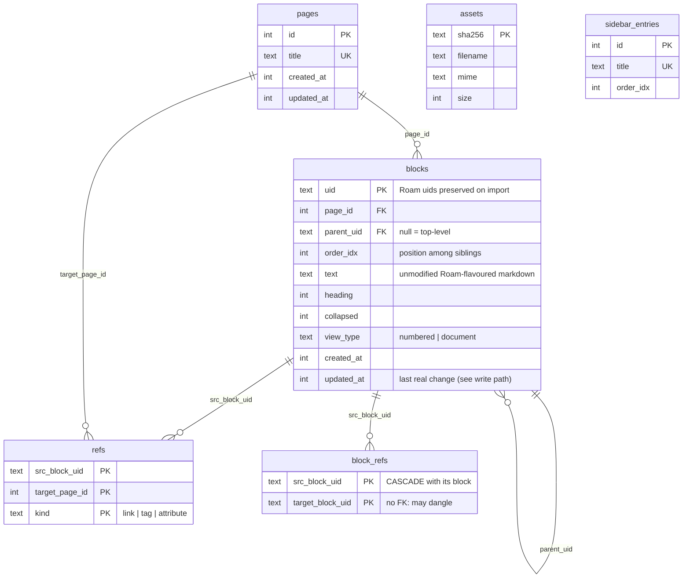
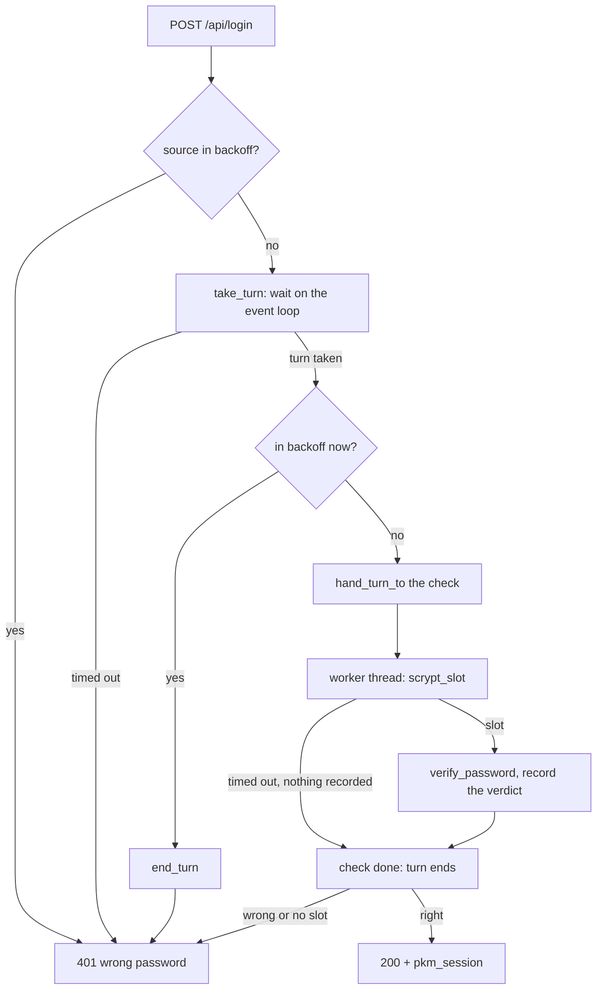

# Backend architecture (server/ + HTTP API)

A Python 3.12+ FastAPI application over a single SQLite file, and the sole
authority for the graph. Block-graph mutations flow through `POST /api/ops`;
other writes use dedicated routes. Refs and full-text indexes are re-derived
in the same transaction, and a trigger-based change journal feeds the sync
protocol. There is no ORM and no migration framework: raw `sqlite3` with
replayable DDL.

[overview.md](overview.md) has the system picture. Siblings own the write
path from `POST /api/ops` to the post-commit nudge
([write-path.md](write-path.md)), the sync protocol
([sync-and-offline.md](sync-and-offline.md)), the CLI and MCP server
([cli-and-mcp.md](cli-and-mcp.md)), import, export and backup
([import-export-and-backup.md](import-export-and-backup.md)), the assistant
([assistant.md](assistant.md)), and assets, local documents and GoodLinks copies
([files-and-assets.md](files-and-assets.md)).

## Module map

Everything lives under `server/src/pkm/`. Each runtime file declares its
[FCIS pattern](overview.md#functional-core--imperative-shell) near the top.

```
pkm/
├── contracts/           Core   the wire contract; imports neither the server nor the client
│   ├── ops.py                  op models, OpBatch, UID_RE, text_hash, new_uid, id brands
│   ├── responses.py            response models
│   ├── titles.py               title brands: RawTitle → NormalizedTitle → CanonicalTitle
│   ├── brands.py               brand(): the x-brand schema marker
│   ├── strict.py               StrictModel, the base of every model
│   ├── text.py                 WellFormedModel: lone surrogates become U+FFFD
│   ├── int64.py                Int64, the bound on int path and query parameters
│   ├── tag_chars.py            TAG_WORD_RANGES, the generated tag word class
│   └── daily.py                date <-> "July 8th, 2026" titles
├── database.py          Shell  Db, the typed connection
├── rows.py              Core   Row: one typed key per name a query may return
├── brand_registry.py    Core   brand NAMES, MINT_SITES, COLUMN_KEYS, SHAPES
├── schema.py            Core   BASE_DDL (replicated to clients) + SERVER_DDL
├── refs.py              Core   the ref grammar and title normalisation
├── todo.py              Core   {{TODO}}/{{DONE}} markers, mirrored by grammar/todo.ts
├── rename.py, unlink.py Core   rename and page-delete rewrites of block text
├── title_migration_core.py Core   title migration planner (the transactional shell is `server/title_migration.py`)
├── planning.py, batch.py, render.py   Core   shared by the CLI, MCP and client
├── *_dump.py            Shell  generated-artifact writers
├── server/                     the FastAPI app (below)
├── client/, cli/, mcp/         PkmClient, `pkm` and `pkm-mcp`
├── assistant/, describe/       embedded assistant; image-description queue
└── importer/, export/, backup/ Roam import, markdown export, nightly backup and restore

server/
├── app.py               Shell  create_app(config): init_db(), routers, 422 handler, SPA
├── db.py                Shell  init_db() at startup, open_db() per request, migrations
├── auth*.py, throttle*.py, origin*.py, http_protocol.py   the request gate, login throttle, origin guard and deadlines (§ Auth)
├── routes_*.py          Shell  the HTTP surface
├── ops_core.py          Core   judges, skips, contexts, effects; plan_op(), classify_skip
├── replay_core.py       Core   the rewrite replay: walk, steps, budget charges, classify_text_edit
├── ops_hash.py, ops_expect.py, conflict_notes.py   Core   batch hashes, stale `expect` entries, conflict and skip text
├── ops_apply.py         Shell  apply_batch: read context, plan, execute effects
├── store.py             Shell  page create, delete, rename, merge; never commits
├── sync_meta.py         Shell  flag and generation; read_title, title_reader
├── sync_core.py         Core   change-feed windows and hydration order
└── ws.py, notify.py     Shell  WebSocket Hub; post-commit nudges
```

`cli`, `mcp`, `client` and `server` depend on `contracts`, which imports
neither side; `tests/test_client_contracts.py` fails on an import that
crosses back. The assistant and describe routes live outside `pkm/server/`;
`app.py` mounts them.

`pkm/planning.py` plans a write on the CLI, MCP and client side, as ops to
post. The server's planner is `ops_core.plan_op`, which turns one received op
and its context into effects ([Planning](write-path.md#planning)).

## Database

One SQLite file, `pkm.sqlite3`, in the data directory. `init_db()` sets WAL
mode and applies the schema once at startup, never per request (its
docstring says why), and refuses a SQLite older than
`db_core.MIN_SQLITE_VERSION`. Each request gets a fresh `Db` from
`open_db()`, whose `recursive_triggers=ON` is what journals cascade deletes.

An `IN (...)` list built from a set the data can grow without bound, such as
a page's block uids, goes through `sync_core.chunk_ids`. SQLite refuses a
statement that binds more variables than its limit, and the route would
answer 500. The offline shim (`replica/localApi/`) binds such a set whole as
one JSON array (`json_each`) instead.

### Schema

`schema.py` holds two DDL blocks. `BASE_DDL` is the data model, **replicated
verbatim to browser clients** through `baseSchema.gen.ts`. `SERVER_DDL` holds
the sync machinery and never leaves the server.



Block text is the only durable data: `refs`, `block_refs` and the FTS5
tables are rebuilt from it. `blocks_fts` and `pages_fts` are external-content
tables kept in step by triggers. `blocks_fts` is keyed by implicit rowid, so
`VACUUM` would break it.

| Server-only table | Holds | Written by |
|---|---|---|
| `changes` | The append-only journal: `seq`, `kind`, `entity_id`, `deleted`, `page_id` | Triggers on `blocks`, `pages` and `sidebar_entries`, so a new write path is journalled automatically; also `JournalBlock` ([Missing targets](write-path.md#missing-targets)) |
| `applied_batches` | Each batch's request hash and stored ack | `post_ops` |
| `block_rewrites` | What a rename, merge, title migration or page delete did to one block's text, replayed over a stale edit ([Conflicts](write-path.md#conflicts)); `schema.py` says what each `kind` stores. Pruned after `BLOCK_REWRITE_RETENTION_MS` | `store.insert_block_rewrites` only, which the store's rewrites and a planned `RecordRewrite` effect both call |
| `page_deletions` | Each user-deleted page's title and the journal head after it ([Stale batches](write-path.md#stale-batches)). Pruned on the same window | `store.delete_page_unlinking` only |
| `conflict_headers` | Today's conflict header per block; a new header deletes other days' rows | `ops_apply._execute` |
| `sync_meta` | `db_generation` (a rebuilt or restored database gets a new one and clients rebootstrap) and the `plain_space_title_canonicalization` flag | startup, title migration apply, `pkm.backup.restore` |

`changes.page_id` is set only on a block tombstone and never shipped;
`schema.py` says why it has no index.

### Schema migrations and legacy data

New tables and indexes are replayable `IF NOT EXISTS` statements. New columns
are guarded `PRAGMA` checks in `db._ensure_schema_migrations`, and
`init_db()` runs the one-time backfills (`db._backfill_*`). Replicas
rebootstrap on a schema-hash change. Startup never runs the
[title migration](#title-integrity-and-one-time-activation).

Shapes a read can still meet:

| Legacy shape | Handled by |
|---|---|
| `blocks.heading` 0, Roam's "no heading", from older imports | `Row.heading` is `StoredHeadingLevel`, so the row check admits it; `rows.heading_level` and `StoredHeading` read it as `None`, so the wire never carries it. A SQL `NULLIF` would cost VM steps on every block row |
| a journal without `changes.page_id` | `db._ensure_changes_page_id`; old rows stay NULL |
| `block_rewrites` rows without `kind` | the column default, `retitle` |
| `applied_batches` rows holding the strict `batch_request_hash` | `post_ops` accepts either that or `batch_replay_hash` |
| acks stored before `seq` or `skipped` | replayed through `OpsAck` as `seq: null` (unknown) and `skipped: []` |
| asset links with an unencoded filename | `/assets/{sha256}/{filename}` ignores the name segment |

### Breadcrumbs and recursive traversal

`routes_pages.py::_fetch_ancestors` builds the breadcrumb trail behind
`GET /api/block/{uid}` and every backlink group. Its recursive CTE holds
`uid` alone and joins with `UNION`, so each distinct ancestor is read once
and a parent cycle ends the walk; `tree.ancestor_trails` rebuilds the
trails. **The ancestor walk must not carry a per-row path string.** One row
per start and ancestor, each copying an `O(depth)` string, makes the
backlinks of a deep chain cost `O(depth³)`.

A backlinks payload sends each ancestor's text once: each `BacklinkGroup`
lists them in `ancestor_texts`, and each item names its trail as positions
in that list (`ancestors`). The web shows each ancestor's full text and the
linked-references filter reads its refs, so an excerpt is no substitute.
`groups.showBacklinkGroups` resolves a batch to texts on arrival, since
positions mean nothing outside their group. `GET /api/block/{uid}` has one
trail and keeps it as texts in `breadcrumbs`.

Every `BacklinkItem` also carries `breadcrumbs`, for tabs running a bundle
built before `ancestors`. Such a bundle reads it off every item and throws
to the root error screen when it is missing. It holds
`STALE_BUNDLE_CRUMB` (`…`) where the item has a trail and nothing
otherwise, never the texts.

The single-chain walks stop a cycle with a path string, spelled once in
`ops_apply._unvisited`. Each walk has a replica mirror; change a pair
together. None caps depth, so a chain deeper than `MAX_OUTLINE_DEPTH` from
before the cap reads whole.

| Walk | Server | Replica mirror | Cycle guard |
|---|---|---|---|
| Ancestors with text, for breadcrumbs and backlink groups | `routes_pages._fetch_ancestors` | `localApi/tree.ts::fetchAncestors` | `UNION` |
| One block's parent chain, for a move's cycle check and the assistant card's ancestors | `ops_apply.parent_chain` | `localOps.ts::parentChain` | path string |
| One block's subtree, deepest first, for delete, re-paging and journalling | `ops_apply._subtree_deepest_first` | `localOps.ts::subtreeUids` | path string |

## Typed boundaries

### Typed database access

Feature code holds a `Db` (`pkm/database.py`), never a `sqlite3.Connection`.
`select` and `select_one` return `Row` dicts; `execute` and `executemany`
take writes only and return `WriteResult`. `table_columns`, `trigger_sql` and
`backup_to` bypass the row check. `raw` exists for tests and tooling, and the
`raw-sqlite` lint rule rejects it elsewhere.

`Row` (`pkm/rows.py`) is a `TypedDict` with one key per name a query may
return, typed with its brand (`uid: BlockUid`) or `Literal` domain. A key
keeps one meaning and one nullability everywhere, so a column that differs
from the key of its name is read under an alias: `pages.id` as `page_id`, a
computed value under the query's own (`COUNT(*) AS n`).
`brand_registry.COLUMN_KEYS` is the list of aliases. With `PKM_ROW_CHECK=1`
([row check](checks.md)), `select` checks each row with `row_problems`. Fix
a `RowCheckError` in the query (alias, `COALESCE`) or the data, never by
loosening `row_problems`. A key admits every value its column stores,
[legacy ones](#schema-migrations-and-legacy-data) included. `Row` is not a
wire type: handlers copy keys into a response model.

### Wire models and brands

Every JSON handler returns a model from `contracts/responses.py`, and
`test_routes_models` rejects a bare `dict`. The web's types are generated
from these models, and `PkmClient` validates every response against them.

- **Closed sets** are `Literal`s, not `str`/`int`. They reach OpenAPI as an
  `enum`, and `pnpm gen-types` makes each a TS union.
- **Brands.** `brand()` (`contracts/brands.py`, whose docstring says how to
  call it) tags a `NewType` with an `x-brand` schema marker, which gen-types
  turns into the web brand of the same name
  ([frontend.md § Brands](frontend.md#brands)).
- **Strict models.** Every model inherits `StrictModel`, so pyrefly checks
  constructor arguments, brands included. Outside the checker: input
  decoded by `model_validate` at runtime, the perf fixture's
  `TypeAdapter(BlockOp)`, FastAPI form bodies and the MCP library's argument
  models.

The [brand lint](checks.md#brand-rules) enforces both;
`brand_registry.MINT_SITES` lists where each brand may be minted.
A path parameter whose brand has a parser comes from its dependency in
`path_params.py`, so a handler only receives the checked brand.

Which brands exist is what `grep 'brand('` returns. The ones whose meaning
a name does not carry:

- `SidebarEntryId` is `sidebar_entries.id`, its own key, never a `PageId`.
- `OrderIdx` is a sparse sibling key, not a position. `SidebarOrderIdx` is
  separate because the web reorders the sidebar by array position and must
  never meet block order code.
- The title brands are a chain, `RawTitle` (unchecked text; `as_raw_title`
  is the general mint) to `NormalizedTitle` (from `refs.normalize_title` or
  `canonicalize_title`) to `CanonicalTitle` (the stored spelling of
  `pages.title`).

`canonicalize_title` returns only a `NormalizedTitle`, since its
`plain_space` is the caller's, not the live flag. A `CanonicalTitle` comes
from `sync_meta.read_title` / `title_reader` (the live flag),
`refs.target_canonical_title` (the title migration's post-activation plan)
or `refs.canonical_daily_title` (canonical under either flag). The title
lookups (`store.fetch_page`, the rename, merge and sidebar helpers,
`query.py`'s `plan_sql`, the migration inventory) take `CanonicalTitle`, so
pyrefly flags a title that skipped a mint. It cannot see an `Any` value or
raw SQL.

## Ref grammar

`refs.py` owns the grammar (`[[links]]`, `#tags`, `attr::`, `((refs))`,
`{{embeds}}`), and `web/src/grammar/scan.ts` mirrors it.

| Rule | Python | TS | Pinned by |
|---|---|---|---|
| Code hides refs; in one left-to-right pass, whichever of a closed fence or an inline span starts first wins | `strip_code` | `scanCode` | `ref_grammar.json` |
| Three backticks followed by an ASCII word character (`[A-Za-z0-9_]`) open a fence rather than close one | `_WORD_CHAR` | `WORD_CHAR_RE` | `ref_grammar.json` |
| A link, `#[[tag]]` or attribute whose title as written holds a backtick is no ref; an enclosing run goes with it | `holds_backtick` | `holdsBacktick` | `ref_grammar.json` |
| A title blank once normalised is no ref | `is_blank_title` | `isBlankRefTitle` | `refs_parity.json`, `title_parity.json` |
| A title with a `.`, `..` or empty `/` segment is no ref, so `#work/` typed on the way to `#work/notes` is never refused | `has_unreachable_segment` | `hasUnreachableSegment` | `title_parity.json` |
| An indented `Title::` is an attribute, its span anchored on the title | `attribute_title_span` | `scanGrammar` | `scan.test.ts` (`"  Key:: v"` at offset 2) |
| The `((uid))` shape, which `UID_RE` and the `BlockUid` brand shape are built from | `BLOCK_REF_TOKEN` | `UID_TOKEN` | `scan.test.ts`, `test_rows_vocabulary.py` |
| How deep `[[` runs nest: the height of the run tree over the code-stripped text | `link_nesting_depth` | `linkNestingDepth` | `text_limits_parity.json` |
| A `#tag` name is a run of `_`, `/`, `.`, `-` and the word characters in `TAG_WORD_RANGES` | `_TAG_NAME` | `TAG_CHARS_RE` | `ref_grammar.json`, `test_tag_chars_artifact.py` |

Each rule's reason sits beside its Python symbol. Both scanners stay
linear: a failed fence-closer search retires the fence rule for the rest of
the text. No word test uses a runtime's own Unicode table, because Python's
lags a browser's and the two sides would disagree on a block's refs. The fence closer's test is ASCII. A tag name
cannot be ASCII, or `#café` would stop being a tag, so its class is the
frozen table in `contracts/tag_chars.py` (`TAG_CHARS_UNICODE_VERSION`). A
Python or browser upgrade therefore changes no tag; moving the table to a
newer Unicode is a deliberate regeneration.

`rename.py` and `unlink.py` keep no copy of the grammar. They locate refs
through `strip_code`, `bracket_spans`, `tag_spans` and `attribute_title_span`,
so they cannot find a ref the index missed or splice over code. A replaced
span hides every ref inside it: an outer `[[run]]` its nested runs, and a
leading attribute the `#tags` in its name (`#a b::` is the attribute `#a b`
and the tag `a`). Rename, merge and their replay match a spelling through
`rename.spelled_or_canonical`, so `[[ Old ]]` is rewritten under plain-space
canonicalisation too.

Writes refuse a text whose runs nest past `MAX_LINK_NESTING`
([text limits](write-path.md#work-bounds-under-the-write-lock)), measured by
`link_nesting_depth` over every run, ref or not. The title guard
(`ops_core.find_op_title_violation`) cannot stand in for it: it judges only
runs that are refs, and a run whose title has an unreachable segment
(`[[a//...`) is none. Runs inside a `{{query: …}}` or `{{pdf: …}}` body
count too, though the web renders that body without tokenizing it; that
only over-counts.

Rows stored before the limit can nest far deeper, so every walk over
`BracketSpan.children` keeps its own stack, as `bracket_spans`,
`rename._rewrite_range` and `unlink._unlink_range` do. A recursive one fails
past the recursion limit, and the page such a block links could then not be
renamed or deleted.

## Title integrity and one-time activation

`refs.canonicalize_title` has two layers. The durable
`plain_space_title_canonicalization` flag selects the second:

| Layer | Runs | Does |
|---|---|---|
| fold (`normalize_title`) | always | every run of `TITLE_WHITESPACE` becomes one U+0020; if that changed anything, edge U+0020 goes too, else the title comes back byte for byte |
| plain-space strip | flag active | strips edge U+0020 whatever the fold did, so a canonical title is its words joined by single spaces |

The flag is inactive on any database neither imported nor migrated, since
only the title migration sets it and every import runs that migration.
There a title with nothing to fold keeps its single-space edge padding
(` A `), so legacy rows still resolve.

`contracts/titles.TITLE_WHITESPACE` is the whitespace set, written out
because Python's `\s` and JS's differ and either would split a page between
server and replica. The web gets the list
[generated](#generated-artifacts-and-parity-fixtures). Blankness keeps
Python's `strip()` (`is_blank_title`, mirrored by `stripLikePython`), and
after the fold the edge strip is `strip(" ")`, never `strip()`.

**A title that arrives as a lookup key goes through `sync_meta.read_title`
before it meets `pages.title` or `sidebar_entries.title`.** Both are exact
matches, so a raw title the rules would change misses its page. The entry
points are a `{title:wholepath}` route parameter, the `page` filter on
`/api/todos` and `/api/changed`, a `[[Page]]` operand in `{{query}}`
(`query_exec.parse_canonical_query`) and the `POST /api/sidebar` title.

The `wholepath` convertor (`server/wholepath.py`) replaces Starlette's `path`,
which stops before a final newline, on title and file-path routes and the
SPA fallback. `test_title_routes_props.py` checks every title-taking route
(its list comes from OpenAPI) and CLI verb against generated spellings.
The web's sidebar form sends input untrimmed, because `trim()`'s set is not
`TITLE_WHITESPACE` and the flag decides edge U+0020.

Every creation path funnels through `store.get_or_create_page()`. Daily pages
(`daily.py`) are auto-created on read and cannot be renamed.
`ops_apply._broadcast_op()` echoes the stored title in place of the caller's
`page_title`, so replicas receive the authoritative spelling.

Activation is an operator action: `pkm migrate-titles`, then
`pkm migrate-titles --apply DIGEST`
([docs/cli.md](../cli.md#one-time-title-canonicalization)).
`pkm/title_migration_core.py` groups pages whose titles share a
`target_canonical_title`, picks a survivor and reports `all_space` or
`forbidden_syntax` blockers. It also lists `sidebar_retitles`: every sidebar
entry the target rule changes that no group already moves. Replacement
values are opaque (`rename.rewrite_title_refs_map()` never rescans one), and
the digest covers the whole relevant snapshot.
`audit_title_migration()` runs in a read transaction it always rolls back.
Apply takes that `audit_digest`, re-inventories under the
[write lock](write-path.md#the-write-lock), and answers 409 to a stale
digest, a blocker, or an active flag with nothing to do. Every change,
activation and the `db_generation` rotation included, is one transaction,
followed by one forced seq frame; replicas rebootstrap before replaying
pending intent
([sync-and-offline.md](sync-and-offline.md#title-activation-across-online-and-offline-paths)).

Apply also runs on an active database, because a change to the fold rule
leaves rows that were canonical under the old one. A page whose stored
title the new fold changes is unreachable, since every key folds, so only
the migration can merge or retitle it.

`server/title_migration.check_titles_at_startup`, run from the app lifespan,
logs one ERROR on `pkm.titles` naming the stored page and sidebar titles the
live rule would change, with `pkm migrate-titles` as the remedy. It never
refuses to start (its docstring says why) and never repairs, because a merge
is irreversible and stays a digest-confirmed operator action.

Some reported rows have no migration remedy, and
[docs/cli.md](../cli.md#rows-the-migration-cannot-fix) gives each one's fix:

| Row | Why the migration leaves it |
|---|---|
| a page whose title the fold turns into a refused or blank one (`Notes/` + NBSP) | it is a blocker, and no route reaches the stored spelling to rename it |
| a sidebar entry whose canonical form is blank or refused | no pin can hold that title, so apply skips it and, with nothing else to do, answers "already active" |

### Refused titles

`refs.title_syntax_reason` refuses a title as `forbidden_syntax` when it holds:

| Syntax | Why |
|---|---|
| `#`, `[[`, `]]` | ref syntax |
| a trailing `]` | `[[a]]]` reads back as `a` |
| a trailing `[` | unlinking `[[a[]]` leaves `a[`, which joins a following `[a[]]` into a fresh link, so a page delete's unlink re-forms one link per pass |
| a backtick | it pairs with another on the line into a code span that hides the ref |
| a `.`, `..` or empty `/` segment (`/x`, `a//b`, `a/../b`) | no URL: clients drop dot segments and the router collapses `//` |

Every rule judges the title edge-stripped of U+0020
(`target_canonical_title`) whatever the flag, because the pure ops check
never knows the flag and must not pass ` a] `. A title is refused at
creation, rename, move, sidebar pin, import, and in the migration audit. In
block text a ref with `#`, `[[`, `]]` or a trailing `]` or `[` fails the
batch with a 400; a backtick or no URL makes it [no ref](#ref-grammar). `...`
and `a.b` are ordinary titles. A row stored with a title ending in `[`
stays readable and deletable; [Page mutations](write-path.md#page-mutations-and-the-sidebar)
bounds its unlink.

A title whose fold (`normalize_title`) is longer than
`MAX_PAGE_TITLE_CHARS` code points is refused too (`refs.title_length_over`,
whose docstring says why the fold is measured). That holds at creation,
rename, move, sidebar pin and import, but not in the migration audit, which
only shortens a title. In block text a link, tag or attribute to such a
title fails the batch with a 400. `refs.title_refusal` judges length before
syntax, so a refusal never echoes the title.

`get_or_create_page` refuses only creating such a page (`TitleTooLongError`).
A row stored before the cap stays readable, renamable to a shorter title and
deletable, and a reindex keeps its backlinks (`index_ref`). An
op naming it as a `page_title` or a link is refused until the page is
renamed. `update_text`'s `page_title` hint is never judged: refusing it
would refuse an edit to a block on such a page and discard the offline
batch.

### Blank titles

A blank title is unreachable, so `get_or_create_page()` raises
`BlankTitleError` and each caller picks its recovery:

| Caller | Recovery | Why |
|---|---|---|
| `POST /api/pages` | 422 | a live client can retry |
| `ops_apply._resolve_page()` | file under `UNTITLED_PAGE_TITLE`, `"Untitled"` | the ops path must never 422 |

`"Untitled"` is an ordinary title, so blank-title ops land on a user's real
"Untitled" page if one exists; that trade-off is accepted. A blank ref
indexes nothing ([Ref grammar](#ref-grammar)), or `[[   ]]` would make a
phantom backlink on "Untitled". `store.index_ref()` also skips a ref that
raises `BlankTitleError`.

## Auth

One shared password behind Tailscale, the transport boundary. `auth_core.py`
does the constant-time scrypt check and signs the `pkm_session` cookie
(`v1.<issued_ms>.<sig>`). [SECURITY.md](../SECURITY.md) owns the cookie
flags, the threat model and what these mechanisms leave open.

Middleware runs outermost first: `RequestLogMiddleware` →
`SecurityHeadersMiddleware` → `OriginGuardMiddleware` →
`AuthGateMiddleware` → router. The two that refuse are innermost, so
their refusals are logged and carry the security headers.
`SecurityHeadersMiddleware` sets every header that applies to all routes;
routes set only their own. An unhandled exception's 500 is built outside it
and carries none.

`AuthGateMiddleware` (`auth_gate.py`, rules in `auth_gate_core.py`)
refuses an anonymous request before routing, without calling `receive`.
**FastAPI reads and parses a body before it runs any dependency**, so a
guard that is only a dependency takes in an anonymous upload whole before
its 401. The refusals are 401 `{"detail": "not authenticated"}` and a 4401
handshake close before accepting. `session_is_valid` (`auth.py`) is the
one session check. The gate hands `is_public` `get_route_path(scope)`, the
string the router matches, so the two cannot disagree on decoding.

| Request (`is_public`) | At the gate |
|---|---|
| `POST /api/login` | public, body capped |
| `GET` or `HEAD` outside `/api` and `/assets`: `GET /login`, `GET /healthz`, `/app-assets/*`, the SPA shell | public |
| anything else, every WebSocket handshake included | needs a valid `pkm_session` |

`require_auth` stays on every router
(`dependencies=[Depends(require_auth)]`) as the route's own check, and
`/api/ws` checks the cookie inline. It is the only check on a `GET`
outside `/api` and `/assets`. `test_the_gate_admits_exactly_the_public_routes`
fails when the gate admits a route of `create_app`'s table outside the
test's `PUBLIC_ROUTES`; routes another app adds, such as the proptest sync
server's `GET /__proptest/*`, are not walked.

The gate caps every body outside `SAFE_METHODS`, because FastAPI would
otherwise parse a body of any size, a multipart upload included, before the
route's own limits refuse it.

| Request | Cap |
|---|---|
| public (`PUBLIC_UNSAFE_ROUTES`), session or not | `PUBLIC_BODY_MAX_BYTES`. The gate reads the body and replays it to the route as one message, before the login throttle runs |
| an authenticated upload (`UPLOAD_ROUTES`) | the config's `max_upload_bytes` plus `UPLOAD_ENVELOPE_BYTES` for the multipart framing |
| any other authenticated method | `PRIVATE_BODY_MAX_BYTES` (`private_body_cap`) |

A declared `Content-Length` past the cap gets 413
`{"detail": "request body too large"}` before the app reads a byte;
`declared_content_length` ignores a length sent beside `Transfer-Encoding`.
An authenticated body with no trusted length is counted as the route reads
it, never buffered by the gate, and refused at the message that passes the
cap.

uvicorn has no read or write timeout of its own. `DeadlineH11Protocol`, whose
docstring in [http_protocol.py](../../server/src/pkm/server/http_protocol.py)
explains each deadline, and the gate bound a slow client:

| What is late | Bound | Answer |
|---|---|---|
| the request head, from the connection's open or its last response | `HEADER_READ_TIMEOUT_S` (`DeadlineH11Protocol`) | the connection is closed |
| the rest of a body answered without reading it (a 401, 403 or 413) | the same deadline, which the leftover body counts against | the connection is closed |
| a public body | `PUBLIC_BODY_READ_TIMEOUT_S` for the whole read | 408 with `Connection: close`, as RFC 9110 advises: the client has shown it will not finish |
| the client taking a response, while writing is paused or the response is finished with bytes unsent | the transport's buffer must shrink within `WRITE_STALL_TIMEOUT_S` | the connection is aborted |
| an authenticated body | none: an upload over a slow link may take minutes | — |
| a request every few seconds on one connection | none: uvicorn's 5 s keep-alive restarts with each one | — |

A 401 or 413 leaves the connection open (`auth_gate.py` says why), so an
upload far past its limit is cut at the head deadline and a browser may
show a reset instead of the 413.

`OriginGuardMiddleware` (`origin_guard.py`, rules in `origin_core.py`)
checks `Origin` on every `/api/ws` handshake and on every HTTP method
outside `SAFE_METHODS`, because the `Lax` cookie rides along on a sibling
tailnet host's handshake and simple POSTs
([SECURITY.md § Authentication](../SECURITY.md#authentication)). A request
with no `Origin` passes, because browsers send one on every request the
guard checks; only non-browser clients omit it. A
request with exactly one `Origin`, in the allowed set, passes. Anything
else is refused.

| Allowed origin | Source |
|---|---|
| each entry of `serve_origins` | config.json, canonicalised on load (`canonical_origin`) |
| `http://<host>:<port>` | each bind host; `--host` replaces `bind_hosts` |
| `http://127.0.0.1:<port>`, `http://localhost:<port>`, `http://[::1]:<port>` | always |

`<port>` is the `api_port` `create_app()` is given, the port `run.py`
serves on. A refused HTTP request gets 403
`{"detail": "origin not allowed"}`, and a refused handshake a 4403 close
before accepting, which uvicorn sends as HTTP 403 (as it does 4401). The
guard runs before the auth gate, so an anonymous handshake from a foreign
origin sees 4403, not 4401.

`Origin: null` is refused, because a sibling page can produce it
(`test_origin_allowed`, `test_ws_refuses_a_foreign_origin`). The web treats
403 as retry-later (`RETRY_LATER_STATUSES` in `web/src/sync/rejection.ts`,
pinned by `rejection.test.ts`), so a wrong `serve_origins` queues edits
instead of discarding them.

Nothing enforces these rules:

- The app must never set `Referrer-Policy: no-referrer`, as a header or a
  meta tag on its own documents. Fetch writes, uploads and the WebSocket
  keep the real origin under it, but the no-cors form posts would send
  `Origin: null` and be refused: the export form in
  `web/src/views/Files.tsx` (Chromium and WebKit) and the assistant close
  beacon in `web/src/assistant/client.ts` (WebKit).
- A new hostname or Serve port needs its origin in `serve_origins`.
- Every public route that takes a body is capped, so one added to
  `PUBLIC_UNSAFE_ROUTES` must accept a body within
  `PUBLIC_BODY_MAX_BYTES`. The cap applies only outside `SAFE_METHODS`, so a
  public `GET` route must not read a body.
- A new upload route joins `UPLOAD_ROUTES`, or its bodies are cut at
  `PRIVATE_BODY_MAX_BYTES`. A route that reads a body itself must let an
  `HTTPException` from `receive` through (`_BodyOverCap` says why), or a
  streamed body past the cap is not answered 413.
- Only `run.uvicorn_config` installs `DeadlineH11Protocol`, and `run.serve`
  is the one way to start a server through it: `run.main`,
  `tests/e2e_serve.py` and `tooling/proptest/sync_server.py` all call it,
  so E2E runs the production protocol. The server must keep starting
  through `python -m pkm.server.run` (the launchd job does). The `uvicorn`
  CLI, or its `httptools` protocol, has neither deadline.
- The gate reads the config from `scope["app"].state.config` on every
  request, never once at startup: the proptest sync server replaces
  `app.state.config` after `create_app`.

### Login throttle

`LoginThrottle` (`throttle.py`, policy in `throttle_core.py`) applies a
per-source exponential backoff (`BASE_BACKOFF_MS` to `MAX_BACKOFF_MS`)
before scrypt runs, and caps scrypt work process-wide at
`MAX_CONCURRENT_SCRYPT` slots. `login()` waits for the source's turn on the
event loop and runs the check on a worker thread.



Every refusal is the same 401 `wrong password` (`_wrong_password`), so a
guesser cannot tell a wrong password from a throttled source or a timeout;
only the timing differs. A throttled source is refused without scrypt even
when it sends the right password, since the backoff exists to spend no
scrypt on it.

The source is `request.client.host`, which uvicorn rewrites from
`X-Forwarded-For` only when the TCP peer is in `run.FORWARDED_ALLOW_IPS`
(`127.0.0.1`).

| Listener | Throttle key |
|---|---|
| Tailscale IP (`bind_hosts`) | the TCP peer, the device's tailnet address; `X-Forwarded-For` is ignored |
| `127.0.0.1`, through Tailscale Serve | the right-most `X-Forwarded-For` entry, which Serve sets to the device's tailnet address, replacing any the client sent |
| `127.0.0.1`, no header (local processes, such as Playwright and the frontend perf check) | `127.0.0.1` |

A device keys the same through Serve and direct over IPv4. Reaching Serve
over its tailnet IPv6 address gives the device a second key, since the
direct listener is IPv4 only. `X-Real-IP`, `Forwarded`
and `Tailscale-User-*` are never read for the key. Serve passes `X-Real-IP`
through from the client, and `Tailscale-User-*` is forgeable on the direct
listeners. What this keying leaves open is in
[SECURITY.md § Known limitations](../SECURITY.md#known-limitations).

Nothing enforces the conditions this keying needs:

- `run.uvicorn_config` passes `proxy_headers` and `forwarded_allow_ips`
  explicitly. Left unset, uvicorn reads the `FORWARDED_ALLOW_IPS`
  environment variable, and `*` there would key on the left-most entry,
  which the client chooses.
- Serve's upstream must stay `http://127.0.0.1:<port>` (`install.sh`'s
  `serve` line). Pointed at the Tailscale IP, Serve becomes an untrusted
  peer, and every Serve client shares the host's backoff bucket unless
  `FORWARDED_ALLOW_IPS` changes with it. An IPv6 loopback upstream (`[::1]`,
  or a `localhost` that resolves to it) reaches no listener, because
  `bind_sockets` opens IPv4 sockets only.

**One password check is in flight per source**, because checking the
backoff and recording the verdict are separate steps: without a turn,
every request of a concurrent burst would pass the first and run scrypt.
The others wait for the turn rather than being refused, so a double-submit
of the right password is never told it was wrong. The turn ends with the
check, not the request, because a worker thread cannot be cancelled
(`hand_turn_to`). A login waits at most two `SCRYPT_ACQUIRE_TIMEOUT_S`
timeouts (`take_turn`, then `scrypt_slot()`) plus one scrypt check, and the
slot timeout keeps concurrent logins from starving the threadpool every
sync route shares.

## HTTP API reference

`routes_*.py` and the generated `web/src/api/openapi.json` are authoritative,
and route docstrings carry the detail. Every endpoint needs the session
cookie unless marked public. FastAPI's `/docs` and `/redoc` are off.

| Method | Path | Purpose |
|---|---|---|
| POST | `/api/login` *(public)* | Password → session cookie ([Auth](#auth)) |
| GET | `/login` *(public)* | HTML login form |
| GET | `/healthz` *(public)* | Liveness check; answers `{"ok": true}` and nothing else |
| GET | `/{path}` *(public)* | SPA fallback; hashed bundles under `/app-assets/` |
| GET | `/api/openapi.json` | Live OpenAPI schema |
| **Writes** | | |
| POST | `/api/ops` | Apply an `OpBatch` ([The write path](write-path.md)); `applied` counts skipped ops too; 400, 412 and 503 in the order [The write path](write-path.md) gives |
| **Pages & blocks** | | |
| GET | `/api/page/{title}?bl_offset&bl_limit` | Page tree, paginated backlinks (not from the page itself) with [`ancestor_texts`](#breadcrumbs-and-recursive-traversal) per group, `block_ref_counts`; daily pages auto-created |
| GET | `/api/block/{uid}` | One block subtree with its page and [breadcrumbs](#breadcrumbs-and-recursive-traversal) |
| GET | `/api/block/{uid}/backlinks` | Blocks referencing `((uid))`, unpaginated, with [`ancestor_texts`](#breadcrumbs-and-recursive-traversal) per group |
| GET | `/api/block-refs?uids=` | Resolve `((uid))` references |
| POST | `/api/pages` | Idempotent page create; 422 for a blank, refused or over-long title |
| DELETE | `/api/page/{title}` | Delete a page, unlinking inbound refs; 409 with `blockers`, each an `excerpt` and `text_length` ([Page mutations](write-path.md#page-mutations-and-the-sidebar)) |
| GET | `/api/delete-preview?title=` | What a delete would rewrite or be refused for, a `limit` blocker included |
| POST | `/api/page/{title}/rename` | Rename and rewrite refs; 409 on collision unless `allow_merge`; 422 when the new title is [refused](#refused-titles), too long included, or the rewrite would carry a block past a text limit |
| GET | `/api/unlinked?title&limit&offset` | Unlinked mentions, not from the page itself |
| GET | `/api/journal?before&days` | Daily-notes feed |
| POST | `/api/journal/cleanup` | Prune empty, unreferenced daily pages from the week before today |
| GET | `/api/current-work` | Recently edited pages, bucketed by age |
| **Migrations** | | |
| GET | `/api/migrations/title-canonicalization` | Side-effect-free audit and digest: `groups`, `blockers`, `sidebar_retitles` ([Title integrity](#title-integrity-and-one-time-activation)) |
| POST | `/api/migrations/title-canonicalization` | Apply the audited digest, returning counts such as `sidebars_retitled`; 409 on stale, blocked, a rewrite past a text limit, or active with nothing to do |
| **Search & queries** | | |
| GET | `/api/search?q&limit&exact` | FTS5 search over pages and blocks; `exact` drops the prefix match on the last term |
| GET | `/api/query?expr&expand` | `{{[[query]]}}` evaluation; `expand` adds one hop through pages that reference the operand; 400 past `query.MAX_QUERY_DEPTH` nesting or `MAX_QUERY_OPERANDS` page operands |
| GET | `/api/titles?q&limit` | Title completion for `[[` and `#` |
| GET | `/api/todos?page` | `{{TODO}}` blocks grouped by page |
| GET | `/api/changed?since&until&page&limit` | Blocks changed in `[since, until)`, each `new` or `edited`; 400 on an empty window |
| **Sidebar** | | |
| GET / POST / PUT / DELETE | `/api/sidebar`… | List, pin, reorder (a permutation), unpin; a pin of a refused or over-long title is a 422 |
| **Sync** ([sync-and-offline.md](sync-and-offline.md)) | | |
| GET | `/api/sync/snapshot?pending` | Full bootstrap with `seq`, `generation`, the title flag and `applied_batches`; gzip when the client accepts it |
| GET | `/api/sync/changes?since&limit&pending` | Windowed incremental feed with the same metadata; gzip when the client accepts it |
| POST | `/api/client/diagnostics` | A replica's self-report before a rebuild, logged as one `pkm.sync` warning cut at `_MAX_DIAGNOSTICS_LOG_CHARS` |
| WS | `/api/ws` | [Post-commit nudges](write-path.md#post-commit-nudges) and op echoes |
| **Assistant** ([assistant.md](assistant.md)) | | |
| GET | `/api/assistant/models` | Models on offer and the default |
| POST | `/api/assistant/conversations` | Create; 400 for a model not offered, 409 over the cap |
| POST | `/api/assistant/conversations/{id}` | Beacon close (`navigator.sendBeacon`) |
| POST | `/api/assistant/conversations/{id}/messages` | One turn → SSE stream; 409 while a turn runs |
| POST | `/api/assistant/conversations/{id}/confirm` | Answer a write confirmation |
| POST | `/api/assistant/conversations/{id}/stop` | Stop the reserved turn, started or not; its stream ends with `turn_stopped` |
| DELETE | `/api/assistant/conversations/{id}` | Close the conversation |
| **Assets** ([files-and-assets.md](files-and-assets.md)) | | |
| POST | `/api/assets` | Multipart upload; 413 past `max_upload_bytes` ([Auth](#auth)) |
| GET | `/assets/{sha256}/{filename}` | Serve by digest; the name segment is ignored |
| GET | `/api/assets/describe-status` | Whether image descriptions are on, and why not |
| POST | `/api/assets/scan?force` | Enqueue undescribed images |
| GET | `/api/assets/search?q&limit&offset&type&from_ms&to_ms&linked` | Search behind `/files` |
| DELETE | `/api/assets/{sha256}` | Delete, stripping its tokens; 409 with `limit` `blockers` when a strip would carry a block past a text limit; `if_unreferenced=true` 409s instead while referenced |
| POST | `/api/assets/export.zip` | Zip the assets named by the form field `sha256s`; unknown shas are skipped; 413 past `MAX_EXPORT_ASSET_COUNT` or `MAX_EXPORT_TOTAL_BYTES` |
| **Local documents** ([files-and-assets.md](files-and-assets.md#local-documents)) | | |
| GET | `/api/local-check` | Classify every `/api/local/` href in block text |
| GET | `/api/local-index` | Every visible file under `local_docs_root`; 503 when the listing fails |
| GET | `/api/local/{path}` | Serve one file; 404 outside the root, 503 when evicted or unopenable |
| **GoodLinks copies** ([files-and-assets.md](files-and-assets.md#goodlinks-copies)) | | |
| POST | `/api/goodlinks/resolve` | Resolve a URL to a link, saving it with `save` |
| GET | `/api/goodlinks/check` | Classify every `/api/goodlinks/` href |
| GET | `/api/goodlinks/{link_id}` | Metadata and sanitised reader HTML; 503 when GoodLinks is down |
| **Export** ([import-export-and-backup.md](import-export-and-backup.md)) | | |
| GET | `/api/export/page/{title}` | One page as markdown; 422 when refs and queries expand past `EXPORT_MAX_CHARS` or too many times |
| GET | `/api/export.zip` | Whole-graph markdown export |

The sync snapshot and changes routes encode their own body
(`_encoded_json`, `http_encoding.py`) rather than through a middleware, which
would compress on the event loop and reach every route. The routes stay
`def`, so the render and the gzip run in the thread pool after `read_txn` has
closed: neither the event loop nor a read snapshot waits on them. **A response
that carries a credential never goes through `encode_body`**, because a
compressed length shows how well a secret compresses beside text an attacker
chose ([SECURITY.md](../SECURITY.md#known-limitations)).

### Hostile input

**No client input, and no row the importer writes, makes a route answer
500.** Tests that walk `app.routes` keep the surrogate and int64 guards on
every route.

| Input | Guard | Kept by |
|---|---|---|
| A lone surrogate in a JSON body | Every request body model derives from `WellFormedModel` | `test_every_json_request_body_is_a_well_formed_model` |
| An int past 64 bits | Int parameters are `Int64` or carry `INT64_RANGE`; `WellFormedModel` refuses one in a body | `test_every_int_parameter_is_bounded_to_sqlite_range` |
| A 422 echoing a surrogate, NaN or deep nesting | `validation_echo.echo_errors`, cut at `MAX_ECHO_DEPTH` | `test_validation_echo.py` |
| A NUL, an over-long component or a link loop in an SPA path | The catch-all treats a path `resolve()` or `is_file()` rejects as naming no file, and serves the shell | `test_spa.py` |
| A session cookie signature that is not ASCII | `verify_session` refuses it before `hmac.compare_digest`, which raises on non-ASCII | `test_hostile_requests.py` |
| A NUL in a search term | `fts.py` makes it a space: FTS5 reads a C string | `test_hostile_requests.py` |
| A GoodLinks or OpenAI body that is not JSON, nests too deep, or holds a surrogate | An unusable answer (503, `DescribeError`); decoded strings made well-formed | `test_no_500_upstream_props.py` |
| An op `order_idx` a sibling shift could push past int64 | `CreateOp` and `MoveOp` bound it with `WIRE_ORDER_IDX` to the JS safe-integer range | `test_an_op_order_idx_stays_in_the_js_safe_range` |
| A Roam heading outside 1–3 or a time past 64 bits | `parse_export` reads it as absent | `test_no_500_stored_props.py` |

Path and query values cannot carry a lone surrogate, because the server
decodes them from bytes. The `test_no_500_*_props.py`
[properties](checks.md#property-gate) send generated input through every route.

The other bounds are owned where their mechanism is: body size
([Auth](#auth)), block text, nesting and outline depth
([Work bounds](write-path.md#work-bounds-under-the-write-lock)), title length
([Refused titles](#refused-titles)), deeply nested `[[`
([Ref grammar](#ref-grammar)), query nesting (the `/api/query` row),
unbounded id sets ([Database](#database)) and export fan-out
([Single-page export](import-export-and-backup.md#single-page-export)).

## Generated artifacts and parity fixtures

These are generated or hand-kept, checked in, and **the test suites fail when
one is stale**. Regenerate and commit with the change that invalidates them.
`uv run python -m pkm.regen` (from `server/`) rewrites every generated row
below, in the order its `STEPS` table holds; add a dump to that table, which
`test_regen.py` enforces. It stops at the first failing step and names it.

| Artifact | Regenerated by | Test that fails when stale | Pins |
|---|---|---|---|
| `web/src/api/openapi.json`, `types.d.ts` | `pkm.regen` | `test_openapi_sync.py`, `genTypes.drift.test.ts` | the web's API types to the response models |
| `web/src/replica/baseSchema.gen.ts` | `pkm.regen` | `test_schema_artifact.py` | the replica schema to `BASE_DDL` |
| `web/src/replica/columns.gen.ts`, `web/tooling/brandRegistry.gen.json` | `pkm.regen` | `test_rows_artifact.py` | `Columns`, `COLUMN_META` and the web lint's registry to `rows.Row` and `brand_registry` |
| `web/src/assistant/previewKeys.gen.ts` | `pkm.regen` (`wire_dump preview-keys`) | `test_assistant_wire_artifact.py` | the approval card's allow-list (`PREVIEW_KEYS`) to `WRITE_PREVIEW_FIELDS`, `CURRENT_TEXT_ENTRIES` and `SUBTREE_DELETE_ENTRIES`, `CURRENT_EXCERPT_CHARS`, and `PREVIEW_FIELDS` to `WritePreview`'s fields |
| `web/src/assistant/events.gen.ts` | `pkm.regen` (`wire_dump events`) | `test_assistant_wire_artifact.py` | the web's `AssistantEvent` union and `EVENT_TYPES` to `events.py`'s dataclasses and `EVENT_NAMES` |
| `server/src/pkm/contracts/tag_chars.py` | `pkm.regen` leaves it alone; `uv run python -m pkm.tag_chars_dump --table > src/pkm/contracts/tag_chars.py`, only to move the tag table to a new Unicode version | `test_tag_chars_artifact.py`, which compares it only under the Unicode version it froze | `TAG_WORD_RANGES` to the running CPython's `\w` |
| `web/src/grammar/tagChars.gen.ts` | `pkm.regen` | `test_tag_chars_artifact.py` | the web's tag class (`TAG_WORD_CLASS`) to `TAG_WORD_RANGES` |
| `web/src/grammar/titleWhitespace.gen.ts` | `pkm.regen` | `test_title_whitespace_artifact.py` | the web's fold set to `TITLE_WHITESPACE` |
| `shared/fixtures/refs_parity.json` | `pkm.regen` | `test_refs_parity_fixture.py` | `refs.extract` |
| `shared/fixtures/title_parity.json` | `pkm.regen` | `test_title_parity_fixture.py` | `normalize_title`, `target_canonical_title`, `title_syntax_reason`, `is_blank_title`, `extract` |
| `shared/fixtures/text_limits_parity.json` | `pkm.regen` | `test_text_limits_parity_fixture.py` | `text_limit_violation`, `link_nesting_depth`, `describe_text_limit`, `MAX_BLOCK_TEXT_CHARS`, `MAX_LINK_NESTING` |
| `shared/fixtures/shim_parity.json` | `pkm.regen` | `test_shim_parity_fixture.py` | the offline shim (`replica/localApi/`) to the read routes' JSON |
| `shared/fixtures/text_hash_parity.json` | `pkm.regen` (vitest with `UPDATE_TEXT_HASH_FIXTURE=1`) | `textHashParity.test.ts` | `text_hash`, `subtree_hash`, `well_formed` |
| `shared/fixtures/local_links_parity.json` | `pkm.regen` (vitest with `UPDATE_LOCAL_LINKS_FIXTURE=1`) | `localLinksParity.test.ts` | `local_docs.extract_local_hrefs` |
| `shared/fixtures/upload_links_parity.json` | `pkm.regen` (vitest with `UPDATE_UPLOAD_LINKS_FIXTURE=1`) | `assetsParity.test.ts` | `assets_core.strip_asset_tokens` |
| `ref_grammar.json` | hand-edited | `test_refs.py` | the [ref grammar](#ref-grammar) |
| `title_syntax.json` | hand-edited | `test_refs.py` | `title_syntax_reason` |
| `title_length.json` | hand-edited | `test_title_length_fixture.py` | `MAX_PAGE_TITLE_CHARS`, `title_length_over`, and which linked titles `find_op_title_violation` refuses, with its wording |
| `missing_targets.json` | hand-edited | `test_ops_core.py` | `classify_skip`; `placement_cases` pin where a create or move lands |
| `subtree_hash.json` | hand-edited | `test_subtree_hash.py` | `subtree_hash` |
| `ops_acks.json` | hand-edited | `test_ops_idempotency.py` | the stored-ack-to-wire mapping and `SkipReason` |
| `op_hashes.json` | hand-edited, never regenerated: a pin that moved would bless the break | `test_ops_idempotency.py` | `batch_request_hash` and `batch_replay_hash` for every op kind, bare and with every optional field set; which fields each leaves out (`HASHED_FIELDS`, `DROPPED_WHEN_UNSET`, `REPLAY_EXCLUDED`, the last read from the fixture and also checked by the web `opHashesParity.test.ts`) |
| `batch_limits.json` | hand-edited | `test_batch_limits_fixture.py` | `MAX_OPS_PER_BATCH`, `PRIVATE_BODY_MAX_BYTES` |
| `outline_depth.json` | hand-edited | `test_outline_depth.py` | `MAX_OUTLINE_DEPTH`, equal to the web's `depthCap.ts` |
| `draft_flush.json` | hand-edited | `test_ops_endpoint.py` | the op an editor draft flushes |
| `registry_paths.json` | hand-edited | `test_brandlint_registry.py`, `eslint-plugin-brands/registry.test.ts` | the brand registry's path syntax: `registry_path_matches` on the server and `pathMatcher` on the web |

Hand-edited fixtures live in `shared/fixtures/`, and `git grep <name>.json`
finds every test that reads one. The seeded parity corpora are tallied by
shape (`parity_corpus.shape_tally`), so they cannot go vacuous.

## Configuration and entrypoints

`config.json` lives in the data directory, never in git;
`python -m pkm.server.setup` writes it mode 0600. `Config` (`config.py`)
holds every default, and `load_config` passes only the keys the file sets.
Path keys, key-file defaults included, resolve relative to `config.json`'s
directory, so the data directory moves as a unit.

| Key | Meaning |
|---|---|
| `db_file` | Required. SQLite database path |
| `assets_dir` | Required. Content-addressed asset store |
| `password_salt`, `password_hash` | Required. scrypt password check (hex) |
| `session_secret` | Required. HMAC key for session cookies (hex) |
| `cookie_secure` | `Secure` flag on the session cookie |
| `web_dist` | Built SPA directory; unset serves the API only |
| `bind_hosts` | Interfaces to listen on |
| `serve_origins` | Origins browsers use to reach the server through Tailscale Serve, e.g. `["https://<machine>.<tailnet>.ts.net"]` ([Auth](#auth)) |
| `max_upload_bytes` | Upload size cap |
| `image_descriptions` | Master switch for image captions |
| `image_description_model` | Vision model |
| `openai_api_key_file` | Key for image captions; else `OPENAI_API_KEY` |
| `zai_api_key_file` | Key that enables the assistant's `glm` model; else `ZAI_API_KEY` |
| `local_docs_root` | Tree served under `/api/local/`; unset disables it |
| `goodlinks_api_key_file` | GoodLinks token; else `GOODLINKS_API_KEY`. With neither, every GoodLinks route but `check` 404s |
| `goodlinks_api_url` | Where the GoodLinks app listens |

A key file wins over its environment variable and defaults to one level
above the data directory, outside anything servable or exportable.

`python -m pkm.server.run` serves its `--port` on `bind_hosts`, or on its
`--host` flags, which replace `bind_hosts` for the origin guard too. launchd
runs it
through `$PKM_HOME/bin/pkm-server`, which stays the Python process's parent,
so macOS attributes file-access consent to a binary that does not change
([the launcher](../../deploy/README.md#the-launcher)). `create_app()` always
runs `init_db()`, so every entrypoint works on a new data directory.

## Logging and observability

There is no metrics stack; the logs answer what the server was doing when it
was slow. `logfmt.uvicorn_log_config()` routes each logger to a handler.

| Logger | Handler | Line |
|---|---|---|
| `pkm.access` | access | One `logfmt.request_line` per request from `RequestLogMiddleware`, after the body is sent |
| `pkm` and every `pkm.*` child | default, INFO | children inherit by propagation |
| uvicorn | default | lifecycle and errors; its own access log is off |

      <client> "GET /api/page/Foo?bl_limit=20" 200 4ms

Attacker-chosen text (a path, an upload's filename, an error text) is
escaped at the handler, not per call site, so no text a request carries can
forge a log line. `request_line` escapes its fields with
`logfmt.escape_controls`; the default handler's `logfmt.EscapePkmMessages`
escapes every `pkm.*` message; and `logfmt.EscapingFormatter` escapes and
indents every traceback. uvicorn's own lines are the exception: h11 admits
only visible ASCII in a request target, but a quote in a websocket path
reaches `server.log` raw.

With `run.py --log-dir` (production) the handlers write `server.log` and
`access.log`; without it, stderr and stdout. The server rotates its own
files at midnight (`TimedRotatingFileHandler`), because launchd holds its
`StandardOutPath` descriptors open and an outside rename would leave the job
writing to the renamed file. Nothing configures the root logger, so
`test_every_declared_pkm_logger_has_an_effective_info_handler` checks that
every `pkm.*` logger reaches a handler.

## Testing

- `cd server && uv run pytest -q` runs the suite with branch coverage
  enforced. AGENTS.md says how to run the gates;
  [checks.md](checks.md) says what fails, including the
  [comment lint](checks.md#comment-and-regex-lint).
- A path with a literal `%` goes through `asgi_get_all` or `single_decode_get`,
  not `TestClient`, which decodes the path twice: a file named `%41` would be
  served as `A`. uvicorn and `httpx.ASGITransport` decode once.
- `server/tooling/` holds the gate engines: `perfcheck`
  ([checks.md § Performance gate](checks.md#performance-gate)), `proptest`
  ([checks.md § Property gate](checks.md#property-gate)), `brandlint`, `regexlint` and
  `commentlint`.
