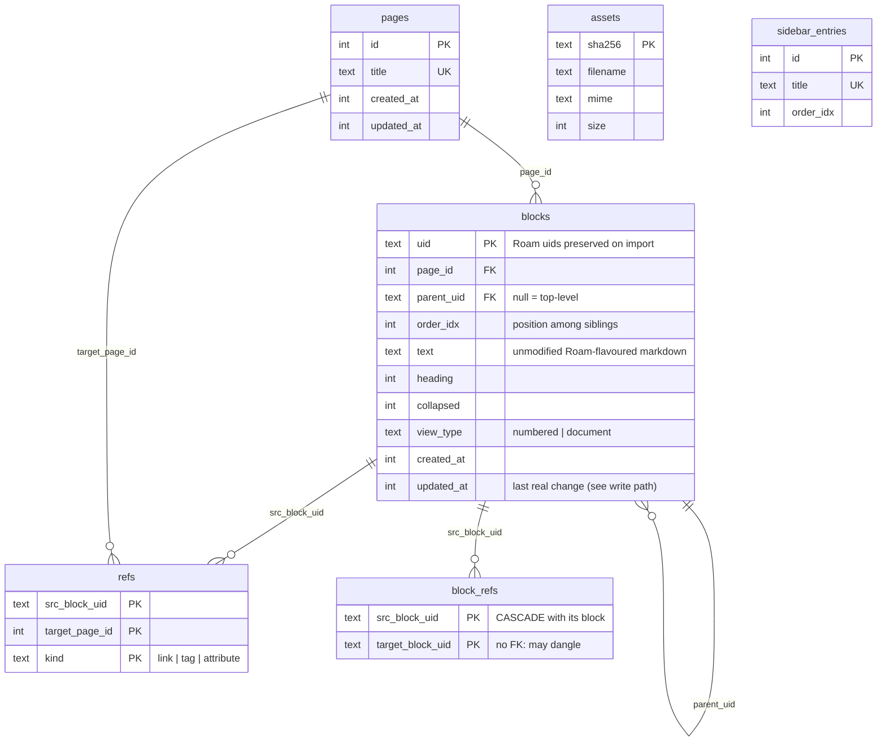
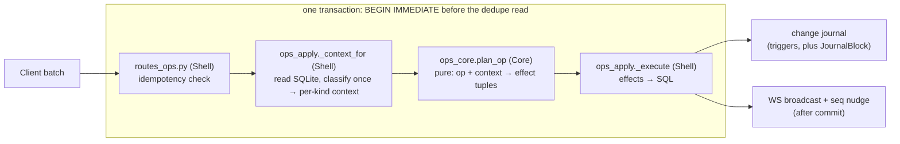
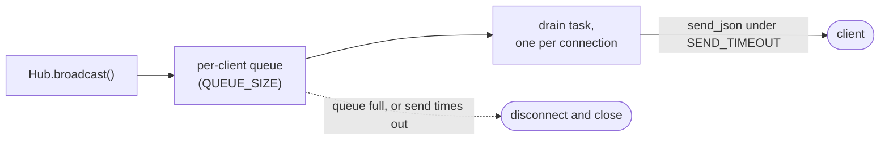

# Backend architecture (server/ + HTTP API)

A Python 3.12+ FastAPI application over a single SQLite file, and the sole
authority for the graph. Block-graph mutations flow through `POST /api/ops`;
other writes use dedicated routes. Refs and full-text indexes are re-derived
in the same transaction, and a trigger-based change journal feeds the sync
protocol. There is no ORM and no migration framework: raw `sqlite3` with
replayable DDL.

[overview.md](overview.md) has the system picture. Siblings own the sync
protocol ([sync-and-offline.md](sync-and-offline.md)), the CLI and MCP server
([cli-and-mcp.md](cli-and-mcp.md)), import, export and backup
([import-export-and-backup.md](import-export-and-backup.md)), the assistant
([assistant.md](assistant.md)), and assets, local documents and GoodLinks copies
([files-and-assets.md](files-and-assets.md)). Failures are indexed by symptom
in [troubleshooting.md](../troubleshooting.md).

## Module map

Everything lives under `server/src/pkm/`. Each runtime file declares its
[FCIS pattern](overview.md#functional-core--imperative-shell) near the top.

```
pkm/
├── contracts/           Core   the wire contract; imports neither the server nor the client
│   ├── ops.py                  op models, OpBatch, UID_RE, text_hash, new_uid, id brands
│   ├── responses.py            response models
│   ├── titles.py               title brands: RawTitle → NormalizedTitle → CanonicalTitle
│   ├── brands.py               brand(): the x-brand schema marker
│   ├── strict.py               StrictModel, the base of every model
│   ├── text.py                 WellFormedModel: lone surrogates become U+FFFD
│   ├── int64.py                Int64, the bound on int path and query parameters
│   └── daily.py                date <-> "July 8th, 2026" titles
├── database.py          Shell  Db, the typed connection
├── rows.py              Core   Row: one typed key per name a query may return
├── brand_registry.py    Core   brand NAMES, MINT_SITES, COLUMN_KEYS, SHAPES
├── schema.py            Core   BASE_DDL (replicated to clients) + SERVER_DDL
├── refs.py              Core   the ref grammar and title normalisation
├── todo.py              Core   {{TODO}}/{{DONE}} markers, mirrored by grammar/todo.ts
├── rename.py, unlink.py Core   rename and page-delete rewrites of block text
├── title_migration.py   Core   plain-space title migration planner
├── planning.py, batch.py, render.py   Core   shared by the CLI, MCP and client
├── *_dump.py            Shell  generated-artifact writers
├── server/                     the FastAPI app (below)
├── client/, cli/, mcp/         PkmClient, `pkm` and `pkm-mcp`
├── assistant/, describe/       embedded assistant; image-description queue
└── importer/, export/, backup/ Roam import, markdown export, nightly backup

server/
├── app.py               Shell  create_app(config): init_db(), routers, 422 handler, SPA
├── config.py, setup.py  Shell  Config from config.json; setup writes it
├── db.py                Shell  init_db() at startup, open_db() per request, migrations
├── wholepath.py         Shell  the {name:wholepath} DOTALL route convertor
├── auth.py, auth_core.py, throttle_core.py   login, require_auth, LoginThrottle; scrypt and tokens; backoff policy
├── routes_*.py          Shell  the HTTP surface
├── ops_core.py          Core   plan_op(), classify_skip, classify_text_edit
├── ops_apply.py         Shell  apply_batch: read context, plan, execute effects
├── store.py             Shell  page create, delete, rename, merge; never commits
├── sync_meta.py         Shell  flag and generation; read_title, title_reader
├── sync_core.py         Core   change-feed windows and hydration order
├── ws.py, notify.py     Shell  WebSocket Hub; post-commit nudges
└── tempfile_response.py Shell  CleanupFileResponse: cleanup runs even on a send error
```

`cli`, `mcp`, `client` and `server` depend on `contracts`, which imports
neither side; `tests/test_client_contracts.py` fails on an import that
crosses back. The assistant and describe routes live outside `pkm/server/`;
`app.py` mounts them.

## Database

One SQLite file, `pkm.sqlite3`, in the data directory. `init_db()` sets WAL
mode and applies the schema once at startup, never per request, because both
take locks that conflict with another connection's open write transaction.
Each request gets a fresh `Db` from `open_db()`, with `foreign_keys=ON`,
`recursive_triggers=ON` and `BUSY_TIMEOUT_MS`.

### Schema

`schema.py` holds two DDL blocks. `BASE_DDL` is the data model, **replicated
verbatim to browser clients** through `baseSchema.gen.ts`. `SERVER_DDL` holds
the sync machinery and never leaves the server.



Block text is the only durable data: `refs`, `block_refs` and the FTS5
tables are rebuilt from it. `blocks_fts` and `pages_fts` are external-content
tables kept in step by triggers. `blocks_fts` is keyed by implicit rowid, so
`VACUUM` would break it.

| Server-only table | Holds | Written by |
|---|---|---|
| `changes` | The append-only journal: `seq`, `kind`, `entity_id`, `deleted`, `page_id` | Triggers on `blocks`, `pages` and `sidebar_entries`, so a new write path is journalled automatically; also `JournalBlock` ([Missing targets](#missing-targets)) |
| `applied_batches` | Each batch's request hash and stored ack | `post_ops` |
| `block_rewrites` | What a rename, merge, title migration or page delete did to one block's text, replayed over a stale edit ([Conflicts](#conflicts)). Pruned after `BLOCK_REWRITE_RETENTION_MS` | `store.rewrite_snapshotted_blocks`, `ops_core.rewrite_effects` |
| `page_deletions` | Each user-deleted page's title and the journal head after it ([Stale batches](#stale-batches)). Pruned on the same window | `store.delete_page_unlinking` only |
| `conflict_headers` | Today's conflict header per block; a new header deletes other days' rows | `ops_apply._execute` |
| `sync_meta` | `db_generation` (a rebuilt database gets a new one and clients rebootstrap) and the `plain_space_title_canonicalization` flag | startup, title migration apply |

Cascade deletes are journalled only because `recursive_triggers=ON`.
`changes.page_id` is set only on a block tombstone: by `blocks_chg_ad`, the
page the deleted block was on; by `JournalBlock`, the page a diverted create
was placed on. It is never shipped and has no index, since every journal
insert would pay for one.

| `block_rewrites.kind` | `old_title` | `new_title` |
|---|---|---|
| `retitle` | the old title | the new title |
| `unlink` | the deleted page's title | empty |
| `inline` | the target block's uid | the text copied in place of `((uid))` |

### Schema migrations and legacy data

New tables and indexes are replayable `IF NOT EXISTS` statements. New columns
are guarded `PRAGMA` checks in `db._ensure_schema_migrations`. Replicas
rebootstrap on a schema-hash change. Startup never runs the
[title migration](#title-integrity-and-one-time-activation).

| Legacy shape | Handled by |
|---|---|
| `blocks.heading` 0, Roam's "no heading", from older imports | `Row.heading` is `StoredHeadingLevel`, so the row check admits it; `rows.heading_level` and `StoredHeading` read it as `None`, so the wire never carries it. A SQL `NULLIF` would cost VM steps on every block row |
| NULL `blocks.created_at` from old imports | `db._backfill_created_at`, through the update trigger so replicas get it |
| blocks from before `block_refs` was maintained | `db._backfill_block_refs`, once, behind a `sync_meta` marker |
| a journal without `changes.page_id` | `db._ensure_changes_page_id`; old rows stay NULL |
| `block_rewrites` rows without `kind` | the column default, `retitle` |
| `applied_batches` rows holding the strict `batch_request_hash` | `post_ops` accepts either that or `batch_replay_hash` |
| acks stored before `seq` or `skipped` | replayed through `OpsAck` as `seq: null` (unknown) and `skipped: []` |
| asset links with an unencoded filename | `/assets/{sha256}/{filename}` ignores the name segment |

### Breadcrumbs and recursive traversal

`routes_pages.py::_fetch_ancestors` builds the breadcrumb trail behind
`GET /api/block/{uid}` and every backlink group. Its recursive CTE carries
`path` as `,uid,uid,…,`, and keeps a row only while
`instr(a.path, ',' || b.uid || ',') = 0`, so a parent cycle in a hand-edited
database stops at the repeat. `UID_RE` admits no comma, so the test is exact.

Every recursive walk over `parent_uid` uses this guard, and each has a
replica mirror written as the same CTE. Change a pair together. None caps
depth.

| Walk | Server | Replica mirror |
|---|---|---|
| Ancestors with text, for breadcrumbs and backlink groups | `routes_pages._fetch_ancestors` | `localApi/tree.ts` |
| One block's parent chain, for a move's cycle check | `ops_apply._parent_chain` | `localOps.ts::parentChain` |
| One block's subtree, deepest first, for delete, re-paging and journalling | `ops_apply._subtree_deepest_first` | `localOps.ts::subtreeUids` |

## Typed boundaries

### Typed database access

Feature code holds a `Db` (`pkm/database.py`), never a `sqlite3.Connection`.
`select` and `select_one` return `Row` dicts; `execute` and `executemany`
take writes only and return `WriteResult`. `table_columns`, `trigger_sql` and
`backup_to` bypass the row check. `raw` exists for tests and tooling, and the
`raw-sqlite` lint rule rejects it elsewhere.

`Row` (`pkm/rows.py`) is a `TypedDict` with one key per name a query may
return, typed with its brand (`uid: BlockUid`) or `Literal` domain. A key
keeps one meaning and one nullability everywhere, so a column that differs
from the key of its name is read under an alias:

| Column | Row key |
|---|---|
| `pages.id` / `sidebar_entries.id` | `page_id` / `sidebar_entry_id` |
| `sidebar_entries.order_idx` | `sidebar_order_idx` |
| `kind` of `refs`, `block_rewrites`, `changes` | `ref_kind`, `rewrite_kind`, `change_kind` |
| `block_rewrites.old_title` / `new_title` | `rewrite_old_text` / `rewrite_new_text` |
| `changes.page_id` (nullable) | `change_page_id` |
| a computed value | the query's alias (`COUNT(*) AS n`) |

`brand_registry.COLUMN_KEYS` lists the aliases and `SHAPES` each brand's
regex; `CLIENT_KEYS` and `CLIENT_LITERALS` cover the replica's own tables.
With `PKM_ROW_CHECK=1`, `select` checks each row with `row_problems` and
raises `RowCheckError` on an unregistered column, a NULL in a non-null key, a
wrong type, a value outside a `Literal` or a brand-shape failure. Tests, e2e
and the proptest sync server turn it on; `perfcheck` turns it off. Fix a
`RowCheckError` in the query (alias, `COALESCE`) or the data, never by
loosening `row_problems`. A key admits every value its column stores,
[legacy ones](#schema-migrations-and-legacy-data) included. `Row` is not a
wire type: handlers copy keys into a response model.

### Wire models and brands

Every JSON handler returns a model from `contracts/responses.py`, and
`test_routes_models` rejects a bare `dict`. The web's types are generated
from these models, and `PkmClient` validates every response against them.

- **Closed sets** are `Literal`s, not `str`/`int`. They reach OpenAPI as an
  `enum`, and `pnpm gen-types` makes each a TS union.
- **Brands.** `brand()` (`contracts/brands.py`) tags a `NewType` with an
  `x-brand` schema marker, which gen-types turns into the web brand of the
  same name ([frontend.md § Brands](frontend.md#brands)). Call it in
  its own statement after the `NewType` line: pyrefly stops treating a
  wrapped `NewType` call as a type. A subtype inherits its parent's marker,
  so each needs its own `brand()`.
- **Strict models.** Every model inherits `StrictModel`, so pyrefly checks
  constructor arguments, brands included, and pydantic never coerces `"1"`
  to an int. Outside the checker: input decoded by `model_validate` at
  runtime, the perf fixture's `TypeAdapter(BlockOp)`, FastAPI form bodies and
  the MCP library's argument models.

The [brand lint](checks.md#brand-rules) enforces both;
`brand_registry.MINT_SITES` lists where each brand may be minted.

| Brand | Base | Declared in | Note |
|---|---|---|---|
| `Sha256Hex`, `ClientId`, `BatchId`, `BlockUid` | `str` | `contracts/ops.py` | |
| `PageId`, `SyncSeq` | `int` | `contracts/ops.py` | |
| `SidebarEntryId` | `int` | `contracts/ops.py` | `sidebar_entries.id`, its own key, not a `PageId` |
| `OrderIdx` | `int` | `contracts/ops.py` | A sparse sibling key, not a position |
| `SidebarOrderIdx` | `int` | `contracts/ops.py` | The web reorders the sidebar by array position, so it never meets block order code |
| `ConversationId`, `ConfirmId` | `str` | `contracts/responses.py` | |
| `GoodlinksId` | `str` | `goodlinks.py` | |
| `RawTitle` | `str` | `contracts/titles.py` | Unchecked text; `as_raw_title` is the general mint |
| `NormalizedTitle` | `RawTitle` | `contracts/titles.py` | From `refs.normalize_title` or `canonicalize_title` |
| `CanonicalTitle` | `NormalizedTitle` | `contracts/titles.py` | The stored spelling of `pages.title` |

`canonicalize_title` takes `plain_space` as an argument rather than reading
the flag, so it returns only a `NormalizedTitle`. A `CanonicalTitle` comes
from `sync_meta.read_title` / `title_reader`, which read the live flag;
`refs.target_canonical_title`, which the title migration uses to plan
against the post-activation state; or `refs.canonical_daily_title`, canonical
under either flag. `store.fetch_page`, the rename, merge and sidebar helpers,
`query.py`'s `plan_sql` and the migration inventory take `CanonicalTitle`,
so pyrefly flags a title that skipped a mint. It cannot see an `Any` value or
raw SQL.

## Ref grammar

`refs.py` owns the grammar (`[[links]]`, `#tags`, `attr::`, `((refs))`,
`{{embeds}}`), and `web/src/grammar/scan.ts` mirrors it.

| Rule | Python | TS | Pinned by |
|---|---|---|---|
| Code hides refs; in one left-to-right pass, whichever of a closed fence or an inline span starts first wins | `strip_code` | `scanCode` | `ref_grammar.json` |
| A link, `#[[tag]]` or attribute whose title as written holds a backtick is no ref; an enclosing run goes with it | `holds_backtick` | `holdsBacktick` | `ref_grammar.json` |
| A title blank once normalised is no ref | `is_blank_title` | `isBlankRefTitle` | `refs_parity.json`, `title_parity.json` |
| A title with a `.`, `..` or empty `/` segment is no ref, so `#work/` typed on the way to `#work/notes` is never refused | `has_unreachable_segment` | `hasUnreachableSegment` | `title_parity.json` |
| An indented `Title::` is an attribute, its span anchored on the title | `attribute_title_span` | `scanGrammar` | `scan.test.ts` (`"  Key:: v"` at offset 2) |
| The `((uid))` shape, which `UID_RE` and the `BlockUid` brand shape are built from | `BLOCK_REF_TOKEN` | `UID_TOKEN` | `scan.test.ts`, `test_rows_vocabulary.py` |

The backtick check reads the original text, because `strip_code()` has
blanked code to spaces. Both scanners stay linear: a failed fence-closer
search retires the fence rule for the rest of the text.

`rename.py` and `unlink.py` keep no copy of the grammar. They locate refs
through `strip_code`, `bracket_spans`, `tag_spans` and `attribute_title_span`,
so they cannot find a ref the index missed or splice over code. `rename.py`
adds which span wins when refs nest and how to spell the replacement. Its
`normalize` argument maps a spelling in the text onto a replacement key.
Rename, merge and their replay pass `rename.spelled_or_canonical`: a spelling
that is itself a key, else its canonical form under the live flag. Matched
byte for byte, `[[ Old ]]` would survive a rename under plain-space
canonicalisation, and the reindex would recreate `Old`.

## The write path

`POST /api/ops` applies an `OpBatch` of 1–500 ops. `batch_id` is required (a
422 without it), because an id-less batch cannot be deduplicated.

| Op | Does |
|---|---|
| `create` | insert a block, uncollapsed. `page_title` places a top-level create; a child lands on its parent's page |
| `update_text` | replace a block's text. `page_title` only labels a missing block's conflict header |
| `move` | reposition or reparent; a cross-page move re-pages the subtree. `page_title` places a top-level move |
| `delete` | remove a block and its subtree |
| `set_heading`, `set_view_type`, `set_collapsed` | set a block attribute; collapse is view state only |
| `create_page` | idempotently ensure a page exists |



### The write lock

The routes below take `BEGIN IMMEDIATE` before their first read, so no
concurrent commit lands between that read and the write it justifies. A new
route whose decision rests on what it reads joins them.

| Route | Lock taken before | Busy lock |
|---|---|---|
| `POST /api/ops` | the dedupe read and every op's context read | 503 + `Retry-After` |
| `POST /api/page/{title}/rename` | the snapshot of referencing blocks, so no batch commits an unrewritten `[[Old]]`; a title race cannot reach the `UPDATE` | 503 + `Retry-After` |
| `DELETE /api/page/{title}` | the snapshot of referencing blocks | 503 + `Retry-After` |
| `DELETE /api/assets/{sha256}` | the strip's read of each referencing block, or with `if_unreferenced=true` the reference check | 503 + `Retry-After` |
| `POST /api/journal/cleanup` | the emptiness and link checks, so a block created on the day cannot go with the page | 503 + `Retry-After` |
| `POST /api/sidebar` | the uniqueness check and `max(order_idx) + 1`, so a same-title race is a 409 | uncaught: 500 |
| `POST /api/migrations/title-canonicalization` | the re-inventory | uncaught: 500 |

### Planning

`ops_apply._context_for` classifies each op once (`classify_skip`, and
`classify_text_edit` for a hashed edit) and hands `plan_op` the context type
that classification calls for, such as `TextConflictContext` or
`StuckMoveContext`. `apply_batch` reads the ack's skip off the same context.
Every context field is required.
A context that does not fit its op is an `AssertionError`, a 500 the client
retries; it must never be a 400, which would poison the client's queue over a
server bug.

- **Ordering.** An insert or move emits `ShiftSiblings`, bumping every
  sibling at or above the target `order_idx`. Nothing renumbers the gaps this
  leaves. A move onto its own slot still bumps every later sibling, because
  `ShiftSiblings` cannot tell staying put from moving there.
- **Refs.** Every text change emits `ReindexRefs`, whose only implementation
  is `store.reindex_refs_for_text`; the rename rewrite calls it too. It never
  commits. The asset-token strip skips it, since asset tokens and `((uid))`
  are disjoint, and so does `importer/migrate_mermaid_blocks.py`. The schema's
  triggers keep `blocks_fts` and `changes` current but never `refs`, so a
  direct SQL `UPDATE blocks SET text` that adds or changes a link leaves
  backlinks stale. Edit linking text through the ops path (`pkm batch`).
- **Timestamps.** `blocks.updated_at` means last really changed, so
  `set_collapsed` stamps neither block nor page; the journal still carries
  the collapse.
- **Idempotency.** A retried `batch_id` with a matching hash replays the
  stored ack with no effects; with other ops it is a 409. The stored
  `batch_replay_hash` (`ops_hash.py`) leaves out `base_text_hash`,
  `update_text`'s `page_title` and `base_subtree_hash`, which the worker may
  fill into only the durable copy of a batch.
- **Well-formed text.** `WellFormedModel` turns lone surrogates into U+FFFD
  ([Hostile input](#hostile-input)). The rule is to normalise, never reject:
  SQLite cannot bind a surrogate, a 5xx is retried forever and a 4xx poisons
  the batch. `text_hash` hashes the well-formed form, as the web does.

Conflicts, missing targets, stale batches and concurrent structure edits are
what a batch meets when the tree changed after it was planned. None rejects
the batch.

### Conflicts

`update_text` may carry `base_text_hash`, the sha256 of the text it was based
on; a hash, unlike a version counter, ignores structural change. On a
mismatch, or an edit to a gone block, the incoming edit wins and the losing
text, blank or not, lands under a `[[conflict]]` header on the daily page of
the batch's `now_ms`. The batch reads the clock once; `_conflict_landing`
never reads it. A second conflict on a block the same day appends under the
same header.

| Case | Header text |
|---|---|
| Block exists, hash mismatch | `` [[conflict]] [[Page]] — overwritten by ((uid)) `` |
| Block gone, hint names an existing page | `` [[conflict]] [[Page]] — edit to a block the server no longer has `` |
| Block gone, hint names no current page | `` [[conflict]] `Page` (page not found) — edit to a block the server no longer has `` |
| Block gone, hint missing, blank or [refused](#refused-titles) | `` [[conflict]] (page unknown) — edit to a block the server no longer has `` |
| Block exists, move target gone or inside it | `` [[conflict]] [[Page]] — ((uid)) `` |
| Guarded `delete` whose subtree changed | `` [[conflict]] [[Page]] — deleted while edited elsewhere `` |

The `page_title` hint never changes whether or where an op applies, and
`find_op_title_violation` never reads it. A hint naming no current page is
inline code, which the ref extractor skips, so the header cannot re-create
the page (`ops_apply._hint_page`). An existing page is linked by its stored
title, only when `[[Page]]` reads back as it
(`conflict_notes.existing_page_label`). `contracts.ops.new_uid` starts uids
with an alphanumeric so the CLI can address them without `--`.

`ops_core.classify_text_edit` sorts a hashed `update_text` on a live block,
checking in this order:

| Situation | Outcome |
|---|---|
| `base_text_hash` matches a pre-rewrite snapshot of this block | The `block_rewrites` rows replay over the incoming text (`ops_core.replay_title_rewrites`), which then meets the rows below |
| Incoming text equals current | No-op, even with a stale hash |
| `hash(current) == base_text_hash` | Clean apply |
| Hashes differ | Incoming wins; the overwritten text lands under a conflict header |

The replay covers renames and, through `unlink.apply_delete_rewrite`, page
deletes. So a stale edit cannot re-create a renamed-away page, a link to a
deleted page, or a `((ref))` to a gone block. A hashless edit to a live block
is last-write-wins. A replay or stale unlink makes the written text differ
from the sent text, and the client hashes its next edit from what it sent.
So `ops_core.rewrite_effects` records a `block_rewrites` chain
(`RecordRewrite`) from the sent text's hash to the written one.

`delete` may carry `base_subtree_hash` over the uid and text of the block
and every descendant ([canonical form](sync-and-offline.md#conflicts-at-push-time)).
Order and nesting are not hashed, so a reorder does not diverge it. On a
mismatch the delete still wins, but first every descendant's text, blank
ones included, lands under the conflict header, nested, with fresh uids
(`ops_core.descendant_copy_effects`). The header is never inside the subtree
being deleted (`_conflict_landing`'s `exclude`).

### Missing targets

An op whose block, or create or move parent, is gone never rejects its
batch: a batch is atomic, so one such op would take every valid op down with
a 400 and wedge the client's queue. `ops_core.classify_skip` sorts it before
its context is read. Each entry is grouped under the block's uid (a diverted
create's under its parent's), and every row is reported in the ack's
`skipped` (`ops_core.skip_report`), with `note_page` null where nothing
landed.

| Op, situation | Outcome | `reason` | Journalled |
|---|---|---|---|
| `set_collapsed` / `delete`, block gone | no-op | `block_not_found` | `set_collapsed`'s uid, since a replica holds a ghost |
| `move` / `set_heading` / `set_view_type`, block gone | child `move skipped: block <uid> not found` (or `heading change` / `view type change`) under `(page unknown)` | `block_not_found` | the uid; a move also its destination siblings |
| `update_text`, block gone | text lands | `block_not_found` | the uid |
| `create`, parent gone | not created; text lands | `parent_not_found` | created uid with its page, and parent uid |
| `move`, parent gone | block stays; `move skipped: target parent <uid> not found` | `parent_not_found` | the parent uid, then the moved subtree |
| top-level `create` into a page deleted since `seen_seq` | not created; text lands under the deleted page's name | `page_deleted` | the created uid |
| top-level `move` onto such a page | block stays; a note naming the page | `page_deleted` | the moved subtree |

Where a row lands text, a blank text lands nothing; a conflict, by contrast,
keeps a blank losing text. A skipped op resolves no `page_title`, which
would create a page for an op that never applied. A later op in the batch
sees a diverted create's block as missing too, and a diverted subtree lands
flat.

`JournalBlock` writes the row a trigger would, straight into `changes`, so
FTS and refs stay untouched. It marks a uid with no block row `deleted`,
because the feed ships a block tombstone only from a delete row. A move to a
missing parent journals the whole moved subtree: the ghost parent's
tombstone cascades the blocks a replica moved under it, and these rows
restore them.

A skipped `create` or `move` shifted its destination siblings in the
client's optimistic apply but not on the server. Where nothing else re-ships
them, `ops_apply._destination_siblings` journals them. The replica's
[replay log](sync-and-offline.md#the-replay-log) does not rely on these rows.

| Skip | Destination | Siblings journalled |
|---|---|---|
| move of a gone block | a live `parent_uid` | its children |
| move of a gone block | top level, `page_title` naming a page | that page's top-level blocks (never created) |
| move of a gone block | top level, no `page_title` | the top level of the page on its latest tombstone with a `changes.page_id` |
| any | a gone `parent_uid` | none: the parent's tombstone cascades them |
| `move_cycle` | the target's children | none: they lie inside the journalled subtree |

A block the server never created has no delete row, so a diverted create
writes its page onto its own tombstone (`ops_apply._diverted_create_page`):
the page its `page_title` names if one exists, else the page on the parent's
tombstone.

Other planning errors stay 400s: an invalid or taken uid, title syntax.
`find_op_title_violation` checks every `page_title` of a `create`,
`create_page` or `move` and every ref title in block text before any op
applies. A skipped op whose own uid fails `UID_RE` is still a 400
(`ops_core.impossible_uid_reason`), which keeps arbitrary strings out of the
journal. So is the gone parent of a diverted create or of a move whose block
exists. A move of a gone block never checks its parent uid. A taken uid outranks a gone parent.

### Stale batches

An offline device that never pulled a page delete still holds edits against
the page. `apply_batch` asks `store.stale_titles` for `page_deletions` titles
with a `seq` above the batch's `seen_seq`; a batch without `seen_seq` pays no
query, and one beyond the journal head (a replaced database) treats every
deletion as newer.

| Op in a stale batch | Outcome |
|---|---|
| `create_page` for a stale title | dropped, not reported; the replica removes its page (`dropStrandedLocalPages`) |
| top-level `create` / `move` with a stale `page_title` | skipped as `stale_page` (a `SkipKind`), reported `page_deleted` (a `SkipReason`) ([above](#missing-targets)) |
| text linking a stale title | the links become plain text (`ops_core.unlink_stale_text`) |
| a leading `Title::` naming a stale title | fenced in place, `` `X`:: v `` (`unlink.defuse_attribute`), so it indexes no ref; the unlink replay defuses too |

A page re-created after its delete still matches until its row is pruned.

### Concurrent structure edits

| Op, situation | Outcome | Journalled |
|---|---|---|
| `create` under a live parent on another page than its `page_title` | created on the parent's page | the block |
| `move` under a parent no longer on the page `page_title` names | moved onto the parent's page | the subtree |
| `move` whose target is the block or its descendant | skipped as `move_cycle`, reported `cycle`; child `move skipped: would create a cycle` under the block's header | the moved subtree, root first |

`_context_for` resolves `page_title` only for a top-level create or move, so
a stale title never creates an empty page. The cycle skip journals no
tombstone, since nothing is gone. Its journalled subtree carries what the
replica's optimistic move touched: re-paged descendants and the target's
shifted children.

### Page mutations and the sidebar

`store.py` page mutations never commit; routes own the transaction. Rename
rewrites every referencing block through `rename.py` and, with `allow_merge`,
merges by concatenating blocks. `DELETE /api/page/{title}` runs
`store.delete_page_unlinking`, which plans with `unlink.plan_page_delete`
before any write:

| Inbound reference | Delete does |
|---|---|
| `[[Title]]`, `#Title`, `#[[Title]]` | becomes plain text |
| `((uid))` to a block of the page | replaced by a copy of that block's text, without its task marker or leading attribute, newlines folded |
| a query macro naming the page | refused: 409 with `blockers`, `reason` `query`; nothing changes |
| a leading `Title:: v` | refused, `used_as_attribute`: the block's next edit would recreate the page |
| unlinking would change the leading attribute name (`[[Title]]:: v`) | refused, `attribute` |
| rewritten text still references the page | refused, `residual` |

`unlink_title_refs` repeats until the text is stable, because a nested legacy
link loses one layer per pass. Rewritten blocks get `unlink` and `inline`
rows and a reindex, and the title goes into `page_deletions`. The replay of
an `unlink` row matches titles through the same `title_reader`, or a stale
padded `[[ Title ]]` would survive and recreate the page.

`cleanup_journal` spares any daily note with an incoming link, so a link to a
journal day cannot dangle. `POST /api/sidebar` is its own path under the
[write lock](#the-write-lock).

### Post-commit nudges

**Every route whose commit touches a journalled table (`blocks`, `pages`,
`sidebar_entries`) sends a WS `{type:"seq", seq}` nudge right after that
commit.** `seq` is the real journal maximum. A metadata or generation change
that may not advance `changes.seq` adds `force:true` and the new
`generation`, which makes a client pull at its own cursor without advancing
it. `POST /api/ops` also echoes the applied ops.

Sync-def routes call `notify.commit_and_nudge_threadpool`; async routes call
`db.commit()`, then `await nudge(request, db)`. `delete_asset` nudges because
it rewrites blocks; `cleanup_journal` only when it deleted something. No type
or test discovers a new route: `test_journal_advancing_contract.py` asserts
the nudge for each route on its hand-kept list, so a new journal-advancing
route adds its own case there.



`Hub.broadcast()` (`ws.py`) never awaits a send, so a stalled client blocks
neither the write path nor other clients. Each connection's `_drain` task is
the sole consumer of its `asyncio.Queue`, and `broadcast()`'s loop has no
`await`, so a client receives frames in `broadcast()` call order; a second
consumer or another queue would break that silently. A client is dropped at
`QUEUE_SIZE` queued frames or a send past `SEND_TIMEOUT`. Dropping closes the
socket (`_safe_close`), because otherwise `onclose` never fires and the
client never resyncs.

## Title integrity and one-time activation

The durable `plain_space_title_canonicalization` flag selects the second
layer of `refs.canonicalize_title`:

| Flag | `canonicalize_title` does |
|---|---|
| inactive (default) | a control character makes whitespace runs collapse to one space and trims their boundary; plain-space padding stays byte-exact, so legacy rows still resolve |
| active | also strips leading and trailing U+0020; internal spaces and NBSP are unchanged |

**A title that arrives as a lookup key goes through `sync_meta.read_title`
before it meets `pages.title` or `sidebar_entries.title`.** Both are exact
matches, so a raw title misses its page once the flag is active. The entry
points are a `{title:wholepath}` route parameter, the `page` filter on
`/api/todos` and `/api/changed`, a `[[Page]]` operand in `{{query}}`
(`query_exec.parse_canonical_query`) and the `POST /api/sidebar` title.

The `wholepath` convertor (`server/wholepath.py`) replaces Starlette's `path`
on title and file-path routes and the SPA fallback. `path` stops before a
final newline, so `Foo%20%0A` would arrive as `Foo `. `test_title_routes_props.py`
checks every title-taking route and CLI verb against generated spellings;
its route list comes from OpenAPI, so a new title route fails until covered.
The web's sidebar form sends input untrimmed, because `trim()` would strip
NBSP.

Every creation path funnels through `store.get_or_create_page()`. Daily pages
(`daily.py`) are auto-created on read and cannot be renamed.
`ops_apply._broadcast_op()` echoes the stored title in place of the caller's
`page_title`, so replicas receive the authoritative spelling.

Activation is an operator action: `pkm migrate-titles`, then
`pkm migrate-titles --apply DIGEST`
([docs/cli.md](../cli.md#one-time-title-canonicalization)).
`pkm/title_migration.py` groups padded titles under a canonical spelling,
picks a survivor and reports `all_space` or `forbidden_syntax` blockers.
Replacement values are opaque (`rename.rewrite_title_refs_map()` never
rescans one), and the digest covers the whole relevant snapshot.
`audit_title_migration()` runs in a read transaction it always rolls back.
Apply takes that `audit_digest`, re-inventories under the
[write lock](#the-write-lock), and answers 409 to a stale digest, a
blocker or an active flag. Every change, through activation and the
`db_generation` rotation, is one transaction, followed by one forced seq
frame; replicas rebootstrap before replaying pending intent
([sync-and-offline.md](sync-and-offline.md#title-activation-across-online-and-offline-paths)).

### Refused titles

`refs.title_syntax_reason` refuses a title as `forbidden_syntax` when it holds:

| Syntax | Why |
|---|---|
| `#`, `[[`, `]]` | ref syntax |
| a trailing `]` | `[[a]]]` reads back as `a` |
| a backtick | it pairs with another on the line into a code span that hides the ref |
| a `.`, `..` or empty `/` segment (`/x`, `a//b`, `a/../b`) | no URL: clients drop dot segments and the router collapses `//` |

Every rule judges the title edge-stripped of U+0020
(`target_canonical_title`) whatever the flag, because the pure ops check
never knows the flag and must not pass ` a] `. A title is refused at
creation, rename, move, sidebar pin, import, and in the migration audit. In
block text a ref with `#`, `[[`, `]]` or a trailing `]` fails the batch with
a 400; a backtick or no URL makes it [no ref](#ref-grammar). `...` and `a.b`
are ordinary titles.

### Blank titles

A blank title is unreachable, so `get_or_create_page()` raises
`BlankTitleError` and each caller picks its recovery:

| Caller | Recovery | Why |
|---|---|---|
| `POST /api/pages` | 422 | a live client can retry |
| `ops_apply._resolve_page()` | file under `UNTITLED_PAGE_TITLE`, `"Untitled"` | the ops path must never 422 |

`"Untitled"` is an ordinary title, so blank-title ops land on a user's real
"Untitled" page if one exists; that trade-off is accepted. A blank ref
indexes nothing ([Ref grammar](#ref-grammar)), or `[[   ]]` would make a
phantom backlink on "Untitled". `store.index_ref()` also skips a ref that
raises `BlankTitleError`.

## Auth

One shared password behind Tailscale, the transport boundary. `auth_core.py`
does the constant-time scrypt check and signs the `pkm_session` cookie
(`v1.<issued_ms>.<sig>`). `docs/SECURITY.md` owns the cookie flags and the
threat model.

Response headers that apply to every route are set in one place,
`SecurityHeadersMiddleware`; routes set only their own. An
unhandled exception's 500 is built outside it and carries none.

`LoginThrottle` (`auth.py`, policy in `throttle_core.py`) applies a per-source exponential backoff
(`BASE_BACKOFF_MS` to `MAX_BACKOFF_MS`) before scrypt runs, and a
process-wide semaphore (`MAX_CONCURRENT_SCRYPT`) on scrypt work.
`scrypt_slot()` waits at most `SCRYPT_ACQUIRE_TIMEOUT_S`, because `login()`
is a sync route that an unbounded wait would let starve the threadpool. A
throttled attempt gets the same 401 as a wrong password. Under
`tailscale serve` every client shares the proxy address, so the backoff is
effectively global.

`GET /login`, `POST /api/login`, `GET /healthz` and the SPA shell are public.
Every feature router declares `dependencies=[Depends(require_auth)]`.
`/api/ws` checks the cookie and closes with 4401 before accepting, which
uvicorn sends as an HTTP 403.

## HTTP API reference

`routes_*.py` and the generated `web/src/api/openapi.json` are authoritative,
and route docstrings carry the detail. Every endpoint needs the session
cookie unless marked public. FastAPI's `/docs` and `/redoc` are off.

| Method | Path | Purpose |
|---|---|---|
| POST | `/api/login` *(public)* | Password → session cookie |
| GET | `/login` *(public)* | HTML login form |
| GET | `/healthz` *(public)* | Liveness check |
| GET | `/{path}` *(public)* | SPA fallback; hashed bundles under `/app-assets/` |
| GET | `/api/openapi.json` | Live OpenAPI schema |
| **Writes** | | |
| POST | `/api/ops` | Apply an `OpBatch` ([The write path](#the-write-path)); `applied` counts skipped ops too |
| **Pages & blocks** | | |
| GET | `/api/page/{title}?bl_offset&bl_limit` | Page tree, paginated backlinks (not from the page itself), `block_ref_counts`; daily pages auto-created |
| GET | `/api/block/{uid}` | One block subtree with its page and [breadcrumbs](#breadcrumbs-and-recursive-traversal) |
| GET | `/api/block/{uid}/backlinks` | Blocks referencing `((uid))`, unpaginated |
| GET | `/api/block-refs?uids=` | Resolve `((uid))` references |
| POST | `/api/pages` | Idempotent page create |
| DELETE | `/api/page/{title}` | Delete a page, unlinking inbound refs; 409 with `blockers` ([Page mutations](#page-mutations-and-the-sidebar)) |
| GET | `/api/delete-preview?title=` | What a delete would rewrite or be refused for |
| POST | `/api/page/{title}/rename` | Rename and rewrite refs; 409 on collision unless `allow_merge` |
| GET | `/api/unlinked?title` | Unlinked mentions, not from the page itself |
| GET | `/api/journal?before&days` | Daily-notes feed |
| POST | `/api/journal/cleanup` | Prune empty, unreferenced daily pages from the week before today |
| GET | `/api/current-work` | Recently edited pages, bucketed by age |
| **Migrations** | | |
| GET | `/api/migrations/title-canonicalization` | Side-effect-free audit and digest ([Title integrity](#title-integrity-and-one-time-activation)) |
| POST | `/api/migrations/title-canonicalization` | Apply the audited digest; 409 on stale, blocked or active |
| **Search & queries** | | |
| GET | `/api/search?q` | FTS5 search over pages and blocks |
| GET | `/api/query?expr` | `{{[[query]]}}` evaluation |
| GET | `/api/titles?q` | Title completion for `[[` and `#` |
| GET | `/api/todos?page` | `{{TODO}}` blocks grouped by page |
| GET | `/api/changed?since&until&page&limit` | Blocks changed in `[since, until)`, each `new` or `edited`; 400 on an empty window |
| **Sidebar** | | |
| GET / POST / PUT / DELETE | `/api/sidebar`… | List, pin, reorder (a permutation), unpin |
| **Sync** ([sync-and-offline.md](sync-and-offline.md)) | | |
| GET | `/api/sync/snapshot?pending` | Full bootstrap with `seq`, `generation`, the title flag and `applied_batches` |
| GET | `/api/sync/changes?since&limit&pending` | Windowed incremental feed with the same metadata |
| POST | `/api/client/diagnostics` | A replica's self-report before a rebuild; one `pkm.sync` warning cut at `_MAX_DIAGNOSTICS_LOG_CHARS` with a marker naming the full length, nothing stored |
| WS | `/api/ws` | [Post-commit nudges](#post-commit-nudges) and op echoes |
| **Assistant** ([assistant.md](assistant.md)) | | |
| GET | `/api/assistant/models` | Models on offer and the default |
| POST | `/api/assistant/conversations` | Create; 400 for a model not offered, 409 over the cap |
| POST | `/api/assistant/conversations/{id}` | Beacon close (`navigator.sendBeacon`) |
| POST | `/api/assistant/conversations/{id}/messages` | One turn → SSE stream; 409 while a turn runs |
| POST | `/api/assistant/conversations/{id}/confirm` | Answer a write confirmation |
| DELETE | `/api/assistant/conversations/{id}` | Close the conversation |
| **Assets** ([files-and-assets.md](files-and-assets.md)) | | |
| POST | `/api/assets` | Multipart upload |
| GET | `/assets/{sha256}/{filename}` | Serve by digest; the name segment is ignored |
| GET | `/api/assets/describe-status` | Whether image descriptions are on, and why not |
| POST | `/api/assets/scan?force` | Enqueue undescribed images |
| GET | `/api/assets/search?q&limit&offset&type&from_ms&to_ms&linked` | Search behind `/files` |
| DELETE | `/api/assets/{sha256}` | Delete, stripping its tokens; `if_unreferenced=true` 409s instead while referenced |
| POST | `/api/assets/export.zip` | Zip the selected assets |
| **Local documents** ([files-and-assets.md](files-and-assets.md#local-documents)) | | |
| GET | `/api/local/check` | Classify every `/api/local/` href in block text |
| GET | `/api/local-index` | Every visible file under `local_docs_root`; 503 when the listing fails |
| GET | `/api/local/{path}` | Serve one file; 404 outside the root, 503 when evicted or unopenable |
| **GoodLinks copies** ([files-and-assets.md](files-and-assets.md#goodlinks-copies)) | | |
| POST | `/api/goodlinks/resolve` | Resolve a URL to a link, saving it with `save` |
| GET | `/api/goodlinks/check` | Classify every `/api/goodlinks/` href |
| GET | `/api/goodlinks/{link_id}` | Metadata and sanitised reader HTML; 503 when GoodLinks is down |
| **Export** ([import-export-and-backup.md](import-export-and-backup.md)) | | |
| GET | `/api/export/page/{title}` | One page as markdown |
| GET | `/api/export.zip` | Whole-graph markdown export |

### Hostile input

**No client input, and no row the importer writes, makes a route answer
500.** A test that walks `app.routes` keeps the first two guards on every
route.

| Input | Guard | Kept by |
|---|---|---|
| A lone surrogate in a JSON body | Every request body model derives from `WellFormedModel` | `test_every_json_request_body_is_a_well_formed_model` |
| An int past 64 bits | Int parameters are `Int64` or carry `INT64_RANGE`; `WellFormedModel` refuses one in a body | `test_every_int_parameter_is_bounded_to_sqlite_range` |
| A 422 echoing a surrogate, NaN or deep nesting | `validation_echo.echo_errors`, cut at `MAX_ECHO_DEPTH` | `test_validation_echo.py` |
| A NUL, an over-long component or a link loop in an SPA path | The catch-all treats a path `resolve()` or `is_file()` rejects as naming no file, and serves the shell | `test_spa.py` |
| A session cookie signature that is not ASCII | `verify_session` refuses it before `hmac.compare_digest`, which raises on non-ASCII | `test_hostile_requests.py` |
| A NUL in a search term | `fts.py` makes it a space: FTS5 reads a C string | `test_hostile_requests.py` |
| A GoodLinks or OpenAI body that is not JSON, nests too deep, or holds a surrogate | An unusable answer (503, `DescribeError`); decoded strings made well-formed | `test_no_500_upstream_props.py` |
| An op `order_idx` a sibling shift could push past int64 | `CreateOp` and `MoveOp` bound it with `WIRE_ORDER_IDX` to the JS safe-integer range | `test_an_op_order_idx_stays_in_the_js_safe_range` |
| A Roam heading outside 1–3 or a time past 64 bits | `parse_export` reads it as absent | `test_no_500_stored_props.py` |

Path and query values cannot carry a lone surrogate, because the server
decodes them from bytes. The `test_no_500_*_props.py`
[properties](checks.md#property-gate) send generated input through every route.

## Generated artifacts and parity fixtures

These are generated or hand-kept, checked in, and **the test suites fail when
one is stale**. Regenerate and commit with the change that invalidates them.
Python commands run from `server/`, `pnpm` ones from `web/`.

| Artifact | Regenerate with | Guarded by | Pins |
|---|---|---|---|
| `web/src/api/openapi.json`, `types.d.ts` | `uv run python -m pkm.server.openapi_dump > ../web/src/api/openapi.json`, then `pnpm gen-types` | `test_openapi_sync.py`, `genTypes.drift.test.ts` | the web's API types to the response models |
| `web/src/replica/baseSchema.gen.ts` | `uv run python -m pkm.schema_dump > ../web/src/replica/baseSchema.gen.ts` | `test_schema_artifact.py` | the replica schema to `BASE_DDL` |
| `web/src/replica/columns.gen.ts`, `web/tooling/brandRegistry.gen.json` | `uv run python -m pkm.rows_dump` | `test_rows_artifact.py`, `columns.test.ts` | `Columns`, `COLUMN_META` and the web lint's registry to `rows.Row` and `brand_registry` |
| `shared/fixtures/refs_parity.json` | `uv run python -m pkm.refs_parity_dump > ../shared/fixtures/refs_parity.json` | `test_refs_parity_fixture.py` | `refs.extract` |
| `shared/fixtures/title_parity.json` | `uv run python -m pkm.title_parity_dump > ../shared/fixtures/title_parity.json` | `test_title_parity_fixture.py`, `titleParity.test.ts` | `normalize_title`, `target_canonical_title`, `title_syntax_reason`, `is_blank_title`, `extract` |
| `shared/fixtures/shim_parity.json` | `uv run python -m pkm.server.shim_parity_dump > ../shared/fixtures/shim_parity.json` | `test_shim_parity_fixture.py` | the offline shim (`replica/localApi/`) to the read routes' JSON |
| `shared/fixtures/text_hash_parity.json` | `UPDATE_TEXT_HASH_FIXTURE=1 pnpm vitest run src/replica/textHashParity.test.ts` | that test, `test_text_hash_parity.py` | `text_hash`, `subtree_hash`, `well_formed` |
| `shared/fixtures/local_links_parity.json` | `UPDATE_LOCAL_LINKS_FIXTURE=1 pnpm vitest run src/outline/localLinksParity.test.ts` | that test, `test_local_links_parity.py` | `local_docs.extract_local_hrefs` |
| `shared/fixtures/upload_links_parity.json` | `UPDATE_UPLOAD_LINKS_FIXTURE=1 pnpm vitest run src/sync/assetsParity.test.ts` | that test, `test_upload_links_parity.py` | `assets_core.strip_asset_tokens` |
| `ref_grammar.json` | hand-edited | `test_refs.py`, `grammar/refs.test.ts` | the [ref grammar](#ref-grammar) |
| `title_syntax.json` | hand-edited | `test_refs.py`, `replica/titles.test.ts` | `title_syntax_reason` |
| `missing_targets.json` | hand-edited | `test_ops_core.py`, `missingTarget.test.ts` | `classify_skip`; `placement_cases` pin where a create or move lands |
| `subtree_hash.json` | hand-edited | `test_subtree_hash.py`, `subtreeHash.test.ts` | `subtree_hash` |
| `ops_acks.json` | hand-edited | `test_ops_idempotency.py`, `opsAck.test.ts` | the stored-ack-to-wire mapping and `SkipReason` |
| `draft_flush.json` | hand-edited | `test_ops_endpoint.py`, `EditablePage.draftFlush.test.tsx` | the op an editor draft flushes |

Hand-edited fixtures live in `shared/fixtures/`. `rows_dump` fails for a
brand `brands.ts` lacks. The seeded corpora in `refs_parity.json` and
`title_parity.json` are tallied by shape, so they cannot go vacuous. The
[ops property](checks.md#property-gate)
checks the server, replica and in-memory implementations against each other
on random batches.

## Configuration and entrypoints

`config.json` lives in the data directory, never in git;
`python -m pkm.server.setup` writes it mode 0600. Path keys resolve relative
to `config.json`'s directory, so the data directory moves as a unit.

| Key | Default | Meaning |
|---|---|---|
| `db_file` | required | SQLite database path |
| `assets_dir` | required | Content-addressed asset store |
| `password_salt`, `password_hash` | required | scrypt password check (hex) |
| `session_secret` | required | HMAC key for session cookies (hex) |
| `cookie_secure` | `true` | `Secure` flag on the session cookie |
| `web_dist` | unset | Built SPA directory; unset serves the API only |
| `bind_hosts` | `["127.0.0.1"]` | Interfaces to listen on |
| `max_upload_bytes` | 150 MB | Upload size cap |
| `image_descriptions` | `true` | Master switch for image captions |
| `image_description_model` | `gpt-4o-mini` | Vision model |
| `openai_api_key_file` | `../openai_key` | Key for image captions; else `OPENAI_API_KEY` |
| `zai_api_key_file` | `../zai_key` | Key that enables the assistant's `glm` model; else `ZAI_API_KEY` |
| `local_docs_root` | unset | Tree served under `/api/local/`; unset disables it |
| `goodlinks_api_key_file` | `../goodlinks_key` | GoodLinks token; else `GOODLINKS_API_KEY`. With neither, every GoodLinks route but `check` 404s |
| `goodlinks_api_url` | `http://localhost:9428/api/v1` | Where the GoodLinks app listens |

A key file wins over its environment variable. Key files default to one
level above the data directory, outside anything servable or exportable.

`python -m pkm.server.run` serves port 8974 on `bind_hosts`. launchd runs it
through `$PKM_HOME/bin/pkm-server`, which stays the Python process's parent,
so macOS attributes file-access consent to a binary that does not change
([the launcher](../../deploy/README.md#the-launcher)). `create_app()` always
runs `init_db()`, so every entrypoint works on a new data directory.

## Logging and observability

There is no metrics stack; the logs answer what the server was doing when it
was slow. `logfmt.uvicorn_log_config()` routes three loggers to two handlers.

| Logger | Handler | Line |
|---|---|---|
| `pkm.access` | access | One `logfmt.request_line` per request from `RequestLogMiddleware`, after the body is sent |
| `pkm` and every `pkm.*` child | default, INFO | children inherit by propagation |
| uvicorn | default | lifecycle and errors; its own access log is off |

      <client> "GET /api/page/Foo?bl_limit=20" 200 4ms

`request_line` escapes each non-printable character in the client, method and
path (query included) as `\xNN`, `\uNNNN` or `\UNNNNNNNN`, and backslash-escapes
backslashes and double quotes. The path is attacker-chosen: a raw newline or
U+2028 would forge a log line, and a quote would close the request field
early and fake the status.

With `run.py --log-dir` (production) the handlers write `server.log` and
`access.log`; without it, stderr and stdout. The server rotates its own
files at midnight (`TimedRotatingFileHandler`), because launchd holds its
`StandardOutPath` descriptors open and an outside rename would leave the job
writing to the renamed file.
`RequestLogMiddleware` defaults the status to 500, so a request that dies
before responding still logs what the client saw. Nothing configures the root
logger, so `test_every_declared_pkm_logger_has_an_effective_info_handler`
checks every `pkm.*` logger reaches a handler.

## Testing

- `cd server && uv run pytest -q` runs the suite with branch coverage
  enforced. AGENTS.md says how to run the gates;
  [checks.md](checks.md) says what fails, including the
  [comment lint](checks.md#comment-and-regex-lint).
- `conftest.py` provides a seeded temp database (five pages, daily page
  "July 7th, 2026"), an authenticated `TestClient` and an in-process
  `PkmClient`.
- A path with a literal `%` goes through `asgi_get_all` or `single_decode_get`,
  not `TestClient`, which decodes the path twice: a file named `%41` would be
  served as `A`. uvicorn and `httpx.ASGITransport` decode once.
- `server/tooling/` holds the gate engines: `perfcheck`
  ([checks.md § Performance gate](checks.md#performance-gate)), `proptest`
  ([checks.md § Property gate](checks.md#property-gate)), `brandlint`, `regexlint` and
  `commentlint`.
