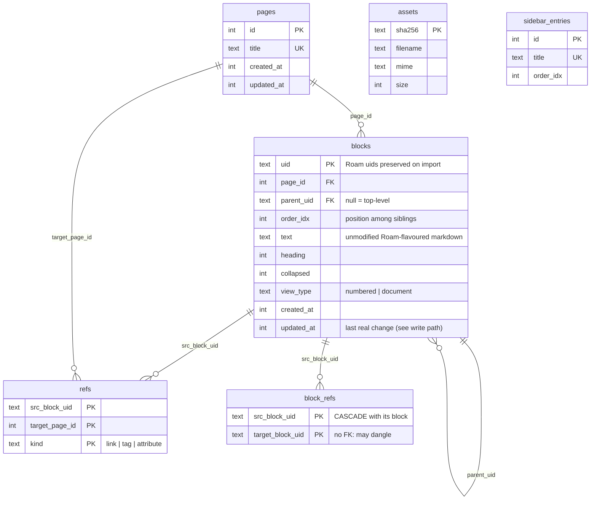

# Backend architecture (server/ + HTTP API)

A Python 3.12+ FastAPI application over a single SQLite file, and the sole
authority for the graph. Block-graph mutations flow through `POST /api/ops`;
other writes use dedicated routes. Refs and full-text indexes are re-derived
in the same transaction, and a trigger-based change journal feeds the sync
protocol. It uses raw `sqlite3` and replayable DDL, with no ORM or migration
framework.

[overview.md](overview.md) has the system picture and the table of sibling
docs; [write-path.md](write-path.md) owns `POST /api/ops` from request to
post-commit nudge. [titles-and-refs.md](titles-and-refs.md) owns the ref
grammar and the title rules, and [request-boundary.md](request-boundary.md)
what a request passes before a route runs: auth, the origin guard, body
caps, deadlines, the login throttle and the hostile-input guards.

## Module map

Everything lives under `server/src/pkm/`. Each runtime file declares its
[FCIS pattern](overview.md#functional-core--imperative-shell) near the top.

```
pkm/
├── contracts/           Core   the wire contract; imports neither the server nor the client
│   ├── ops.py                  op models, OpBatch, UID_RE, text_hash, new_uid, id brands
│   ├── responses.py            response models
│   ├── titles.py               title brands: RawTitle → NormalizedTitle → CanonicalTitle
│   ├── brands.py               brand(): the x-brand schema marker
│   ├── strict.py               StrictModel, the base of every model
│   ├── text.py                 WellFormedModel: lone surrogates become U+FFFD
│   ├── int64.py                Int64, the bound on int path and query parameters
│   ├── tag_chars.py            TAG_WORD_RANGES, the generated tag word class
│   └── daily.py                date <-> "July 8th, 2026" titles
├── database.py          Shell  Db, the typed connection
├── rows.py              Core   Row: one typed key per name a query may return
├── brand_registry.py    Core   brand NAMES, MINT_SITES, COLUMN_KEYS, SHAPES
├── schema.py            Core   BASE_DDL (replicated to clients) + SERVER_DDL
├── refs.py              Core   the ref grammar and title normalisation
├── todo.py              Core   {{TODO}}/{{DONE}} markers, mirrored by grammar/todo.ts
├── rename.py, unlink.py Core   rename and page-delete rewrites of block text
├── planning.py, batch.py, render.py   Core   shared by the CLI, MCP and client
├── *_dump.py            Shell  generated-artifact writers
├── server/                     the FastAPI app (below)
├── client/, cli/, mcp/         PkmClient, `pkm` and `pkm-mcp`
├── assistant/, describe/       embedded assistant; image-description queue
└── importer/, export/, backup/ Roam import, markdown export, nightly backup and restore

server/
├── app.py               Shell  create_app(config): init_db(), routers, 422 handler, SPA
├── db.py                Shell  init_db() at startup, open_db() per request, migrations
├── auth*.py, throttle*.py, origin*.py, http_protocol.py   request gate, throttle, origin guard (request-boundary.md)
├── routes_*.py          Shell  the HTTP surface
├── ops_core.py          Core   judges, skips, contexts, effects; plan_op(), classify_skip
├── replay_core.py       Core   the rewrite replay: walk, steps, budget charges, classify_text_edit
├── ops_hash.py, ops_expect.py, conflict_notes.py   Core   batch hashes, stale `expect` entries, conflict and skip text
├── ops_apply.py         Shell  apply_batch: read context, plan, execute effects
├── store.py             Shell  page create, delete, rename, merge; never commits
├── sync_meta.py         Shell  flag and generation; read_title, title_reader
├── sync_core.py         Core   change-feed windows and hydration order
└── ws.py, notify.py     Shell  WebSocket Hub; post-commit nudges
```

`cli`, `mcp`, `client` and `server` depend on `contracts`, which imports
neither side; `tests/test_client_contracts.py` fails on an import that
crosses back. The assistant and describe routes live outside `pkm/server/`;
`app.py` mounts them.

`pkm/planning.py` plans a write on the CLI, MCP and client side, as ops to
post. The server's planner is `ops_core.plan_op`, which turns one received op
and its context into effects ([Planning](write-path.md#planning)).

## Database

One SQLite file, `pkm.sqlite3`, in the data directory. `init_db()` sets WAL
mode and applies the schema once at startup, never per request (its
docstring says why), and refuses a SQLite older than
`db_core.MIN_SQLITE_VERSION`. Each request gets a fresh `Db` from
`open_db()`, and its `recursive_triggers=ON` makes cascade deletes reach the
journal.

An `IN (...)` list built from a set the data can grow without bound, such as
a page's block uids, goes through `sync_core.chunk_ids`. SQLite refuses a
statement that binds more variables than its limit, and the route would
answer 500. The offline shim (`replica/localApi/`) binds such a set whole as
one JSON array (`json_each`) instead.

### Schema

`schema.py` holds two DDL blocks. `BASE_DDL` is the data model, replicated
verbatim to browser clients through `baseSchema.gen.ts`. `SERVER_DDL` holds
the sync machinery and never leaves the server.



Block text is the only durable data: `refs`, `block_refs` and the FTS5
tables are rebuilt from it. `blocks_fts` and `pages_fts` are external-content
tables kept in step by triggers. `blocks_fts` is keyed by implicit rowid, so
`VACUUM` would break it.

| Server-only table | Holds | Written by |
|---|---|---|
| `changes` | The append-only journal: `seq`, `kind`, `entity_id`, `deleted`, `page_id` | Triggers on `blocks`, `pages` and `sidebar_entries`, so a new write path is journalled automatically; also `JournalBlock` ([Missing targets](write-path.md#missing-targets)) |
| `applied_batches` | Each batch's request hash and stored ack | `post_ops` |
| `block_rewrites` | What a rename, merge, title migration or page delete did to one block's text, replayed over a stale edit ([Conflicts](write-path.md#conflicts)); `schema.py` says what each `kind` stores, and [contracts/backend.md](contracts/backend.md#database) the rows each write leaves. Pruned after `BLOCK_REWRITE_RETENTION_MS` | `store.insert_block_rewrites` only, which the store's rewrites and a planned `RecordRewrite` effect both call |
| `page_deletions` | Each user-deleted page's title and the journal head after it ([Stale batches](write-path.md#stale-batches)). Pruned on the same window | `store.delete_page_unlinking` only |
| `conflict_headers` | Today's conflict header per block; a new header deletes other days' rows | `ops_apply._execute` |
| `sync_meta` | `db_generation` (a rebuilt or restored database gets a new one and clients rebootstrap) and the `plain_space_title_canonicalization` flag | startup, title migration apply, `pkm.backup.restore` |

`changes.page_id` is set only on a block tombstone and never shipped;
`schema.py` says why it has no index.

### Schema migrations and legacy data

New tables and indexes are replayable `IF NOT EXISTS` statements. New columns
are guarded `PRAGMA` checks in `db._ensure_schema_migrations`, and
`init_db()` runs the one-time backfills (`db._backfill_*`). Replicas
rebootstrap on a schema-hash change. Startup never runs the
[title migration](titles-and-refs.md#title-integrity-and-one-time-activation).

Shapes a read can still meet:

| Legacy shape | Handled by |
|---|---|
| `blocks.heading` 0, Roam's "no heading", from older imports | `Row.heading` is `StoredHeadingLevel`, so the row check admits it; `rows.heading_level` and `StoredHeading` read it as `None`, so the wire never carries it. A SQL `NULLIF` would cost VM steps on every block row |
| a journal without `changes.page_id` | `db._ensure_changes_page_id`; old rows stay NULL |
| `block_rewrites` rows without `kind` | the column default, `retitle` |
| `applied_batches` rows holding the strict `batch_request_hash` | `post_ops` accepts either that or `batch_replay_hash` |
| acks stored before `seq` or `skipped` | replayed through `OpsAck` as `seq: null` (unknown) and `skipped: []` |
| asset links with an unencoded filename | `/assets/{sha256}/{filename}` ignores the name segment |

### Breadcrumbs and recursive traversal

`routes_pages.py::_fetch_ancestors` builds the breadcrumb trail behind
`GET /api/block/{uid}` and every backlink group. Its recursive CTE holds
`uid` alone and joins with `UNION`, so each distinct ancestor is read once
and a parent cycle ends the walk; `tree.ancestor_trails` rebuilds the
trails. **The ancestor walk must not carry a per-row path string.** One row
per start and ancestor, each copying an `O(depth)` string, makes the
backlinks of a deep chain cost `O(depth³)`.

A backlinks payload sends each ancestor's full text once, because the web
shows it and the linked-references filter reads its refs. Each
`BacklinkGroup` lists the texts in `ancestor_texts`, and each item names its
trail as positions in that list (`ancestors`). `groups.showBacklinkGroups`
resolves a batch to texts on arrival, since
positions mean nothing outside their group. `GET /api/block/{uid}` has one
trail and keeps it as texts in `breadcrumbs`.

The single-chain walks stop a cycle with a path string, spelled once in
`ops_apply._unvisited`. Each walk has a replica mirror; change a pair
together. None caps depth, so a chain deeper than `MAX_OUTLINE_DEPTH` from
before the cap reads whole.

| Walk | Server | Replica mirror | Cycle guard |
|---|---|---|---|
| Ancestors with text, for breadcrumbs and backlink groups | `routes_pages._fetch_ancestors` | `localApi/tree.ts::fetchAncestors` | `UNION` |
| One block's parent chain, for a move's cycle check and the assistant card's ancestors | `ops_apply.parent_chain` | `localOps.ts::parentChain` | path string |
| One block's subtree, deepest first, for delete, re-paging and journalling | `ops_apply._subtree_deepest_first` | `localOps.ts::subtreeUids` | path string |

## Typed boundaries

### Typed database access

Feature code holds a `Db` (`pkm/database.py`), never a `sqlite3.Connection`.
`select` and `select_one` return `Row` dicts; `execute` and `executemany`
take writes only and return `WriteResult`. `table_columns`, `trigger_sql` and
`backup_to` bypass the row check. `raw` exists for tests and tooling, and the
`raw-sqlite` lint rule rejects it elsewhere.

`Row` (`pkm/rows.py`) is a `TypedDict` with one key per name a query may
return, typed with its brand (`uid: BlockUid`) or `Literal` domain. A key
keeps one meaning and one nullability everywhere, so a column that differs
from the key of its name is read under an alias: `pages.id` as `page_id`, a
computed value under the query's own (`COUNT(*) AS n`).
`brand_registry.COLUMN_KEYS` is the list of aliases. With `PKM_ROW_CHECK=1`
([row check](checks.md)), `select` checks each row with `row_problems`. Fix
a `RowCheckError` in the query (alias, `COALESCE`) or the data, never by
loosening `row_problems`. A key admits every value its column stores,
[legacy ones](#schema-migrations-and-legacy-data) included. Handlers copy
`Row` keys into a response model; a `Row` is never sent.

### Wire models and brands

Every JSON handler returns a model from `contracts/responses.py`, and
`test_routes_models` rejects a bare `dict`. The web's types are generated
from these models, and `PkmClient` validates every response against them.

- **Closed sets** are `Literal`s, not `str`/`int`. They reach OpenAPI as an
  `enum`, and `pnpm gen-types` makes each a TS union.
- **Brands.** `brand()` (`contracts/brands.py`, whose docstring says how to
  call it) tags a `NewType` with an `x-brand` schema marker, which gen-types
  turns into the web brand of the same name
  ([frontend.md § Brands](frontend.md#brands)).
- **Strict models.** Every model inherits `StrictModel`, so pyrefly checks
  constructor arguments, brands included. Outside the checker: input
  decoded by `model_validate` at runtime, the perf fixture's
  `TypeAdapter(BlockOp)`, FastAPI form bodies and the MCP library's argument
  models.

The [brand lint](checks.md#brand-rules) enforces both;
`brand_registry.MINT_SITES` lists where each brand may be minted.
A path parameter whose brand has a parser comes from its dependency in
`path_params.py`, so a handler only receives the checked brand.

`grep 'brand('` lists the brands. Those whose name does not explain them:

- `SidebarEntryId` is `sidebar_entries.id`, its own key, never a `PageId`.
- `OrderIdx` is a sparse sibling key, not a position. `SidebarOrderIdx` is
  separate because the web reorders the sidebar by array position and must
  never meet block order code.
- The title brands are a chain, `RawTitle` → `NormalizedTitle` →
  `CanonicalTitle`, whose levels the `contracts/titles.py` docstring
  defines; `as_raw_title` is the general `RawTitle` mint.

`canonicalize_title` returns only a `NormalizedTitle`, since its
`plain_space` is the caller's, not the live flag. A `CanonicalTitle` comes
from `sync_meta.read_title` / `title_reader` (the live flag),
`refs.target_canonical_title` (the title migration's post-activation plan)
or `refs.canonical_daily_title` (canonical under either flag). The title
lookups (`store.fetch_page`, the rename, merge and sidebar helpers,
`query.py`'s `plan_sql`, the migration inventory) take `CanonicalTitle`, so
pyrefly flags a title that skipped a mint. It cannot see an `Any` value or
raw SQL.

## HTTP API reference

`routes_*.py` and the generated `web/src/api/openapi.json` are authoritative,
and route docstrings carry the detail. Every endpoint needs the session
cookie unless marked public. FastAPI's `/docs` and `/redoc` are off.

| Method | Path | Purpose |
|---|---|---|
| POST | `/api/login` *(public)* | Password → session cookie ([Auth](request-boundary.md#auth)) |
| GET | `/login` *(public)* | HTML login form |
| GET | `/healthz` *(public)* | Liveness check; answers `{"ok": true}` and nothing else |
| GET | `/{path}` *(public)* | SPA fallback; hashed bundles under `/app-assets/` |
| GET | `/api/openapi.json` | Live OpenAPI schema |
| **Writes** | | |
| POST | `/api/ops` | Apply an `OpBatch` ([The write path](write-path.md)); `applied` counts skipped ops too |
| **Pages & blocks** | | |
| GET | `/api/page/{title}?bl_offset&bl_limit` | Page tree, paginated backlinks (not from the page itself) with [`ancestor_texts`](#breadcrumbs-and-recursive-traversal) per group, `block_ref_counts`; daily pages auto-created |
| GET | `/api/block/{uid}` | One block subtree with its page and [breadcrumbs](#breadcrumbs-and-recursive-traversal) |
| GET | `/api/block/{uid}/backlinks` | Blocks referencing `((uid))`, unpaginated, with [`ancestor_texts`](#breadcrumbs-and-recursive-traversal) per group |
| GET | `/api/block-refs?uids=` | Resolve `((uid))` references |
| POST | `/api/pages` | Idempotent page create; 422 for a blank, refused or over-long title |
| DELETE | `/api/page/{title}` | Delete a page, unlinking inbound refs; 409 with `blockers` ([Page mutations](write-path.md#page-mutations-and-the-sidebar)) |
| GET | `/api/delete-preview?title=` | What a delete would rewrite or be refused for, a `limit` blocker included |
| POST | `/api/page/{title}/rename` | Rename and rewrite refs; 409 on collision unless `allow_merge`; 422 for a [refused](titles-and-refs.md#refused-titles) title |
| GET | `/api/unlinked?title&limit&offset` | Unlinked mentions, not from the page itself |
| GET | `/api/journal?before&days` | Daily-notes feed |
| POST | `/api/journal/cleanup` | Prune empty, unreferenced daily pages from the week before today |
| GET | `/api/current-work` | Recently edited pages, bucketed by age |
| **Migrations** | | |
| GET | `/api/migrations/title-canonicalization` | Side-effect-free audit and digest: `groups`, `blockers`, `sidebar_retitles` ([Title integrity](titles-and-refs.md#title-integrity-and-one-time-activation)) |
| POST | `/api/migrations/title-canonicalization` | Apply the audited digest, returning counts such as `sidebars_retitled` |
| **Search & queries** | | |
| GET | `/api/search?q&limit&exact` | FTS5 search over pages and blocks; `exact` drops the prefix match on the last term |
| GET | `/api/query?expr&expand` | `{{[[query]]}}` evaluation; `expand` adds one hop through pages that reference the operand; 400 past `query.MAX_QUERY_DEPTH` nesting or `MAX_QUERY_OPERANDS` page operands |
| GET | `/api/titles?q&limit` | Title completion for `[[` and `#` |
| GET | `/api/todos?page` | `{{TODO}}` blocks grouped by page |
| GET | `/api/changed?since&until&page&limit` | Blocks changed in `[since, until)`, each `new` or `edited`; 400 on an empty window |
| **Sidebar** | | |
| GET / POST / PUT / DELETE | `/api/sidebar`… | List, pin, reorder (a permutation), unpin; a pin of a refused or over-long title is a 422 |
| **Sync** ([sync-and-offline.md](sync-and-offline.md)) | | |
| GET | `/api/sync/snapshot?pending` | Full bootstrap with `seq`, `generation`, the title flag and `applied_batches`; gzip when the client accepts it |
| GET | `/api/sync/changes?since&limit&pending` | Windowed incremental feed with the same metadata; gzip when the client accepts it |
| POST | `/api/client/diagnostics` | A replica's self-report before a rebuild, logged as one `pkm.sync` warning cut at `_MAX_DIAGNOSTICS_LOG_CHARS` |
| WS | `/api/ws` | [Post-commit nudges](write-path.md#post-commit-nudges) and op echoes |
| **Assistant** ([assistant.md](assistant.md)) | | |
| GET | `/api/assistant/models` | Models on offer and the default |
| POST | `/api/assistant/conversations` | Create; 400 for a model not offered, 409 over the cap |
| POST | `/api/assistant/conversations/{id}` | Beacon close (`navigator.sendBeacon`) |
| POST | `/api/assistant/conversations/{id}/messages` | One turn → SSE stream; 409 while a turn runs |
| POST | `/api/assistant/conversations/{id}/confirm` | Answer a write confirmation |
| POST | `/api/assistant/conversations/{id}/stop` | Stop the reserved turn, started or not; its stream ends with `turn_stopped` |
| DELETE | `/api/assistant/conversations/{id}` | Close the conversation |
| **Assets** ([files-and-assets.md](files-and-assets.md)) | | |
| POST | `/api/assets` | Multipart upload, capped by `max_upload_bytes` ([Auth](request-boundary.md#auth)) |
| GET | `/assets/{sha256}/{filename}` | Serve by digest; the name segment is ignored |
| GET | `/api/assets/describe-status` | Whether image descriptions are on, and why not |
| POST | `/api/assets/scan?force` | Enqueue undescribed images |
| GET | `/api/assets/search?q&limit&offset&type&from_ms&to_ms&linked` | Search behind `/files` |
| DELETE | `/api/assets/{sha256}` | Delete, stripping its tokens; `if_unreferenced=true` 409s instead while referenced |
| POST | `/api/assets/export.zip` | Zip the assets named by the form field `sha256s`; unknown shas are skipped |
| **Local documents** ([files-and-assets.md](files-and-assets.md#local-documents)) | | |
| GET | `/api/local-check` | Classify every `/api/local/` href in block text |
| GET | `/api/local-index` | Every visible file under `local_docs_root`; 503 when the listing fails |
| GET | `/api/local/{path}` | Serve one file; 404 outside the root, 503 when evicted or unopenable |
| **GoodLinks copies** ([files-and-assets.md](files-and-assets.md#goodlinks-copies)) | | |
| POST | `/api/goodlinks/resolve` | Resolve a URL to a link, saving it with `save` |
| GET | `/api/goodlinks/check` | Classify every `/api/goodlinks/` href |
| GET | `/api/goodlinks/{link_id}` | Metadata and sanitised reader HTML; 503 when GoodLinks is down |
| **Export** ([import-export-and-backup.md](import-export-and-backup.md)) | | |
| GET | `/api/export/page/{title}` | One page as markdown ([Single-page export](import-export-and-backup.md#single-page-export)) |
| GET | `/api/export.zip` | Whole-graph markdown export |

The sync snapshot and changes routes encode their own body
(`_encoded_json`, `http_encoding.py`) rather than through a middleware, which
would compress on the event loop and reach every route. The routes stay
`def`, so the render and the gzip run in the thread pool after `read_txn` has
closed: neither the event loop nor a read snapshot waits on them. **A response
that carries a credential never goes through `encode_body`**, because a
compressed length shows how well a secret compresses beside text an attacker
chose ([SECURITY.md](../SECURITY.md#known-limitations)).

## Generated artifacts and parity fixtures

These are generated or hand-kept and checked in, and the test suites fail
when one is stale. Regenerate and commit with the change that invalidates
them. `uv run python -m pkm.regen` (from `server/`) rewrites every generated
row below, in the order its `STEPS` table holds, and stops at the first
failing step. Add a new dump to that table; `test_regen.py` enforces it.

| Artifact | Test that fails when stale | Pins |
|---|---|---|
| `web/src/api/openapi.json`, `types.d.ts` | `test_openapi_sync.py`, `genTypes.drift.test.ts` | the web's API types to the response models |
| `web/src/replica/baseSchema.gen.ts` | `test_schema_artifact.py` | the replica schema to `BASE_DDL` |
| `web/src/replica/columns.gen.ts`, `web/tooling/brandRegistry.gen.json` | `test_rows_artifact.py` | `Columns`, `COLUMN_META` and the web lint's registry to `rows.Row` and `brand_registry` |
| `web/src/assistant/previewKeys.gen.ts` (`wire_dump preview-keys`) | `test_assistant_wire_artifact.py` | the approval card's allow-list (`PREVIEW_KEYS`) to `WRITE_PREVIEW_FIELDS`, `CURRENT_TEXT_ENTRIES` and `SUBTREE_DELETE_ENTRIES`, `CURRENT_EXCERPT_CHARS`, and `PREVIEW_FIELDS` to `WritePreview`'s fields |
| `web/src/assistant/events.gen.ts` (`wire_dump events`) | `test_assistant_wire_artifact.py` | the web's `AssistantEvent` union and `EVENT_TYPES` to `events.py`'s dataclasses and `EVENT_NAMES` |
| `server/src/pkm/contracts/tag_chars.py` (not a `pkm.regen` step) | `test_tag_chars_artifact.py`, only under the Unicode version it froze | `TAG_WORD_RANGES` to the running CPython's `\w` |
| `web/src/grammar/tagChars.gen.ts` | `test_tag_chars_artifact.py` | the web's tag class (`TAG_WORD_CLASS`) to `TAG_WORD_RANGES` |
| `web/src/grammar/titleWhitespace.gen.ts` | `test_title_whitespace_artifact.py` | the web's fold set to `TITLE_WHITESPACE` |
| `shared/fixtures/refs_parity.json` | `test_refs_parity_fixture.py` | `refs.extract` |
| `shared/fixtures/title_parity.json` | `test_title_parity_fixture.py` | `normalize_title`, `target_canonical_title`, `title_syntax_reason`, `is_blank_title`, `extract` |
| `shared/fixtures/text_limits_parity.json` | `test_text_limits_parity_fixture.py` | `text_limit_violation`, `link_nesting_depth`, `describe_text_limit`, `MAX_BLOCK_TEXT_CHARS`, `MAX_LINK_NESTING` |
| `shared/fixtures/mime_parity.json` | `test_mime_parity_fixture.py`; `filesCore.test.ts` replays it | `assets_core.mime_category` over every `MIME_POLICY` type, to the web Files view's `mimeCategory` and its own `DOCUMENT_MIME` list |
| `shared/fixtures/shim_parity.json` | `test_shim_parity_fixture.py` | the offline shim (`replica/localApi/`) to the read routes' JSON |
| `shared/fixtures/text_hash_parity.json` | `textHashParity.test.ts` | `text_hash`, `subtree_hash`, `well_formed` |
| `shared/fixtures/local_links_parity.json` | `localLinksParity.test.ts` | `local_docs.extract_local_hrefs` |
| `shared/fixtures/upload_links_parity.json` | `assetsParity.test.ts` | `assets_core.strip_asset_tokens` |

`pkm.regen` writes the last three by running vitest with
`UPDATE_TEXT_HASH_FIXTURE=1`, `UPDATE_LOCAL_LINKS_FIXTURE=1` and
`UPDATE_UPLOAD_LINKS_FIXTURE=1`. `tag_chars.py` moves to a new Unicode version
only through
`uv run python -m pkm.tag_chars_dump --table > src/pkm/contracts/tag_chars.py`.

The other fixtures in `shared/fixtures/` (`ref_grammar.json`,
`op_hashes.json` and the rest) are hand-edited, and `git grep <name>.json`
finds every test that reads one. `op_hashes.json` is never regenerated,
because a pin that moved would bless the break. It pins
`batch_request_hash` and `batch_replay_hash` for every op kind, and which
fields each leaves out (`HASHED_FIELDS`, `DROPPED_WHEN_UNSET`,
`REPLAY_EXCLUDED`). The seeded parity corpora are tallied by shape
(`parity_corpus.shape_tally`), so they cannot go vacuous.

## Configuration and entrypoints

`config.json` lives in the data directory, never in git;
`python -m pkm.server.setup` writes it mode 0600. `Config` (`config.py`)
holds every key with its default and a comment, and `load_config` passes
only the keys the file sets. The file's `db_file` key loads as
`Config.db_path`. Path keys, key-file defaults included, resolve relative to
`config.json`'s directory, so the data directory moves as a unit.

Each `*_api_key_file` (OpenAI, z.ai, GoodLinks) wins over its environment
variable and defaults to one level above the data directory, outside
anything servable or exportable. With neither a GoodLinks key file nor
`GOODLINKS_API_KEY`, every GoodLinks route but `check` 404s.
`serve_origins` feeds the origin guard ([Auth](request-boundary.md#auth)).

`python -m pkm.server.run` serves its `--port` on `bind_hosts`, or on its
`--host` flags, which replace `bind_hosts` for the origin guard too. launchd
runs it through `$PKM_HOME/bin/pkm-server`, which stays the Python process's
parent, so macOS attributes file-access consent to a binary that does not
change ([the launcher](../../deploy/README.md#the-launcher)).
`create_app()` always runs `init_db()`, so every entrypoint works on a new
data directory.

## Logging and observability

There is no metrics stack, so the logs are the record of what a slow server
was doing. `logfmt.uvicorn_log_config()` routes each logger to a handler.

| Logger | Handler | Line |
|---|---|---|
| `pkm.access` | access | One `logfmt.request_line` per request from `RequestLogMiddleware`, after the body is sent |
| `pkm` and every `pkm.*` child | default, INFO | children inherit by propagation |
| uvicorn | default | lifecycle and errors; its own access log is off |

      <client> "GET /api/page/Foo?bl_limit=20" 200 4ms

Attacker-chosen text (a path, an upload's filename, an error text) is
escaped at the handler, not per call site, so no text a request carries can
forge a log line. `request_line` escapes its fields with
`logfmt.escape_controls`; the default handler's `logfmt.EscapePkmMessages`
escapes every `pkm.*` message; and `logfmt.EscapingFormatter` escapes and
indents every traceback. uvicorn's own lines are the exception: h11 admits
only visible ASCII in a request target, but a quote in a websocket path
reaches `server.log` raw.

With `run.py --log-dir` (production) the handlers write `server.log` and
`access.log`; without it, stderr and stdout. The server rotates its own
files at midnight (`TimedRotatingFileHandler`), because launchd holds its
`StandardOutPath` descriptors open and an outside rename would leave the job
writing to the renamed file. Nothing configures the root logger, so
`test_every_declared_pkm_logger_has_an_effective_info_handler` checks that
every `pkm.*` logger reaches a handler.

## Testing

- `cd server && uv run pytest -q` runs the suite with branch coverage
  enforced. [checks.md](checks.md) says what each gate checks and what
  fails, including the [comment lint](checks.md#comment-and-regex-lint).
- A path with a literal `%` goes through `asgi_get_all` or `single_decode_get`,
  not `TestClient`, which decodes the path twice: a file named `%41` would be
  served as `A`. uvicorn and `httpx.ASGITransport` decode once.
- `server/tooling/` holds the gate engines: `perfcheck`
  ([Performance gate](checks.md#performance-gate)), `proptest`
  ([Property gate](checks.md#property-gate)), `brandlint`, `regexlint` and
  `commentlint`.
