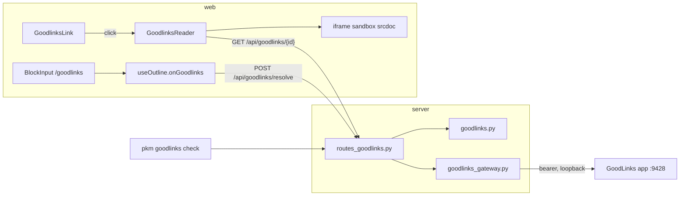

# Files and assets

A block can link to a file in three places. Each is an ordinary markdown link
whose href the app recognises, served through the server so other devices
reach it over the tailnet.

| Surface | Href | Lives in | Server code |
|---|---|---|---|
| [Assets](#assets-and-the-file-browser) | `/assets/<sha256>/<name>` | the content-addressed store under `assets_dir` | `assets_core.py`, `routes_assets.py` |
| [Local documents](#local-documents) | `/api/local/<path>` | a host folder, `local_docs_root`, usually in iCloud Drive | `local_docs.py`, `routes_local.py` |
| [GoodLinks copies](#goodlinks-copies) | `/api/goodlinks/<32-hex id>` | the GoodLinks read-later app on the host | `goodlinks.py`, `routes_goodlinks.py`, `goodlinks_gateway.py` |

Uploaded images also get [LLM captions](#image-descriptions) that make their
content searchable. The routes are in
[backend.md](backend.md#http-api-reference) and the config keys in
[backend.md § Configuration](backend.md#configuration-and-entrypoints).
Operator setup is in [deploy/README.md](../../deploy/README.md). Failures are
indexed by symptom in [troubleshooting.md](../troubleshooting.md).

## Assets and the file browser

Uploads stream in chunks (`_CHUNK_SIZE`) with a running size cap (413 over
`max_upload_bytes`), MIME-sniffed from the first chunk (`mime_sniff.py`).
Files are stored at `<assets_dir>/<sha256[:2]>/<sha256>` and deduplicated by
digest; the `assets` row keeps the display filename, MIME and size. Raster
images and PDFs serve inline (`INLINE_MIME`). Everything else downloads with
`nosniff`, including SVG, which can script.

An asset digest is `Sha256Hex` (`contracts/ops.py`), not a plain string.
`routes_assets.py` checks every sha256 path parameter against `SHA256_HEX_RE`
before minting one, and `assets_core.py` mints from `hashlib`. On the web the
only mint point is the `/assets/<sha>/<name>` autolink rule in
`grammar/tokenize.ts`. Anything its capture group rejects renders as plain text
or a generic link.

The upload response's `existing` says whether the row was already there (a
dedup hit). The CLI's upload compensation keys on it
([cli-and-mcp.md](cli-and-mcp.md#shared-write-workflows)).

**Search** behind `/files` is `LIKE` over `description` and `filename`, not
FTS: the table is personal-scale and has no offline-parity burden. The
`linked`/`orphan` filters need refs for every candidate, so they scan the
whole filtered set.

**Delete** has two modes.

| Mode | Referenced asset | Unreferenced asset |
|---|---|---|
| `DELETE /api/assets/{sha256}` (`/files`) | its tokens are stripped from block text, then the row and file go | row and file go |
| `?if_unreferenced=true` (undoing an upload, `sync/assetRelease.ts`) | 409, nothing changes | row and file go |

The stripping rules:

- `strip_asset_tokens` matches markdown links with the web's rule
  (`grammar/markdown.ts`) and removes both URL spellings, the percent-encoded
  one `asset_url` returns and the raw name older uploads wrote.
- Each removed token takes one adjacent space; every other character stays.
- A token between `[` and `[` keeps them apart, so a strip can nest a block
  deeper or past a text limit. A strip that makes a block worse on a limit
  refuses the whole delete before any write: 409 with `blockers` in page
  delete's shape, reason `limit`
  ([backend.md § Page mutations](backend.md#page-mutations-and-the-sidebar)).
  `/files` shows them in `DeleteBlockedDialog`.
- A block left empty and childless is deleted. An emptied parent is kept,
  because asset deletion must never cascade away real content.
- The file is unlinked after the commit, so a crash leaves at worst an
  unreferenced file, never a row pointing at a missing one.
- Every rewritten block is reindexed (`store.reindex_refs_for_text`).
  Asset URLs produce no `refs` rows, but a strip can create a link: a
  token between `[` and `[Foo]]` kept them apart, and once it goes the
  block holds `[[Foo]]`, which links and creates `Foo`.
- An upload of the same bytes that dedups onto the row before its linking
  batch commits is not protected: an `if_unreferenced` delete in between
  removes the file under it. The window is accepted.

**Selected-asset zip** is form-encoded, so a plain `<form method="post">` lets
the browser own the download. Unusable digests are skipped, and colliding
filenames get a sha prefix (`zip_arcnames`). A selection over
`MAX_EXPORT_ASSET_COUNT` or `MAX_EXPORT_TOTAL_BYTES` (summed from the `size`
column) is refused with 413 rather than truncated.

## Image descriptions

An LLM captions each uploaded raster image (`image/png`, `image/jpeg`,
`image/webp`, `image/gif`) with a transcription of its visible text and a
sentence or two of description. The result lands in the `assets` columns
`description`, `described_at` and `describe_error`. Eligibility is MIME-only:
HEIC and SVG are not described, and every GIF is.

| File (`pkm/describe/`) | Pattern | Role |
|---|---|---|
| `core.py` | Core | `describe_action`, the OpenAI payload, `parse_description`, `enabled_reason`, status (`described` / `failed` / `pending`) |
| `service.py` | Shell | `DescribeService`: the queue, the worker, shutdown |
| `openai_client.py` | Shell | `OpenAIDescriber`, one `httpx2` POST per image, no OpenAI SDK |
| `routes.py` | Shell | The status and scan endpoints |

A missing key or `image_descriptions: false` makes every entry point a no-op
(`DescribeService.enabled = False`) rather than failing uploads.
`GET /api/assets/describe-status` and `/settings` show why, via
`enabled_reason`.

Descriptions are searchable only through `GET /api/assets/search`. They are
not in `blocks_fts` or `pages_fts`.

### The queue

`DescribeService` drains an in-memory `asyncio.Queue` with one sequential
worker per process, to stay friendly to rate limits. An `_active` set of queued
and in-flight shas makes `maybe_enqueue` and `scan` idempotent. `_process`
re-reads the row and stops if a description has appeared.

`OpenAIDescriber.describe` turns every answer into a description or a
`DescribeError`, which `_process` stores. Any other exception is only logged,
and the asset stays pending. The queue is not persisted, so
`POST /api/assets/scan` (with `force=true`, failures too) is the recovery path
after a restart or an outage.

The service owns the `ImageDescriber` it is given. Shutdown cancels the worker,
then closes the transport once.

## Local documents

An `/api/local/<path>` href names a file under `local_docs_root`, usually
written as a `Local copy::` attribute. The `/api/local*` routes are
the only ones that read outside the data directory, and `/api/local/{path}`
is the only one that returns file contents.

Every path under `/api/local/` names a file, so the fixed routes
(`/api/local-check`, `/api/local-index`) sit beside the prefix, never under it.
A fixed route under it would shadow the file of the same name, which the index
lists and stored notes link.
`test_nothing_but_the_file_route_sits_in_a_file_namespace` fails on one.

**A path that escapes the root gets the same 404 as a missing file, never a
403.** So a response never confirms what exists outside it. Inside the root
the index, the check and the file route's 503s do report what is there.
`local_docs.clean_relative` rejects an absolute path, a `.` or `..`
segment, a control character or a backslash. `is_within` then re-checks the
resolved path against the resolved root, so a symlink out is a 404 too. The
file route's parameter arrives decoded once through the
[`wholepath` convertor](backend.md#title-integrity-and-one-time-activation).
`/api/local-check` starts from a raw href in block text, so it uses
`resolve_relative`, which unquotes once.

| File state | `/api/local/{path}` | `/api/local-check` |
|---|---|---|
| href fails `resolve_relative` | — | `invalid` |
| outside the root, not a regular file, or absent with no stub | 404 | `missing` |
| an `.icloud` stub beside a missing file (`_is_evicted`) | 503 + `Retry-After`, after a best-effort `brctl download` | `evicted` |
| `SF_DATALESS` set in `st_flags` (`_is_dataless`) | the same; never opened, since opening blocks while it downloads | `evicted` |
| open probe fails or times out | 503 `the host can't open this file` | `unreadable` |
| probe cap full | 503 `too many file opens are in flight on the host; see the server log` | `unchecked` |
| probe succeeds | `FileResponse`, inline for PDF and image extensions, else attachment, `nosniff` | `ok` |

Both routes share the eviction helpers, so they cannot disagree.

### The open probe

`open()` on an iCloud path can block in the kernel while macOS waits on a
consent prompt. On anyio's shared threadpool that would leak a thread per
attempt until every sync route hung. So a file is never handed to
`FileResponse` unprobed. `local_open.OpenProber` runs `os.open` on its own
daemon thread with a timeout, shares one thread among callers asking about the
same path, and caps distinct in-flight probes (`DEFAULT_CAP`). A blocked
`open()` cannot be cancelled, so the cap bounds stuck threads.

The probe and `FileResponse` each open the file. A file that becomes
unopenable between the two still hangs after the 200 headers; that window is
accepted.

### The index

`/api/local-index` feeds the link-to-local-file picker. It never opens a file,
so listing does not download an evicted one. A directory listing can block
too, so `local_index.TreeScanner` walks on a daemon thread, one walk at a time.
An overrun walk or an unreadable directory is a 503
`the host can't read the local documents folder`, never a partial list.

The index lists only names `clean_relative` accepts (`visible_name`), so the
picker never offers a link the file route 404s. An evicted `.Name.ext.icloud`
stub is listed as `Name.ext`. Hrefs come from `local_href`.

### Errors a person sees

A file-route failure is JSON for `fetch()` and pdf.js. A browser navigation
gets a short HTML page with the same status, plus `no-store`, because Safari
would save the JSON as `<name>.pdf.json`. `local_docs.wants_html_error`
decides from `Sec-Fetch-Mode`, `Sec-Fetch-Dest`, or failing both, `Accept`.

## GoodLinks copies

GoodLinks is Arthur's read-later app, and it archives web pages. A block notes
a copy with `Local copy:: [Goodlinks](/api/goodlinks/<32-hex id>)`. The
renderer keys on the href, never the link text, so any link with that href
opens the reader.

### Two barriers for third-party HTML

`GET /api/goodlinks/{link_id}` is the only route that returns third-party HTML
for the app to render in its own frame: GoodLinks' reader-view extraction of a
page. (`/api/local/{path}` serves a host `.html` file only as a download.) Two
independent barriers stand between it and the browser, and neither may be
widened for convenience.

1. The server reduces it with `sanitize_article` (`nh3`) to a tag and
   attribute allowlist. A `"*": set()` entry removes `nh3`'s default generic
   attributes. `url_relative="deny"` drops relative and protocol-relative
   URLs, which would resolve against the app's origin inside a `srcdoc`
   frame; article images and links must be absolute or they disappear. Every
   anchor gets `target="_blank"` and `rel="noopener noreferrer"`.
2. The reader renders it only inside
   `<iframe sandbox="allow-popups allow-popups-to-escape-sandbox" srcdoc>`
   (`goodlinksReaderDoc.ts`). HTML that slipped the allowlist would still run
   no script and could not reach the app's origin or cookies. This is the only
   place third-party HTML reaches the DOM. The app's other
   `dangerouslySetInnerHTML` uses (Mermaid, KaTeX, highlighted code) render
   markup the app generated.

Article images still load from their original hosts, because GoodLinks' API
returns the article with their original URLs even when it keeps its own copy
of them. Opening a copy reveals the reader's IP to those hosts.

### Why a proxy

The browser never holds GoodLinks' bearer token. The server holds it and
forwards through `GoodlinksGateway` to `goodlinks_api_url`, loopback by
default, so the GoodLinks app must be running on the host. GoodLinks itself
listens on every interface ([SECURITY.md](../SECURITY.md#known-limitations)),
so the proxy keeps the token, not the port, off other devices. An unreachable app and a refused token are 503s. A GoodLinks 404 passes
through, and a refused save is a 422 carrying its text.
`GoodlinksUnavailable` covers a closed app and any 2xx that is not a usable
link ([hostile input](backend.md#hostile-input)). A 401 or 403
(`GoodlinksUnauthorized`) gets its own detail,
"Goodlinks rejected the API token". With no API key configured,
`app.state.goodlinks` is `None` and `get_goodlinks` turns every route except
`check` into a 404.

`resolve` tries exact lookups against `candidate_urls` (the URL, without query
and fragment, each with its trailing slash toggled), then one search on
`search_query`. A search counts only when exactly one hit matches
(`search_match`); two hits is a miss, not a guess. Only when all of that
misses, and only with `save: true`, does it save the page, read-marked.
Lookup runs before save so an archived link's read date is never bumped.

### The reader and the /goodlinks command

`GoodlinksReader` is a full-screen overlay that shares `useOverlayDismiss` with
`ImageOverlay`. Escape stops closing it once focus is inside the iframe,
because the frame runs no script and its keydown never reaches the app's
`window` listener. The Close button still works. Fixing Escape would need
`allow-scripts`, which barrier 2 forbids.

The original URL arrives only with the article, so on failure the bar has no
link, and only a note and Close are guaranteed.

`/goodlinks` follows `/upload`'s shape. `BlockInput.pick` records the cursor
offset and blurs the block before any network work. `useOutline.onGoodlinks`
takes the first URL `goodlinksCandidates` finds in the block's own text, then
its parent, then its previous sibling. It resolves with `save: true` and
splices the `Local copy::` link in through `spliceUploadedMarkdown`. Its
notices (`goodlinksNotice`) go to the page-level `.editor-notice` slot.

| Case | Server | Reader | `/goodlinks` |
|---|---|---|---|
| Not configured (no API key) | 404, except `check`: `enabled: false` | "No longer in Goodlinks" | "Not in Goodlinks" |
| GoodLinks app not running | 503 `Goodlinks is not running on the host` | "Goodlinks is not running on the Mac" | "Goodlinks is not running" |
| Token refused (401/403) | 503 `Goodlinks rejected the API token` | that detail | that detail |
| Link no longer in GoodLinks | 404 | "No longer in Goodlinks" | "Not in Goodlinks" |
| Link known, no reader copy (a paywall, a PDF, a fresh save) | 200, empty `html` | "Goodlinks has no reader copy of this page", full bar | — |
| GoodLinks rejects a save | 422 with its text | — | "Goodlinks refused the URL" |
| Resolve misses with `save: false` | 404 `not in Goodlinks` | — | not reachable: the command always saves |
| No response (offline, or the replica has no route) | — | "Needs the server" | "Couldn't reach the server" |
| Anything else | — | "Couldn't load this article." | "Couldn't reach Goodlinks" |

Every reader error keeps Close working. A failed `/goodlinks` splices nothing.

The e2e spec (`web/e2e/goodlinks.spec.ts`) runs against
`server/tests/fake_goodlinks_server.py`, which implements only the endpoints
`goodlinks_gateway.py` calls. Its seeded article holds a `<script>` tag, so the
spec can assert the tag never reaches the page.
