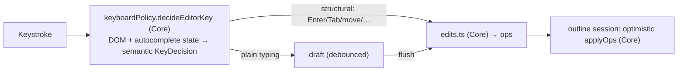

# Frontend: the outline editor (`web/src/outline/`)

This doc covers the outline engine: the per-title sessions that own a block
tree, and the editor that mutates one. [frontend.md](frontend.md) holds the
app shell around it. The cases a block's draft meets sit under the same
section names in [contracts/frontend-editor.md](contracts/frontend-editor.md),
which the draft property model is written from.

## Module map

```
web/src/outline/
├── handlers.ts              —      OutlineHandlers, the command port (types only)
├── useOutline.ts            Shell  Implements OutlineHandlers: drafts, run(), uploads
├── outlineSessions.ts       Shell  Per-title shared sessions and loader election
├── outlineState.ts          Core   transitionOutline, the session reducer
├── draft.ts                 Core   PendingDraft, openDraft, pendingTextOps
├── command.ts               Core   planCommand, planReplay: what useOutline.run and
│                                   the undo dispatch compose, and the property runner too
├── droppedDrafts.ts         Shell  Refused drafts kept for the app-level notice
├── depthCap.ts              Core   MAX_OUTLINE_DEPTH and findDepthViolation
├── parentReadElection.ts,   Shell  Who starts a title's next parent read; the
│   repairEpochs.ts                 post-settlement repair pass
├── useOutlinePageLoad.ts    Shell  The read lifecycle for PageView and sidebar panels
├── loadOutlineBlocks.ts     Shell  The page read behind every loader; applies
│                                   missingPage.ts (Core)
├── tree.ts, orderIdx.ts     Core   applyOps and hidesChildren; order-key arithmetic
├── edits.ts, keyEdits.ts    Core   Structural edit planning; text and caret transforms
├── keyboardPolicy.ts        Core   Keystroke → KeyDecision
├── useBlockDraft.ts         Shell  The focused block's draft, IME, caret, auto-grow
├── autocomplete.ts,         Core   Completion contexts and commands; useAutocomplete.ts
│   slashCommands.ts                holds the popup state
├── history.ts               Core   Undo entries, invertOps, resolveAnchors
├── undoManager.ts           Shell  Undo/redo dispatch, re-keyed and re-stamped at replay
├── baseTextHash.ts          Core   Base hashes on update_text and delete ops
└── the rest                 Core   blockSelection, blockStamps, paste, dnd, fileDrop,
                                    keyboardBar, localFiles, goodlinks …
```

## Per-title outline sessions

`outline/outlineSessions.ts` holds the block tree. A module-level
`Map<title, Session>` external store hands every view of a title one
ref-counted session, sharing a flushed tree and a monotonic revision. One view
holds the **editor lease** and the others render read-only, so the same page in
the main pane and the sidebar cannot double-edit.

A fetched payload carries a `ReadToken` and is adopted only if it is the newest
request, the revision is unchanged, and no relevant write ticket is unsettled.
The pure reducer is `outlineState.ts::transitionOutline`. `repairEpochs.ts`
runs the post-settlement repair
([sync-recovery.md](sync-recovery.md#a-local-write-fails)).

### Driving a session from a view

`outline/useOutlinePageLoad.ts` is the read lifecycle for both single-page
surfaces, `PageView` and `EditableSidebarPanel`. Both wrap their content in
`BlockRefProvider`, which fetches refs typed after load, not the bare
`BlockRefContext.Provider`. `PageView` answers a `resyncGeneration` bump with
`reload("resync")`; the sidebar does not.

The hook keys its session by the page's canonical title, which the main
thread cannot compute. A first read that reports a different
`page.title` re-keys the hook once, onto the session every other surface of
that page uses (the hook's header walks it).

The Journal bypasses the hook. It loads many days in one `/api/journal`
request and delivers each day's blocks through its own capture-ticket path.

### Loader election

A session also starts reads nobody asked for: after a write settles, when a
remote move names a uid the tree lacks, and once per repair epoch. Several
surfaces of one title are usually mounted, so `LOADER_PRECEDENCE` ranks the
loaders they register: the highest kind wins, then the newest registration.
Mount order must not decide which fetch runs.

| Kind | Registered by | Missing-page policy |
|---|---|---|
| `page` | `useOutlinePageLoad` (`PageView`, `EditableSidebarPanel`) | `substituteMissingDaily` |
| `day` | `Journal` | `substituteMissingDay` |
| `editable` | `useOutline` (every `EditablePage`) | `substituteMissingDaily` |

`substituteMissingDaily` (`outline/missingPage.ts`) turns a 404 on a daily
title into an empty editable page, because the server auto-creates only today's
daily and the first edit creates any other. Every other missing page stays an
error.

### Replay

A repair epoch adopts the server's tree and reapplies every write still
unsettled for that title, so each tracked write carries a **replay**: its own
ops, or `OutlineReplayAction` metadata attached through `attachOutlineReplay`.
Drag-and-drop supplies the moved subtree, which no wire op describes. Both
paths that announce a write to a session, `applyLocal` and the delivery
registry, must state the replay, or the write loses its edit at the next
repair.

### Applying ops

Every mutation goes through the pure `applyOps` (`outline/tree.ts`), which
mirrors the server's op semantics, so the same ops drive the screen, the
replica and the server. `order_idx` is a sparse `OrderIdx` sibling key, not a
position. A dense position converts to one only in
`edits.ts::orderIdxAfterPosition`, and in `orderIdx.ts::freshChildOrderIdx`
for a block the same plan created.

`applyOpsWithChange` reports `changed: false` when the result is `blocksEqual`
to the input, and only a changed batch advances `transitionOutline`'s
`revision`. A stamp counts as a change, since `update_text` bumps
`updated_at` whatever the text, as on the server.

`tree.ts::needsAuthoritativeReload` judges each remote move against the tree
the batch's earlier ops leave, so a batch that moves a block off the page and
back reloads.

## The editor

Only the focused block is editable. It is an auto-growing `<textarea>`
holding raw markdown; every other block is rendered HTML (`EditableBlockTree` →
`EditableBlock` → `BlockInput`). There is no `contenteditable`.



From the session on, a write takes the path in
[frontend.md § How reads and writes flow](frontend.md#how-reads-and-writes-flow).

Components hold no block-tree state. `BlockInput` holds one block's draft,
which `outline/useBlockDraft.ts` tracks. It auto-grows the textarea with CSS
`field-sizing: content`. Where that is unsupported, a JS fallback resets the
height, forcing a layout, only when `textareaHeight.ts::mayHaveShrunk` says
the content might be shorter. While `field-sizing` applies no code sets an
inline `height`. So `useBlockDraft.ts`'s
`CSS.supports("field-sizing", "content")` tests the same declaration as the
`@supports` rule on `.block-input` in `styles.css`.

A keystroke batch re-renders every row, so a row's decisions must be
constant-time. `EditableBlockTree` walks `ancestorChain(blocks, focus.uid)`
once and passes `focusChain` down. Only `TocBlock` reads beyond its own node,
through `RootBlocksContext`.

### The `OutlineHandlers` port

Everything the UI can ask the editor to do is the `OutlineHandlers` port in
`outline/handlers.ts`. `useOutline` implements it; `EditableBlockTree`,
`EditableBlock` and `BlockInput` only call it, so the engine never imports
UI code. An eslint ban on `src/outline/**` keeps that true, so a type the
engine needs from a component moves into `outline/`.

### Navigating to a block

Toc entries, block refs and search hits link to `#<uid>`.
`useScrollFlashTarget` scrolls to the target and flashes it, in `PageView` or
scoped to a sidebar panel. `PageView` passes the router's location key, so a
second click on one entry jumps again. Content above the target grows after
the jump as PDF pages and embeds load, so the hook re-centres it until the
reader's first input or `PIN_QUIET_MS` of quiet (its header says how).

A target under a collapsed ancestor has no row. `EditablePage` calls
`useOutline.reveal` (`edits.ts::revealBlock`), one `set_collapsed(false)`
batch with no undo step, once per navigation. Re-running it on a lease change
would re-open a row the reader has collapsed since. A read-only outline
cannot emit the batch, so its hidden target stays hidden.

### Rules an edit must not break

| Rule | What breaks without it |
|---|---|
| A programmatic text change rides the draft or key-edit path | the textarea's draft overwrites it at the next flush |
| A growing text selection escalates to a block selection at the block's edge | it falls through to arrow navigation and drops the selection |
| Every mutating selection branch gates on `!readOnly`; a gated key resolves to `"none"`, left uncancelled | `useOutline`'s handlers do not re-check editability; a cancelled read-only Tab traps focus |
| Authoritative text lands on the tree even for the focused block, while the textarea keeps its draft | the flush overwrites the remote text with no conflict copy ([below](#drafts-and-commit-points)) |
| `/upload` blurs the block (`onBlurBlock`) before clicking the tree-owned file input | the blur would depend on the native dialog, and the asset would not render at once |
| `preventDefault` and `dropEffect` stay synchronous and unconditional in every `dragover` handler (`allowedDepths` never returns empty) | the browser ignores them later, refusing the drop |
| A history replay re-keys creates and moves against the live tree (`resolveAnchors`), or a fresh read when no session exists. `undoManager` runs replays in keypress order and stamps hashes at dispatch; entries hold ops unstamped (`withoutStamps`) | a recorded `order_idx` names a different slot after any intervening edit, and an entry-time hash lands a spurious conflict. The headers of `history.ts` and `undoManager.ts` walk the cases |
| Undo of an upload clears redo (`takeUndo`); after delivery `undoManager` releases its `freshAssets` (`sync/assetRelease.ts`, `if_unreferenced=true`) | a delete before delivery gets a 409; a redo would name a deleted file |
| `setHeading`, `setViewType` and `setCollapsed` emit nothing for the current value | a no-op gesture sends ops; a repeated heading or view type re-dates the block and adds an empty undo step |
| A restored focus lands on a visible block with a clamped caret (`validateOutlineFocus`). One rule, `hidesChildren`, decides what hides, for it, `visibleUids` and the renderer ([contract](contracts/frontend-editor.md#rules-an-edit-must-not-break)) | focus on a block the user cannot see, or thrown out of a table cell the user can; arrows skip visible cell rows |
| A block selection treats a valid Roam table as one row (`selectableUids`, `startSelection`, `selectionText`) | Shift+Arrow spends presses on table cells, and a copied table loses them |
| A selection and an editing focus never coexist: every focus set clears the selection, and each adopted tree drops a selection whose end is gone or hidden (`pruneSelection`) | the tree keeps owning the keyboard for a selection that selects nothing |
| An edit never places a block under a collapsed row; indent, outdent and cross-parent moves expand it first, and `allowedDepths` offers no depth under one | the block vanishes into a closed subtree |
| An offset transform, and a caret the editor places, snaps with `snapCaret` (`keyEdits.ts`) | a slice between surrogate halves stores two U+FFFD |
| `set_collapsed` does not stamp (`opBumpsUpdatedAt`, which `replica/localOps.test.ts` pins for the replica) | collapsing re-dates the block |
| No command queues a batch the server would refuse. Every path that queues (`run()`, `undoManager`'s dispatch, a cross-page drop) asks `editRefusal` (below), and a refusal stops the whole command | the server refuses the batch whole, and the offline queue's [rebase](sync-recovery.md#a-batch-the-server-rejects) drops its other ops with it |

`editRefusal` (`outline/editRefusal.ts`) refuses a batch that would:

- place a subtree past `MAX_OUTLINE_DEPTH` in the tree the ops leave
  (`depthCap.ts`);
- hold a text past a [text limit](write-path.md#work-bounds-under-the-write-lock);
- hold a ref (link, tag or attribute) to a
  [refused title](titles-and-refs.md#refused-titles);
- exceed `MAX_OPS_PER_BATCH` or the body cap (`findBatchSizeViolation`).

`useBlockDraft.admit` also judges a draft's text limit and refs as it is typed
or pasted, and `run()` judges a saved draft's refs again (`draftRefusal`).
Every ref a text holds is judged, so a block already holding a refused one
refuses edits that keep it.

A refusal shows in the outline's one `edit` notice (`outline/notices.ts`
says what clears it). A refused keystroke leaves the textarea as it was, with
the caret where the refused insertion began (`refusedEditCaret`). The draft
still ships, unless its own titles are refused
([refused drafts](#refused-drafts)). A refused undo or redo keeps its entry
for a retry (`restoreEntry`). An undo for an unmounted page whose read fails,
and a cross-page drop, reach `editRefusal` with no tree, so the server judges
their depth.

### Drafts and commit points

Plain typing debounces into a draft, which every commit point flushes
([contract](contracts/frontend-editor.md#drafts-and-commit-points)). A draft
is held inside a half-typed `[[ref` or `#tag`, so autosave cannot create a
page from a partial title.

**A draft's `base` is the text the textarea showed, and a flush hashes `base`,
never the tree.** A `PendingDraft` (`outline/draft.ts`) is
`{ uid, text, base }`. A remote batch can reach the tree before the textarea
adopts it, and a dirty textarea never adopts it. Hashing `base` lets the
server keep both texts when another device edited from the same base.

The pending draft is the only record of a dirty textarea. `useBlockDraft`
asks `handlers.pendingDraft(uid)` and keeps no flag of its own, so a draft a
command flushed cannot leave the textarea dirty over the text the command
spliced in. When it adopts the tree's text is a row in the
[contract](contracts/frontend-editor.md#drafts-and-commit-points).
`handlers.subscribeDraftEnd` tells it when a draft ends, because a flush
that sends nothing leaves the tree's text unchanged and gives it no other
cue.

#### Refused drafts

`admit` leaves out the title the caret is in (`heldCaret`). The user is still
typing it, and a title the server accepts can pass through one it refuses
(`[[a [b] c]]` passes through `[[a []]]`). `run()` judges the whole draft's
refs when it saves it, so no path ships an unjudged text. A draft it refuses
is never sent. It stays on screen to be fixed while its block can show it:

| With a refused draft on a shown block | What happens |
|---|---|
| A flush (debounce, blur, tab hide) | nothing is sent; the draft stays pending, its textarea dirty, and the notice shows |
| Another block's first edit | `onDraftStart` returns false and `useBlockDraft` drops the edit |
| A command, or a cross-page drop (`OutlineDndApi.flushDraft`) | refused whole |
| Undo or redo | refused in the textarea, leaving the draft open. From another outline's textarea, `performUndo` does nothing and that outline shows `HISTORY_BLOCKED_NOTICE`, since the draft's own notice may be out of view. With no textarea focused (`UndoRedoKeys`), only the draft's own notice shows |
| Focus leaving the block (click, arrow, blur, block selection) | refused, so the textarea stays mounted and shows the draft |
| `Ctrl-O` / `Ctrl-Shift-O` (`onFlushDraft` returns false) | no page is created and nothing opens |
| A reload or closing the tab | `droppedDrafts.ts`'s `beforeunload` listener asks first, where the browser shows that prompt |

When its block can no longer show it (`droppedDrafts.ts` lists when),
`releaseUnshownDraft` and the unmount flush hand the draft to
`droppedDrafts.ts`. Its list feeds `DroppedDraftNotice`, which outlives the
outline. The command or focus change that met the draft then goes ahead. A
refused draft is lost only when the tab is killed or reloaded. Desktop asks
before a reload; iPad Safari does not.

#### When a draft flushes

When a draft opens, flushes and yields to the tree's text, and what
`pendingTextOps` sends for it, are rows in the
[contract](contracts/frontend-editor.md#when-a-draft-flushes).

A held draft has no armed timer, and React delivers no blur for a node it
removes. So `useOutline` flushes on unmount, for navigation the editor never
sees (the `Ctrl-Shift-D` chord, back/forward). That flush is a layout cleanup
declared before the session effect's. So another surface of the page (a
sidebar panel) takes the editor lease already showing the last edit.
`ensureRefPageThenOpen` (`Ctrl-O` over a `[[ref]]`) flushes before
`POST /api/pages`. The `visibilitychange` flush covers tab hide and reload.

### Keyboard policy

`decideEditorKey` (a focused textarea) and `decideSelectionKey` (a
multi-block selection, keyed by the tree container) decide every key. The
shell (`EditableBlockTree.onKeyDown`, `BlockInput`) executes the decision and
owns every DOM effect. The block menu, ref popover and local-file picker are
portalled out of the tree's DOM but not its React tree, so their keys bubble
to `EditableBlockTree.onKeyDown`. It returns early for a target outside its
own DOM; without that check, Tab or Backspace in the menu would indent or
delete the selection.

New shortcuts go into one of the two functions, and Cmd-letter wraps into
`META_WRAP_EDITS`, never into ad-hoc handlers. [keyboard.md](../keyboard.md)
owns the list, and a new key must not collide with an app-global chord.

A keydown the IME owns decides `none`, whatever the key, so committing a
conversion with Enter never splits. `useBlockDraft.imeOwns` answers for it
([contract](contracts/frontend-editor.md#keyboard-policy)).
`useBlockDraft.ts` says why keyCode 229 alone is not enough, and why the
window is read on `imeClock`, never an event's `timeStamp`.

`KeyboardBar` feeds each key to `decideEditorKey` as the key it names. When the
policy answers `none` for a character, `insertTypedChar` types it, since no
native keystroke follows. The bar's platform rules are in
[frontend.md](frontend.md#ios-and-phone-behaviour).

### Autocomplete

`outline/autocomplete.ts` detects contexts; `useAutocomplete.ts` holds the
popup. `keyboardPolicy.autocompleteKeyAction` lets the popup claim only
unmodified Arrow, Enter, Tab and Escape.

No action uses a remembered caret, because clicks and caret moves fire no input
event. Every action re-derives the context through `resolve(textarea)` from
`selectionEnd`, and a pick places its caret in a layout effect of the commit
that sets the value (`useBlockDraft.replace`), never a
`requestAnimationFrame` (`useAutocomplete.ts` says why each).

A read-only outline hides the popup, and the policy is told it is closed,
since a pick edits the block. The highlight is clamped to the rows shown:
title rows can shrink under it when a slower fetch for the query lands, with
no edit to reset it.

### Paste

Plain Cmd-V is native, unless its result would be past a text limit:
`BlockInput` judges it first and prevents it. `Shift-Cmd-V` arms an outline
paste, which `paste.ts` plans as one batch, comparing indent widths
ordinally so 2-space, 4-space and tab clipboards all work. `ClipboardEvent`
carries no modifiers, so the chord is recorded on keydown without
`preventDefault`, and the next `paste` consumes it.

### Slash commands

[keyboard.md](../keyboard.md#slash-commands) lists them, and
`help/slashCommandsDocumented.test.ts` fails on an undocumented one.
`/upload`, `/goodlinks`
([files-and-assets.md](files-and-assets.md#goodlinks-copies)) and
`/link-local-file` give up the block before their picker opens.
`LocalFilePicker` is a cached `import()` chunk, which keeps fzf out of the
entry.

### The bullet and the block menu

The `.bullet` span is the block menu's only keyboard route (a focusable
`role="button"`). Removing its tab stop removes keyboard access to Copy
block reference and the view modes
([styling.md](styling.md#focus-and-interactive-affordances) constrains its
ring). With `fallback=true`, bullets are inert and chevrons disabled, so one
renderer serves the live shared outline.

### Drag and drop

`useDropZone` runs one geometry pass per animation frame, over row rects
cached for the drag (`dnd/dropGeometry.ts::cacheIsUsable` says what discards
them). A drop resolves the last processed candidate, so a block lands where
the indicator was drawn.

A `DragSource` (`outline/dnd.ts`) is `blocks` or `files`; both share the
zone's geometry and `resolveDrop`.

A block drag's `dragend` can be lost. A remote batch that removes the
handle mid-drag detaches it, so its `dragend` never reaches React, or never
fires. The handle therefore listens for its own `dragend`
(`onDragEndBlock`). A zone also ends the block drag at the first drag event
that carries `"Files"` without `BLOCK_DRAG_TYPE` (`useDropZone.ts` says why).
Otherwise a later Finder drop would move the old block instead of uploading
the files.

`allowedDepths` offers no depth past `MAX_OUTLINE_DEPTH`, so a drag needs no
depth notice. A legacy subtree too tall for any depth gets the shallowest, and
`run()` or the server refuses it. The subtree's height travels in `BlockDragSource.height`, so a
drop on another page is judged without a source tree. `DndProvider` plans a
cross-page drop with `planCrossPageDrop`, judges it with `editRefusal`, and
does not record it in history.

| Files drag | Rule |
|---|---|
| Start | `"Files"` in `dataTransfer.types` and `uploadableDrag` (`outline/fileDrop.ts`) finds an image or PDF, or cannot tell (WebKit lists empty types) |
| End | there is no `dragend`. `DndProvider` ends it on a window `drop`, or when its `dragenter` minus `dragleave` count reaches zero, since WebKit's `relatedTarget` is always null |
| Missed | `DndProvider` refuses and swallows it, so the browser never navigates to the file |
| Over a textarea | the zone ignores it; `BlockInput` hands the files to `onFiles` (`planUploadBlocks`) |
| Drop | `useOutline.onDropFiles` uploads in turn, then one `run()` adds a block per file. Focus stays put, or the block would show raw markdown |
| Parent gone | `planFileDropBlocks` appends at the end of the page |
