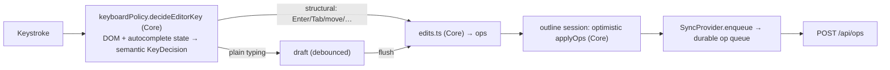

# Frontend: the outline editor (`web/src/outline/`)

This doc covers the outline engine: the per-title sessions that own a block
tree, and the editor that mutates one. [frontend.md](frontend.md) holds the
app shell around it. Failures are indexed by symptom in
[troubleshooting.md](../troubleshooting.md).

## Module map

```
web/src/outline/
├── handlers.ts              —      OutlineHandlers, the command port (types only)
├── useOutline.ts            Shell  Implements OutlineHandlers: drafts, run(), uploads
├── outlineSessions.ts       Shell  Per-title shared sessions and loader election
├── outlineState.ts          Core   transitionOutline, the session reducer
├── parentReadElection.ts,   Shell  Who starts a title's next parent read; the
│   repairEpochs.ts                 post-settlement repair pass
├── useOutlinePageLoad.ts    Shell  The read lifecycle for PageView and sidebar panels
├── loadOutlineBlocks.ts     Shell  The page read behind every loader; applies
│                                   missingPage.ts (Core)
├── tree.ts, orderIdx.ts     Core   applyOps and hidesChildren; order-key arithmetic
├── edits.ts, keyEdits.ts    Core   Structural edit planning; text and caret transforms
├── keyboardPolicy.ts        Core   Keystroke → KeyDecision
├── useBlockDraft.ts         Shell  The focused block's draft, IME, caret, auto-grow
├── autocomplete.ts,         Core   Completion contexts and commands; useAutocomplete.ts
│   slashCommands.ts                holds the popup state
├── history.ts               Core   Undo entries, invertOps, resolveAnchors
├── undoManager.ts           Shell  Undo/redo dispatch, re-keyed and re-stamped at replay
├── baseTextHash.ts          Core   Base hashes on update_text and delete ops
└── the rest                 Core   blockSelection, blockStamps, paste, dnd, fileDrop,
                                    keyboardBar, localFiles, goodlinks …
```

## Per-title outline sessions

`outline/outlineSessions.ts` is the block tree's home. A module-level
`Map<title, Session>` external store hands every view of a title one
ref-counted session, sharing a flushed tree and a monotonic revision. One view
holds the **editor lease** and the others render read-only, so the same page in
the main pane and the sidebar cannot double-edit.

A fetched payload carries a `ReadToken` and is adopted only if it is the newest
request, the revision is unchanged, and no relevant write ticket is unsettled.
The pure reducer is `outlineState.ts::transitionOutline`. Beside the store,
`parentReadElection.ts` (`ParentReadHost`) elects the surface that starts a
title's next parent read, and `repairEpochs.ts` (`RepairTarget`) runs the
post-settlement repair ([sync-recovery.md](sync-recovery.md#a-local-write-fails)).

### Driving a session from a view

`outline/useOutlinePageLoad.ts` is the read lifecycle for both single-page
surfaces, `PageView` and `EditableSidebarPanel`. It owns the generation per
mount, the parent readiness promise, the loader registered on the session and
the unmount cleanup order. Both surfaces wrap their content in
`BlockRefProvider`, not the bare `BlockRefContext.Provider`. `PageView` answers
a `resyncGeneration` bump with `reload("resync")`; the sidebar does not.

The hook keys its session by the page's canonical title. The main thread cannot
canonicalize, because the plain-space flag lives in the replica worker, so the
first read runs under the requested title. When it reports a different
`page.title`, the hook re-keys once and re-reads under the canonical session,
which another surface may already hold at a newer revision.

The Journal bypasses the hook. It loads many days in one `/api/journal`
request and delivers each day's blocks through its own capture-ticket path.

### Loader election

A session also starts reads nobody asked for: after a write settles, when a
remote move names a uid the tree lacks, and once per repair epoch. Several
surfaces of one title are usually mounted, so `LOADER_PRECEDENCE` ranks the
loaders they register: the highest kind wins, then the newest registration.
Mount order must not decide which fetch runs.

| Kind | Registered by | Missing-page policy |
|---|---|---|
| `page` | `useOutlinePageLoad` | its surface's |
| `day` | `Journal` | `substituteMissingDay` |
| `editable` | `useOutline` (every `EditablePage`) | `substituteMissingDaily` |

`substituteMissingDaily` (`outline/missingPage.ts`) turns a 404 on a daily
title into an empty editable page, because the server auto-creates only today's
daily and the first edit creates any other. Every other missing page stays an
error.

`tree.ts::needsAuthoritativeReload` checks each remote move against the tree
the batch's earlier ops leave. A batch that moves a block off the page and back
therefore reloads: the echo cannot place the block on the second move.

### Replay

A repair epoch adopts the server's tree and reapplies every write still
unsettled for that title, so each tracked write carries a **replay**: its own
ops, or `OutlineReplayAction` metadata attached through `attachOutlineReplay`.
Drag-and-drop supplies the moved subtree, which no wire op describes. Both
paths that announce a write to a session, `applyLocal` and the delivery
registry, must state the replay, or the write loses its edit at the next
repair.

### Applying ops

Every mutation goes through the pure `applyOps` (`outline/tree.ts`), which
mirrors the server's op semantics, so the same ops drive the screen, the
replica and the server. `order_idx` is a sparse `OrderIdx` sibling key, not a
position. A dense position (`Located.index`) converts to one only in
`edits.ts`'s `orderIdxAfterPosition` and in `freshChildOrderIdx`, for the
children of a block created earlier in the same plan.

`applyOpsWithChange` reports `changed: false` when the result is `blocksEqual`
to the input, and only a changed batch advances `transitionOutline`'s
`revision`. A stamp counts as a change, since `update_text` bumps
`updated_at` whatever the text, as on the server.

## The editor

**Only the focused block is editable.** It is an auto-growing `<textarea>`
holding raw markdown; every other block is rendered HTML (`EditableBlockTree` →
`EditableBlock` → `BlockInput`). There is no `contenteditable`.

A keystroke batch re-renders every row, so a row's decisions must be
constant-time. `EditableBlockTree` walks `ancestorChain(blocks, focus.uid)`
once and passes `focusChain` down. A `{{toc}}` block is the one row that sees
past its own node, through `RootBlocksContext`, which only `TocBlock` reads.

### Navigating to a block

Toc entries, block refs and search hits link to `#<uid>`.
`useScrollFlashTarget` scrolls to the target and flashes it, in `PageView` or
scoped to a sidebar panel. `PageView` passes the router's location key, so a
second click on one entry jumps again.

- A target under a collapsed ancestor has no row. `EditablePage`'s
  `revealBlock` expands each ancestor that `hidesChildren` says hides it, in one
  `set_collapsed(false)` batch with no undo step, once per navigation.
  Re-running it on a lease change would re-open a row the reader has collapsed
  since. A read-only outline cannot emit the batch, so its hidden target stays
  hidden.
- Content above the target grows after the jump as PDF pages and embeds load.
  The hook re-centres on any ancestor resize until the reader's first input or
  `PIN_QUIET_MS` of quiet. It watches ancestors because `body` never resizes.

### Which way the editor's dependencies point

Everything the UI can ask the editor to do is the `OutlineHandlers` port in
`outline/handlers.ts`. `useOutline` implements it; `EditableBlockTree`,
`EditableBlock` and `BlockInput` only call it, so the engine never imports a
type from UI code.

No component holds block-tree state. The most any owns is `BlockInput`'s draft
of one block, which `outline/useBlockDraft.ts` tracks with IME composition and
caret restoration. It auto-grows the textarea with CSS `field-sizing: content`,
or a JS fallback that resets the height only when
`textareaHeight.ts::mayHaveShrunk` says the content might be shorter.



### Rules an edit must not break

| Rule | What breaks without it |
|---|---|
| A programmatic text change rides the draft or key-edit path | the textarea's draft overwrites it at the next flush |
| A growing text selection escalates to a block selection at the block's edge | it falls through to arrow navigation and drops the selection |
| Every mutating selection branch gates on `!readOnly`; a gated key resolves to `"none"`, left uncancelled | `useOutline`'s handlers do not re-check editability; a cancelled read-only Tab traps focus |
| Authoritative text lands on the tree even for the focused block, while the textarea keeps its draft | the flush overwrites the remote text with no conflict copy ([below](#drafts-and-commit-points)) |
| `/upload` blurs the block (`onBlurBlock`) before clicking the tree-owned file input | the blur would depend on the native dialog, and the asset would not render at once |
| `preventDefault` and `dropEffect` stay synchronous and unconditional in every `dragover` handler (`allowedDepths` never returns empty) | the browser ignores them later, refusing the drop |
| A history replay re-keys creates and moves against the live tree (`resolveAnchors`), or a fresh read when no session exists. `undoManager` runs replays in keypress order and stamps hashes then; entries hold ops unstamped (`withoutStamps`) | a recorded `order_idx` names a different slot after any intervening edit (`history.ts`'s header), and an entry-time hash lands a spurious conflict |
| Undo of an upload clears redo (`takeUndo`); after delivery `undoManager` releases its `freshAssets` (`sync/assetRelease.ts`, `if_unreferenced=true`) | a delete before delivery gets a 409; a redo would name a deleted file |
| `setHeading`, `setViewType` and `setCollapsed` emit nothing for the current value | a no-op gesture sends ops; a repeated heading or view type re-dates the block and adds an empty undo step |
| A restored focus lands on a visible block with a clamped caret (`validateOutlineFocus`). `hidesChildren` decides what hides, for `visibleUids` too; a collapsed Roam table still shows its cells | focus on a block the user cannot see; arrows skip visible cell rows |
| A block selection treats a valid Roam table as one row (`selectableUids`, `startSelection`, `selectionText`) | Shift+Arrow spends presses on table cells, and a copied table loses them |
| An edit never places a block under a collapsed row; indent, outdent and cross-parent moves expand it first, and `allowedDepths` offers no depth under one | the block vanishes into a closed subtree |
| An offset transform, and a caret the editor places, snaps with `snapCaret` (`keyEdits.ts`); `outline/surrogatePairs.props.test.ts` covers each | a slice between surrogate halves stores two U+FFFD |
| `set_collapsed` does not stamp (`opBumpsUpdatedAt`, which `replica/localOps.test.ts` pins for the replica) | collapsing re-dates the block |
| No create or move lands a block past `MAX_OUTLINE_DEPTH`. `run()` and `undoManager`'s dispatch judge each by its subtree in the tree the ops leave (`depthCap.ts`), and refuse the whole command | the server refuses the batch whole, and the offline queue's [rebase](sync-recovery.md#a-batch-the-server-rejects) drops its other ops with it |
| No edit queues a text past a [text limit](backend.md#planning), or a ref (link, tag or attribute) to a [refused title](backend.md#refused-titles): past `MAX_PAGE_TITLE_CHARS`, or holding `#` or other forbidden syntax. `useBlockDraft.admit` judges typing and a plain paste, `run()` a draft it saves ([below](#drafts-and-commit-points)) and a command's ops, and `undoManager`'s dispatch a replay. As on the server, every ref a text holds is judged (`linkedTitleRefusal` shares `findOpTitleViolation`'s loop), so a block holding a refused one refuses edits that keep it. `UnlinkedSection` judges a Link's text limits only | the same: the server's 400 poisons the batch, and the repair drops its other ops with it |
| No command queues a batch past `MAX_OPS_PER_BATCH` or the private body cap (`findBatchSizeViolation`, `batchLimits.ts`). `run()` judges the draft's text ops together with the command's, for the reason it judges depth | the server refuses the batch whole, and a queued refusal discards it |

A depth refusal (`DEPTH_NOTICE`), a text-limit one (`textLimitNotice`), a
title one (`TITLE_LENGTH_NOTICE`, `TITLE_SYNTAX_NOTICE`) or a size one
(`BATCH_TOO_LARGE_NOTICE`) shows in the one `editNotice` slot `EditablePage` renders. The next command
that applies, or Dismiss, clears it, and a refused draft's notice also
clears once the draft saves. A refused keystroke leaves the textarea
as it was, with the caret where the refused insertion began
(`refusedEditCaret`). A refused paste is prevented, so its caret and
selection are untouched. The draft's own text still ships, unless its own
titles are refused ([below](#drafts-and-commit-points)), and a refused undo or
redo keeps its entry for a retry. The entry goes back as though refused at the
keypress (`restoreEntry`), because an unmounted page's read can take long
enough for a new edit to be recorded meanwhile. A refused undo goes back below
every edit recorded during its read, so the next undo still takes the newest
edit first. A refused redo whose take a newer edit followed is dropped, since
that edit cleared redo.
Code can hide a nest: a split inside a fence can cut off its closing
backticks, so the first half exposes the nest and is refused, here and by the
server.

Where the web cannot see the tree, it sends and the server decides. An undo
for an unmounted page whose read fails is judged for the text limits and
the titles only, and a cross-page drop meets only `allowedDepths`
([below](#drag-and-drop)).
Refusing there would block an edit the web cannot check, for a case that
needs an outline near the cap. A cross-page drop meets no title judge
either: a drop onto a page whose title was stored past the cap is refused
by the replica's queue or the server, not by the outline.

### Drafts and commit points

Plain typing debounces into a draft (`TEXT_DEBOUNCE_MS` in `useOutline.ts`).
Structural edits, blur, undo, tab-hide and in-editor navigation
(`onFlushDraft`) flush it first. A draft is held while the caret sits inside a
half-typed `[[ref` or `#tag`, so autosave cannot create a page from a partial
title.

**A draft's `base` is the text the textarea showed, and a flush hashes `base`,
never the tree.** A `PendingDraft` (`outline/outlineState.ts`) is
`{ uid, text, base }`. A remote batch can reach the tree before the textarea
adopts it, and a dirty textarea never adopts it. Hashing `base` lets the server keep
both texts when another device edited from the same base.

| When | Rule |
|---|---|
| A clean draft's first edit | `onDraftStart` reports the shown text, which `captureDraft` keeps as `base` |
| Undo, redo, or an upload that fills the focused (empty) block | `BlockInput` calls `settle()`, so the draft adopts the tree's text. An undo or redo that a refused draft stopped (`onUndo` returns false) does not settle |
| Focus or a new draft moves to another block | the old draft flushes first. A block a remote batch removes unmounts with no blur, so nothing else would flush it |
| A remote batch reparents the block or an ancestor | the textarea remounts with no blur. `BlockInput` reads `handlers.pendingDraft(uid)` at mount and resumes it dirty with its base, and restores the selection the old textarea reported (`onInputUnmount`) |
| A parent passes a new `initial` | the draft flushes first, so the parent tree waits for that write |

`pendingTextOps` decides what the flush sends:

| Draft at flush | Flush sends |
|---|---|
| `text === base`, or the tree already holds `text` | nothing |
| block in the tree, text changed | `update_text` with `base_text_hash` of `base`, plus `page_title` |
| block gone (remote delete, cross-page move) | the same op. The server applies it on the block's new page, or lands an edit to a deleted block on today's daily note |
| `base` is `null` | `update_text` with `page_title`; `stampBaseTextHashes` hashes it like any op |

A held draft has no armed timer, and React delivers no blur for a node it
removes. So `useOutline` flushes on unmount, for navigation the editor never
sees (the `Ctrl-Shift-D` chord, back/forward); its callback sits in a ref so
the effect runs only then. `ensureRefPageThenOpen` (`Ctrl-O` over a `[[ref]]`)
flushes before `POST /api/pages`. Tab hide and reload are covered by the
`visibilitychange` flush.

Typing leaves out the title the caret is in while the draft is held
(`linkedTitleRefusal`'s `heldCaret`). The user is still typing that title,
and one the server accepts can pass through one it refuses: `[[a [b] c]]`
passes through `[[a []]]`, whose title ends in `[`. `run()` judges the whole draft when it saves it, so no
path ships an unjudged text. A draft it refuses is never sent and never
dropped:

| With a refused draft | What happens |
|---|---|
| A flush (debounce, blur, tab hide, `onFlushDraft`) | nothing is sent; the draft stays pending, its textarea dirty, and the notice shows |
| A command, undo or redo, or a cross-page drop (`OutlineDndApi.flushDraft`) | refused whole |
| Focus leaving the block (click, arrow, blur, block selection) | refused, so the textarea stays mounted and shows the draft |
| The outline unmounting (navigation) | `keptDrafts` keeps it by page title; the next outline that edits the page resumes it, focused, with the notice |

Two cases still lose it. `keptDrafts` is memory, so a reload or a killed tab
drops a refused draft. A remote batch that removes its block unmounts the
textarea, and a draft started on another block then replaces it.

### Keyboard policy

Two pure functions decide; the shell (`EditableBlockTree.onKeyDown`,
`BlockInput`) executes and owns every DOM effect. `decideEditorKey` handles a
focused textarea. `decideSelectionKey` handles a multi-block selection, keyed by
the tree container. New shortcuts go into one of them, and Cmd-letter wraps
into `META_WRAP_EDITS`, never into ad-hoc handlers. [keyboard.md](../keyboard.md)
owns the list, and a new key must not collide with an app-global chord.

`KeyboardBar` feeds each key to `decideEditorKey` as the key it names. When the
policy answers `none` for a character, `insertTypedChar` types it, since no
native keystroke follows. The bar's platform rules are in
[frontend.md](frontend.md#ios-and-phone-behaviour).

### Autocomplete

`outline/autocomplete.ts` detects contexts; `useAutocomplete.ts` holds the
popup. `keyboardPolicy.autocompleteKeyAction` lets the popup claim only
unmodified Arrow, Enter, Tab and Escape.

No action uses a remembered caret, because clicks and caret moves fire no input
event. Every action re-derives the context through `resolve(textarea)`. The
live caret is `selectionEnd`: `[[` wrapped around a selection leaves the query
selected, and `selectionStart` would read it as empty. After a pick, the caret
is placed in a layout effect of the commit that sets the value
(`useBlockDraft.replace`), which runs before the next keystroke; a
`requestAnimationFrame` can run after it.

### Paste

Plain Cmd-V is native, unless its result would be past a text limit:
`BlockInput` judges it first and prevents it. `Shift-Cmd-V` arms an outline
paste, which `paste.ts` plans as one batch, comparing indent widths
ordinally so 2-space, 4-space and tab clipboards all work. `ClipboardEvent` carries no modifiers, so the chord is
recorded on keydown without `preventDefault`, and the next `paste` consumes it.

### Slash commands

[keyboard.md](../keyboard.md#slash-commands) lists them, and
`help/slashCommandsDocumented.test.ts` fails on an undocumented one. `/upload`,
`/goodlinks` ([files-and-assets.md](files-and-assets.md#goodlinks-copies)) and `/link-local-file` give up the
block before their picker opens. `LocalFilePicker` is a cached `import()`
chunk, which keeps fzf out of the entry.

### The bullet and the block menu

The `.bullet` span is the block menu's only keyboard route: `role="button"`,
`tabIndex={0}`, `aria-label="Open block menu"`, `aria-haspopup`,
`aria-expanded`, and Enter, Space, ContextMenu and Shift-F10. Removing its tab
stop removes keyboard access to Copy block reference and the view modes
([styling.md](styling.md#focus-and-interactive-affordances) constrains its
ring). With `fallback=true`, bullets are inert and chevrons disabled, so one
renderer serves the live shared outline.

### Drag and drop

`useDropZone` runs one geometry pass per animation frame and measures each row
at most once per drag. `cacheIsUsable` (`dnd/dropGeometry.ts`) keys cached
rects by uid, and a scroll discards them, since tops are viewport-relative like
`clientY`. A drop resolves the last processed candidate, so a block lands where
the indicator was drawn.

A `DragSource` (`outline/dnd.ts`) is `blocks` or `files`; both share the
zone's geometry and `resolveDrop`.

`allowedDepths` offers no depth that would put the dragged subtree past
`MAX_OUTLINE_DEPTH`, so a drag needs no depth notice. The exception is a
legacy subtree too tall for any depth: it still gets the shallowest, which
`run()` or the server refuses. The subtree's height travels in
`BlockDragSource.height`, measured at drag start, so a drop on another
page needs no source tree. That is the only depth check a cross-page drop
meets, since `DndProvider` moves it without `run()`.

| Files drag | Rule |
|---|---|
| Start | `"Files"` in `dataTransfer.types` and `uploadableDrag` (`outline/fileDrop.ts`) finds an image or PDF, or cannot tell (WebKit lists empty types) |
| End | there is no `dragend`. `DndProvider` ends it on a window `drop`, or when its `dragenter` minus `dragleave` count reaches zero, since WebKit's `relatedTarget` is always null |
| Missed | `DndProvider` refuses and swallows it, so the browser never navigates to the file |
| Over a textarea | the zone ignores it; `BlockInput` hands the files to `onFiles`, and `planUploadBlocks` puts each in its own sibling block after the current one (an empty block takes the first) |
| Drop | `useOutline.onDropFiles` uploads in turn, then one `run()` adds a block per file. Focus stays put, or the block would show raw markdown |
| Parent gone | `planFileDropBlocks` appends at the end of the page |
