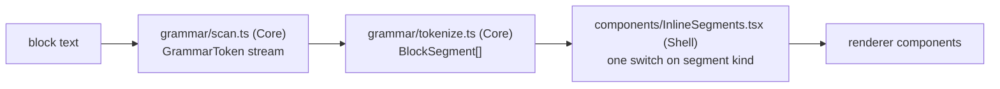

# Rendering pipeline (read path)

Block text is raw Roam-flavoured markdown; this doc follows it to the DOM. The
app shell is in [frontend.md](frontend.md) and the editor that produces the
text in [frontend-editor.md](frontend-editor.md). Failures are indexed by
symptom in [troubleshooting.md](../troubleshooting.md).

## The pipeline

`scan.ts` is the client's grammar authority for `[[...]]` pairs, fences,
inline code and TODO markers. Ref extraction (`grammar/refs.ts`,
`replica/refs.ts`), caret lookup (`outline/refAtCaret.ts`), TODO toggling and
slash commands adapt its token stream rather than scanning privately.
`shared/fixtures/ref_grammar.json` pins it to `server/src/pkm/refs.py`; both
sides' tests replay the fixture.

`tokenize.ts` adds what the scanner does not model: markdown links and images,
bare-URL autolinking (including bare `/assets/<sha256>/`), emphasis,
`{{query}}` and `{{pdf}}` macros, `$$` math and line breaks.

A hashtag, page ref or attribute whose title `isRefTitle` rejects renders as
source text and is no Ctrl-O target. A rejected title is blank, or has a `.`,
`..` or empty `/` segment. `extractRefs` gives the same verdict, so what
renders as a link is what counts as a ref.

`grammar/markdown.ts` scans markdown links and images. Older uploads' URLs hold
the raw file name, so a destination may contain spaces and nested parentheses.
It closes at the first `)` not matched on its line, or at the first `)` of all
when the parentheses never balance. A new upload's label swaps `[` and `]` for
`(` and `)` (`sync/assetNames.ts`), so it cannot open `[[` or close early.

## Segment dispatch

`InlineSegments.tsx`'s `Segment` is one switch over a `BlockSegment`'s `kind`,
and the only place a segment becomes a component.

| Segment kind | Renders as |
|---|---|
| `text`, `linebreak`, `inline-code` | the text, ` `, `<code class="inline-code">` |
| `bold` / `italic` / `strike` / `highlight` | `<strong>` / `<em>` / `<s>` / `<mark>` around a nested `InlineSegments` |
| `page-ref` | `PageLink`; `attribute` wraps the same link in `span.attribute` |
| `block-ref` | `BlockRef` |
| `image`, `asset-link` | `AssetImage`, `AssetLink` |
| `math` | `MathSpan` |
| `code-block` | `MermaidDiagram` when `lang` is `mermaid`, else `CodeBlock` |
| `query` | `QueryBlock` |
| `todo` | `TodoCheckbox` |
| `pdf-embed` | `PdfEmbed` when `isPdfHref`, else the last two rows below |
| `link` | the first row below that applies |

| A `link` whose href | Renders as |
|---|---|
| has a GoodLinks id (`goodlinksIdFromHref`) | `GoodlinksLink` ([files-and-assets.md](files-and-assets.md#goodlinks-copies)) |
| is a PDF (`isPdfHref`) | `PdfEmbed` |
| is a Bluesky post URL and equals its text (a bare URL) | `BlueskyEmbed`; a labelled link stays an anchor |
| passes `isSafeHref` | `<a target="_blank">` |
| anything else | plain text |

A `depth` prop rides the recursive cases: `BlockRef` renders the raw `((uid))`
at its `MAX_DEPTH` of 3, and `QueryBlock` stops at 2. `EditableBlockTree`
resolves two block-level shapes before this dispatch, `{{toc}}` (`TocBlock`,
`tocEntries.ts`, `isTocMacro`) and a table macro (`roamTableRows`), both only
while the row is unfocused.

## Lazy renderers and their caches

KaTeX, beautiful-mermaid, stock mermaid, pdf.js, highlight.js and the
`/link-local-file` picker each load behind a cached module-level `import()`
promise, so Vite emits each as its own chunk. A rejected promise is cleared, so
one failed fetch cannot wedge every later render.

| Cache | Keyed on | Module | Limit |
|---|---|---|---|
| tokenized segments | raw block text | `tokenizeBlock` (`grammar/tokenize.ts`) | `TOKENIZE_CACHE_LIMIT` |
| highlighted HTML | `(lang, code)` | `cachedHighlight` (`CodeBlock.tsx`) | `HIGHLIGHT_CACHE_LIMIT` |
| rendered SVG | `(effectiveTheme, code)` | `MermaidDiagram.tsx` | `MERMAID_CACHE_LIMIT` |
| rendered HTML | `(display, tex)` | `MathSpan.tsx` | `MATH_CACHE_LIMIT` |

Each is a `Map` cleared in full at its limit rather than evicted LRU-style
(`renderCache.ts`'s `createBoundedCache`). `CodeBlock`'s is two-level, since no
printable character is a safe delimiter inside `code`. The mermaid and math
caches are read before the dynamic import, and only successful renders are
cached. Highlighted HTML, KaTeX HTML and mermaid SVG reach the DOM through
`dangerouslySetInnerHTML`; all three are library output, never raw block text.

## Resolving `((uid))` texts

A `((uid))` reaches its text through two channels, and `useBlockRefText` is the
one way to read either.

| Channel | Source | Carrier | Wakes |
|---|---|---|---|
| payload | a page or journal payload's `block_ref_texts`, plus a nested `BacklinksSection`'s overlay | `BlockRefContext` | every consumer, when a payload changes |
| fetched | `BlockRefProvider`'s on-demand `GET /api/block-refs` | `blockRefStore.ts` | only the uids a batch resolved |

The payload wins where both have the uid. The store keeps per-uid listener sets
read through `useSyncExternalStore`, so a resolved batch wakes only its own
refs. Requests from one render pass batch into one call, chunked at the
server's 50-uid cap. `claimRequest` is the fetch-once guard, and keeps claims
only for uids the server could not resolve.

## Mermaid

Diagrams render through beautiful-mermaid first (the chunk is named by the
`beautifulMermaid.ts` barrel), falling back silently to stock mermaid on any
failure. The fallback must stay: it carries gantt, pie, mindmap and the other
families beautiful-mermaid lacks. `mermaidTheme.ts` maps the design tokens onto
both theming surfaces (`beautifulMermaidOptions`, base-theme
`themeVariables`); beautiful-mermaid re-renders on a theme flip
(`useEffectiveTheme`), and the stock fallback keeps its initialize-time
snapshot. Every render uses its instance's own id. Only the cached copy is
normalised to `MERMAID_CACHE_RENDER_ID`, which `withRenderId` swaps back on
each read.

## PDF embeds and the viewer

| `.pdf` href | Renders as |
|---|---|
| under `/assets/`, no query string | inline `PdfEmbed`, auto-loading |
| under `/api/local/`, no query string | deferred `PdfEmbed` (`isDeferredPdfHref`): a link and an Open button, fetching nothing until clicked |
| any, with a query string | a plain link; the query signals a download |

Deferral keeps a page of `Local copy::` papers from pulling each PDF from iCloud
on the host. A file the host does not serve becomes a note, not a saved error
body: `pdfViewerCore.hostFailureNote` maps the status to the note, which the
viewer reads through `failureNote` because pdf.js exposes the status and not
the body. A tap on a deferred link's download first asks for one byte
(`Range: bytes=0-0`; the route has no HEAD), and only a success starts the
native download.

In `PdfViewer`, a new `href` resets its state and bumps a generation counter
synchronously in render, and every load callback checks the generation it
captured. A reset effect would run after a `Document` child's `onLoadSuccess`.
The viewer mounts only pages near the viewport, plus `MOUNT_RADIUS` either side
(`mountedPageWindow`). An unmounted page keeps its `rendered` entry
(`retainPages`) and a `placeholderHeight` slot, since a zero-height slot would
collapse the scrollbar. The inline `.pdf-frame` is layout-contained
([styling.md](styling.md#layout-invariants)), so the fullscreen overlay portals
to `document.body`.

## Link safety and lazy loading

`isSafeHref` admits `http(s):`, `mailto:` and single-slash site-relative hrefs.
It rejects control characters outright, since browsers strip tab, CR and LF
before parsing a URL, and a second leading `/` or `\`, which would escape to
another origin. Stock mermaid runs in `securityLevel` strict.

`AssetImage`, the `/files` grid and `BlueskyEmbed`'s iframe carry
`loading="lazy"`; without it a page of Bluesky embeds opens one scripted
document per embed on mount. `BlueskyEmbed` sizes itself from the embed page's
`postMessage`.
