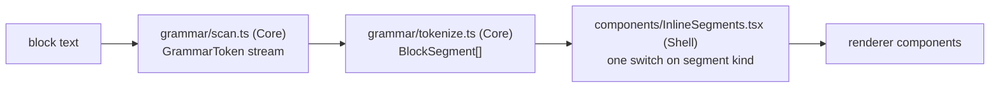

# Rendering pipeline (read path)

Block text is raw Roam-flavoured markdown; this doc follows it to the DOM. The
app shell is in [frontend.md](frontend.md) and the editor that produces the
text in [frontend-editor.md](frontend-editor.md).

## The pipeline

`scan.ts` is the client's grammar authority for `[[...]]` pairs, fences,
inline code and TODO markers. Ref extraction (`grammar/refs.ts`,
`replica/refs.ts`), caret lookup (`outline/refAtCaret.ts`), TODO toggling and
slash commands adapt its token stream rather than scanning privately.
`server/src/pkm/refs.py` owns the grammar and `scan.ts` mirrors it
([titles-and-refs.md § Ref grammar](titles-and-refs.md#ref-grammar)).
`shared/fixtures/ref_grammar.json` pins the two together, and both sides' tests
replay it ([generated artifacts and parity
fixtures](backend.md#generated-artifacts-and-parity-fixtures)).

A block whose `[[` runs nest past `MAX_LINK_NESTING` gets no run tokens from
`scanGrammar`: its brackets render as text, and `extractRefs` reports none of
its links, though its hashtags and `((uid))` refs survive. Every write refuses such a text, so only a row stored before the
[limit](write-path.md#work-bounds-under-the-write-lock) reaches this. The
server's `refs.extract` still reports those links; the replica takes pulled
blocks' `refs` rows from the server, so the two sides agree.

**Grammar code stays linear in the text, and never spreads a token array
into a call (`push(...xs)`).** A block at `MAX_BLOCK_TEXT_CHARS` holds
hundreds of thousands of tokens. A spread passes each one as a call
argument and overflows the stack. A rescan per token, such as a closer
search from every `[` or every `{{query:`, takes minutes at that size. The
length-cap cases in `tokenize.test.ts`, `refs.test.ts`, `markdown.test.ts`
and `replica/blockRefs.test.ts` pin it.

`tokenize.ts` adds what the scanner does not model: markdown links and images,
bare-URL autolinking (including bare `/assets/<sha256>/`), emphasis,
`{{query}}` and `{{pdf}}` macros, `$$` math and line breaks.

A hashtag, page ref or attribute whose title `isRefTitle` rejects renders as
source text and is no Ctrl-O target. A rejected title is blank, or has a `.`,
`..` or empty `/` segment. `extractRefs` gives the same verdict, so rendered
links and extracted refs match.

`grammar/markdown.ts` scans markdown links and images, whose destinations may
hold spaces and nested parentheses from older uploads' raw file names (`closesOf`
gives the closing rule). A new upload's label swaps `[` and `]` for `(`
and `)` (`sync/assetNames.ts`), so it cannot open `[[` or close early.

## Segment dispatch

`InlineSegments.tsx`'s `Segment` is one switch over a `BlockSegment`'s `kind`,
and the only place a segment becomes a component.

| Segment kind | Renders as |
|---|---|
| `text`, `linebreak`, `inline-code` | the text, ` `, `<code class="inline-code">` |
| `bold` / `italic` / `strike` / `highlight` | `<strong>` / `<em>` / `<s>` / `<mark>` around a nested `InlineSegments` |
| `page-ref` | `PageLink`; `attribute` wraps the same link in `span.attribute` |
| `block-ref` | `BlockRef` |
| `image`, `asset-link` | `AssetImage`, `AssetLink` |
| `math` | `MathSpan` |
| `code-block` | `MermaidDiagram` when `lang` is `mermaid`, else `CodeBlock` |
| `query` | `QueryBlock` |
| `todo` | `TodoCheckbox` |
| `pdf-embed` | `PdfEmbed` when `isPdfHref`, else the last two rows below |
| `link` | the first row below that applies |

| A `link` whose href | Renders as |
|---|---|
| has a GoodLinks id (`goodlinksIdFromHref`) | `GoodlinksLink` ([files-and-assets.md](files-and-assets.md#goodlinks-copies)) |
| is a PDF (`isPdfHref`) | `PdfEmbed` |
| is a Bluesky post URL and equals its text (a bare URL) | `BlueskyEmbed`; a labelled link stays an anchor |
| passes `isSafeHref` | `<a target="_blank">` |
| anything else | plain text |

A `depth` prop rides the recursive cases: `BlockRef` renders the raw `((uid))`
at its own `MAX_DEPTH`, and `QueryBlock` stops at its own. `EditableBlockTree`
resolves two block-level shapes before this dispatch, `{{toc}}` (`TocBlock`,
`tocEntries.ts`, `isTocMacro`) and a table macro (`roamTable`, rendered by
`RoamTable`), both only while the row is unfocused.

### Media in table cells

A query's Table and Cards cells (`CellValue`) and a plain table's body cells
(`PlainTable`) provide `CellMediaContext`. Its `CellMediaTarget` says which
table the cell is in, and for a query cell names the cell's page and uid.
Under it, `Segment` asks `cellMedia` (`cellMediaCore.ts`) first. A value's
other segments render as they do anywhere else.

| Segment | Query table or card | Plain table |
|---|---|---|
| a link or `pdf-embed` with `isPdfHref` | `pdf` label: `PdfEmbed` in overlay mode (`onClose`), as `/files` opens a PDF | same |
| an `image`, upload or external | `image` label: `ImageOverlay` | same |
| a code block | `line` label | `CodeBlock` |
| a mermaid diagram | `line` label | `CodeBlock` with no language |
| a bare Bluesky post URL | `line` label | a plain link |
| a query | `line` label | the segment's `source` text |

A label (`CellMediaLabel`) keeps a row table-sized, and nothing is fetched
until its click. A
`line` label goes to the line that holds the media, `pagePath(page)#uid`,
and shift-click calls `openInSidebar(page, uid)`. A query cell's line is on
another page, where the outline renders the media. A plain table's line
would be the cell itself, so a plain table renders that media in place
instead of a label that leads back to where it sits.

The label is a button that stops its click: the `<td>` opens the cell editor
on any click that reaches it, and on a code block in a plain cell it does.
`RoamTable`'s `StaticTable`, shown until the tables chunk loads, provides the
same context and `data-cell-uid`, so the swap to `PlainTable` neither fetches
media nor misses a jump. In overlay mode `PdfEmbed` renders nothing in place
while the viewer chunk loads, and a failed chunk calls `onError`, so the
label reads "(unavailable)" instead of the cell growing a link. A jump to a
plain-table cell, from a query cell's label or a search hit, finds the
`data-cell-uid` that `DataTable`'s `cellAnchor` writes on the `<td>`. It
never uses `data-uid`, which `useOutline`, `useDropZone` and `FindBar` read
as a block row. Row titles (`RecordLink`) keep media inert instead, under
`InertMediaContext`.

`TodoCheckbox`, a query's cell editor and its "Save this view" act on the host
block through `BlockEditContext`. Only an editable row provides it, so a
backlink, a sidebar panel or a read-only outline renders them inert.
`QueryResults` and `BlockRef` provide null beneath themselves: what they
render is other blocks' text, and a TODO or query in it must never act on
the host.

## Lazy renderers and their caches

KaTeX, beautiful-mermaid, stock mermaid, pdf.js, highlight.js, the
`/link-local-file` picker and the tables chunk each load behind a cached
module-level `import()` promise, so Vite emits each as its own chunk. A
rejected promise is cleared, so one failed fetch cannot wedge every later
render. For a component, `lazyLoader` (`components/lazyComponent.ts`) is
that cache and `useLazy` renders from it. Its `peek()` gives a mount after
the load the component on its first render, not a placeholder for a frame.

A block-level feature that only some pages use stays out of the entry
chunk, whose size `budgets.json` caps (`initialEntryBytes`). An eager shell
renders at once and the loaded component replaces it. `QueryBlock` shows
its expression line, and `RoamTable` a static table with the loaded
table's look, so nothing moves while the chunk loads. Query results and
plain tables share `DataTable`, the toolbar and the view state, so they
load as one chunk (`tablesChunk.ts`). Two chunks and a shared third would
add files to every install's precache.

| Cache | Keyed on | Module | Limit |
|---|---|---|---|
| tokenized segments | raw block text | `tokenizeBlock` (`grammar/tokenize.ts`) | `TOKENIZE_CACHE_LIMIT` |
| highlighted HTML | `(lang, code)` | `cachedHighlight` (`CodeBlock.tsx`) | `HIGHLIGHT_CACHE_LIMIT` |
| rendered SVG | `(effectiveTheme, code)` | `MermaidDiagram.tsx` | `MERMAID_CACHE_LIMIT` |
| rendered HTML | `(display, tex)` | `MathSpan.tsx` | `MATH_CACHE_LIMIT` |

Each is a `Map` cleared in full at its limit rather than evicted LRU-style
(`renderCache.ts`'s `createBoundedCache`). `CodeBlock`'s is two-level, since no
printable character is a safe delimiter inside `code`. The mermaid and math
caches are read before the dynamic import, and only successful renders are
cached. Highlighted HTML, KaTeX HTML and mermaid SVG reach the DOM through
`dangerouslySetInnerHTML`; all three are library output, never raw block text.

## Resolving `((uid))` texts

Read a `((uid))` text only through `useBlockRefText`, which merges these
channels:

| Channel | Source | Carrier | Wakes |
|---|---|---|---|
| payload | a page or journal payload's `block_ref_texts`, plus a nested `BacklinksSection`'s overlay | `BlockRefContext` | every consumer, when a payload changes |
| fetched | `BlockRefProvider`'s on-demand `GET /api/block-refs` | `blockRefStore.ts` | only the uids a batch resolved |

The payload wins where both have the uid. The store keeps per-uid listener sets
read through `useSyncExternalStore`, so a resolved batch wakes only its own
refs. Requests from one render pass batch into one call, chunked at the
server's per-request cap (`CHUNK` in `BlockRefProvider.tsx`). `claimRequest` is
the fetch-once guard, and keeps claims only for uids the server could not
resolve.

## Query and table macros

### Macro options

A `{{query}}` or `{{table}}` macro saves a view as options after its head,
each one ` | name: value`:
`{{query: {and: [[Book]]} | view: cards | sort: Published desc}}`,
`{{table | filter: apache}}`.

| Option | Value | Read by |
|---|---|---|
| `view` | `table`, `cards` or `blocks` | queries |
| `filter` | the filter box's text | both |
| `sort` | a column name, then `asc` or `desc` | both |
| `columns` | column names, comma-separated, in order | queries |

`grammar/macroOptions.ts` reads options and sits in the entry chunk with
the tokenizer. Reading drops what it cannot use: an unknown name, a bad
value, a segment with no colon. A ` | ` splits only outside braces and
`[[ ]]`, so a ref title holding ` | ` stays whole. `macroOptionsWrite.ts`
writes them and loads with the tables chunk. `server/src/pkm/macro_options.py`
mirrors both halves, and `macro_options_parity.json` holds the two sides
together ([backend.md](backend.md#generated-artifacts-and-parity-fixtures)).
The markdown export strips options before it runs a query
(`find_query_macros`).

**An option never holds ref syntax.** Ref extraction (`refs.extract`,
`extractRefs`) scans the whole macro, options included, so ref syntax in an
option would become a ref. Save refuses such a value (`optionsRefusal`,
`options_refusal`) rather than teaching both extractors about options.
Padding and empty values are normalised, not refused. Save also reads the
rewritten text back, and refuses when it would not give the same options.

A table macro's opening `{{` must close, braces counted, on the trimmed
text's last character (`tableMacroOptions`). Otherwise
`{{table | a}} x {{y}}` would read ` x {{y` as option text, and a rewrite of
the options would drop it. The cases are in the
[contract](contracts/frontend-editor.md#rules-an-edit-must-not-break).

### Query blocks

A `query` segment carries `expr` (the head, without options), `options`,
and `span`, the whole `{{...}}` in the text the tokenizer was given.
`QueryBlock` is the eager shell. `QueryResults` reads
`GET /api/query/records` first, since the records decide the default view.
When no record has a cell the default is blocks and the records answer
carries the groups, so that view needs no second request; `queryDefaults`
reads the default from whether `groups` is null, so the rule lives on the
server only. Otherwise `/api/query` is read for the groups: alongside the
records whenever the macro saves `view: blocks` and the reader has not
picked another view (discarded if the records carry the groups), on demand
when the reader picks Blocks. Leaving the blocks view and returning retries
a failed fetch. `QueryResults` only runs the requests: the block's state
and `groupsFetchDue` are `tables/queryBlock.ts`'s, and the cases are in the
[contract](contracts/frontend-editor.md#what-a-query-block-fetches).

| View | Shows |
|---|---|
| `table` | `QueryTable`: a Result column, then one column per `::` key, editable ([frontend-editor.md § Tables](frontend-editor.md#tables)) |
| `cards` | `QueryCards`: one card per record, with the same columns; read-only |
| `blocks` | the grouped results, each nested one under a link to its parent line (`.query-crumb`); a filter keeps the results of the records it matches |

With nothing saved, the view is `table` when any record has a `::` cell,
else `blocks`. The default columns are the keys at least half the records
hold, in the order they first appear (`queryDefaults`, `defaultColumns`).

Save finds its macro again in the host block's own text
(`BlockEditApi.text`, `planQuerySave`), by expression and current options,
and refuses unless exactly one macro matches. The segment's `span` is
relative to the text the tokenizer was given, which a `> ` quote prefix
makes a different text. A query shown through a block ref is not in the
host's text at all.

## Mermaid

Diagrams render through beautiful-mermaid first (the chunk is named by the
`beautifulMermaid.ts` barrel), falling back silently to stock mermaid on any
failure. The fallback must stay: it carries gantt, pie, mindmap and the other
families beautiful-mermaid lacks. It is held to the no-fetch rule in
[§ Link safety and external media](#link-safety-and-external-media), and in
replies it waits for a click.

`mermaidTheme.ts` maps the design tokens onto both theming surfaces
(`beautifulMermaidOptions`, base-theme `themeVariables`). beautiful-mermaid
re-renders on a theme flip (`useEffectiveTheme`); the stock fallback keeps
its initialize-time snapshot. Every render uses its instance's own id. Only the cached copy is
normalised to `MERMAID_CACHE_RENDER_ID`, which `withRenderId` swaps back on
each read.

## PDF embeds and the viewer

| Href | Renders as |
|---|---|
| under `/assets/` (`isUploadedAsset`), ending in `.pdf` | inline `PdfEmbed`, auto-loading |
| under `/api/local/`, ending in `.pdf` | deferred `PdfEmbed` (`isDeferredPdfHref`): a link and an Open button, fetching nothing until clicked |
| not ending in `.pdf`, as `a.pdf?dl=1` does | a plain link; the query signals a download |
| climbing out of either prefix (`isPathUnder`), as `/assets/../api/local/a.pdf` does | a plain link |

`isPdfHref` tests the ending of the whole href, so an href whose query or
fragment ends in `.pdf` (`?a=.pdf`, `#.pdf`) still embeds. Any PDF href that
is not provably an upload defers to a click: `isDeferredPdfHref` is
`!isUploadedAsset`.

Deferral keeps a page of `Local copy::` papers from pulling each PDF from iCloud
on the host. A file the host does not serve becomes a note
(`pdfViewerCore.hostFailureNote`), not a saved error body. A deferred link's
download first asks for one byte (`Range: bytes=0-0`; the route has no HEAD),
and only a success starts the native download.

In a table cell a PDF is a label that opens the overlay instead
([Media in table cells](#media-in-table-cells)).

`InlineSegments` keys each `PdfEmbed` by its href, so an embed's click-to-load
state (`armed`) never survives an href change. Reusing the instance would load
a deferred PDF without its click.

In `PdfViewer`, a new `href` resets its state and bumps a generation counter
synchronously in render, since an effect would run after a `Document` child's
`onLoadSuccess`. Every load callback checks the generation it captured.
The viewer mounts only pages near the viewport, plus `MOUNT_RADIUS` either side
(`mountedPageWindow`). An unmounted page keeps its `rendered` entry
(`retainPages`) and a `placeholderHeight` slot, since a zero-height slot would
collapse the scrollbar. The inline `.pdf-frame` is layout-contained
([styling.md](styling.md#layout-invariants)), so the fullscreen overlay portals
to `document.body`.

## Link safety and external media

`isSafeHref` admits `http(s):`, `mailto:` and single-slash site-relative hrefs.
It rejects control characters outright, since browsers strip tab, CR and LF
before parsing a URL, and a second leading `/` or `\`, which would escape to
another origin.

The browser fetches a rendered URL with no click and no write approval, so
whoever can write the markdown, the assistant included, could send note text
to any host. Only `/assets/` uploads (`isUploadedAsset`) load on render. A src
the URL parser would turn into another same-origin path is not an upload,
because `/assets/../api/export.zip` would run an export on render.
`isPathUnder` refuses a `..` segment in every encoding a browser or
path-cleaning proxy reads (`externalMedia.ts` lists them). All other external
media renders through `ClickToLoad`:

| Media | Gated where | Placeholder |
|---|---|---|
| `AssetImage`, any src but an upload | everywhere | `externalImageLabel`, naming the host |
| `BlueskyEmbed` (its handle lookup and iframe reach Bluesky) | under `UntrustedContentContext`, which `AssistantPanel` provides; notes embed on render | `Bluesky post from <actor>` |
| `MermaidDiagram`'s stock fallback | under `UntrustedContentContext`; a diagram beautiful-mermaid renders shows directly | `Render diagram`, below the source |

In a table cell an external image is a label, and its click opens
`ImageOverlay` directly: that click is the consent `ClickToLoad` asks for.

`ClickToLoad` keeps its children unmounted until the click, because the fetch
starts at commit. It compares the revealed key with the current one during
render, so a new key never commits its media (an ``, an iframe) without
its own click. The click stops propagating, so it never reaches edit mode or
ref navigation. A reveal from the focused button moves focus to the revealed
media's wrapper.

A row that navigates (`BacklinkGroupList` with `onNavigate`, as in
`BlockRefBacklinksPopover`) provides `InertMediaContext`, so the whole row is
the click target. Inside it an uploaded image gets no expand trigger, and
`ClickToLoad`'s placeholder is plain text.

`AssetImage`'s img (an upload, or an external image once clicked), the
`/files` grid and `BlueskyEmbed`'s iframe carry `loading="lazy"`. Without it a
page of Bluesky embeds opens one scripted document per embed on mount.
`BlueskyEmbed` sizes itself from the embed page's `postMessage`.

**No diagram fetches, in a note or a reply** (`mermaidSafety.ts`).
beautiful-mermaid escapes labels, but its SVG opens with a Google Fonts
`@import`, which `stripCssImports` removes before the SVG is cached. Stock
mermaid's `securityLevel: strict` still lets some fetches through
(`mermaidSafety.test.ts` lists them). `mermaid.render` lays the diagram out
in the live document, so a fetch starts before the SVG returns, and cleaning the output
would be too late. Before render, the app therefore:

- secures the CSS-bearing config keys (`STOCK_MERMAID_SECURE`);
- forbids the label tags and attributes that load a URL
  (`STOCK_MERMAID_DOMPURIFY`);
- keeps from `mermaid.render` any source those two cannot stop
  (`refusesStockRender`), which then shows as source.

A stock render cached from a note still waits for the click in a reply.

