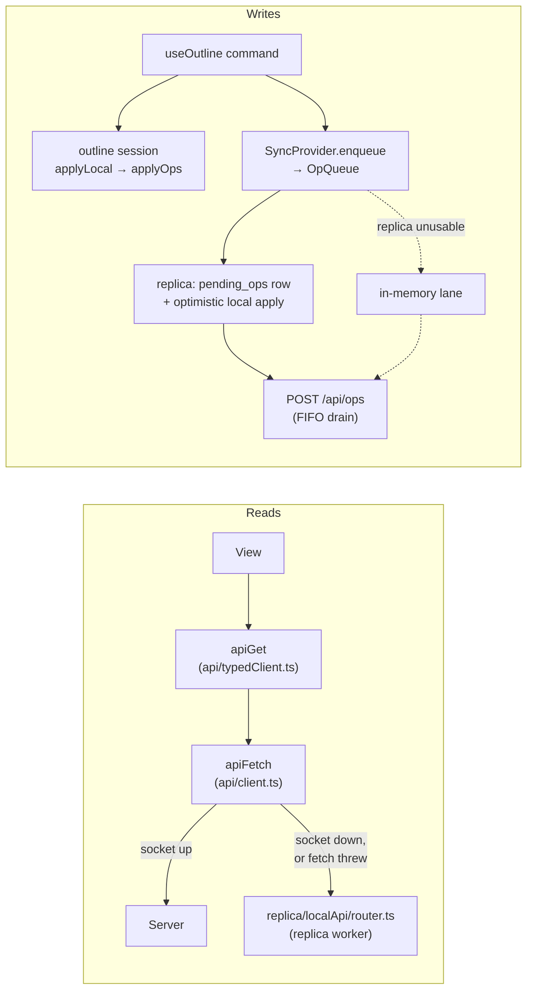

# Frontend architecture (web/)

The frontend is a React single-page app built with Vite: an offline-capable,
real-time-synced Roam-style outliner. The server owns its shapes. API types
are generated from its OpenAPI schema, the replica schema from its DDL, and
the block grammar is pinned to the Python parser by shared fixtures. `pnpm
check:fcis` (`web/tooling/fcis.mjs`) fails a Functional Core module that
imports a Shell ([overview.md](overview.md#functional-core--imperative-shell)).

This doc covers the app shell. The outline editor is in
[frontend-editor.md](frontend-editor.md), block text to DOM in
[frontend-rendering.md](frontend-rendering.md), CSS in
[styling.md](styling.md), and the sync engine and replica in
[sync-and-offline.md](sync-and-offline.md). Failures are indexed by symptom in
[troubleshooting.md](../troubleshooting.md).

## How reads and writes flow



- A write's `WriteTicket` separates *persisted locally* (`settled`) from
  *acknowledged by the server* (`delivered`). Pages created offline get
  negative ids, remapped by `replica/reconcile.ts`.
- `SyncProvider` registers the offline gateway (`setOfflineGateway`). It
  serves only once the replica is ready, and treats only a dropped socket as
  offline; a cold start reaches it through a failed fetch. The shim answers with the server's JSON shapes
  (`shared/fixtures/shim_parity.json`). An unshimmed route throws
  `OfflineError`, and its UI says "online only".
- Views refetch when `resyncGeneration` bumps
  ([sync-and-offline.md](sync-and-offline.md#when-views-refetch)).
- `OfflineIndicator`'s wording states what is true of unsent work, so it is
  documented beside the mechanisms that decide it
  ([sync-recovery.md](sync-recovery.md#what-the-ui-shows)). Change both
  together.

## State management

There is no Redux or Zustand. A view holds the payload it fetched and refetches
through `useResync(fn)`. `sync/SyncProvider.tsx` holds the queue and
connectivity. `outline/outlineSessions.ts` holds one shared block tree per
title ([frontend-editor.md](frontend-editor.md#per-title-outline-sessions)).

`SyncProvider` publishes four contexts, one per rate of change:

| Hook | Value | New identity when |
|---|---|---|
| `useSyncActions()` | `enqueue`, `subscribe`, `settled`, `attachOutlineReplay`, `retryProblem`, `dismissProblem`, `discardProblem`, `resetReplica` | never: each method reads current state through a ref |
| `useResyncGeneration()` | `resyncGeneration` | server state may have diverged (reconnect after a gap, repair finished) |
| `useSyncEditability()` | `canEdit`, `readOnlyReason` | editing becomes allowed or blocked; a flap with a ready replica changes neither |
| `useSyncHealth()` | `status`, `replicaMode`, `pending`, `unsentInMemory`, `problem` | the socket flaps, or an op is queued or acknowledged |

React cannot subscribe to part of a context value, and the Journal mounts one
outline per loaded day. **Anything sharing an identity with `pending`
re-renders every mounted outline twice per flushed edit**, so a consumer takes
the narrowest hook it can. Tests inject a complete `Sync` through
`SyncContext`, which every hook prefers when set. `EditableBlock` is memoised
behind props `EditableBlockTree` holds stable, so only a changed context
identity reaches a row.

`pending` has one publisher, the op queue. Code that changes the durable queue
behind its back calls `queue.refreshPending()` rather than reading the replica.

## API layer

`apiFetch<T>` (`api/client.ts`) handles JSON, the 401 → `/login` redirect and
the offline gateway. Reads carry a `READ_TIMEOUT_MS` abort signal. Mutations
carry none, because an aborted write the server applied would leave the op
queue retrying a batch it cannot know landed. `/api/sync/snapshot` opts out
(`{ timeoutMs: null }`), or a slow cold-start bootstrap would abort.

Product code calls `api/typedClient.ts`'s `apiGet`/`apiPost`/`apiPut`/
`apiDelete`; ESLint's `no-restricted-imports` bars `apiFetch` elsewhere. The
typed client takes the OpenAPI path template, so the generated `paths` table
decides the parameters, body and response type:

    apiGet("/api/page/{title}", { path: { title } })

Path parameters are encoded per segment, because `{title:wholepath}` routes
carry titles whose slashes must survive. Raw `apiFetch` remains in the typed
client itself, multipart upload (`sync/assets.ts`) and `SyncProvider.tsx`'s
`replicaSync` seam (`fetchJson: apiFetch`).

Types come from `api/types.d.ts`, generated by `pnpm gen-types` from
`api/openapi.json`. Never hand-write API types: the server suite fails on a
stale artifact ([backend.md](backend.md#generated-artifacts-and-parity-fixtures)).

## Brands

A server field typed with a branded `NewType` carries an `x-brand` marker in
`openapi.json` ([backend.md](backend.md#wire-models-and-brands)).
`tooling/genTypes-core.mjs` turns it into `Brands.<Name>`, a reference to the
export of that name in `api/brands.ts`, where every web brand is defined. A
subtype brand adds a second key, not a second `__brand`, since two `__brand`
literals intersect to `never`.

**The main tsconfig's `skipLibCheck` skips every `.d.ts`, so a `Brands.<Name>`
that `brands.ts` does not export degrades silently to `any`.** `pnpm typecheck`
therefore runs a second pass, `tsconfig.apitypes.json`, with lib checking on.
`tooling/genTypes.drift.test.ts` fails when the committed `types.d.ts` is not
what `pnpm gen-types` writes; the stock openapi-typescript CLI would turn every
brand back into `string`.

Where a brand may be minted is `MINT_SITES` in
`server/src/pkm/brand_registry.py`, enforced on the web by
`brands/no-brand-assertion` ([checks.md § Brand rules](checks.md#brand-rules)).
Tests mint through the checked helpers in `test-helpers.ts`. `sync/wire.ts`
reads network bodies, tombstone ids (`tombstoneIdOfWire`) and WebSocket frames
(`wsFrameOfWire`) as the contract's types; `ReplicaDb.select` does the same for
replica rows ([sync-and-offline.md](sync-and-offline.md#reading-rows)).
`assistant/writePreview.ts` mints the `CanonicalTitle` of an approval card's
current page where it parses the preview: the server sends the stored
`pages.title`, which is canonical.

A title no check has run on is a `RawTitle`: request bodies, `paths.ts`'s
`titleFromPathname`, and the op `page_title`. That op field is canonical only
on the server's WS echo, so a `CanonicalTitle` is assignable to it.
`asRawTitle` (`replica/titles.ts`) mints from plain text. `replica/apply.ts`'s
`parkedTitle`, the placeholder written while two rows swap titles, is its own
`ParkedTitle` brand, so no reader can take it for a canonical title.

## Views and navigation

| Route | View |
|---|---|
| `/` | Journal, an infinite scroll of daily pages |
| `/page/*` | PageView, one page |
| `/current-work` | Recently edited pages |
| `/files` | The asset browser |
| `/settings` | Whole-database export |
| `/help` | The keyboard-shortcut doc |
| `*` | NotFound |

Every pathname under `/page/` renders PageView directly, because react-router
compiles `*` to a `.*` that matches no newline, U+2028 or U+2029. A title
the fold changes (a hand-typed `%0A`, a double space, an NBSP) is first
redirected to the title it folds to (`normalizeRefTitle`). PageView, a sidebar panel and the Journal key their
outline session by the page's stored title, whatever spelling opened them
(`outline/titleKeys.props.test.tsx`).

### One table for route metadata

`routeMeta.ts` holds the path, top-bar label and browser title of every static
route. `App.tsx`'s routes and nav links, TopBar, and `useRouteTitle.ts` all
read it, so a route cannot be labelled in one place and not another. `/page/*`
and the catch-all have no entry; `PageView.tsx` sets its own title.

### Navigation chrome

The left nav holds pinned pages (`/api/sidebar`), app destinations and the
theme toggle. The right sidebar is a session-only stack: shift-clicking a page
link or ref pushes a `SidebarPanel`.

**No link in the left nav may leave shift-click to the browser.** react-router
ignores modified clicks (`shouldProcessLinkClick` bails on `shiftKey`), so a
nav link is never a bare `NavLink`:

| Component | For | Shift-click |
|---|---|---|
| `NavPageLink` | destinations that are pages (pinned entries, TODO) | opens the page in the sidebar |
| `NavRouteLink` | routes with no page behind them | swallowed, leaving `onNavigate` unfired so a phone drawer stays open |

The global chords ([keyboard.md](../keyboard.md#anywhere-in-the-app)) share one
`window` keydown listener in `App.tsx`. They fire while a block is edited
only because `BlockInput` never calls `stopPropagation` on keydown. The
`Ctrl+Shift` forms exist because the page gets no keydown for the Cmd forms
(macOS reserves `Ctrl+Cmd+D`, the browser owns `Cmd+T`). jsdom and Playwright deliver keydowns
the real OS would swallow, so confirm a new chord in the running app.

### The Journal

Each day's linked references arrive with the day in `/api/journal`'s payload
and render inline (`JournalDayReferences`, reusing `BacklinksSection`). A day on
screen keeps the list it first rendered: `BacklinksSection` snapshots `initial`
into state, and a resync replaces day objects in place under stable keys.
Nothing unmounts a loaded day, so each mounted outline and its `useDismiss`
listener last for the session (perf scenarios `I` and `J`).

### Popovers and menus

`Popover.tsx` is the chrome every anchored popover renders through:
`position: fixed` at its anchor, measured after layout and clamped into the
viewport by `clampPopoverPosition`, since an overflowing fixed element grows no
scrollbar. Its `remeasure` prop names values whose change resizes the content.
`Popover` and `BlockMenu` portal into `document.body`
([styling.md](styling.md#layout-invariants) says why). A portal moves the DOM
node, not the React node, so a portalled surface stops its own clicks.

| Surface | Dismissal |
|---|---|
| `BlockRefBacklinksPopover`, `FileCardPopovers` | `Popover`'s own `useDismiss` (outside `mousedown` or Escape) |
| `BlockMenu` | `useDismiss`; roving focus and Tab stay in the component |
| `TopBar`'s page menu, `SearchBar` | `useDismiss` with `enabled` |
| `ConfirmDialog` | hand-rolled: `window` listener, Escape/Enter |
| `ImageOverlay`, `GoodlinksReader`, `LocalFilePicker` | `useOverlayDismiss`: capture-phase `window` listener, scroll lock, focus restore |
| `AutocompletePopup`, `DatePickerPopup` | none: `BlockInput` owns their keys |

Hand-roll dismissal only for a modal surface (one that traps focus, locks
scrolling or answers keys beyond Escape), or one whose keys another component
owns.

A row's `RefCountBadge` opens `BlockRefBacklinksPopover`, which fetches
`GET /api/block/{uid}/backlinks` at open, so the list is live while the count
is as fresh as the page payload.

Every confirmation goes through `useConfirm` (`components/ConfirmDialog.tsx`),
never `window.confirm` ([below](#ios-and-phone-behaviour)). The owning
component must render the returned `dialog`, or `confirm()` never settles; a
hook with a confirm-backed handler re-exports it, as `useOutline` does. Remote
batches can land while a dialog is open, so a handler re-derives its target
after the await.

### The `/files` browser

`/files` is a table over `/api/assets/search`; the store is in
[files-and-assets.md](files-and-assets.md). Image and PDF thumbs open in-app
(`ImageOverlay`, `PdfViewer`'s overlay-only mode). The refs popover renders
through `BacklinkGroupList`, whose rows render media inert
(`InertMediaContext`) so the whole row is a click target. `AssetRefGroup` has
no `page_id`, which keeps asset refs out of `mergeGroups`. Pagination has a
synchronous single-flight lock against a double click, and a generation guard
that discards responses a filter change has made stale.

## iOS and phone behaviour

| Platform behaviour | What the app does | Code |
|---|---|---|
| An installed iOS app opens external links in an in-app WKWebView | rewrites a cross-origin click to `x-safari-https://` (or `-http`), which opens Safari. Hrefs stay `https://` | `ExternalLinkInterceptor`, `externalLink.ts::isIosStandalone` |
| In standalone, a same-origin `target="_blank"` link replaces the whole app | the interceptor does not rewrite same-origin clicks, so PDF links and /files thumbs open the in-app `PdfViewer` overlay rather than a `target="_blank"` anchor | `PdfEmbed`, `PdfViewer`, `externalLink.ts::safariHrefForClick` |
| A tap inside a cross-origin iframe never reaches that listener | in standalone, `BlueskyEmbed` lays a `.bluesky-embed-tap` anchor to the post over its iframe | `BlueskyEmbed.tsx` |
| Standalone suppresses `window.confirm`, returning `false` | every confirmation uses `useConfirm` | `ConfirmDialog.tsx` |
| Standalone ignores `beforeunload` | the in-memory lane's unload guard cannot hold ([sync-recovery.md](sync-recovery.md#the-in-memory-fallback-lane)) | `sync/unloadGuard.ts` |
| The iPhone keyboard has no Tab key | `BlockInput` renders `KeyboardBar`. `isPhoneUserAgent` decides, not width, so an iPad or narrow desktop never gets it | `outline/keyboardBar.ts` |
| iOS Safari does not shrink the layout viewport for the keyboard | the bar sits `keyboardInset` above its bottom, tracked from `visualViewport` | `KeyboardBar.tsx` |
| Safari zooms into a focused field under 16px; `.block-input` is 15px | on an iPhone `main.tsx` adds `maximum-scale=1`, or the zoom pans the bar off screen | `phoneViewportContent` |
| The iOS 26 Safari tab's floating address pill is outside the visual viewport | the bar sits one pill higher, the lowest position where every key can be tapped | `keyboardInset` |
| Cancelling `pointerdown` keeps the keyboard open, but WebKit then sends no click | a bar key acts on `pointerdown`; only a `detail === 0` click (VoiceOver) acts on its own | `KeyboardBar.tsx` |
| A touch on a key starts text selection; two quick taps zoom | `.keyboard-bar` sets `user-select: none`, `-webkit-touch-callout: none`, `touch-action: manipulation` | `styles.css` |
| iPadOS may freeze a hidden tab's socket | a socket still reporting `OPEN` after `RESUME_STALE_MS` hidden is closed on return to visibility ([sync-and-offline.md](sync-and-offline.md#ancillary-details)) | `sync/socket.ts` |

## The assistant panel

`src/assistant/` is the chat panel for the server-side assistant
([assistant.md](assistant.md)). Conversations are lost on reload. The model
list comes from `GET /api/assistant/models` on first open, with a hardcoded
fallback in `useAssistant.ts`.

- `client.ts::streamMessage` feeds the response body through `sse.ts`, a pure
  frame parser, into `useAssistant.ts`. It bypasses `apiFetch`, which reads
  the body as JSON, and replicates its 401 handling.
- `sse.ts` drops a frame whose `event:` name is not in `EVENT_TYPES`. That
  hides keepalives, and also drops a new event type until it is added.
- After `STREAM_STALL_TIMEOUT_MS` with nothing received the turn errors, with
  an error that is not an `AbortError`: `useAssistant` treats an `AbortError`
  after Stop as success.
- `newChat` bumps a generation counter before clearing state, so a superseded
  turn's events and finalizers are dropped.
- The busy clock (`elapsed.ts::elapsedLabel`) restarts on each phase label,
  tool start and confirm resume, so a parked approval does not inflate it.
- A tool line pairs with its `tool_finished` by `tool_use_id`, across turns,
  so a stopped turn's write still resolves in the next. Only a line not yet
  done pairs, so a reused id cannot turn a finished line's `✗` into `✓`.
  A failed write's
  `.assistant-tool-failed` is a text node, never `tokenizeBlock`: the reason
  can echo model-chosen input; so is `.assistant-tool-warning`.
- `stripCaretBlockRefs` (`assistant/normalizeRefs.ts`) runs before
  `tokenizeBlock`, because some models copy the `^uid` marker into citations
  and the grammar rejects `((^uid))`.
- Replies render under `UntrustedContentContext`, so a Bluesky post or a
  diagram that needs stock mermaid waits for a click (external images already
  do everywhere)
  ([frontend-rendering.md](frontend-rendering.md#link-safety-and-external-media)).

## Testing and quality gates

`pnpm verify` runs the web gates;
[checks.md](checks.md#every-check) lists what each
fails on, and `AGENTS.md` § Testing says how to run them.

- **Unit** (Vitest + jsdom): co-located `*.test.ts(x)`. `src/test-setup.ts`
  fails any unsilenced `console.warn`/`console.error`. `src/test-guards.ts`,
  shared with the property suite, caps fast-check filters and starts
  `orphanWatchdog.ts`, which kills a vitest worker whose parent has gone.
  Coverage thresholds are in `vite.config.ts`.
- **E2E** (Playwright, `web/e2e/`): any HTTP 5xx fails the run (`fixtures.ts`),
  and a server-side exception fails teardown.
  `e2e/server-state.ts::waitForServerText` waits for a write to reach the
  server before a reload. jsdom computes accessible names differently from
  Chromium, so check one with a Playwright aria snapshot. Traps that make a
  spec pass vacuously or hang:

  | Trap | Instead |
  |---|---|
  | A bare `#Tag` at the caret's end reopens autocomplete, which swallows Enter | type a trailing space first |
  | `Escape` blurs and unmounts `textarea.block-input` | re-locate the textarea after it |
  | The op queue drains in order, so an early block can reach the server first | before a reload, wait on `waitForServerText` for the last block created |
  | A `.ws-banner` count of 0 holds whenever the socket is connected | assert the state the banner reports |
  | `.journal-day.last()` moves as days are added | locate a seeded day by its title |
  | jsdom has no popups | prove a click opens no window with `context.on("page")` |
  | "element is not stable" or "detached" retries for 30 s | something bumped `resyncGeneration` and remounted the tree |
- **Lint**: `web/eslint.config.js`'s header names its rule families;
  `tooling/lintConfig.test.ts` proves each rule fires.
- **Budgets** (`web/tooling/budgets.json`, `viteBudgetPlugin.ts`): the build
  fails when the entry, largest asset, total, service-worker precache or a
  library's owned bytes (mermaid, pdfjs, katex) exceed their caps.
- **Perf**: `web/tooling/perf/check.mjs` is the frontend half of
  `perf/check.sh` ([checks.md § Performance gate](checks.md#performance-gate)); its
  [README](../../web/tooling/perf/README.md) covers the investigation toolkit.

## Build notes (`vite.config.ts`)

- The dev server proxies `/api` (with WebSocket), `/assets` and `/login` to
  the backend on `PKM_API_PORT` (default 8974, production's port), so run the server beside `pnpm dev`.
  The backend refuses any `Origin` but its own on `/api/ws` and unsafe
  methods, so the `/api` proxy rewrites the dev server's own origin to the
  backend's (`devProxyOrigin` in `web/tooling/devProxyOrigin.ts`). Any other
  origin goes upstream unchanged and is refused there. Rewriting every origin
  would let any page on `localhost` write to the backend through the proxy.
- `@sqlite.org/sqlite-wasm` stays in `optimizeDeps.exclude`, because its wasm
  URL resolution breaks under dep optimization.
- Hashed bundles go under `app-assets/`. The server sends `index.html` with
  `Cache-Control: no-cache`, so a reload after a deploy fetches the new shell
  and its chunk names.
- The service worker (`vite-plugin-pwa`, `autoUpdate`) precaches what
  `globPatterns` lists: the app shell, every emitted chunk, the sqlite wasm,
  the pdf.js worker and the core KaTeX fonts. A cold offline start therefore
  boots, and lazy renderers load offline. It runtime-caches `/assets/` and
  never caches `/api`.

## Tech stack

| Concern | Choice (major versions) |
|---|---|
| UI | React 18, react-router-dom 6 (v7 future flags), TypeScript 5 |
| Build | Vite 6, `vite-plugin-pwa`, pnpm. Overrides go in `pnpm-workspace.yaml`, since pnpm 11 ignores `package.json` overrides |
| Offline | `@sqlite.org/sqlite-wasm` in a Web Worker on the OPFS SAHPool VFS |
| Lazy-loaded | KaTeX, beautiful-mermaid with a stock Mermaid fallback, react-pdf/pdf.js, highlight.js, fzf |
| Tests | Vitest + jsdom, Playwright, Testing Library, type-aware ESLint |

## Module map

An orientation map, not an inventory. `outline/` is mapped in
[frontend-editor.md](frontend-editor.md#module-map), and `sync/` and
`replica/` in [sync-and-offline.md](sync-and-offline.md#key-pieces).

```
web/src/
├── main.tsx, App.tsx         Shell  Entry; providers; routes; the global chords
├── routeMeta.ts              Core   Path, label and browser title per route
├── Popover.tsx               Shell  Anchored-popover chrome
├── useDismiss.ts             Shell  Outside-mousedown and Escape dismissal
├── useScrollFlashTarget.ts   Shell  Scroll a data-uid into view, flash and pin it
├── externalLink.ts           Core   iOS-standalone check; the x-safari rewrite
├── uid.ts                    Shell  Mints uids, ClientId and BatchId
├── ids.ts                    Core   Parses an untrusted string into an id brand
├── test-helpers.ts           —      Checked brand mints for tests
├── styles.css                —      All styling (styling.md)
├── api/                      Shell  apiFetch, the typed client, brands.ts, the
│                                    generated openapi.json and types.d.ts
├── views/                    Shell  One file per route. EditablePage is one editable
│                                    outline, shared by PageView and sidebar panels
├── components/               Shell  Editor views (EditableBlockTree, BlockInput),
│                                    inline renderers and chrome; each pure half
│                                    sits beside its component (pdfViewerCore …)
├── assistant/                Shell  The chat panel; sse.ts (Core) parses frames
├── dnd/                      Shell  Drag context and drop zones; dropGeometry.ts (Core)
├── grammar/                  Core   Block grammar (frontend-rendering.md)
├── outline/                  —      The editor engine (frontend-editor.md)
└── sync/, replica/           —      Delivery and the offline engine
                                     (sync-and-offline.md)
```
