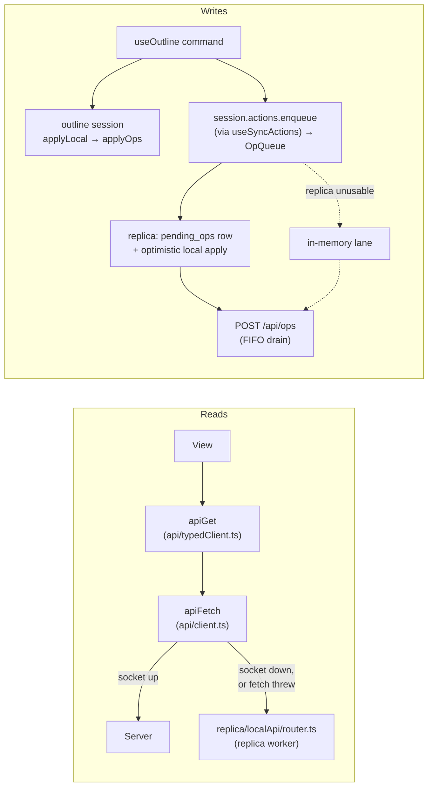
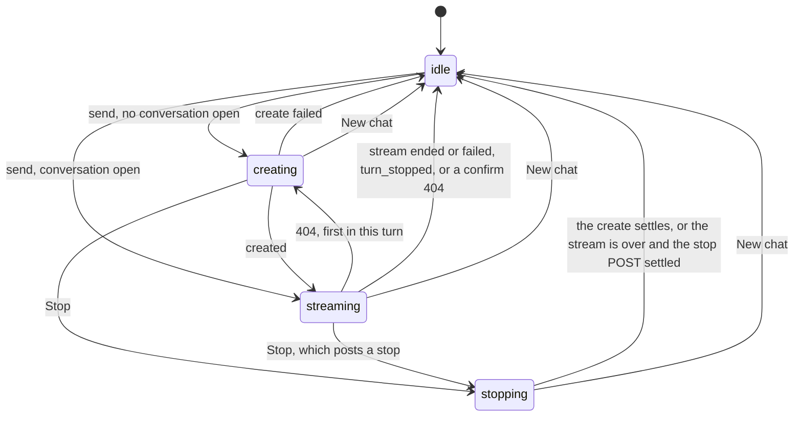

# Frontend architecture (web/)

The frontend is a React single-page app built with Vite: an offline-capable,
real-time-synced Roam-style outliner. The server owns its shapes. API types
are generated from its OpenAPI schema, the replica schema from its DDL, and
the block grammar is pinned to the Python parser by shared fixtures. `pnpm
check:fcis` (`web/tooling/fcis.ts`) fails a Functional Core module that
imports a Shell ([overview.md](overview.md#functional-core--imperative-shell)).

This doc covers the app shell. The outline editor is in
[frontend-editor.md](frontend-editor.md), block text to DOM in
[frontend-rendering.md](frontend-rendering.md), CSS in
[styling.md](styling.md), and the sync engine and replica in
[sync-and-offline.md](sync-and-offline.md). Failures are indexed by symptom in
[troubleshooting.md](../troubleshooting.md).

## Module map

An orientation map, not an inventory. `outline/` is mapped in
[frontend-editor.md](frontend-editor.md#module-map), and `sync/` and
`replica/` in [sync-and-offline.md](sync-and-offline.md#key-pieces).

```
web/src/
├── main.tsx, App.tsx         Shell  Entry; providers; routes; the global chords
├── routeMeta.ts              Core   Path, label and browser title per route
├── Popover.tsx               Shell  Anchored-popover chrome
├── useDismiss.ts             Shell  Outside-mousedown and Escape dismissal
├── useScrollFlashTarget.ts   Shell  Scroll a data-uid into view, flash and pin it
├── externalLink.ts           Core   iOS-standalone check; the x-safari rewrite
├── uid.ts                    Shell  Mints uids, ClientId and BatchId
├── ids.ts                    Core   Parses an untrusted string into an id brand
├── paths.ts                  Core   Page title to URL path and back
├── contexts.ts               Shell  The app's React contexts
├── useStaleGuard.ts          Shell  The stale-response idiom for async reads
├── useReducerRef.ts          Shell  A reducer whose handler reads its own dispatch's state
├── useModal.ts, focusWrap.ts Shell  Modal keys, scroll lock and focus; the Tab wrap (Core)
├── useStoredToggle.ts        Shell  A two-valued localStorage preference (keys: prefKeys.ts)
├── theme.ts, useTheme.ts,    —      The theme preference and the theme it resolves to
│   useEffectiveTheme.ts
├── test-helpers.ts           —      Unit-test fixtures; re-exports test-mint.ts
├── test-mint.ts              —      Checked brand mints for unit and e2e tests
├── styles.css                —      All styling (styling.md)
├── api/                      Shell  apiFetch, the typed client, brands.ts, the
│                                    generated openapi.json and types.d.ts
├── views/                    Shell  One file per route. EditablePage is one editable
│                                    outline, shared by PageView and sidebar panels
├── components/               Shell  Editor views (EditableBlockTree, BlockInput),
│                                    inline renderers and chrome; each pure half
│                                    sits beside its component (pdfViewerCore …)
├── assistant/                Shell  The chat panel; chatMachine.ts (Core) is its
│                                    state, sse.ts (Core) parses frames
├── help/                     Core   parseHelpMarkdown.ts, the /help renderer
├── dnd/                      Shell  Drag context and drop zones; dropGeometry.ts (Core)
├── grammar/                  Core   Block grammar (frontend-rendering.md)
├── outline/                  —      The editor engine (frontend-editor.md)
└── sync/, replica/           —      Delivery and the offline engine
                                     (sync-and-offline.md)
```

## How reads and writes flow



- A write's `WriteTicket` separates *persisted locally* (`settled`) from
  *acknowledged by the server* (`delivered`). Pages created offline get
  negative ids, remapped by `replica/reconcile.ts`.
- `SyncProvider` registers the offline gateway (`setOfflineGateway`). It
  serves only once the replica is ready, and treats only a dropped socket as
  offline; a cold start reaches it through a failed fetch. The shim answers
  with the server's JSON shapes (`shared/fixtures/shim_parity.json`). An
  unshimmed route throws `OfflineError`, and its UI says "online only".
- Views refetch when `resyncGeneration` bumps
  ([sync-and-offline.md](sync-and-offline.md#when-views-refetch)).
- `OfflineIndicator`'s wording states what is true of unsent work, so it is
  documented beside the mechanisms that decide it
  ([sync-recovery.md](sync-recovery.md#what-the-ui-shows)). Change both
  together.

## State management

There is no Redux or Zustand. A view holds the payload it fetched and refetches
through `useResync(fn)`. `sync/session.ts` holds the queue and
connectivity; `sync/SyncProvider.tsx` publishes them.
`outline/outlineSessions.ts` holds one shared block tree per title
([frontend-editor.md](frontend-editor.md#per-title-outline-sessions)).

`SyncProvider` publishes four contexts, one per rate of change:

| Hook | Value | New identity when |
|---|---|---|
| `useSyncActions()` | `enqueue`, `subscribe`, `settled`, `attachOutlineReplay`, `retryProblem`, `dismissProblem`, `discardProblem`, `resetReplica` | never: `session.actions`, one object for the session's life |
| `useResyncGeneration()` | `resyncGeneration` | server state may have diverged (reconnect after a gap, repair finished) |
| `useSyncEditability()` | `canEdit`, `readOnlyReason` | editing becomes allowed or blocked; a flap with a ready replica changes neither |
| `useSyncHealth()` | `status`, `replicaMode`, `pending`, `unsentInMemory`, `problem` | the socket flaps, or an op is queued or acknowledged |

React cannot subscribe to part of a context value, and the Journal mounts one
outline per loaded day. **Anything sharing an identity with `pending`
re-renders every mounted outline twice per flushed edit**, so a consumer takes
the narrowest hook it can. Tests inject a complete `Sync` through
`SyncContext`, which every hook prefers when set. `EditableBlock` is memoised
behind props `EditableBlockTree` holds stable, so only a changed context
identity reaches a row.

`pending` has one publisher, the op queue. Code that changes the durable queue
behind its back calls `queue.refreshPending()` rather than reading the replica.

### Fetch state

A response that lands after its input changed must not commit. Which guard to
use depends on how many requests of the same kind can be live:

| Situation | Idiom | Because |
|---|---|---|
| One request live at a time (a debounced search, a popup, `CurrentWork`) | `useStaleGuard`: `begin()` per request, commit only if `!isStale(token)`, `cancel()` when the surface empties | a later input supersedes the earlier one, even when the offline gateway ignores an abort |
| One request tied to one effect (`SidebarNav`, `BlockRefBacklinksPopover`) | a `cancelled` flag local to the effect, set by its cleanup | the effect re-runs or unmounts when the answer stops mattering |
| Several loads of one list that must stay valid together | a Core reducer whose events carry the load id they answer, driven through `useReducerRef`: `journalPaging.ts`, `filesPaging.ts`, `backlinksPaging.ts` | `useStaleGuard` has a single live token; these loads join one generation |

`useReducerRef` exists because a handler reads the state its own dispatch
made: a second click before React re-renders must see the first click's lock,
and a fetch must read the load id it just started. A plain `useReducer`'s
state in a handler is the last render's. A reducer that returns the same
object sets no state, so a refused event costs no render. `unlinkedStatus.ts`
uses it without load ids, as a double-click guard on Link.

An async handler in chrome that outlives a route, such as `TopBar`'s, checks
after each `await` that the route is still the one it started on (`titleRef`).
Otherwise a slow answer opens a dialog or navigates over the page the user has
moved to.

A `mounted` ref is set `true` in its effect's body, not only by
`useRef(true)`. StrictMode's dev replay runs the cleanup and then the body
again, so a ref set once stays `false`.

## API layer

`apiFetch<T>` (`api/client.ts`) handles JSON, the 401 → `/login` redirect and
the offline gateway. Reads carry a `READ_TIMEOUT_MS` abort signal. Mutations
carry none, because an aborted write the server applied would leave the op
queue retrying a batch it cannot know landed. `/api/sync/snapshot` opts out
(`{ timeoutMs: null }`), or a slow cold-start bootstrap would abort.

Product code calls `api/typedClient.ts`'s `apiGet`/`apiPost`/`apiPut`/
`apiDelete`; ESLint's `no-restricted-imports` bars `apiFetch` elsewhere. The
typed client takes the OpenAPI path template, so the generated `paths` table
decides the parameters, body and response type:

    apiGet("/api/page/{title}", { path: { title } })

Path parameters are encoded per segment, because `{title:wholepath}` routes
carry titles whose slashes must survive. Raw `apiFetch` remains in the typed
client itself, multipart upload (`sync/assets.ts`) and `SyncProvider.tsx`'s
`replicaSync` seam (`fetchJson: apiFetch`).

Types come from `api/types.d.ts`, generated by `pnpm gen-types` from
`api/openapi.json`. Never hand-write API types: the server suite fails on a
stale artifact ([backend.md](backend.md#generated-artifacts-and-parity-fixtures)).

## Brands

A server field typed with a branded `NewType` carries an `x-brand` marker in
`openapi.json` ([backend.md](backend.md#wire-models-and-brands)).
`tooling/genTypes-core.ts` turns it into `Brands.<Name>`, a reference to the
export of that name in `api/brands.ts`, where every web brand is defined. A
subtype brand adds a second key, not a second `__brand`, since two `__brand`
literals intersect to `never`.

**The main tsconfig's `skipLibCheck` skips every `.d.ts`, so a `Brands.<Name>`
that `brands.ts` does not export degrades silently to `any`.** `pnpm typecheck`
therefore runs a second pass, `tsconfig.apitypes.json`, with lib checking on.
`tooling/genTypes.drift.test.ts` fails when the committed `types.d.ts` is not
what `pnpm gen-types` writes; the stock openapi-typescript CLI would turn every
brand back into `string`.

Where a brand may be minted is `MINT_SITES` in
`server/src/pkm/brand_registry.py`, enforced on the web by
`brands/no-brand-assertion` ([checks.md § Brand rules](checks.md#brand-rules)
says where tests mint). The web's readers of untrusted data are mint sites:
`sync/wire.ts` for network bodies and WebSocket frames, `ReplicaDb.select` for
replica rows ([sync-and-offline.md](sync-and-offline.md#reading-rows)).

A title no check has run on is a `RawTitle`: request bodies, `paths.ts`'s
`titleFromPathname`, and the op `page_title`. That op field is canonical only
on the server's WS echo, so a `CanonicalTitle` is assignable to it.
`asRawTitle` (`replica/titles.ts`) mints from plain text. `replica/apply.ts`'s
`parkedTitle`, the placeholder written while two rows swap titles, is its own
`ParkedTitle` brand, so no reader can take it for a canonical title.

## Views and navigation

The routes are `STATIC_ROUTES` plus `/page/*`, one page in `PageView`; any other
path renders `NotFound`. `STATIC_ROUTES` in `routeMeta.ts` holds the id, path,
top-bar label and browser title of every static route. `App.tsx` maps each id
to its view through `VIEWS`, a `Record<StaticRouteId, ComponentType>` the
compiler checks for completeness. TopBar and `useRouteTitle.ts` read the same
array, so a route cannot be labelled in one place and not another. `/page/*`
has no entry, and `PageView.tsx` sets its title. `documentTitleFor` returns
`NOT_FOUND_TITLE` for any other path. `/help`
renders `docs/keyboard.md` (bundled with `?raw`) through
`help/parseHelpMarkdown.ts`, which knows only headings, paragraphs, pipe
tables and code spans: a list or link there renders literally.

Every pathname under `/page/` renders PageView directly, because react-router
compiles `*` to a `.*` that matches no newline, U+2028 or U+2029. A title
the fold changes (a hand-typed `%0A`, a double space, an NBSP) is first
redirected to the title it folds to (`normalizeRefTitle`). PageView, a sidebar
panel and the Journal key their outline session by the page's stored title,
whatever spelling opened them (`outline/titleKeys.props.test.tsx`).

### Navigation chrome

The left nav holds pinned pages (`/api/sidebar`), app destinations and the
theme toggle. The right sidebar is a session-only stack: shift-clicking a page
link or ref pushes a `SidebarPanel`.

No link in the left nav may leave shift-click to the browser. react-router
ignores modified clicks (`shouldProcessLinkClick` bails on `shiftKey`), so a
nav link is never a bare `NavLink`:

| Component | For | Shift-click |
|---|---|---|
| `NavPageLink` | destinations that are pages (pinned entries, TODO) | opens the page in the sidebar |
| `NavRouteLink` | routes with no page behind them | swallowed, leaving `onNavigate` unfired so a phone drawer stays open |

The global chords ([keyboard.md](../keyboard.md#anywhere-in-the-app)) share one
`window` keydown listener in `App.tsx`. They fire while a block is edited
only because `BlockInput` never calls `stopPropagation` on keydown. The
`Ctrl+Shift` forms exist because the page gets no keydown for the Cmd forms
(macOS reserves `Ctrl+Cmd+D`, the browser owns `Cmd+T`). jsdom and Playwright
deliver keydowns the real OS would swallow, so confirm a new chord in the
running app.

### Paged lists

Each list exists for one rule:

| List | State lives in | The rule |
|---|---|---|
| Journal days | `views/journalPaging.ts` | One load in flight; a failed load keeps the days and their cursor ([The Journal](#the-journal)) |
| `/files` | `views/filesPaging.ts` | A filter change bumps the generation at the keystroke; Select all and Load more start only from a list loaded under the current generation ([The `/files` browser](#the-files-browser)) |
| Linked references | `components/backlinksPaging.ts` | Show more and the filter panel's load-all are walks and several can be in flight, so the section is loading until every walk settles; a sync refresh replaces the groups from offset 0, and while one is in flight no walk starts and the panel stays closed, since either would page on from groups about to be replaced |
| Unlinked references | paging in `components/UnlinkedSection.tsx`; each Link's status in `components/unlinkedStatus.ts` | The server drops a block from `/api/unlinked` once it references the page, so a delivered Link takes its block out of the loaded list and one off `total`, and Show more asks from the count of loaded blocks still listed: counting an undelivered Link as gone only re-fetches a block, which `mergeGroups` drops, while counting a gone one as listed skips the next block |

#### The Journal

Each day's linked references arrive with the day in `/api/journal`'s payload
and render inline (`JournalDayReferences`, reusing `BacklinksSection`). A day on
screen keeps the list it first rendered: `BacklinksSection` snapshots `initial`
into state, and a resync replaces day objects in place under stable keys.
Nothing unmounts a loaded day, so each mounted outline and its `useDismiss`
listener last for the session (the perf gate's journal scenarios).

The days on screen are a contiguous, newest-first run of the non-empty days
`/api/journal` serves, starting at today. Paging state lives in one reducer,
`views/journalPaging.ts`, and one load is in flight at a time:

| Event | Load it starts | When it lands |
|---|---|---|
| mount, or "Load older days" with nothing on screen | head: `BATCH` days | replaces the days |
| the sentinel or "Load older days" | older: `BATCH` days `before` the oldest shown; ignored while a load is in flight or the past is exhausted | appends |
| resync | head: as many days as are on screen, at least `BATCH`, at most `SERVER_MAX_DAYS`; supersedes the load in flight | replaces the days |

A failed load leaves the days and their cursor as they were. So "Load older
days" after a failed resync continues from the oldest day shown, rather than
starting over with one batch. The error shows only while the latest completed
load failed: any success clears it. A result that answers a superseded load
changes nothing. A batch shorter than asked for means the past is exhausted.
A resync over more than `SERVER_MAX_DAYS` days drops the oldest off, since the
server clamps `days`; scrolling loads them back.

#### The `/files` browser

`/files` is a table over `/api/assets/search`; the store is in
[files-and-assets.md](files-and-assets.md). Image and PDF thumbs open in-app
(`ImageOverlay`, `PdfViewer`'s overlay-only mode). The refs popover renders
through `BacklinkGroupList`, which provides `InertMediaContext` itself
whenever `onNavigate` is set, so media in a navigable row is inert and the
whole row is the click target. `AssetRefGroup` has
no `page_id`, which keeps asset refs out of `mergeGroups`. `filesPaging.ts`
owns the list's fetch state. A filter change bumps the generation and clears
the selection at the keystroke, not when the debounced reload fires. Select
all and Load more start only from a list loaded under the current generation,
since until then `items` and `total` belong to the old filter and a Delete
would remove files outside the new one.

### Popovers and menus

`Popover.tsx` is the chrome every anchored popover renders through:
`position: fixed` at its anchor, measured after layout and clamped into the
viewport by `clampPopoverPosition`, since an overflowing fixed element grows no
scrollbar. Its `remeasure` prop names values whose change resizes the content.
`Popover` and `BlockMenu` portal into `document.body`
([styling.md](styling.md#layout-invariants) says why). A portal moves the DOM
node, not the React node, so a portalled surface stops its own clicks.

| Surface | Dismissal |
|---|---|
| `BlockRefBacklinksPopover`, `FileCardPopovers` | `Popover`'s own `useDismiss` (outside `mousedown` or Escape) |
| `BlockMenu` | `useDismiss`; roving focus and Tab stay in the component |
| `TopBar`'s page menu, `SearchBar` | `useDismiss` with `enabled` |
| `ConfirmDialog` (Enter on a focused dialog button is left to that button), `DeleteBlockedDialog`, `PdfViewer`'s overlay | `useModal`, `trap: "cycle"` |
| `ImageOverlay`, `GoodlinksReader`, `LocalFilePicker` | `useModal`, `trap: "pin"` |
| `AutocompletePopup`, `DatePickerPopup` | none: `BlockInput` owns their keys |

A modal surface (one that traps focus, locks scrolling or answers keys beyond
Escape) uses `useModal` and nothing hand-rolled; a surface whose keys another
component owns hand-rolls its dismissal. `useModal` keeps a stack, and
`useModal.test.tsx` pins it: only the topmost modal answers keys, the body
stays locked until the last one closes, and focus goes back (to `triggerRef`,
else to what held it) only from the topmost.

The topmost modal stops Escape in the capture phase at `window`, so nothing
beneath it closes on the same keypress, whether a menu, the assistant panel's
`onKeyDown` or a `useDismiss` listener. A non-modal popover inside a modal
therefore cannot answer Escape and must itself be a `useModal`.

`"cycle"` wraps Tab and Shift+Tab inside the surface (`focusWrap.ts`).
`"pin"` keeps Tab on one element: `LocalFilePicker` is driven from its search
box, and `GoodlinksReader`'s sandboxed iframe would swallow a cycling Tab,
since its keydowns never reach the app
([files-and-assets.md](files-and-assets.md#the-reader-and-the-goodlinks-command)).

A row's `RefCountBadge` opens `BlockRefBacklinksPopover`, which fetches
`GET /api/block/{uid}/backlinks` at open, so the list is live while the count
is as fresh as the page payload.

Every clipboard write goes through `copyText`, which resolves `false` instead
of throwing when the Clipboard API is missing or the write is refused.
`Files` and `DroppedDraftNotice` then show the text to copy by hand. The block
menu's Copy block reference and Cmd/Ctrl+C on a block selection
(`EditableBlockTree`) ignore the result, so their failure shows nothing.

Every confirmation goes through `useConfirm` (`components/ConfirmDialog.tsx`),
never `window.confirm` ([below](#ios-and-phone-behaviour)). The owning
component must render the returned `dialog`, or `confirm()` never settles; a
hook with a confirm-backed handler takes `confirm` as an argument, as
`useOutline` does, and its owner (`EditablePage`) renders the dialog. Remote
batches can land while a dialog is open, so a handler re-derives its target
after the await.

Dismissible notice lines render through `DismissibleNotice`, whose classes and
roles (`tone: "error"` an alert, `"status"` a status) are what `styles.css`
and the e2e locators select on. `useOutline` exposes one `notices` list
(`outline/notices.ts`: one slot per `NoticeKind`, listed by `noticeList`),
which `EditablePage` maps.

## iOS and phone behaviour

| Platform behaviour | What the app does | Code |
|---|---|---|
| An installed iOS app opens external links in an in-app WKWebView | rewrites a cross-origin click to `x-safari-https://` (or `-http`), which opens Safari. Hrefs stay `https://` | `ExternalLinkInterceptor`, `externalLink.ts::isIosStandalone` |
| In standalone, a same-origin `target="_blank"` link replaces the whole app | the interceptor does not rewrite same-origin clicks, so PDF links and /files thumbs open the in-app `PdfViewer` overlay rather than a `target="_blank"` anchor | `PdfEmbed`, `PdfViewer`, `externalLink.ts::safariHrefForClick` |
| A tap inside a cross-origin iframe never reaches that listener | in standalone, `BlueskyEmbed` lays a `.bluesky-embed-tap` anchor to the post over its iframe | `BlueskyEmbed.tsx` |
| Standalone suppresses `window.confirm`, returning `false` | every confirmation uses `useConfirm` | `ConfirmDialog.tsx` |
| Standalone ignores `beforeunload` | the in-memory lane's unload guard cannot hold ([sync-recovery.md](sync-recovery.md#the-in-memory-fallback-lane)) | `sync/unloadGuard.ts` |
| The iPhone keyboard has no Tab key | `BlockInput` renders `KeyboardBar`. `isPhoneUserAgent` decides, not width, so an iPad or narrow desktop never gets it | `outline/keyboardBar.ts` |
| iOS Safari does not shrink the layout viewport for the keyboard | the bar sits `keyboardInset` above its bottom, tracked from `visualViewport` | `KeyboardBar.tsx` |
| Safari zooms into a focused field under 16px; `.block-input` is 15px | on an iPhone `main.tsx` adds `maximum-scale=1`, or the zoom pans the bar off screen | `phoneViewportContent` |
| The iOS 26 Safari tab's floating address pill is outside the visual viewport | the bar sits one pill higher, the lowest position where every key can be tapped | `keyboardInset` |
| Cancelling `pointerdown` keeps the keyboard open, but WebKit then sends no click | a bar key acts on `pointerdown`; only a `detail === 0` click (VoiceOver) acts on its own | `KeyboardBar.tsx` |
| A touch on a key starts text selection; two quick taps zoom | `.keyboard-bar` sets `user-select: none`, `-webkit-touch-callout: none`, `touch-action: manipulation` | `styles.css` |
| iPadOS may freeze a hidden tab's socket | a socket still reporting `OPEN` after `RESUME_STALE_MS` hidden is closed on return to visibility ([sync-and-offline.md](sync-and-offline.md#ancillary-details)) | `sync/socket.ts` |

## The assistant panel

`src/assistant/` is the chat panel for the server-side assistant
([assistant.md](assistant.md)). Conversations are lost on reload. The model
list comes from `GET /api/assistant/models` on first open, with a hardcoded
fallback (`FALLBACK_MODELS` in `chatMachine.ts`).

- `client.ts::streamMessage` feeds the response body through `sse.ts`, a pure
  frame parser, into the chat driver (`chatDriver.ts`). It bypasses `apiFetch`,
  which reads the body as JSON, and replicates its 401 handling.
- `sse.ts` drops a frame whose `event:` name is not in `EVENT_TYPES`, which
  is generated with the `AssistantEvent` union ([assistant.md § The stream
  contract](assistant.md#the-stream-contract), which owns the tolerance rule).
  That hides keepalives, and also drops a new event type until the web is
  regenerated.
- A stalled stream (`STREAM_STALL_TIMEOUT_MS`) errors with something that is
  not an `AbortError`: the driver's `streamFailure` reports an `AbortError` as
  `aborted`, and `step` shows no error for it.
- A tool line pairs with its `tool_finished` by `tool_use_id`, across turns,
  so a stopped turn's write still resolves in the next. Only a line not yet
  done pairs, so a reused id cannot turn a finished line's `✗` into `✓`.
- A tool result is untrusted text, and a failure reason can echo model-chosen
  input, so `.assistant-tool-failed` and `.assistant-tool-warning` are text
  nodes, never `tokenizeBlock`.
- `stripCaretBlockRefs` (`assistant/normalizeRefs.ts`) runs before
  `tokenizeBlock`, because some models copy the `^uid` marker into citations
  and the grammar rejects `((^uid))`.
- Replies render under `UntrustedContentContext`, so a Bluesky post or a
  diagram that needs stock mermaid waits for a click (external images already
  do everywhere)
  ([frontend-rendering.md](frontend-rendering.md#link-safety-and-external-media)).

### The chat machine

`assistant/chatMachine.ts` (Core) holds the whole chat as one reducer:
`step(state, event)` returns the next state and the effects to run.
`useAssistant.ts` only dispatches the user's actions; the driver in
`chatDriver.ts` (`createChatDriver(publish, client)`, which takes the client
functions rather than importing them) feeds each request's result back and
starts the requests the effects name. Stop is offered per `canStop`, which
holds while a card's answer posts or has failed. The conversation is
`none`, `creating` or `open`; the turn moves like this:



Stop is a move from every busy phase. After it, no output of that turn
reaches the panel. A create cannot be called back, so Stop in `creating`
keeps the conversation the create returns but starts no stream from it.
Stop in `streaming` asks the server (`postStop`), and the rules below keep the
panel busy until the server's turn is over
([turn phase](assistant.md#the-turn-phase)). After an aborted stream, from
Stop's fallback or New chat, the server may still be draining;
`streamWithBusyRetry` retries the 409 that a send meets then.

| Rule | Reason |
|---|---|
| Every request's result names its turn, and changes nothing on screen unless that turn is busy and not stopping. That includes a failed confirm POST | New chat clears the transcript at once, so a superseded turn's events must not fold into the new one. After Stop no card is left to answer again |
| A stream's 404 re-creates the conversation once, with the same model, in the same turn. A second 404 fails the turn | The server retires a reaped, evicted or dead conversation, and a lost harness ends its turn with `HARNESS_LOST`. The next send to it gets a 404 |
| The picker shows the model of the conversation that is creating or open, as the create returned it, and is locked then. The models list's default applies only while there is none and the user has not picked | A conversation keeps the model it was created with, so the picker shows that one |
| The driver posts the stop only once the stream's response has opened, and retries no 409 after Stop. A stream that settles first posts nothing | `POST …/stop` names no turn. An opened response means the server has reserved this turn, so the stop cannot reach another |
| A stopped turn ends only once its stop POST has settled (`stopSettled`) | The server acts on a stop before it answers, so a settled POST cannot stop a later turn |
| If the POST fails, or the turn has not ended within `STOP_ACK_TIMEOUT_MS` (`chatDriver.ts`), the driver aborts the stream and the POST | The server's own bound is `INTERRUPT_TIMEOUT_S` + `DRAIN_TIMEOUT_S` once it hears the stop; past it the panel must still be freed. An aborted POST can still reach the server later and stop the next turn |
| A `turn_stopped` for a turn that did not stop ends it with `UNASKED_STOP_MESSAGE` | That is a stop meant for an earlier turn: the user is told the reply was cut short, never left without one |
| New chat aborts the stream, a stopping turn's included, and sends the DELETE only after that stream settles. A conversation created for a superseded turn is deleted | The server sees the dropped connection and ends the turn before it closes the conversation |

`web/src/props/assistant` checks these rules against a model written from
this section ([checks.md § Property gate](checks.md#property-gate)).

## Testing and quality gates

`pnpm verify` runs the web gates;
[checks.md](checks.md#every-check) lists what each
fails on, and `AGENTS.md` § Testing says how to run them.

- **Unit** (Vitest + jsdom): co-located `*.test.ts(x)`. `src/test-setup.ts`
  fails whichever test is running when a `console.warn` or `console.error`
  lands, or the file when it lands after the last test. So a stray timer's
  message surfaces in a later test: read the message, not the test name. Traps
  that make a test pass without proving anything:

  | Trap | Instead |
  |---|---|
  | `fireEvent.click` in jsdom moves no focus, and the op queue posts nothing | call `focus()` yourself; assert writes through `SyncFake` (`test-helpers.ts`) |
  | A bubble listener never sees a click inside an interactive island, which stops propagation | to prove a click was not prevented, read `defaultPrevented` in a `document` listener added with `capture: true` |
  | A fixture that derives a daily-page title from the real date collides with a seeded page on some days | pin the date, as `router.test.ts` and `parity.test.ts` pin `nowMs` |
  | A hidden `<input type=file>` inside a component that unmounts on blur loses the pick, because `change` fires after the unmount (no `POST /api/assets` in the logs) | keep it in a stable ancestor, as `EditableBlockTree` does with `.upload-input` |
- **E2E** (Playwright, `web/e2e/`): any HTTP 5xx fails the run (`fixtures.ts`),
  and a server-side exception fails teardown.
  `e2e/server-state.ts::waitForServerText` waits for a write to reach the
  server before a reload. jsdom computes accessible names differently from
  Chromium, so check one with a Playwright aria snapshot. Traps that make a
  spec pass vacuously or hang:

  | Trap | Instead |
  |---|---|
  | A bare `#Tag` at the caret's end reopens autocomplete, which swallows Enter | type a trailing space first |
  | `Escape` blurs and unmounts `textarea.block-input` | re-locate the textarea after it |
  | The op queue drains in order, so an early block can reach the server first | before a reload, wait on `waitForServerText` for the last block created |
  | A `.ws-banner` count of 0 holds whenever the socket is connected | assert the state the banner reports |
  | `.journal-day.last()` moves as days are added | locate a seeded day by its title |
  | jsdom has no popups | prove a click opens no window with `context.on("page")` |
  | "element is not stable" or "detached" retries for 30 s | something bumped `resyncGeneration` and remounted the tree |
- **Perf**: `web/tooling/perf/check.ts` is the frontend half of
  `perf/check.sh` ([checks.md § Performance gate](checks.md#performance-gate)); its
  [README](../../web/tooling/perf/README.md) lists the files and the measurement caveats.

## Build notes (`vite.config.ts`)

- The dev server proxies `/api` (with WebSocket), `/assets` and `/login` to
  the backend on `PKM_API_PORT`. Unset, that is 8974, production's port, so
  `pnpm dev` writes to production: on this machine set `PKM_API_PORT=8975` and
  run a scratch server there.
  The backend refuses any `Origin` but its own on `/api/ws` and unsafe
  methods, so the `/api` proxy rewrites the dev server's own origin to the
  backend's (`devProxyOrigin` in `web/tooling/devProxyOrigin.ts`). Any other
  origin goes upstream unchanged and is refused there. Rewriting every origin
  would let any page on `localhost` write to the backend through the proxy.
- `web/pnpm-workspace.yaml` turns off pnpm's stale-dependency check
  (`verifyDepsBeforeRun`). The check keys on the project path, and a
  worktree shares the main checkout's `node_modules` through a symlink. With
  the check on, a script run in a worktree installs through the link and
  repoints the main checkout's packages at that worktree.
- `@sqlite.org/sqlite-wasm` stays in `optimizeDeps.exclude`, because its wasm
  URL resolution breaks under dep optimization.
- Hashed bundles go under `app-assets/`. The server sends `index.html` with
  `Cache-Control: no-cache`, so a reload after a deploy fetches the new shell
  and its chunk names.
- `server.fs.allow` lists the repo root so `?raw` can import `docs/keyboard.md`
  from above `web/`; without it vitest fails with "Denied ID".
- A build over budget throws in `generateBundle`, before the output is written,
  so measure a size with the limits in `budgets.json` raised. Attribute a
  budget delta against the commit just before the merge.
- The service worker (`vite-plugin-pwa`, `autoUpdate`) precaches what
  `globPatterns` lists: the app shell, every emitted chunk, the sqlite wasm,
  the pdf.js worker and the core KaTeX fonts. A cold offline start therefore
  boots, and lazy renderers load offline. It runtime-caches `/assets/` and
  never caches `/api`.

## Tech stack

Versions are in `web/package.json`. What the code does not say:

| Concern | Choice |
|---|---|
| Build | Vite with `vite-plugin-pwa` and pnpm. Overrides go in `pnpm-workspace.yaml`, since pnpm 11 ignores `package.json` overrides |
| Offline | `@sqlite.org/sqlite-wasm` in a Web Worker on the OPFS SAHPool VFS |
| Lazy-loaded | KaTeX, beautiful-mermaid with a stock Mermaid fallback, react-pdf/pdf.js, highlight.js, fzf |
