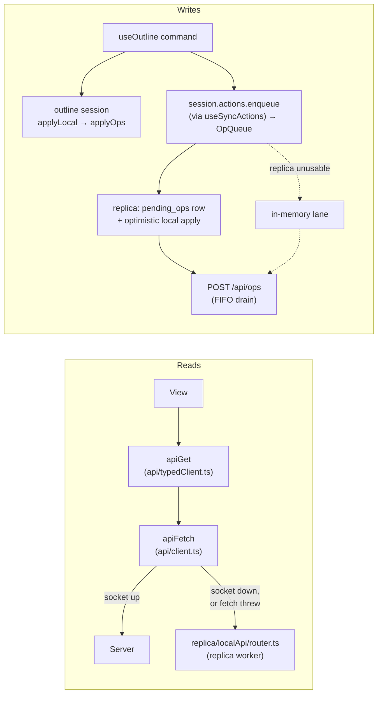
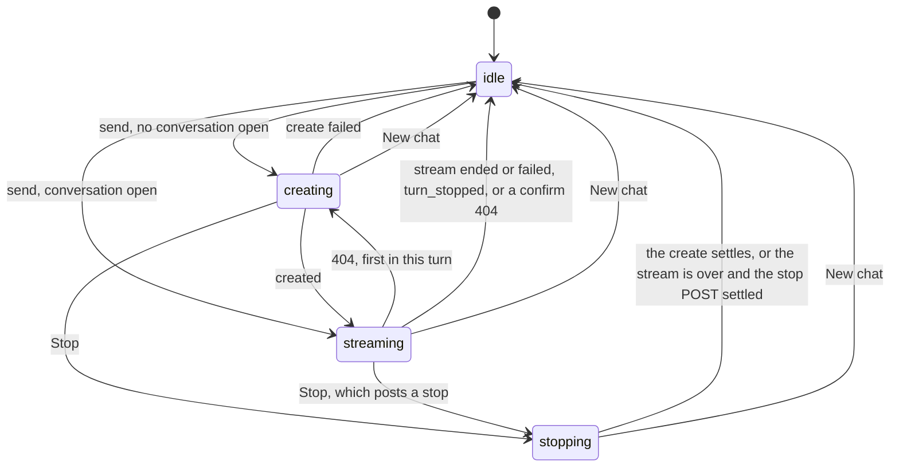

# Frontend architecture (web/)

The frontend is a React single-page app built with Vite: an offline-capable,
real-time-synced Roam-style outliner. The server owns its shapes. API types
are generated from its OpenAPI schema, the replica schema from its DDL, and
the block grammar is pinned to the Python parser by shared fixtures.

This doc covers the app shell. The outline editor is in
[frontend-editor.md](frontend-editor.md), block text to DOM in
[frontend-rendering.md](frontend-rendering.md), CSS in
[styling.md](styling.md), and the sync engine and replica in
[sync-and-offline.md](sync-and-offline.md).

## Module map

An orientation map, not an inventory. `outline/` is mapped in
[frontend-editor.md](frontend-editor.md#module-map), and `sync/` and
`replica/` in [sync-and-offline.md](sync-and-offline.md#key-pieces).

```
web/src/
├── main.tsx, App.tsx         Shell  Entry; providers; routes; the global chords
├── routeMeta.ts              Core   Path, label and browser title per route
├── Popover.tsx               Shell  Anchored-popover chrome
├── useDismiss.ts             Shell  Outside-mousedown and Escape dismissal
├── uid.ts                    Shell  Mints uids, ClientId and BatchId
├── ids.ts                    Core   Parses an untrusted string into an id brand
├── paths.ts                  Core   Page title to URL path and back
├── useStaleGuard.ts          Shell  The stale-response idiom for async reads
├── useReducerRef.ts          Shell  A reducer whose handler reads its own dispatch's state
├── useModal.ts, focusWrap.ts Shell  Modal keys, scroll lock and focus; the Tab wrap (Core)
├── useStoredToggle.ts        Shell  A two-valued localStorage preference (keys: prefKeys.ts)
├── theme.ts, useTheme.ts,    —      The theme preference and the theme it resolves to
│   useEffectiveTheme.ts
├── test-helpers.ts           —      Unit-test fixtures; re-exports test-mint.ts
├── test-mint.ts              —      Checked brand mints for unit and e2e tests
├── styles.css                —      All styling (styling.md)
├── api/                      Shell  apiFetch, the typed client, brands.ts, the
│                                    generated openapi.json and types.d.ts
├── views/                    Shell  One file per route. EditablePage is one editable
│                                    outline, shared by PageView and sidebar panels
├── components/               Shell  Editor views (EditableBlockTree, BlockInput),
│                                    inline renderers and chrome; each pure half
│                                    sits beside its component (pdfViewerCore …)
├── assistant/                Shell  The chat panel; chatMachine.ts (Core) is its
│                                    state, sse.ts (Core) parses frames
├── help/                     Core   parseHelpMarkdown.ts, the /help renderer
├── dnd/                      Shell  Drag context and drop zones; dropGeometry.ts (Core)
├── grammar/                  Core   Block grammar (frontend-rendering.md)
├── outline/                  —      The editor engine (frontend-editor.md)
└── sync/, replica/           —      Delivery and the offline engine
                                     (sync-and-offline.md)
```

## How reads and writes flow



- `SyncProvider` registers the offline gateway (`setOfflineGateway`); it
  serves only once the replica is ready. Only a dropped socket counts as offline, so a cold
  start reaches the gateway through a failed fetch. The shim and its
  "online only" routes are in [sync-and-offline.md](sync-and-offline.md).
- Views refetch when `resyncGeneration` bumps
  ([sync-and-offline.md](sync-and-offline.md#when-views-refetch)).
- `OfflineIndicator`'s wording states what is true of unsent work, so it
  changes together with the mechanisms that decide it
  ([sync-recovery.md](sync-recovery.md#what-the-ui-shows)).

## State management

There is no Redux or Zustand. A view holds the payload it fetched and refetches
through `useResync(fn)`. `sync/session.ts` holds the queue and
connectivity; `sync/SyncProvider.tsx` publishes them.
`outline/outlineSessions.ts` holds one shared block tree per title
([frontend-editor.md](frontend-editor.md#per-title-outline-sessions)).

`SyncProvider` publishes four contexts, one per rate of change:

| Hook | Value | New identity when |
|---|---|---|
| `useSyncActions()` | `enqueue`, `subscribe`, `settled`, `attachOutlineReplay`, `retryProblem`, `dismissProblem`, `discardProblem`, `resetReplica` | never: `session.actions`, one object for the session's life |
| `useResyncGeneration()` | `resyncGeneration` | server state may have diverged (reconnect after a gap, repair finished) |
| `useSyncEditability()` | `canEdit`, `readOnlyReason` | editing becomes allowed or blocked; a flap with a ready replica changes neither |
| `useSyncHealth()` | `status`, `replicaMode`, `pending`, `unsentInMemory`, `problem` | the socket flaps, or an op is queued or acknowledged |

React cannot subscribe to part of a context value, and the Journal mounts one
outline per loaded day. **Anything sharing an identity with `pending`
re-renders every mounted outline twice per flushed edit**, so a consumer takes
the narrowest hook it can. Tests inject a complete `Sync` through
`SyncContext`, which every hook prefers when set. `EditableBlock` is memoised
behind props `EditableBlockTree` holds stable, so only a changed context
identity reaches a row.

`pending` has one publisher, the op queue. Code that changes the durable queue
behind its back calls `queue.refreshPending()` rather than reading the replica.

### Fetch state

A response that lands after its input changed must not commit. Which guard to
use depends on how many requests of the same kind can be live:

| Situation | Idiom | Because |
|---|---|---|
| One request live at a time (a debounced search, a popup, `CurrentWork`) | `useStaleGuard`: `begin()` per request, commit only if `!isStale(token)`, `cancel()` when the surface empties | a later input supersedes the earlier one, even when the offline gateway ignores an abort |
| One request tied to one effect (`SidebarNav`, `BlockRefBacklinksPopover`) | a `cancelled` flag local to the effect, set by its cleanup | the effect re-runs or unmounts when the answer stops mattering |
| Several loads of one list that must stay valid together | a Core reducer whose events carry the load id they answer, driven through `useReducerRef` (its header says why): `journalPaging.ts`, `filesPaging.ts`, `backlinksPaging.ts` | `useStaleGuard` has a single live token; these loads join one generation |

An async handler in chrome that outlives a route, such as `TopBar`'s, checks
after each `await` that the route is still the one it started on (`titleRef`).
Otherwise a slow answer opens a dialog or navigates over the page the user has
moved to.

A `mounted` ref is set `true` in its effect's body, not only by
`useRef(true)`. StrictMode's dev replay runs the cleanup and then the body
again, so a ref set once stays `false`.

## API layer

`apiFetch<T>` (`api/client.ts`) handles JSON, the 401 → `/login` redirect and
the offline gateway. Only reads carry a timeout (`READ_TIMEOUT_MS`;
`client.ts` says why mutations do not). A read may bound its silence instead
of its total time: `stallMs` fails it with `StalledReadError` once no byte,
the headers included, arrives for that long. The sync snapshot, whose size
grows with the graph, has only this bound; during a recovery its `onProgress`
renews the [recovery lease](sync-recovery.md#the-recovery-lease). A stall
never falls back to the offline gateway, which does not serve the snapshot.
Product code calls
`api/typedClient.ts`'s `apiGet`/`apiPost`/`apiPut`/`apiDelete`, and ESLint's
`no-restricted-imports` bars `apiFetch` elsewhere. The typed client takes the
OpenAPI path template, so the generated `paths` table decides the parameters,
body and response type:

    apiGet("/api/page/{title}", { path: { title } })

Types come from `api/types.d.ts`, generated by `pnpm gen-types` from
`api/openapi.json`. Never hand-write API types: the server suite fails on a
stale artifact ([backend.md](backend.md#generated-artifacts-and-parity-fixtures)).

## Brands

A server field typed with a branded `NewType` carries an `x-brand` marker in
`openapi.json` ([backend.md](backend.md#wire-models-and-brands)).
`tooling/genTypes-core.ts` turns it into `Brands.<Name>`, a reference to the
export of that name in `api/brands.ts`, where every web brand is defined.

**The main tsconfig's `skipLibCheck` skips every `.d.ts`, so a `Brands.<Name>`
that `brands.ts` does not export degrades silently to `any`.** `pnpm typecheck`
therefore runs a second pass, `tsconfig.apitypes.json`, with lib checking on.

Where a brand may be minted is `MINT_SITES`
([checks.md § Brand rules](checks.md#brand-rules)). A title no check has run
on is a `RawTitle`; `brands.ts` documents the title hierarchy above it.

## Views and navigation

The routes are `STATIC_ROUTES` (`routeMeta.ts`) plus `/page/*`; any other path
renders `NotFound`. `App.tsx` maps each route id to its view through `VIEWS`,
which the compiler checks for completeness, and TopBar and `useRouteTitle.ts`
read the same array, so a route cannot be labelled in one place and not
another. `/help` renders `docs/keyboard.md` through
`help/parseHelpMarkdown.ts`, which knows a narrow subset: a list or link there
renders literally.

Every pathname under `/page/` renders PageView by its prefix, because
react-router's `*` matches no newline, U+2028 or U+2029. A title the fold
changes (a hand-typed `%0A`, a double space, an NBSP) is first redirected to
the title it folds to (`normalizeRefTitle`). PageView, a sidebar panel and the
Journal key their outline session by the page's stored title, whatever
spelling opened them (`outline/titleKeys.props.test.tsx`).

### Navigation chrome

The left nav holds pinned pages (`/api/sidebar`), app destinations and the
theme toggle. The right sidebar is a session-only stack: shift-clicking a page
link or ref pushes a `SidebarPanel`.

No link in the left nav may leave shift-click to the browser. react-router
ignores modified clicks, so a nav link is never a bare `NavLink`:

| Component | For | Shift-click |
|---|---|---|
| `NavPageLink` | destinations that are pages (pinned entries, TODO) | opens the page in the sidebar |
| `NavRouteLink` | routes with no page behind them | swallowed, leaving `onNavigate` unfired so a phone drawer stays open |

The global chords ([keyboard.md](../keyboard.md#anywhere-in-the-app)) share one
`window` keydown listener in `App.tsx`. They fire while a block is edited
only because `BlockInput` never calls `stopPropagation` on keydown. The
`Ctrl+Shift` forms exist because the page gets no keydown for the Cmd forms
(macOS reserves `Ctrl+Cmd+D`, the browser owns `Cmd+T`). jsdom and Playwright
deliver keydowns the real OS would swallow, so confirm a new chord in the
running app.

### Paged lists

Each list's fetch state exists for one rule; the linked section or the
state's file gives the reasons:

| List | State lives in | The rule |
|---|---|---|
| Journal days | `views/journalPaging.ts` | One load in flight; a failed load keeps the days and their cursor ([The Journal](#the-journal)) |
| `/files` | `views/filesPaging.ts` | A filter change bumps the generation at the keystroke, not when the debounced reload fires ([The `/files` browser](#the-files-browser)) |
| Linked references | `components/backlinksPaging.ts` | Show more and load-all overlap, so the section is loading until every walk settles; no walk starts while a sync refresh is in flight |
| Unlinked references | `components/UnlinkedSection.tsx`, `components/unlinkedStatus.ts` | A delivered Link leaves the loaded list and `total`, because the server's list has shifted left; Show more asks from the count of loaded blocks still listed: counting an undelivered Link as gone only re-fetches a block `mergeGroups` drops; the reverse skips one |

#### The Journal

Each day's linked references arrive with the day in `/api/journal`'s payload
and render inline (`JournalDayReferences`, reusing `BacklinksSection`). A day on
screen keeps the list it first rendered: `BacklinksSection` snapshots `initial`
into state, and a resync replaces day objects in place under stable keys.
Nothing unmounts a loaded day, so each mounted outline and its `useDismiss`
listener last for the session (the perf gate's journal scenarios).

The days on screen are a contiguous, newest-first run of the non-empty days
`/api/journal` serves, starting at today. One load is in flight at a time:

| Event | Load it starts | When it lands |
|---|---|---|
| mount, or "Load older days" with nothing on screen | head: `BATCH` days | replaces the days |
| the sentinel or "Load older days" | older: `BATCH` days `before` the oldest shown; ignored while a load is in flight or the past is exhausted | appends |
| resync | head: as many days as are on screen, at least `BATCH`, at most `SERVER_MAX_DAYS`; supersedes the load in flight | replaces the days |

A failed load leaves the days and their cursor as they were. So "Load older
days" after a failed resync continues from the oldest day shown, rather than
starting over with one batch. The error shows only while the latest completed
load failed: any success clears it. A result that answers a superseded load
changes nothing. A batch shorter than asked for means the past is exhausted.
A resync over more than `SERVER_MAX_DAYS` days drops the oldest off, since the
server clamps `days`; scrolling loads them back.

#### The `/files` browser

`/files` is a table over `/api/assets/search`; the store is in
[files-and-assets.md](files-and-assets.md). `AssetRefGroup` has no `page_id`,
which keeps asset refs out of `mergeGroups`. A filter change clears the
selection and bumps the generation at the keystroke. Until the debounced
reload lands, `items` and `total` belong to the old filter, so Select all and
Load more starting from them would let a Delete remove files outside the new
one. Select all and Load more also
exclude each other (the buttons and `filesPaging` both refuse the second): the
later answer would land on a list the earlier one replaced, showing files
twice.

### Popovers and menus

`Popover.tsx` is the chrome every anchored popover renders through:
`position: fixed` at its anchor, measured after layout and clamped into the
viewport by `clampPopoverPosition`, since an overflowing fixed element grows no
scrollbar. Its `remeasure` prop names values whose change resizes the content.
`Popover` and `BlockMenu` portal into `document.body`
([styling.md](styling.md#layout-invariants) says why). A portal moves the DOM
node, not the React node, so a portalled surface stops its own clicks.

| Surface | Dismissal |
|---|---|
| `BlockRefBacklinksPopover`, `FileCardPopovers` | `Popover`'s own `useDismiss` (outside `mousedown` or Escape) |
| `BlockMenu` | `useDismiss`; roving focus and Tab stay in the component |
| `TopBar`'s page menu, `SearchBar` | `useDismiss` with `enabled` |
| `ConfirmDialog` (Enter on a focused dialog button is left to that button), `DeleteBlockedDialog`, `PdfViewer`'s overlay | `useModal`, `trap: "cycle"` |
| `ImageOverlay`, `GoodlinksReader`, `LocalFilePicker` | `useModal`, `trap: "pin"` |
| `AutocompletePopup`, `DatePickerPopup` | none: `BlockInput` owns their keys |

A modal surface (one that traps focus, locks scrolling or answers keys beyond
Escape) uses `useModal` and nothing hand-rolled; a surface whose keys another
component owns hand-rolls its dismissal. Only the topmost `useModal` answers
keys, and it stops Escape in the capture phase at `window`
(`useModal.test.tsx` pins the stack). A non-modal popover inside a modal
therefore cannot answer Escape and must itself be a `useModal`. `"pin"`
keeps Tab on one element: `LocalFilePicker` is driven from its search box,
and `GoodlinksReader`'s sandboxed iframe would swallow a cycling Tab, since
its keydowns never reach the app
([files-and-assets.md](files-and-assets.md#the-reader-and-the-goodlinks-command)).

A row's `RefCountBadge` opens `BlockRefBacklinksPopover`, which fetches
`GET /api/block/{uid}/backlinks` at open, so the list is live while the count
is as fresh as the page payload. Media in a row that navigates is inert
(`InertMediaContext`, from `BacklinkGroupList`), so the whole row is the click
target.

Every clipboard write goes through `copyText`, which resolves `false` instead
of throwing when the Clipboard API is missing or the write is refused.
`Files` and `DroppedDraftNotice` then show the text to copy by hand, as do
`EditableBlockTree`'s two copies (Copy block reference, Cmd/Ctrl+C on a block
selection), whose text appears in the outline's copy notice.

Every confirmation goes through `useConfirm` (`components/ConfirmDialog.tsx`),
never `window.confirm` ([below](#ios-and-phone-behaviour)). A hook with a
confirm-backed handler takes `confirm` as an argument, and its owner renders
the returned `dialog`, or `confirm()` never settles. Remote batches can land
while a dialog is open, so a handler re-derives its target after the await.

Dismissible notice lines render through `DismissibleNotice`, whose classes and
roles (`tone: "error"` an alert, `"status"` a status) are what `styles.css`
and the e2e locators select on.

## iOS and phone behaviour

| Platform behaviour | What the app does | Code |
|---|---|---|
| An installed iOS app opens external links in an in-app WKWebView | rewrites a cross-origin click to `x-safari-https://` (or `-http`), which opens Safari. Hrefs stay `https://` | `ExternalLinkInterceptor`, `externalLink.ts::isIosStandalone` |
| In standalone, a same-origin `target="_blank"` link replaces the whole app | the interceptor does not rewrite same-origin clicks, so PDF links and /files thumbs open the in-app `PdfViewer` overlay rather than a `target="_blank"` anchor | `PdfEmbed`, `PdfViewer`, `externalLink.ts::safariHrefForClick` |
| A tap inside a cross-origin iframe never reaches that listener | in standalone, `BlueskyEmbed` lays a `.bluesky-embed-tap` anchor to the post over its iframe | `BlueskyEmbed.tsx` |
| Standalone suppresses `window.confirm`, returning `false` | every confirmation uses `useConfirm` | `ConfirmDialog.tsx` |
| Standalone ignores `beforeunload` | the in-memory lane's unload guard cannot hold ([sync-recovery.md](sync-recovery.md#the-in-memory-fallback-lane)) | `sync/unloadGuard.ts` |
| The iPhone keyboard has no Tab key | `BlockInput` renders `KeyboardBar`. `isPhoneUserAgent` decides, not width, so an iPad or narrow desktop never gets it | `outline/keyboardBar.ts` |
| iOS Safari does not shrink the layout viewport for the keyboard | the bar sits `keyboardInset` above its bottom, tracked from `visualViewport` | `KeyboardBar.tsx` |
| Safari zooms into a focused field under 16px; `.block-input` is 15px | on an iPhone `main.tsx` adds `maximum-scale=1`, or the zoom pans the bar off screen | `phoneViewportContent` |
| The iOS 26 Safari tab's floating address pill is outside the visual viewport | the bar sits one pill higher, the lowest position where every key can be tapped | `keyboardInset` |
| Cancelling `pointerdown` keeps the keyboard open, but WebKit then sends no click | a bar key acts on `pointerdown`; only a `detail === 0` click (VoiceOver) acts on its own | `KeyboardBar.tsx` |
| A touch on a key starts text selection; two quick taps zoom | `.keyboard-bar` sets `user-select: none`, `-webkit-touch-callout: none`, `touch-action: manipulation` | `styles.css` |
| iPadOS may freeze a hidden tab's socket | a socket still reporting `OPEN` after `RESUME_STALE_MS` hidden is closed on return to visibility ([sync-and-offline.md](sync-and-offline.md#ancillary-details)) | `sync/socket.ts` |

## The assistant panel

`src/assistant/` is the chat panel for the server-side assistant
([assistant.md](assistant.md)). Conversations are lost on reload. The model
list comes from `GET /api/assistant/models` on first open, with a hardcoded
fallback (`FALLBACK_MODELS` in `chatMachine.ts`).

- `client.ts::streamMessage` feeds the response body through `sse.ts` into
  the chat driver (`chatDriver.ts`), bypassing `apiFetch`.
- `sse.ts` drops a frame whose `event:` name is not in the generated
  `EVENT_TYPES`, so a new event type is invisible until the web is
  regenerated ([assistant.md § The stream
  contract](assistant.md#the-stream-contract) owns the tolerance rule).
- `client.ts::readWithStallGuard` fails a stream silent for
  `STREAM_STALL_TIMEOUT_MS` with an error that is not an `AbortError`,
  which the driver would read as the user's Stop and show no error for.
- A tool line pairs with its `tool_finished` by `tool_use_id`, across turns,
  so a stopped turn's write still resolves in the next. Only a line not yet
  done pairs, so a reused id cannot turn a finished line's `✗` into `✓`.
- A tool result is untrusted text, and a failure reason can echo model-chosen
  input, so `.assistant-tool-failed` and `.assistant-tool-warning` are text
  nodes, never `tokenizeBlock`.
- `stripCaretBlockRefs` (`assistant/normalizeRefs.ts`) runs before
  `tokenizeBlock`, because some models copy the `^uid` marker into citations
  and the grammar rejects `((^uid))`.
- Replies render under `UntrustedContentContext`
  ([frontend-rendering.md](frontend-rendering.md#link-safety-and-external-media)).

### The chat machine

`assistant/chatMachine.ts` (Core) holds the whole chat as one reducer:
`step(state, event)` returns the next state and the effects to run.
`useAssistant.ts` only dispatches the user's actions. The driver
(`createChatDriver` in `chatDriver.ts`) starts the requests the effects name
and feeds each result back. The conversation is `none`, `creating` or `open`;
the turn moves like this:



Stop is a move from every busy phase. After it, no output of that turn
reaches the panel. A create cannot be called back, so Stop in `creating`
keeps the conversation the create returns but starts no stream from it.
Stop in `streaming` asks the server (`postStop`), and the rules below keep the
panel busy until the server's turn is over
([turn phase](assistant.md#the-turn-phase)). After an aborted stream, from
Stop's fallback or New chat, the server may still be draining;
`streamWithBusyRetry` retries the 409 that a send meets then.

| Rule | Reason |
|---|---|
| Every request's result names its turn, and changes nothing on screen unless that turn is busy and not stopping. That includes a failed confirm POST | New chat clears the transcript at once, so a superseded turn's events must not fold into the new one. After Stop no card is left to answer again |
| A stream's 404 re-creates the conversation once, with the same model, in the same turn. A second 404 fails the turn | The server retires a reaped, evicted or dead conversation, and a lost harness ends its turn with `HARNESS_LOST`. The next send to it gets a 404 |
| While a conversation is creating or open, the picker shows its model as the create returned it, and is locked. Otherwise the models list's default applies until the user picks | A conversation keeps the model it was created with |
| The driver posts the stop only once the stream's response has opened, and retries no 409 after Stop. A stream that settles first posts nothing | `POST …/stop` names no turn. An opened response means the server has reserved this turn, so the stop cannot reach another |
| A stopped turn ends only once its stop POST has settled (`stopSettled`) | The server acts on a stop before it answers, so a settled POST cannot stop a later turn |
| If the POST fails, or the turn has not ended within `STOP_ACK_TIMEOUT_MS` (`chatDriver.ts`), the driver aborts the stream and the POST | The server's own bound is `INTERRUPT_TIMEOUT_S` + `DRAIN_TIMEOUT_S` once it hears the stop; past it the panel must still be freed. An aborted POST can still reach the server later and stop the next turn |
| A `turn_stopped` for a turn that did not stop ends it with `UNASKED_STOP_MESSAGE` | That is a stop meant for an earlier turn: the user is told the reply was cut short, never left without one |
| New chat aborts the stream, a stopping turn's included, and sends the DELETE only after that stream settles. A conversation created for a superseded turn is deleted | The server sees the dropped connection and ends the turn before it closes the conversation |

`web/src/props/assistant` checks these rules against a model written from
this section ([checks.md § Property gate](checks.md#property-gate)).

## Testing and quality gates

`pnpm verify` runs the web gates; [checks.md](checks.md#every-check) lists
what each fails on, and `AGENTS.md` § Testing says how to run them. Traps that
make a unit test (Vitest + jsdom, co-located `*.test.ts(x)`) pass without
proving anything, or fail somewhere else:

| Trap | Instead |
|---|---|
| `src/test-setup.ts` fails whichever test is running when a stray `console.warn` or `console.error` lands, so a timer's message surfaces in a later test | read the message, not the test name |
| `fireEvent.click` in jsdom moves no focus, and the op queue posts nothing | call `focus()` yourself; assert writes through `SyncFake` (`test-helpers.ts`) |
| A bubble listener never sees a click inside an interactive island, which stops propagation | to prove a click was not prevented, read `defaultPrevented` in a `document` listener added with `capture: true` |
| A fixture that derives a daily-page title from the real date collides with a seeded page on some days | pin the date, as `router.test.ts` and `parity.test.ts` pin `nowMs` |
| A hidden `<input type=file>` inside a component that unmounts on blur loses the pick, because `change` fires after the unmount (no `POST /api/assets` in the logs) | keep it in a stable ancestor, as `EditableBlockTree` does with `.upload-input` |
| jsdom computes accessible names differently from Chromium | check one with a Playwright aria snapshot |

Traps that make a Playwright spec (`web/e2e/`) pass vacuously or hang:

| Trap | Instead |
|---|---|
| A bare `#Tag` at the caret's end reopens autocomplete, which swallows Enter | type a trailing space first |
| `Escape` blurs and unmounts `textarea.block-input` | re-locate the textarea after it |
| The op queue drains in order, so an early block can reach the server first | before a reload, wait on `e2e/server-state.ts::waitForServerText` for the last block created |
| A `.ws-banner` count of 0 holds whenever the socket is connected | assert the state the banner reports |
| `.journal-day.last()` moves as days are added | locate a seeded day by its title |
| jsdom has no popups | prove a click opens no window with `context.on("page")` |
| "element is not stable" or "detached" retries for 30 s | something bumped `resyncGeneration` and remounted the tree |

## Build notes (`vite.config.ts`)

- The dev server proxies `/api` (with WebSocket), `/assets` and `/login` to
  the backend on `PKM_API_PORT`, which defaults to production's port
  ([AGENTS.md](../../AGENTS.md) § Production and ports). The `/api` proxy
  rewrites only the dev server's own `Origin` to the backend's
  (`web/tooling/devProxyOrigin.ts` says why not every origin).
- `web/pnpm-workspace.yaml` turns off pnpm's stale-dependency check
  (`verifyDepsBeforeRun`). The check keys on the project path, and a
  worktree shares the main checkout's `node_modules` through a symlink. With
  the check on, a script run in a worktree installs through the link and
  repoints the main checkout's packages at that worktree.
- Hashed bundles go under `app-assets/`. The server sends `index.html` with
  `Cache-Control: no-cache`, so a reload after a deploy fetches the new shell
  and its chunk names.
- A build over budget throws in `generateBundle`, before the output is written,
  so measure a size with the limits in `budgets.json` raised. Attribute a
  budget delta against the commit just before the merge.
- `server.fs.allow` lists the repo root so `?raw` can import `docs/keyboard.md`
  from above `web/`; without it vitest fails with "Denied ID".
- The service worker (`vite-plugin-pwa`) precaches what `globPatterns` lists,
  so a cold offline start boots and lazy renderers load offline. It
  runtime-caches `/assets/` and never caches `/api`.

## Tech stack

Versions are in `web/package.json`. What the code does not say:

| Concern | Choice |
|---|---|
| Build | Vite with `vite-plugin-pwa` and pnpm. Overrides go in `pnpm-workspace.yaml`, since pnpm 11 ignores `package.json` overrides |
| Offline | `@sqlite.org/sqlite-wasm` in a Web Worker on the OPFS SAHPool VFS |
| Lazy-loaded | KaTeX, beautiful-mermaid with a stock Mermaid fallback, react-pdf/pdf.js, highlight.js, fzf |
