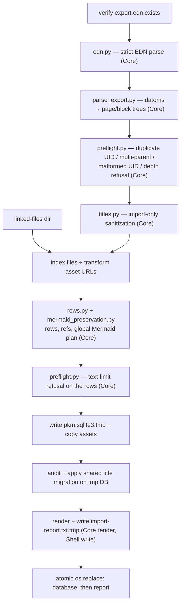

# Import, export and backup

The batch jobs either side of the live server. `pkm.backup` takes the nightly
snapshot, `pkm.export` renders a database to markdown, and `pkm.importer`
builds a fresh database from a Roam EDN export. None is on a request path; the
two exports are also downloads over HTTP. The server is in
[backend.md](backend.md), the schedule and restore steps in
[deploy/README.md](../../deploy/README.md#backups).

## Backup job

`python -m pkm.backup` takes an online SQLite `.backup()` from a read-only
connection into `backups/sqlite/`, so the live database is never opened for
writing. `rotation.py` prunes the snapshots. The job then runs the markdown
export from that same snapshot and git-commits it. Any failure exits
non-zero.

## Restore

`python -m pkm.backup.restore --data-dir DATA SNAPSHOT` is the one way a
snapshot goes back in place; `deploy/icloud_backup.py restore` calls it, and
[deploy/README.md § Restore](../../deploy/README.md#restore) has the steps.
**It always rotates `db_generation`.** The restored journal restarts from the
snapshot's `sqlite_sequence`, so it reuses seqs a device may already have
pulled past. The `since > latest` guard in `sync_changes` misses every cursor
the new timeline has overtaken, and only a new generation makes that device
rebootstrap ([sync-recovery.md § Rebootstrap
triggers](sync-recovery.md#rebootstrap-triggers)).

The snapshot is copied as bytes, then `init_db` and the rotation run on the
copy before it is renamed over the target. Opening the snapshot instead would
leave `-wal` and `-shm` beside it, since a read-only connection to a WAL-mode
file cannot remove them on close.

Both tools that swap a whole database file in, the restore and the importer,
run `db_swap.swap_refusal` on the target. SQLite replays a leftover WAL over
whatever file holds the name on the next open, so a file swapped in beside
one reads as the old database, or a mix of both.

| Sidecars beside the target | `swap_refusal` |
|---|---|
| none | passes |
| left by a crash or a closed read-only reader, such as the nightly backup | folds them by opening and closing the target read-write, then passes |
| held by an open connection | the fold's close leaves them, so it refuses: "Stop the server first" |

**It never unlinks a sidecar.** A live writer's WAL holds commits the file
does not, and only SQLite's last-connection close may remove it. Folding a
stale WAL into the old file loses nothing, because that file is about to be
replaced. Each tool checks immediately before its `os.replace`, and the
importer also checks before it starts. The check is not a running-server
probe: the server opens a connection per request, so an idle one holds none
and passes. Stopping it is the operator's step.

## Markdown export

`export/writer.py::export_graph` renders pages to `export/pages/<title>.md` and
dailies to `export/journal/YYYY-MM-DD.md`. `markdown.py` resolves `((refs))`
one level deep and keeps `{{query: ...}}` macros as written. Unchanged files
are rewritten byte-identically, so a nightly git diff is minimal.
`/api/export.zip` runs the same `export_graph()` into a temp directory.

It calls `refs.extract()` once per block (`collect_block_ref_uids`), so
`extract()` must stay linear, including on a long `::`-free run such as a
blanked code fence.

Page filenames and asset zip arcnames dedupe by `filenames.fs_dedupe_key`,
which compares names as APFS does (Unicode-normalised, case-folded). A key
weaker than the filesystem's silently overwrites a page; a stricter one only
adds a dedupe suffix. `test_filenames.py` checks the key against the real
filesystem.

Assets are mirrored incrementally. An existing destination is checked against
the `assets` row's size and sha256 before it is hardlinked into the new tree
(`assets_disk.asset_on_disk_needs_repair`, `assets_core.asset_needs_repair`).
A mismatch is re-copied from the live store, and the importer calls the same
check. `export/writer.py` counts each outcome (`assets_copied`,
`assets_repaired`, `assets_missing_source_on_repair`).

The export directory has one writer, so each run sweeps abandoned
`.export-staging-*` entries first, with no lock or age heuristic. Rendering
and asset copying happen in a fresh staging directory, then `_publish_dir`
swaps `pages/`, `journal/` and `assets/` in with one atomic rename each.

| Failure at | Leaves | Healed by |
|---|---|---|
| rendering, disk or asset copy | the last export, byte-identical | — |
| between two `_publish_dir` renames | a mixed old/new tree; old subtrees under `<name>.stale` | the next successful run |

Either way the exception stops the backup job before its git commit.

## Single-page export

`GET /api/export/page/{title}` (`routes_export.py`, `export/resolve.py`) is the
user's download, and it renders what a reader of the live page sees:

- `((refs))` resolve recursively and are inlined as plain text.
- `{{query: ...}}` and `{{[[query]]: ...}}` execute through the live
  `/api/query` path (`query_exec.parse_canonical_query`, `plan_sql`,
  `query_exec.execute_plan`) and render as results grouped by page.
- Depth caps match the UI: `BLOCK_REF_MAX_DEPTH` mirrors `BlockRef.tsx`'s
  `MAX_DEPTH`, and `QUERY_MAX_DEPTH` mirrors `QueryBlock.tsx`'s. Nothing checks
  that they agree.

`export/resolve.py` is pure over uid→text and expr→results maps. The route
fetches them breadth-first with a `visited` set: the depth caps stop a cyclic
`((ref))` chain from rendering forever, not from fetching forever.

The depth caps bound how deep expansion goes, not how much it produces: K refs
a level over `BLOCK_REF_MAX_DEPTH` levels is K to that power copies of the
leaf. So `render_page_resolved` holds one budget, shared by every block and
every recursion, with two limits:

| Limit | Charged | Why it exists |
|---|---|---|
| `EXPORT_MAX_CHARS` characters of body | each piece of text as it is appended | K to the depth copies of a leaf |
| call units, one per `CHARS_PER_CALL` characters of that bound | one per `resolve_text` or `render_query_result` call, plus one per `SCAN_CHARS_PER_UNIT` characters a `resolve_text` call scans | refs back to back over an empty leaf output nothing yet make that many calls |

Past either limit the renderer raises `ExportTooLarge`. The route answers 422
with the exception's message, which says which limit was passed. A page is
never truncated.

**Characters are charged as text is appended, never on the finished body.**
Expansion is built bottom-up, so a check on the result would come after the
whole exponential body was built.

The route's gather (`_gather_resolution_data`) runs before the renderer and is
charged against the same limits through `GatherBudget`, one per export, shared
by every query expression in every round. Expressions that differ only in
spacing slip past the `visited` set, so the shared budget is what bounds them.

Every expression the gather runs is rendered at least once, so it refuses only
what the renderer would. One divergence is accepted. The gather follows the
refs `refs.extract` finds, and the renderer follows those `_BLOCK_REF_RE` finds
outside query macros. A query reached only through a ref inside a query macro's
body is gathered and charged but never rendered. A parent cycle would be a
second case, but no write makes one: `/api/ops` skips a move into the block's
own subtree as `move_cycle` ([write-path.md § Concurrent structure
edits](write-path.md#concurrent-structure-edits)).

## Importer (Roam EDN → fresh database)

`python -m pkm.importer.run export.edn --files <dir> --out <data-dir>` builds a
complete new database and swaps it in, so re-running is safe once the server
is stopped ([Restore](#restore) has the WAL refusal it shares).

| Stage | Invariant |
|---|---|
| EDN parse | Malformed input exits 2 with `error: malformed export at offset N: DETAIL`. The solidus escape `\/` stays invalid |
| Preflight | Duplicate block uids, a block reached through two parents, and any uid failing `UID_RE` refuse the run, listing every offender before any output. A block past [`MAX_OUTLINE_DEPTH`](write-path.md#work-bounds-under-the-write-lock) refuses it too (`validate_export_depth`). No uid is re-minted, because every `((uid))` recognizer shares `UID_RE`'s bound |
| Title sanitization | `importer/titles.py` strips balanced `[[`/`]]` and `#` markers and rewrites refs. Collisions merge in source order, preferring an already-clean survivor |
| Text limits | A block past a [text limit](write-path.md#work-bounds-under-the-write-lock) refuses the run, naming the block and its sanitised page (`validate_row_text_limits`). It judges rows, since asset-URL rewriting and mermaid folding change the text. A deep nest pays `extract`, quadratic in depth, before its refusal, which a local operator tool can bear |
| Title migration | The operator route's `audit_title_migration()` / `apply_title_migration()` run on the temp database, so `plain_space_title_canonicalization` arrives active. A blocker, or a rewrite past a text limit (`RewriteTextLimitError`), exits 2 |
| Timestamps | `:create/time`, `:edit/time`, uids and sibling order survive, so every `((block ref))` resolves. A time past 64 bits or a heading outside 1–3 reads as absent |
| Mermaid flattening | A component with an inbound `((uid))` into its subtree stays nested blocks (`mermaid_preservation.py`, shared with `migrate_mermaid_blocks.py`). `migrate_mermaid_blocks.py` also leaves a component whose fence would be past a text limit unconverted, and lists it (`Plan.over_limit`) |
| Orphan blocks | Every subtree unreachable from a page (`Export.orphan_blocks`, cycles included) is attached intact under `RECOVERY_PAGE_TITLE`, so refs into it resolve. The first placement of a block stands, and later claims are listed (`Export.dropped_claims`) |
| Asset copying | The [export's verify-then-copy check](#markdown-export), rewriting a mismatched destination atomically. It runs after the row `commit()`, which the title migration needs |

`sanitize_import_title` refuses some spellings (malformed markers, a
[refused title](backend.md#refused-titles), or blank once stripped). A refusal
never stops the run:

| The refused spelling is | The import |
|---|---|
| a page title | skips the page (`SanitizedImport.skipped_pages`); its blocks go to the recovery page |
| a ref `refs.extract()` reports (`[[#]]`, `#[[#]]`, `#:: v`) | makes it plain text with `unlink.unlink_stale_refs` |
| text `extract()` reads as no ref (`[[]]`, `[[.]]`, ``[[a`b]]``) | leaves it byte-identical |

A refused ref cannot stay a ref: the ops title check would refuse every edit
to its block, and the title migration audit would refuse the implicit page
`rows.py` creates.

| Failure at | Leaves | Healed by |
|---|---|---|
| any stage before the first `os.replace`, or a WAL another connection holds | the published database and report untouched | — (the next run deletes `pkm.sqlite3.tmp` first) |
| between the database and report replaces | the new database beside the old report | the next successful run |
