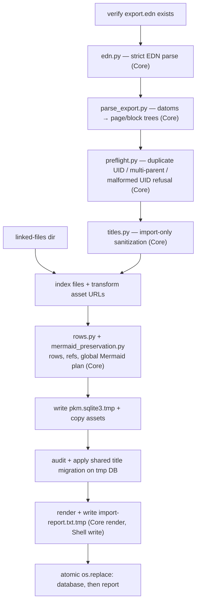

# Import, export and backup

The batch jobs either side of the live server. `pkm.backup` takes the nightly
snapshot, `pkm.export` renders a database to markdown, and `pkm.importer`
builds a fresh database from a Roam EDN export. None is on a request path; the
two exports are also downloads over HTTP. The server is in
[backend.md](backend.md), the schedule and restore steps in
[deploy/README.md](../../deploy/README.md#backups). Failures are indexed by
symptom in [troubleshooting.md](../troubleshooting.md).

## Backup job

`python -m pkm.backup` takes an online SQLite `.backup()` from a read-only
connection into `backups/sqlite/`, so the live database is never opened for
writing. `rotation.py` prunes the snapshots. The job then runs the markdown
export from that same snapshot and git-commits it. Its success line prints the
whole export-count dictionary, and any failure exits non-zero.

## Markdown export

`export/writer.py::export_graph` renders pages to `export/pages/<title>.md` and
dailies to `export/journal/YYYY-MM-DD.md`. `markdown.py` resolves `((refs))`
one level deep and keeps `{{query: ...}}` macros as written. Unchanged files
are rewritten byte-identically, so a nightly git diff is minimal.
`/api/export.zip` runs the same `export_graph()` into a temp directory.

Page filenames and asset zip arcnames dedupe by `filenames.fs_dedupe_key`,
which compares names as APFS does (Unicode-normalised, case-folded). A key
weaker than the filesystem's silently overwrites a page; a stricter one only
adds a ` (2)` suffix. `test_filenames.py` checks the key against the real
filesystem.

It calls `refs.extract()` once per block (`collect_block_ref_uids`), so
`extract()` must stay linear, including on a long `::`-free run such as a
blanked code fence.

Assets are mirrored incrementally. An existing destination is checked against
the `assets` row's size and sha256 before it is hardlinked into the new tree:
`assets_disk.asset_on_disk_needs_repair` stats first and hashes only once the
size matches, and `assets_core.asset_needs_repair` rules on the pair. A
mismatch is re-copied from the live store. The importer calls the same check.

| Outcome | Counter |
|---|---|
| fresh transfer | `assets_copied` |
| corrupt destination replaced | `assets_repaired` |
| repair source missing (asset dropped, `pkm.export` warning) | `assets_missing_source_on_repair` |

The export directory has one writer, so each run sweeps abandoned
`.export-staging-*` entries first, with no lock or age heuristic. Rendering
and asset copying happen in a fresh staging directory, then `_publish_dir`
swaps `pages/`, `journal/` and `assets/` in with one atomic rename each.

| Failure at | Leaves | Healed by |
|---|---|---|
| rendering, disk or asset copy | the last export, byte-identical | — |
| between two `_publish_dir` renames | a mixed old/new tree; old subtrees under `<name>.stale` | the next successful run |

Either way the exception stops the backup job before its git commit.

## Single-page export

`GET /api/export/page/{title}` (`routes_export.py`, `export/resolve.py`) is the
user's download, and it renders what a reader of the live page sees:

- `((refs))` resolve recursively and are inlined as plain text.
- `{{query: ...}}` and `{{[[query]]: ...}}` execute through the live
  `/api/query` path (`query_exec.parse_canonical_query`, `plan_sql`,
  `query_exec.execute_plan`) and render as results grouped by page.
- Depth caps match the UI: `BLOCK_REF_MAX_DEPTH` mirrors `BlockRef.tsx`'s
  `MAX_DEPTH`, and `QUERY_MAX_DEPTH` mirrors `QueryBlock.tsx`'s. Nothing checks
  that they agree.

`export/resolve.py` is pure over uid→text and expr→results maps. The route
fetches them breadth-first with a `visited` set: the depth caps stop a cyclic
`((ref))` chain from rendering forever, not from fetching forever.

## Importer (Roam EDN → fresh database)

`python -m pkm.importer.run export.edn --files <dir> --out <data-dir>` builds a
complete new database and swaps it in, so re-running is always safe.

| Stage | Invariant |
|---|---|
| EDN parse | Malformed input exits 2 with `error: malformed export at offset N: DETAIL`. The solidus escape `\/` stays invalid |
| Preflight | Duplicate block uids, a block reached through two parents, and any uid failing `UID_RE` refuse the run, listing every offender before any output. No uid is re-minted, because every `((uid))` recognizer shares `UID_RE`'s bound |
| Title sanitization | `importer/titles.py` strips balanced `[[`/`]]` and `#` markers and rewrites refs. Collisions merge in source order, preferring an already-clean survivor |
| Title migration | The operator route's `audit_title_migration()` / `apply_title_migration()` run on the temp database, so `plain_space_title_canonicalization` arrives active. A blocker exits 2 |
| Timestamps | `:create/time`, `:edit/time`, uids and sibling order survive, so every `((block ref))` resolves. A time past 64 bits or a heading outside 1–3 reads as absent |
| Mermaid flattening | A component with an inbound `((uid))` into its subtree stays nested blocks (`mermaid_preservation.py`, shared with `migrate_mermaid_blocks.py`) |
| Orphan blocks | Every subtree unreachable from a page (`Export.orphan_blocks`, cycles included) is attached intact under `RECOVERY_PAGE_TITLE`, so refs into it resolve. The first placement of a block stands, and later claims are listed (`Export.dropped_claims`) |
| Asset copying | The [export's verify-then-copy check](#markdown-export), rewriting a mismatched destination atomically. It runs after the row `commit()`, which the title migration needs |

`sanitize_import_title` refuses some spellings (malformed markers, a
[refused title](backend.md#refused-titles), or blank once stripped). A refusal
never stops the run:

| The refused spelling is | The import |
|---|---|
| a page title | skips the page (`SanitizedImport.skipped_pages`); its blocks go to the recovery page |
| a ref `refs.extract()` reports (`[[#]]`, `#[[#]]`, `#:: v`) | makes it plain text with `unlink.unlink_stale_refs` |
| text `extract()` reads as no ref (`[[]]`, `[[.]]`, ``[[a`b]]``) | leaves it byte-identical |

A refused ref cannot stay a ref: the ops title check would refuse every edit
to its block, and the title migration audit would refuse the implicit page
`rows.py` creates.

| Failure at | Leaves | Healed by |
|---|---|---|
| any stage before the first `os.replace` | the published database and report untouched | — (the next run deletes `pkm.sqlite3.tmp` first) |
| between the database and report replaces | the new database beside the old report | the next successful run |
