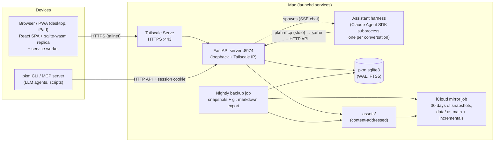

# PKM architecture overview

PKM is a single-user, self-hosted replacement for Roam Research: an
outliner-style notes app with daily notes, `[[page links]]`, backlinks,
full-text search, block references and locally hosted assets. It runs on a
Mac, is reached over Tailscale from other devices, and works fully offline
as an installable PWA.

This directory is the "get up to speed" layer. It describes the system as it
is. The system-wide *why* is in [Key decisions](#key-decisions); per-feature
designs and their rejected alternatives are in the specs under
[`docs/superpowers/specs/`](../superpowers/specs/).

| Doc | Read when you |
|---|---|
| this file | are new: the system picture, the core idea and the decisions behind it, the stack |
| [backend.md](backend.md) | change a route, the schema, an op, the ref grammar, titles or config |
| [sync-and-offline.md](sync-and-offline.md) | change how an edit travels from the editor to the server and back |
| [sync-recovery.md](sync-recovery.md) | change what happens when a sync hop fails: banners, repairs, resets |
| [sqlite-wasm-patch.md](sqlite-wasm-patch.md) | upgrade `@sqlite.org/sqlite-wasm` |
| [frontend.md](frontend.md) | add a view, route or module to the SPA, or touch the API layer or assistant panel |
| [frontend-editor.md](frontend-editor.md) | change editing, keyboard handling, drag and drop or the outline sessions |
| [frontend-rendering.md](frontend-rendering.md) | change how block text becomes DOM |
| [styling.md](styling.md) | add a token, a control class or a stylesheet rule |
| [files-and-assets.md](files-and-assets.md) | touch uploads, image descriptions, `/api/local/` documents or GoodLinks copies |
| [import-export-and-backup.md](import-export-and-backup.md) | change the nightly backup, the markdown exports or the Roam importer |
| [cli-and-mcp.md](cli-and-mcp.md) | change the `pkm` CLI or an MCP tool |
| [assistant.md](assistant.md) | change the embedded LLM harness |
| [checks.md](checks.md) | add or answer a mechanical check: commit hooks, coverage, perf and property gates |
| [troubleshooting.md](../troubleshooting.md) | are chasing a symptom someone has seen before |

## System context



One server process, one SQLite file, one assets directory. Browser, CLI and
MCP all speak the same HTTP API with the same session-cookie auth. Block
content changes go through `POST /api/ops`
([the write path](backend.md#the-write-path)); pages, the sidebar and assets
have their own routes ([API reference](backend.md#http-api-reference)).
The embedded assistant is one more client: a harness subprocess per
conversation, confined to the
[`pkm-mcp` tools](cli-and-mcp.md#the-mcp-tool-surface), which call the same
API.

## Core idea

**Server-authoritative, block-granular, no CRDTs.** The server's SQLite is the
single source of truth. Browsers apply edits optimistically and send batches of
block-level ops. A trigger-based change journal plus a client cursor handles
down-sync, and a WebSocket only nudges. Per-block last-write-wins, with losing
text preserved as `[[conflict]]` blocks, is enough for one person. Offline is a
cache of that state: a sqlite-wasm replica plus a durable op queue in each
browser. Portability comes from a nightly plain-markdown export.
[sync-and-offline.md](sync-and-offline.md) has the protocol end to end.

## Key decisions

Two alternatives to the core idea were rejected. A client-side graph with
op-log sync, Roam's own architecture, is fast but means owning a sync protocol
and its data-loss modes. Markdown files plus an index, as Obsidian does it,
are portable, but files fit badly with stable block uids and live structural
edits. The nightly markdown export supplies the portability instead. The
[original design spec](../superpowers/specs/2026-07-08-roam-migration-pkm-design.md)
has the full trade-off.

| Decision | Why |
|---|---|
| Block text is stored as unmodified Roam-flavoured markdown; `refs` and the FTS index are derived from it | the durable data is always plain text |
| Block uids survive import, and daily pages keep Roam's ordinal titles (`July 8th, 2026`) | imported links and block refs keep resolving |
| Assets are content-addressed files outside SQLite | a backup is one database file plus one append-only directory |
| The UI never renders an unbounded list: backlinks paginate, unlinked refs compute on demand, the journal loads a few days at a time | rendering, not SQL, is the scale constraint; the target is 50k pages and 500k blocks |
| Sync is journal rows in the same SQLite file, a generation token and idempotent batch ids, with no vector clocks or merge machinery | sync stays debuggable; per-block last-write-wins is enough for one person |

Out of scope: multiple users, multiple graphs, full datalog queries and
encrypted blocks; the design spec gives the reasons. Some features stay
online-only:
[sync-and-offline.md § Ancillary details](sync-and-offline.md#ancillary-details)
lists them, and the
[offline design spec](../superpowers/specs/2026-07-12-offline-editing-design.md)
explains the deferral.

## Tech stack

| Layer | Choices |
|---|---|
| Backend | Python ≥ 3.12, FastAPI, Pydantic v2, raw `sqlite3` (WAL + FTS5, no ORM), uvicorn + `websockets`, `uv` (hatchling build) |
| Frontend | Versions in [frontend.md](frontend.md#tech-stack) |
| Agent access | `pkm` CLI + `pkm-mcp` stdio server (httpx2; FastMCP from the `mcp` SDK) over the same HTTP API |
| Embedded assistant | Claude Agent SDK harness, server-side; SSE chat in the SPA |
| Ops | launchd services, Tailscale Serve (HTTPS) |

## Cross-cutting patterns

### Functional Core / Imperative Shell

The whole codebase follows FCIS. Pure logic (op planning, ref extraction,
query evaluation, tree building, state transitions) lives in Functional Core
files. I/O (routes, SQLite, WebSocket, workers, React effects) lives in thin
Imperative Shell files that gather inputs, call the core, and persist results.
Every runtime file declares its role in a header comment:

```
# pattern: Functional Core        (Python)
// pattern: Imperative Shell      (TypeScript)
```

On the web the boundary is machine-checked: `pnpm check:fcis`
(`web/tooling/fcis.mjs`) fails on any Functional-Core → Shell import, type-only
imports excepted. On the server it is convention plus review. The write path
is the clearest case: a pure planner (`ops_core.plan_op`) between two thin
shells ([backend.md](backend.md#the-write-path)). The rules and escape hatches
are in `AGENTS.md`.

### One grammar, two languages, pinned by fixtures

Roam-flavoured markdown (`[[links]]`, `#tags`, `Attr::`, `((block refs))`,
`{{[[query]]}}`, `{{TODO}}`) is parsed on both sides: `server/src/pkm/refs.py`
(the reference implementation, feeding the `refs` table) and
`web/src/grammar/scan.ts` (feeding rendering, autocomplete and the replica).
Both test suites replay the fixtures in `shared/fixtures/`, so the two parsers
cannot drift. The same technique pins the offline API shim to the real routes
and the replica schema to the server's DDL, and the server's response models
generate the TypeScript API types. Each artifact is generated and checked in;
[backend.md](backend.md#generated-artifacts-and-parity-fixtures) names its
generator, the test that fails when it goes stale, and its consumer.

## Deployment and development

Production is launchd services on this Mac under `$PKM_HOME` (default
`~/.config/pkm`): `app/` (a checkout of local `main`), `data/` (`config.json`,
`pkm.sqlite3`, `assets/`), `backups/` and `logs/`. Tailscale Serve terminates
HTTPS and proxies to the server on `127.0.0.1:8974`.
[deploy/README.md](../../deploy/README.md) owns install, update, backups and
restore. `AGENTS.md` is the contract for working in this repo: beans, worktrees,
the gates to run and how to answer them. [checks.md](checks.md) describes what
each gate checks. Per-feature designs are in `docs/superpowers/specs/` and plans
in `docs/superpowers/plans/`.
