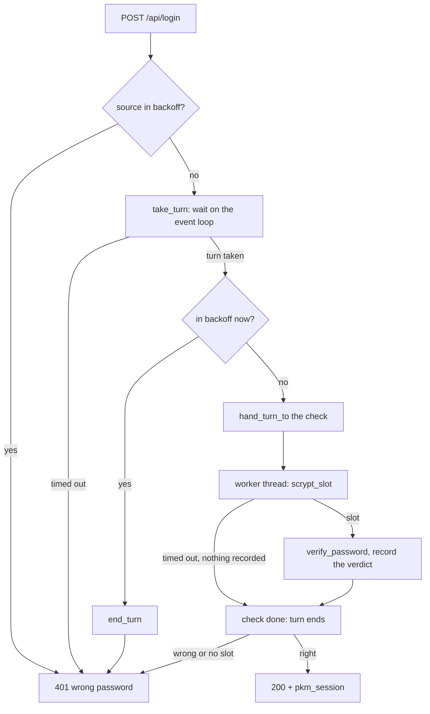

# Request boundary

What every HTTP request and WebSocket handshake passes before a route runs:
the auth gate, body caps and deadlines, the origin guard and the login
throttle, and the rule that no hostile input makes a route answer 500. The
routes themselves are in [backend.md](backend.md#http-api-reference).

## Auth

Auth is one shared password, and Tailscale is the transport boundary.
`auth_core.py` does the constant-time scrypt check and signs the
`pkm_session` cookie (`v1.<issued_ms>.<sig>`). [SECURITY.md](../SECURITY.md)
owns the cookie flags, the threat model and what these mechanisms leave open.

Middleware runs outermost first: `RequestLogMiddleware` →
`SecurityHeadersMiddleware` → `OriginGuardMiddleware` →
`AuthGateMiddleware` → router. The two that refuse are innermost, so
their refusals are logged and carry the security headers.
`SecurityHeadersMiddleware` sets every header that applies to all routes;
routes set only their own. An unhandled exception's 500 is built outside it
and carries none.

`AuthGateMiddleware` (`auth_gate.py`, rules in `auth_gate_core.py`)
refuses an anonymous request before routing, without calling `receive`.
FastAPI reads and parses a body before it runs any dependency, so a guard
that is only a dependency takes in an anonymous upload whole before its 401.
The refusals are 401 `{"detail": "not authenticated"}` and a 4401
handshake close before accepting. Every session check calls
`session_is_valid` (`auth.py`). The gate hands `is_public`
`get_route_path(scope)`, the string the router matches, so the two cannot
disagree on decoding.

| Request (`is_public`) | At the gate |
|---|---|
| `POST /api/login` | public, body capped |
| `GET` or `HEAD` outside `/api` and `/assets`: `GET /login`, `GET /healthz`, `/app-assets/*`, the SPA shell | public |
| anything else, every WebSocket handshake included | needs a valid `pkm_session` |

`require_auth` stays on every router
(`dependencies=[Depends(require_auth)]`) as the route's own check, and
`/api/ws` checks the cookie inline. It alone guards a `GET` outside `/api`
and `/assets`.

The gate caps every body outside `SAFE_METHODS`, since FastAPI would
otherwise parse one of any size, a multipart upload included, before the
route's own limits run.

| Request | Cap |
|---|---|
| public (`PUBLIC_UNSAFE_ROUTES`), session or not | `PUBLIC_BODY_MAX_BYTES`. The gate reads the body and replays it to the route as one message, before the login throttle runs |
| an authenticated upload (`UPLOAD_ROUTES`) | the config's `max_upload_bytes` plus `UPLOAD_ENVELOPE_BYTES` for the multipart framing |
| any other authenticated method | `PRIVATE_BODY_MAX_BYTES` (`private_body_cap`) |

A declared `Content-Length` past the cap gets 413
`{"detail": "request body too large"}` before the app reads a byte;
`declared_content_length` ignores a length sent beside `Transfer-Encoding`.
An authenticated body with no trusted length is counted as the route reads
it, never buffered by the gate, and refused at the message that passes the
cap.

`DeadlineH11Protocol` and the gate bound a slow client, since uvicorn has no
read or write timeout of its own. The
[http_protocol.py](../../server/src/pkm/server/http_protocol.py) docstring
explains each deadline.

| What is late | Bound | Answer |
|---|---|---|
| the request head, from the connection's open or its last response | `HEADER_READ_TIMEOUT_S` (`DeadlineH11Protocol`) | close the connection |
| the rest of a body answered unread (a 401, 403 or 413) | counts against the next head's deadline | close the connection |
| a public body | `PUBLIC_BODY_READ_TIMEOUT_S` for the whole read | 408 with `Connection: close` (RFC 9110) |
| a response the client stops taking | the transport's buffer must shrink within `WRITE_STALL_TIMEOUT_S` | abort the connection |
| an authenticated body | none: an upload over a slow link may take minutes | — |
| a request every few seconds on one connection | none: uvicorn's 5 s keep-alive restarts with each one | — |

A 401 or 413 leaves the connection open (`auth_gate.py` says why), so an
upload far past its limit is cut at the head deadline and a browser may
show a reset instead of the 413.

`OriginGuardMiddleware` (`origin_guard.py`, rules in `origin_core.py`)
checks `Origin` on every `/api/ws` handshake and on every HTTP method
outside `SAFE_METHODS`. The `Lax` cookie rides along on a sibling tailnet
host's handshake and simple POSTs
([SECURITY.md § Authentication](../SECURITY.md#authentication)). A request
with no `Origin` passes, because browsers send one on every request the
guard checks. A request with exactly one `Origin`, in the allowed set,
passes. Anything else is refused, `Origin: null` included, since a sibling
page can produce it.

| Allowed origin | Source |
|---|---|
| each entry of `serve_origins` | config.json, canonicalised on load (`canonical_origin`) |
| `http://<host>:<port>` | each bind host; `--host` replaces `bind_hosts` |
| `http://127.0.0.1:<port>`, `http://localhost:<port>`, `http://[::1]:<port>` | always |

`<port>` is the `api_port` `create_app()` is given, the port `run.py`
serves on. A refused HTTP request gets 403
`{"detail": "origin not allowed"}`, and a refused handshake a 4403 close
before accepting, which uvicorn sends as HTTP 403 (as it does 4401). The
guard runs before the auth gate, so an anonymous handshake from a foreign
origin sees 4403, not 4401. The web treats 403 as retry-later
(`RETRY_LATER_STATUSES` in `web/src/sync/rejection.ts`), so a wrong
`serve_origins` queues edits instead of discarding them.

Nothing enforces these rules:

- The app must never set `Referrer-Policy: no-referrer`, as a header or a
  meta tag on its own documents. Fetch writes, uploads and the WebSocket
  keep the real origin under it, but the no-cors form posts would send
  `Origin: null` and be refused: the export form in
  `web/src/views/Files.tsx` and the assistant close beacon in
  `web/src/assistant/client.ts`.
- A new hostname or Serve port needs its origin in `serve_origins`.
- Every public route that takes a body is capped, so one added to
  `PUBLIC_UNSAFE_ROUTES` must accept a body within
  `PUBLIC_BODY_MAX_BYTES`. The cap applies only outside `SAFE_METHODS`, so a
  public `GET` route must not read a body.
- A new upload route joins `UPLOAD_ROUTES`, or its bodies are cut at
  `PRIVATE_BODY_MAX_BYTES`. A route that reads a body itself must let an
  `HTTPException` from `receive` through (`_BodyOverCap` says why), or a
  streamed body past the cap is not answered 413.
- Only `run.uvicorn_config` installs `DeadlineH11Protocol`, so every server
  must start through `run.serve`, production as `python -m pkm.server.run`.
  The `uvicorn` CLI, or its `httptools` protocol, has neither deadline.
- The gate reads the config from `scope["app"].state.config` on every
  request, never once at startup: the proptest sync server replaces
  `app.state.config` after `create_app`.

## Login throttle

`LoginThrottle` (`throttle.py`, policy in `throttle_core.py`) applies a
per-source exponential backoff (`BASE_BACKOFF_MS` to `MAX_BACKOFF_MS`)
before scrypt runs, and caps scrypt work process-wide at
`MAX_CONCURRENT_SCRYPT` slots. `login()` waits for the source's turn on the
event loop and runs the check on a worker thread.

Every refusal is the same 401 `wrong password` (`_wrong_password`). A
guesser cannot tell a wrong password from a throttled source or a timeout;
only the timing differs. A throttled source is refused without scrypt even
when it sends the right password, since the backoff exists to spend no
scrypt on it.

The source is `request.client.host`, which uvicorn rewrites from
`X-Forwarded-For` only when the TCP peer is in `run.FORWARDED_ALLOW_IPS`
(`127.0.0.1`).

| Listener | Throttle key |
|---|---|
| Tailscale IP (`bind_hosts`) | the TCP peer, the device's tailnet address; `X-Forwarded-For` is ignored |
| `127.0.0.1`, through Tailscale Serve | the right-most `X-Forwarded-For` entry, which Serve sets to the device's tailnet address, replacing any the client sent |
| `127.0.0.1`, no header (local processes, such as Playwright and the frontend perf check) | `127.0.0.1` |

A device keys the same through Serve and direct over IPv4. Reaching Serve
over its tailnet IPv6 address gives the device a second key, since the
direct listener is IPv4 only. What this keying leaves open is in
[SECURITY.md § Known limitations](../SECURITY.md#known-limitations).

Nothing enforces the conditions this keying needs:

- `run.uvicorn_config` passes `proxy_headers` and `forwarded_allow_ips`
  explicitly. Left unset, uvicorn reads the `FORWARDED_ALLOW_IPS`
  environment variable, and `*` there would key on the left-most entry,
  which the client chooses.
- Serve's upstream must stay `http://127.0.0.1:<port>` (`install.sh`'s
  `serve` line). Pointed at the Tailscale IP, Serve becomes an untrusted
  peer, and every Serve client shares the host's backoff bucket unless
  `FORWARDED_ALLOW_IPS` changes with it. An IPv6 loopback upstream (`[::1]`,
  or a `localhost` that resolves to it) reaches no listener, because
  `bind_sockets` opens IPv4 sockets only.

**One password check is in flight per source**, because checking the
backoff and recording the verdict are separate steps. Without a turn,
every request of a concurrent burst would pass the first and run scrypt.
The others wait for the turn rather than being refused, so a double-submit
of the right password is never told it was wrong. The turn ends with the
check, not the request, because a worker thread cannot be cancelled
(`hand_turn_to`).

## Hostile input

**No client input, and no row the importer writes, makes a route answer
500.** Tests that walk `app.routes` keep the surrogate and int64 guards on
every route.

| Input | Guard |
|---|---|
| A lone surrogate in a JSON body | Every request body model derives from `WellFormedModel` |
| An int past 64 bits | Int parameters are `Int64` or carry `INT64_RANGE`; `WellFormedModel` refuses one in a body |
| A 422 echoing a surrogate, NaN or deep nesting | `validation_echo.echo_errors`, cut at `MAX_ECHO_DEPTH` |
| A NUL, an over-long component or a link loop in an SPA path | The catch-all treats a path `resolve()` or `is_file()` rejects as naming no file, and serves the shell |
| A session cookie signature that is not ASCII | `verify_session` refuses it before `hmac.compare_digest`, which raises on non-ASCII |
| A NUL in a search term | `fts.py` makes it a space: FTS5 reads a C string |
| A GoodLinks or OpenAI body that is not JSON, nests too deep, or holds a surrogate | An unusable answer (503, `DescribeError`); decoded strings made well-formed |
| An op `order_idx` a sibling shift could push past int64 | `CreateOp` and `MoveOp` bound it with `WIRE_ORDER_IDX` to the JS safe-integer range |
| A Roam heading outside 1–3 or a time past 64 bits | `parse_export` reads it as absent |

Path and query values cannot carry a lone surrogate, because the server
decodes them from bytes. The `test_no_500_*_props.py`
[properties](checks.md#property-gate) send generated input through every route.

Other bounds are owned where their mechanism is:

| Bound | Owner |
|---|---|
| body size | [Auth](#auth) |
| block text, nesting and outline depth | [Work bounds](write-path.md#work-bounds-under-the-write-lock) |
| title length | [Refused titles](titles-and-refs.md#refused-titles) |
| deeply nested `[[` | [Ref grammar](titles-and-refs.md#ref-grammar) |
| query nesting and operands | the `/api/query` row in [backend.md](backend.md#http-api-reference) |
| unbounded id sets | [Database](backend.md#database) |
| export fan-out | [Single-page export](import-export-and-backup.md#single-page-export) |
