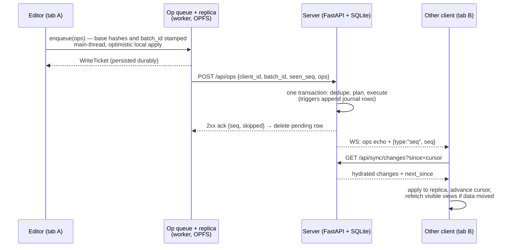
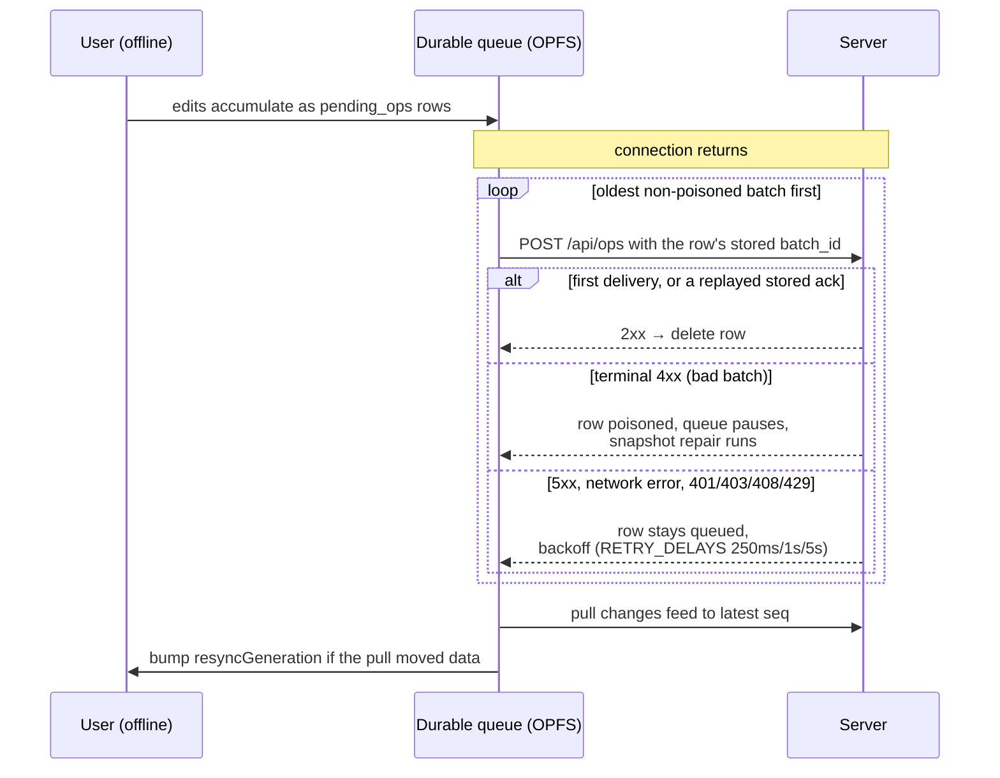

# Sync and offline architecture

This doc follows an edit from a keystroke, through the browser's durable queue
and replica, to the server, and back out to other clients. What each guard does
when a hop fails is in [sync-recovery.md](sync-recovery.md). The server half of
every hop is in [backend.md](backend.md). Failures are indexed by symptom in
[troubleshooting.md](../troubleshooting.md); the design and its rejected
alternatives are in
[`docs/superpowers/specs/2026-07-12-offline-editing-design.md`](../superpowers/specs/2026-07-12-offline-editing-design.md).

## The model in one paragraph

**Server-authoritative, no CRDTs.** SQLite on the server is the single source
of truth. Clients apply edits optimistically and send op batches to
`POST /api/ops`. Down-sync is pull-based: SQLite triggers populate an
append-only change journal that gives every change a monotonic `seq`, and
`GET /api/sync/changes?since=` returns everything after a client's cursor. The
WebSocket only nudges, and correctness never depends on receiving a frame.
Offline is a cache, not a fork: each browser holds a sqlite-wasm replica and a
durable queue of unacknowledged batches. Batch ids make replays idempotent, and
per-block last-write-wins with `[[conflict]]` preservation resolves collisions
at push time.

## Key pieces

| Piece | Where | Role |
|---|---|---|
| Change journal | `schema.py` (`changes`), triggers | Every mutation gets a `seq`, whatever path wrote it |
| Windowed feed | `routes_sync.py`, `sync_core.py` | `changes?since=` serves windows of the journal; `snapshot` bootstraps |
| Sync metadata | `sync_meta` (`db_generation`, `plain_space_title_canonicalization`) | A new generation forces every client to rebootstrap |
| WS hub | `ws.py`, `notify.py` | Post-commit nudges and op echoes ([backend.md § Post-commit nudges](backend.md#post-commit-nudges)) |
| Replica | `web/src/replica/` | sqlite-wasm in a worker, on the OPFS SAHPool VFS |
| Op queue | `sync/opQueue.ts`, `replica/queue.ts`, `sync/outbox.ts` | Durable `pending_ops`, optimistic apply, drain |
| Orchestration | `sync/SyncProvider.tsx`, `clientRuntime.ts`, `useSocketLifecycle.ts`, `reconnectFlow.ts`, `replicaSync.ts` | Connect ordering, the pull loop, recovery, view refetch |
| Offline API shim | `replica/localApi/` | Serves the read API's JSON shapes from the replica |

No `OpQueue` method may emit synchronously. `SyncProvider` subscribes in an
effect after the commit that built the queue, so a synchronous emission reaches
no listener. `opQueue.replica.test.ts` pins this.

## The replica

One file, `/pkm-replica.sqlite3`, holds the graph copy (the server's
`BASE_DDL`, via the generated `replica/baseSchema.gen.ts`) and the client-only
tables in `replica/clientSchema.ts`:

| Table | Holds |
|---|---|
| `pending_ops` | The durable queue, one row per batch. Its shape changes only additively, so a newer client can read an older file. Its id (`PendingRowId`) restarts after a reset or file replacement |
| `pending_seen` | Each batch's `seen_seq` |
| `sync_client_meta` | `cursor`, `generation`, `schema_version`, the plain-space flag, `deferred_block_tombstones` |
| `replay_log`, `replay_log_refs`, `replay_batches` | [The replay log](#the-replay-log) |

A second file, `/pkm-replica-carry.sqlite3`, holds the queue during a
[file replacement](sync-recovery.md#reset-rebase-and-file-replacement).

A commit is atomic across the worker's death, because the next read plays back
the hot `-journal` a killed worker left. Upstream's pool VFS does not do this
yet, so the replica runs a patched build
([sqlite-wasm-patch.md](sqlite-wasm-patch.md)).

`ReplicaRpc` (`replica/client.ts`) types every worker RPC with the branded
ids. `rpc.ts`'s `serveRpc` is the one place that takes wire data on trust,
since structured clone carries values, not brands.

**The replica is a cache; the queue is the user's intent.** A snapshot can
always be re-fetched; an unflushed pending op cannot. Every guard in
[sync-recovery.md](sync-recovery.md#failure-modes-at-a-glance) follows from
this rule.

## An online edit, end to end

Success is the 2xx. The client's own state comes back through the same pull
every other client uses. WS op echoes are never written to the replica: a tab
drops its own, matched by `client_id`, and uses others' only for live views.
The ack's `seq` is kept with the row delete, so a pull already in flight can
accept its window ([below](#windows-and-the-pending-queue)).

`seen_seq` is the replica's cursor at enqueue, which the server uses to drop
edits that predate a page delete
([backend.md § Stale batches](backend.md#stale-batches)). `enqueueBatch`
records it in `pending_seen` only when the replica has a generation. A batch
with no row, such as a carried one, posts without it and counts as current.

## The changes feed

`GET /api/sync/changes?since=<cursor>` (`sync_core.dedupe_window`) reads a
window of raw journal rows in one read transaction.

- `next_since` advances to the last raw row *scanned*, not the last distinct
  entity, because an entity's older row can share a window with someone else's
  newer row.
- Rows hydrate from current state. A block ships with every row it depends on:
  its refs, their target pages, its own page, and its parent chain
  (`_with_parent_closure`). A missing dependency fails the replica's deferred
  FK check at COMMIT.
- `block_refs` never ships; both sides derive it through the parity-pinned
  extractor.
- Hydration batches ids through `sync_core.chunk_ids`, under SQLite's historic
  999-parameter cap.
- The client loops `pull → apply → cursor = next_since` until
  `next_since >= latest_seq`.

`sync_core.tombstone_entities` picks the tombstones. Page and sidebar ids
(`REUSABLE_ID_KINDS`) have no `AUTOINCREMENT`, so deleting the highest id frees
it for reuse, and a live row does not prove the id names the same entity.

| In the window | Ships |
|---|---|
| A page or sidebar entry absent now | A tombstone |
| A page or sidebar id with a delete row, live now | A tombstone and the live row. For a page, also every current block on it or with a ref to it, since the replica's page cascade removes them |
| A block present now | Its live row (an undo can recreate a uid) |
| A block absent now | A tombstone, only from the window holding its delete row |

The replica dispatches each tombstone `kind` (`EntityKind`) to its own branch.
An unknown kind deletes nothing and logs. It must never fall through to a
delete, or an older replica meeting a newer server's kind destroys an unrelated
row. `parseTombstoneId` (`sync/wire.ts`) is the one reader of the text id; a
malformed one throws `MalformedTombstoneError` and rolls the window back.

## Applying a window over pending edits

`applyWindow` (`replica/apply.ts`) applies a window in one transaction. It
cannot patch pending batches onto the server's rows. A local apply writes rows
it never names (shifted siblings, re-paged descendants, a delete's cascade),
and the server does not always journal the same ones. So the window takes the
pending effects off, lands the server's rows, and replays each batch as if it
were enqueued again.

| Step | Why it sits there |
|---|---|
| 1. `dropAppliedPending`, `pruneReplayBatches` | A batch the payload already holds stops being pending ([below](#a-payload-that-already-holds-a-pending-batch)) |
| 2. `rewind("pending")` | Pending effects come off, so step 9 is a first apply. Poisoned batches are rewound and not replayed |
| 3. Page and sidebar tombstones | Titles are UNIQUE, so a row that gave a title up goes before the row that took it |
| 4. Page upserts | `reconcilePage` remaps local page ids, replay-log keys included. `parkTakenTitles` parks a swapped title until its own upsert |
| 5. Block upserts | Deferred FKs make their order irrelevant |
| 6. `dropWindowRecords` | The server's row is now the base, so an acked batch's record on it has nothing to restore |
| 7. Block tombstones, head window only | [Below](#block-tombstones-wait-for-the-head-window) |
| 8. `rewind("all")`, head window only | Settles acked batches' records. After 6, or rewinding a block an acked batch created would delete the server children shipped under it |
| 9. Sidebar, cursor, meta, `reconcileActivationPageTitles`, `replayPending` | The queue replays over the window's final rows, each batch at its enqueue time |
| 10. `dropStrandedLocalPages`, head window only | After 9, since a replay re-makes the local pages it needs |

A window that cannot apply returns `needs-bootstrap` or throws
([sync-recovery.md § Rebootstrap triggers](sync-recovery.md#rebootstrap-triggers)).

### Block tombstones wait for the head window

A block tombstone cascades the replica's local subtree. A kept descendant of a
moved-out ancestor has no row of its own to re-ship, so nothing would bring it
back. **Block tombstones apply only in the window at the journal head, after
its upserts.**

| Window | Block tombstones |
|---|---|
| Short of the head | Recorded in `deferred_block_tombstones` with the cursor written in the same transaction. A block a later window ships live leaves the record |
| At the head | The recorded ones and its own apply; the record clears. A record whose cursor is not the current one is void |
| Snapshot | `applySnapshot` clears the record |

By the head window every block the server kept is placed by its own row or
under a chain the server kept, so the cascade takes only what the server
deleted. `test_sync_block_tombstone_window.py` models this. Between windows a
deleted block stays editable, and an edit to it lands as a conflict entry.

### Windows and the pending queue

`pullLoop` snapshots the pending batch ids before each fetch. A window read
before batch B committed lacks B. If B's ack deleted its row meanwhile, the
window would drop B's edit with nothing left to replay.
`pendingSetStillCovered` (`replica/pendingGuard.ts`) checks, in order:

| Condition | Result |
|---|---|
| any acked `seq` the worker holds is past the window's `latest_seq` | `pending-changed` |
| ids unchanged | applied |
| some removed, each on an ack with a `seq` | applied |
| any other removal, an addition, or a reorder | `pending-changed` |

On `pending-changed`, `pullLoop` refetches up to `PENDING_CHANGED_CAP` (20)
times, then throws `PullStarvedError`. A bootstrap snapshot takes the same
check against its `seq`, which `sync_snapshot` reads in the rows' own read
transaction. It needs one because the queue resumes before
`replicaSync.start()` and can ack a batch while the first snapshot is in
flight.

An acked removal is safe because `sync_changes` reads `latest_seq` in the
window's read transaction. It is the common case: the nudge starts a pull while
the batch is still pending. Every held ack is checked, not only the removed
rows'. A batch queued and acked during the fetch leaves the ids unchanged, and
step 8 would rewind it to its pre-images.

The worker keeps acked seqs in memory (`ackedSeqs`) by row id and clears them
on a schema rebuild, which restarts the ids. For the same reason every delete
and poison mark names its row by `id` and `batch_id` both
(`queue.ts::deleteBatch`, `markPoisoned`), so a stale delete cannot remove the
batch that took its old id.

### A payload that already holds a pending batch

A batch can commit while its row is still pending: its ack was lost, or its
own nudge pulled first. Replaying it over a window that shows its effects
applies it twice, and no later window re-ships the damaged rows. Only the
server knows which batches a read holds, so the pull asks.

| Step | Where | What |
|---|---|---|
| Name | `pendingQuery` (`replicaSync.ts`) | `pending=<batch_id>` for the non-poisoned queue head, at most `PENDING_IDS_CAP` (100) |
| Answer | `_applied_batches` (`routes_sync.py`) | `applied_batches`: each named id the server has applied, with its stored `seq` and `skipped`. An older server omits it |
| Drop | `dropAppliedPending` | Deletes the named rows that were in the snapshot, never a poisoned one |
| Settle | `settleApplied`, `OpQueue.settleCommitted` | Resolves tickets and lane marks as the ack would, and bumps resync on a skip |

**The server reads `applied_batches` inside the read transaction that hydrates
the payload.** `post_ops` commits a batch's writes and its `applied_batches`
row together, so a named batch is one the payload shows. Delivery is in queue
order, so only a head prefix can commit while pending. A recovery snapshot
names nothing; its commit deletes acked rows itself
([runRecovery](sync-recovery.md#runrecovery)).

### The replay log

`localOps.ts` records a row's pre-image in `replay_log`
(`replica/replayLog.ts`) before a batch's first write to it.

| Table | Holds |
|---|---|
| `replay_log` | One record per `(batch_id, kind, key)`, first touch wins. A block's columns in `pre_json`, NULL for a block the batch created; a page's `updated_at` |
| `replay_log_refs` | The block's `refs` rows. `block_refs` and FTS derive from the restored text |
| `replay_batches` | `enqueued_ms`, reused as the stamp of every replay. A page keeps the later of its `updated_at` and the stamp |

Page ids sit in the log's own columns (`pre_page_id`, `replay_log_refs`), so
`remapLogPage` reaches them when `reconcilePage` swaps a local id. A queue
handler that runs before `init()` installs the client tables an older file
lacks (`ensureClientTables`), so a log insert cannot roll an optimistic apply
back.

`rewind` (`replica/rewind.ts`) restores with UPDATE and INSERT, never REPLACE.
With `recursive_triggers` on, REPLACE's implicit delete fires the FTS delete
trigger and cascades the row's children and refs. Per `(kind, key)` the oldest
record wins.

The rewind is why the replica does not depend on the server journalling a
skipped op's destination siblings. It undoes the shifts of every skipped or
re-placed create and move, whichever group the server journalled.

`replayPending` runs each batch under a savepoint and screens it with
`targetedFkHit`, which reads only the rows the batch wrote. On a hit it diffs
`PRAGMA foreign_key_check` against a baseline and redoes the batch op by op;
an op that adds a violation rolls back alone. Nothing leaves `pending_ops`. The
diff also covers the reset rebuild under `foreign_keys=OFF`, which is why the
local `delete` removes its blocks' `refs` and `block_refs` itself.

## Offline editing and reconnect

Offline, reads and search come from the replica through the local API shim,
and edits enqueue durably. `enqueueBatch` applies each optimistically under its
own SAVEPOINT; an op that cannot apply locally is skipped, never dropped from
the queue.

The optimistic apply mirrors the server's rules as well as its rows: for
example `set_collapsed` leaves `updated_at` alone. Local `refs` resolve titles
to negative page ids that `remapLocalPage` (`reconcile.ts`) remaps later. Both
replica paths derive `block_refs` through `reindexBlockRefs`, the counterpart
of `store.reindex_refs_for_text`, inside the caller's transaction.

The shim's response builders declare generated return types, so a server field
rename fails `pnpm typecheck`; `shared/fixtures/shim_parity.json` pins the
values. Every recursive walk in the replica is a copy of one server walk, and
each pair changes together
([backend.md § Breadcrumbs and recursive traversal](backend.md#breadcrumbs-and-recursive-traversal)).

### Missing and overtaken targets

An op whose target another device deleted or moved never rejects its batch;
the server skips or re-places it and acks 200
([backend.md § Missing targets](backend.md#missing-targets),
[§ Concurrent structure edits](backend.md#concurrent-structure-edits)). The
replica decides the same way: `skipsOnMissingTarget` (`replica/missingTarget.ts`)
mirrors `ops_core.classify_skip`, and `placementFor` (`replica/placement.ts`)
mirrors where `ops_apply` lands a create or move.
`shared/fixtures/missing_targets.json` pins both, in `cases` and
`placement_cases`.

Agreement matters on a replay. When the feed removes one op's target,
`replayPending` skips that op and keeps the rest of the batch. Rolling the
whole batch back would revert its other edits until the ack, and the next edit
would hash against stale text. A move that another device's move made a cycle
must skip too, or its subtree vanishes from the page.

### The reconnect drain

`reconnectFlow.ts` drains before it pulls, so the pull sees this client's
offline edits. A socket reconnect and the queue's `onDrain`
(`reconnect.observeDrain`) share one completion. Before its drain, a connect
retries a failed rejected-batch repair (`retryFailedRepair`), whose barrier
would block the drain
([sync-recovery.md § A batch the server rejects](sync-recovery.md#a-batch-the-server-rejects)).

### When views refetch

`resyncGeneration` is the React counter that makes visible views refetch. It
counts bumps and never carries a seq. Views read through the guarded read, not
the outline repair epoch, so pending edits elsewhere on a page survive a bump.

| Trigger | Bumps when | Where |
|---|---|---|
| A reconnect completes | its catch-up moved data (`replicaSync.appliedVersion()`), or there is no usable replica | `reconnectFlow.ts` |
| A first connect | `begin({ viewsAreStale: true })`: the queue holds an earlier page load's rows, or `replicaSync.hasStarted()` is false | `useSocketLifecycle.ts` |
| An ack lists skipped ops | always, whatever the replica state | `opQueue.ts`, `replicaSync.ts` (`ops-skipped`) |
| A repair or reset succeeds | always | `syncState.ts` |
| The replica turns ready while disconnected | always | `syncState.ts` (`mode-ready-check`) |

The skipped-ops bump runs on every path that posts a batch (`deliverLaneHead`,
`runDrain`, `deliverLaneAhead`, `replicaSync.flushBatches`), each through
`readOpsAck`. A tab with no replica gets no tombstone for the ghost block, and
a replica tombstone raises no resync. Without the bump the ghost stays on
screen, and each flush into it lands another daily-note entry.

### Conflicts at push time

Conflicts resolve on the server, per block
([backend.md § Conflicts](backend.md#conflicts)). The client supplies the
hashes, both `Sha256Hex`, minted only by `text_hash` / `subtree_hash`
(`sha256Hex` / `subtreeHash` on the web):

- The editor stamps `base_text_hash`, `base_subtree_hash` and `page_title`
  while building the batch (`outline/baseTextHash.ts`), against the tree it
  was planned from, so op N leaves the text op N+1's hash matches. The worker
  fills a hash only when it is still `undefined`.
- Undo history records unstamped ops, and `undoManager.dispatch` stamps at
  replay. An entry-time hash is stale and lands a spurious conflict.
- An editor flush hashes the text the user typed over
  ([frontend-editor.md § Drafts and commit points](frontend-editor.md#drafts-and-commit-points)),
  so of two concurrent edits from one base the later wins and the earlier
  becomes the conflict copy.
- The subtree hash is the sha256 of one `{uid} {text_hash(text)}` line per
  block, sorted by uid and joined by newlines. `subtree_hash.json` and
  `text_hash_parity.json` (lone surrogates read as U+FFFD) pin both sides.

## Title activation across online and offline paths

The server flag `plain_space_title_canonicalization` rides in every snapshot
and changes payload beside `generation`.
[backend.md § Title integrity and one-time activation](backend.md#title-integrity-and-one-time-activation)
owns its server meaning and the audited apply. The replica persists `"0"` or
`"1"`, and `canonicalizeTitle` strips boundary U+0020 only under `"1"`.
"Whitespace" means Python's: `grammar/scan.ts` uses the set `str.strip()` and
`re`'s `\s` use, and `title_parity.json` replays the server's verdicts.

`findOpTitleViolation()` refuses a gesture on a
[forbidden title](backend.md#refused-titles) before any optimistic mutation,
and `enqueueBatch()` repeats the check. Snapshot and feed payloads are always
accepted, because rejecting one would wedge the queue.

The replica persists the flag in the payload's own transaction. Activation then
moves negative-id pages made under the old rule onto a matching server page,
or retitles them, before the durable wire ops replay unchanged under the new
rule. A new generation returns `needs-bootstrap` before any metadata changes.

The main thread keeps its own copy (`sync/titleCanonicalization.ts`) for titles
read from block text, such as backlink chips. It reads `false` until
`replicaSync` sees `init()` or a payload, so an online-only session keeps the
old chips. An `update_text` echo carries the caller's `page_title` hint
unresolved, so no consumer may treat it as the block's page.

## Ancillary details

- **Socket** (`sync/socket.ts`): reconnect backoff 2 s doubling to 30 s
  (`reconnectBackoff.ts`), resetting only on a received frame or `STABLE_MS`
  (5 s) open. Attempts wait while `document.hidden`. After `RESUME_STALE_MS`
  (30 s) hidden, a socket still `OPEN` is closed, because iPadOS may have
  frozen it.
- **Online-only features** degrade explicitly rather than queueing: asset
  upload, sidebar edits, page deletion and `{{[[query]]}}` say "online only";
  `/files` and the assistant are unavailable (no shim for `/api/assets/*` or
  `/api/assistant/*`). A `Local copy::` PDF falls back to a download link,
  since `/api/local/*` is never cached, and a GoodLinks copy
  (`/api/goodlinks/*`) shows "Needs the server".
- **Service worker** precaches the app shell so a cold offline start boots
  ([frontend.md § Sync and offline](frontend.md#sync-and-offline-ui-side-summary)).
- **`pkm` CLI and MCP writes** ride the same path: a fresh `batch_id` per
  command, and base hashes on updates and `pkm batch` deletes
  ([cli-and-mcp.md](cli-and-mcp.md#writes-uids-and-missing-pages)).
