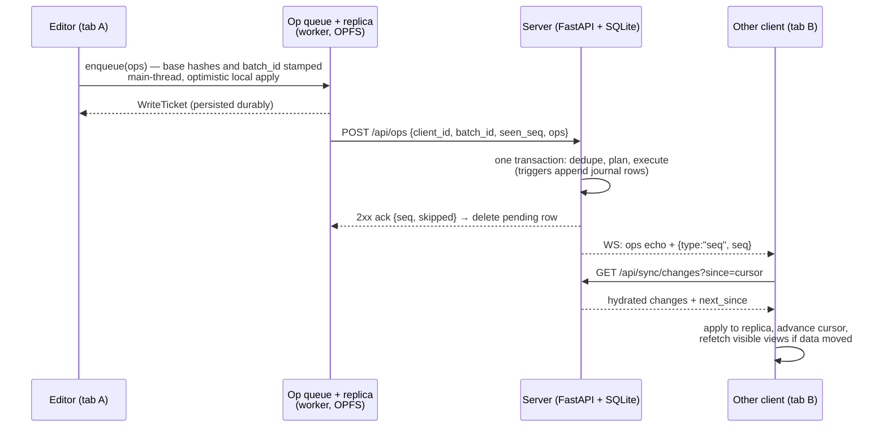
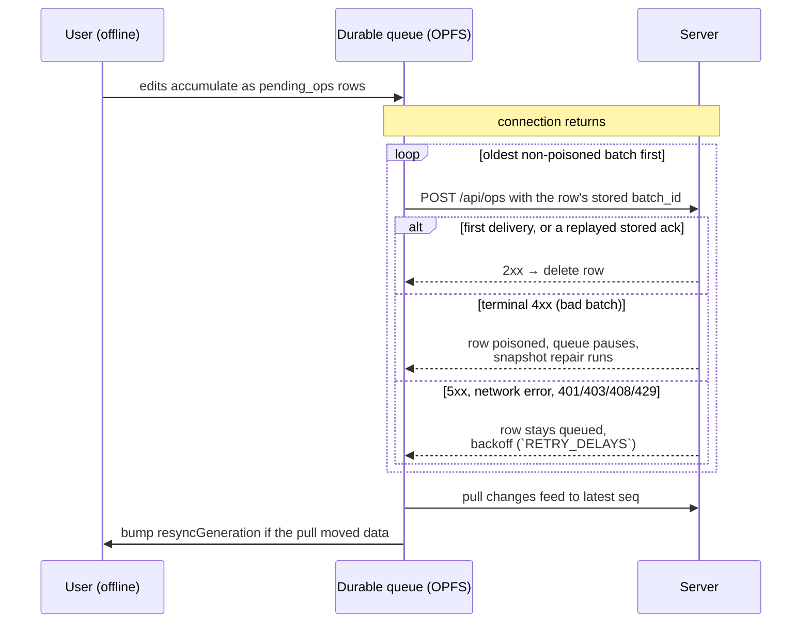

# Sync and offline architecture

This doc follows an edit from a keystroke, through the browser's durable queue
and replica, to the server, and back out to other clients. What each guard does
when a hop fails is in [sync-recovery.md](sync-recovery.md). The server half of
every hop is in [write-path.md](write-path.md) and [backend.md](backend.md).
The design and its rejected alternatives are in
[`docs/superpowers/specs/2026-07-12-offline-editing-design.md`](../superpowers/specs/2026-07-12-offline-editing-design.md).
The cases the sync property encodes sit under the same section names in
[contracts/sync-and-offline.md](contracts/sync-and-offline.md).

## Model

The server is authoritative, and there are no CRDTs: SQLite on the server is
the single source of truth. Clients apply edits optimistically and send op
batches to `POST /api/ops`. Down-sync is pull-based. SQLite triggers append
every change to a journal with a monotonic `seq`, and
`GET /api/sync/changes?since=` returns everything after a client's cursor.
The WebSocket only nudges, so correctness never depends on receiving a frame.
Offline, each browser holds a sqlite-wasm replica and a durable queue of
unacknowledged batches. Batch ids make replays idempotent, and per-block
last-write-wins with `[[conflict]]` preservation resolves collisions at push
time.

## Key pieces

| Piece | Where | Role |
|---|---|---|
| Change journal | `schema.py` (`changes`), triggers | Every mutation gets a `seq`, whatever path wrote it |
| Windowed feed | `routes_sync.py`, `sync_core.py` | `changes?since=` serves windows of the journal; `snapshot` bootstraps |
| Sync metadata | `sync_meta` (`db_generation`, `plain_space_title_canonicalization`) | A new generation forces every client to rebootstrap |
| WS hub | `ws.py`, `notify.py` | Post-commit nudges and op echoes ([write-path.md § Post-commit nudges](write-path.md#post-commit-nudges)) |
| Replica | `web/src/replica/` | sqlite-wasm in a worker, on the OPFS SAHPool VFS |
| Op queue | `sync/opQueue.ts`, `replica/queue.ts`, `sync/outbox.ts` | Durable `pending_ops`, optimistic apply, the drain, and every `/api/ops` POST |
| Orchestration | `sync/session.ts` (`createSyncSession`), built from `clientRuntime.ts`, `reconnectFlow.ts`, `replicaSync.ts`, `outlineRepair.ts` | The one composition (connect ordering, pull loop, recovery, banner fold), also run by the sync property harness |
| React shell | `sync/SyncProvider.tsx`, `useSocketLifecycle.ts` | State, contexts, the owned worker and the offline gateway; the socket and the deferred teardown |
| Offline API shim | `replica/localApi/` | Serves the read API's JSON shapes from the replica |

The session is built during render, so building it reports nothing, and a
listener added after construction still hears every emission (the
`opQueue.ts` header names the two synchronous ones). A StrictMode replay may
cancel the deferred `dispose()`, so every listener and report checks `live()`
first.

## The replica

One file, `/pkm-replica.sqlite3`, holds the graph copy (the server's
`BASE_DDL`, via the generated `replica/baseSchema.gen.ts`) and the client-only
tables in `replica/clientSchema.ts`:

| Table | Holds |
|---|---|
| `pending_ops` | The durable queue, one row per batch. Its shape changes only additively, so a newer client can read an older file. Its id (`PendingRowId`) restarts after a reset or file replacement |
| `pending_seen` | Each batch's `seen_seq` |
| `sync_client_meta` | `cursor`, `generation`, `schema_version`, the plain-space flag, `deferred_block_tombstones` |
| `replay_log`, `replay_log_refs`, `replay_batches` | [The replay log](#the-replay-log) |

Safari and the home-screen PWA on one device have separate storage, so each
holds its own replica, cursor and queue.

A second file, `/pkm-replica-carry.sqlite3`, holds the queue during a
[file replacement](sync-recovery.md#reset-rebase-and-file-replacement).

A commit is atomic across the worker's death, because the next read plays
back the hot `-journal` a killed worker left. The opfs-sahpool VFS does this
from `@sqlite.org/sqlite-wasm` 3.54.1 on, which
`web/e2e/replica-hot-journal.spec.ts` pins.

`ReplicaRpc` (`replica/client.ts`) types every worker RPC with the branded
ids. `rpc.ts`'s `serveRpc` is the one place that takes wire data on trust,
since structured clone carries values, not brands.

**A recovery may discard the replica, never an unacknowledged pending op.**
A snapshot can always be re-fetched; an unflushed pending op cannot.

### Reading rows

`ReplicaDb.select(sql, keys, params?)` (`replica/db.ts`) returns rows typed
`Pick<Columns, K>[]`, where `keys` lists the columns the SQL returns
(`id AS pending_row_id` aliases one). The keys must be an array literal,
because a widened array would type every column as present. `Columns` in
`replica/columns.gen.ts` is generated from the server's `rows.Row`
([backend.md](backend.md#generated-artifacts-and-parity-fixtures)).

Under vitest only, `select` checks every row against `keys` and `rowProblems`
(`replica/rowCheck.ts`; [checks.md](checks.md#every-check)), and
`introspect` refuses a column that may carry a brand.

## An online edit, end to end

The client counts a 2xx ack as success, and its own state comes back through
the pull every client uses. WS op echoes are never written to the replica: a
tab drops its own, matched by `client_id`, and uses others' only for live
views.
The ack's `seq` is kept with the row delete, so a pull already in flight can
accept its window ([below](#windows-and-the-pending-queue)).

`seen_seq` is the replica's cursor at enqueue, which the server uses to drop
edits that predate a page delete
([write-path.md § Stale batches](write-path.md#stale-batches)). `enqueueBatch`
records it in `pending_seen` only when the replica has a generation. A batch
with no row, such as a carried one, posts without it and counts as current.

## The changes feed

`GET /api/sync/changes?since=<cursor>` (`sync_core.dedupe_window`) reads a
window of raw journal rows in one read transaction.

- `next_since` advances to the last raw row *scanned*, not the last distinct
  entity, because an entity's older row can share a window with someone else's
  newer row.
- Rows hydrate from current state. A block ships with every row it depends on:
  its refs, their target pages, its own page, and its parent chain
  (`_with_parent_closure`). A missing dependency fails the replica's deferred
  FK check at COMMIT.
- `block_refs` never ships; both sides derive it through the parity-pinned
  extractor.
- The client loops `pull → apply → cursor = next_since` until
  `next_since >= latest_seq`.

`sync_core.tombstone_entities` picks the tombstones. Page and sidebar ids
(`REUSABLE_ID_KINDS`) have no `AUTOINCREMENT`, so deleting the highest id frees
it for reuse, and a live row does not prove the id names the same entity.

| In the window | Ships |
|---|---|
| A page or sidebar entry absent now | A tombstone |
| A page or sidebar id with a delete row, live now | A tombstone and the live row. For a page, also every current block on it or with a ref to it, since the replica's page cascade removes them |
| A block present now | Its live row (an undo can recreate a uid) |
| A block absent now | A tombstone, only from the window holding its delete row |

The replica dispatches each tombstone `kind` (`EntityKind`) to its own branch.
An unknown kind deletes nothing and logs. It must never fall through to a
delete, or an older replica meeting a newer server's kind destroys an unrelated
row. `parseTombstoneId` (`sync/wire.ts`) is the one reader of the text id.
A malformed wire id rolls the window back (`MalformedTombstoneError`), but a
malformed entry in the deferred record is only dropped with a warning,
because the record outlives the window.

## Applying a window over pending edits

`applyWindow` (`replica/apply.ts`) applies a window in one transaction. A
local apply writes rows it never names (shifted siblings, re-paged
descendants, a delete's cascade), and the server does not always journal the
same ones. So the window takes the pending effects off, lands the server's
rows, and replays each batch as if it were enqueued again.

| Step | Why it sits there |
|---|---|
| 1. `dropAppliedPending`, `pruneReplayBatches` | A batch the payload already holds stops being pending ([below](#a-payload-that-already-holds-a-pending-batch)) |
| 2. `rewind("pending")` | Pending effects come off, so step 9 is a first apply. Poisoned batches are rewound and not replayed |
| 3. Page and sidebar tombstones | Titles are UNIQUE, so a row that gave a title up goes before the row that took it |
| 4. Page upserts | `reconcilePage` remaps local page ids, replay-log keys included. `parkTakenTitles` parks a swapped title until its own upsert |
| 5. Block upserts | Deferred FKs make their order irrelevant |
| 6. `dropWindowRecords` | The server's row is now the base, so an acked batch's record on it has nothing to restore |
| 7. Block tombstones, head window only | [Below](#block-tombstones) |
| 8. `rewind("all")`, head window only | Settles acked batches' records. After 6, or rewinding a block an acked batch created would delete the server children shipped under it |
| 9. Sidebar, cursor, meta, `reconcileActivationPageTitles`, `replayPending` | The queue replays over the window's final rows, each batch at its enqueue time |
| 10. `dropStrandedLocalPages`, head window only | After 9, since a replay re-makes the local pages it needs |

A window that cannot apply returns `needs-bootstrap` or throws
([sync-recovery.md § Rebootstrap triggers](sync-recovery.md#rebootstrap-triggers)).

### Block tombstones

A block tombstone cascades the replica's local subtree. A kept descendant of a
moved-out ancestor has no row of its own to re-ship, so nothing would bring it
back. **Block tombstones apply only in the window at the journal head, after
its upserts.** A window short of the head records them instead
([contract](contracts/sync-and-offline.md#block-tombstones)).
`applyWindow`'s docstring argues that the head-window cascade takes only
what the server deleted.

### Windows and the pending queue

A window read before batch B committed lacks B. If B's ack deleted its row
meanwhile, the window would drop B's edit with nothing left to replay. So
`pullLoop` snapshots the pending batch ids before each fetch.
`pendingSetStillCovered` (`replica/pendingGuard.ts`, whose header gives the
argument) accepts the window only if the ids lost nothing but acked batches,
and its `latest_seq` has reached every ack the worker holds. Otherwise
`pullLoop` refetches up to `PENDING_CHANGED_CAP` times, then throws
`PullStarvedError`.

A bootstrap snapshot takes the same check, against the `seq` `sync_snapshot`
reads in the rows' own read transaction. The queue resumes before
`replicaSync.start()`, so it can ack a batch while the first snapshot is in
flight.

Row ids restart after a schema rebuild, so every delete and poison mark names
its row by `id` and `batch_id` both (`queue.ts::deleteBatch`, `markPoisoned`).

### A payload that already holds a pending batch

A batch can commit while its row is still pending: its ack was lost, or its
own nudge pulled first. Replaying it over a window that shows its effects
applies it twice, and no later window re-ships the damaged rows. So the pull
names its pending batch ids, and the server answers which of them the read
holds.

| Step | Where | What |
|---|---|---|
| Name | `pendingQuery` (`replicaSync.ts`) | `pending=<batch_id>` for the non-poisoned queue head, at most `PENDING_IDS_CAP` |
| Answer | `_applied_batches` (`routes_sync.py`) | `applied_batches`: each named id the server has applied, with its stored `seq` and `skipped`. An older server omits it |
| Drop | `dropAppliedPending` | Deletes the named rows that were in the snapshot, never a poisoned one |
| Settle | `settleApplied`, `OpQueue.settleCommitted` | Takes each batch's `skipped`; resolves tickets and lane marks as the ack would, and emits `onSkipped` once if any batch skipped |

**The server reads `applied_batches` inside the read transaction that hydrates
the payload.** `post_ops` commits a batch's writes and its `applied_batches`
row together, so a named batch is one the payload shows. Delivery is in queue
order, so only a head prefix can commit while pending. A recovery snapshot
names nothing; its commit deletes acked rows itself
([runRecovery](sync-recovery.md#runrecovery)).

### The replay log

`localOps.ts` records a row's pre-image in `replay_log` before a batch's first
write to it, and `rewind` (`replica/rewind.ts`) puts every recorded row back.
The headers of `replica/replayLog.ts` and `rewind.ts` give the record shapes,
a batch's states and the restore order. `replay_batches` holds each batch's
`enqueued_ms`, reused as the stamp of every replay; a page keeps the later of
its `updated_at` and the stamp.

`rewind` undoes the shifts of every skipped or re-placed create and move,
so the replica does not depend on the server journalling a skipped op's
destination siblings.

`replayPending` redoes a batch that trips an FK pre-check op by op, rolling
back only the ops that add a violation, and nothing leaves `pending_ops` (the
`apply.ts` header). A queue handler that runs before `init()` installs the
tables an older file lacks (`ensureClientTables`), so a log insert cannot
roll an optimistic apply back.

## Offline editing and reconnect

Offline, reads and search come from the replica through the local API shim,
and edits enqueue durably. `enqueueBatch` applies each optimistically under its
own SAVEPOINT; an op that cannot apply locally is skipped, never dropped from
the queue.

`enqueueBatch` first refuses, whole and before anything is stored, a batch
the server would always refuse: a
[text limit](write-path.md#work-bounds-under-the-write-lock)
(`findOpTextLimitViolation`) or a
[forbidden or over-long title](titles-and-refs.md#refused-titles)
(`findOpTitleViolation`), in the server's order. It throws `LocalOpError`,
whose `rejected` flag makes `opQueue` treat it as the server's refusal
([sync-recovery.md § A local write fails](sync-recovery.md#a-local-write-fails)).
It backstops the editor, which refuses such an edit earlier
([frontend-editor.md](frontend-editor.md#rules-an-edit-must-not-break)).
`opQueue.enqueue` judges text limits too, for a session without a usable
replica.

The optimistic apply mirrors the server's rules as well as its rows: for
example `set_collapsed` leaves `updated_at` alone. Local `refs` resolve titles
to negative page ids that `remapLocalPage` (`reconcile.ts`) remaps later. Both
replica paths derive `block_refs` through `reindexBlockRefs`, the counterpart
of `store.reindex_refs_for_text`, inside the caller's transaction.

The shim's response builders declare generated return types, so a server field
rename fails `pnpm typecheck`. `shared/fixtures/shim_parity.json` pins the
values. Every recursive walk in the replica is a copy of one server walk, and
each pair changes together
([backend.md § Breadcrumbs and recursive traversal](backend.md#breadcrumbs-and-recursive-traversal)).

### Missing and overtaken targets

The server skips or re-places an op whose target another device deleted or
moved, and acks 200
([write-path.md § Missing targets](write-path.md#missing-targets),
[§ Concurrent structure edits](write-path.md#concurrent-structure-edits)). The
replica decides the same way: `skipsOnMissingTarget` (`replica/missingTarget.ts`)
mirrors `ops_core.classify_skip`, and `placementFor` (`replica/placement.ts`)
mirrors where `ops_apply` lands a create or move.
`shared/fixtures/missing_targets.json` pins both, in `cases` and
`placement_cases`.

The two must agree because of replay. When the feed removes one op's
target, `replayPending` skips that op and keeps the rest of the batch.
Rolling the whole batch back would revert its other edits until the ack, and
the next edit would hash against stale text. A move that another device's move made a cycle
must skip too, or its subtree vanishes from the page.

### The reconnect drain

`reconnectFlow.ts` first retries a failed repair (`retryFailedRepair`;
[sync-recovery.md § A batch the server rejects](sync-recovery.md#a-batch-the-server-rejects)),
then drains, then pulls, so the pull sees this client's offline edits. A
socket reconnect and the queue's `onDrain`
(`reconnect.observeDrain`) share one completion, under the late-caller rule in
[sync-recovery.md § Calls that arrive during a run](sync-recovery.md#calls-that-arrive-during-a-run).
A connect that joins it gets one more pull before the resync decision, because
the running one may be past its pull and the server sends no seq frame on
connect.

A failed completion rejects the `begin()` waiting on it, which the session
logs; a failed pull or `start()` retries on
[`noteFailure`'s backoff](sync-recovery.md#a-pull-that-keeps-failing).
When the reconnect's last pull fails, or was queued behind a pass that
failed, `start()` resolves false and the reconnect bumps views anyway. The
backoff retry that later fetches the missed rows bumps nothing, so this bump
is the views' only refetch.

### The socket

`sync/socket.ts`'s header gives the reconnect policy: exponential backoff,
no scheduled attempt while the tab is hidden, and an immediate one when it
returns. A socket still reporting `OPEN` after `RESUME_STALE_MS` hidden is
closed on return, because iPadOS may have frozen it.

### Online-only features

These degrade explicitly rather than queueing.

| Feature | Offline |
|---|---|
| asset upload, sidebar edits, page deletion, `{{[[query]]}}` | say "online only" |
| `/files`, the assistant | unavailable: no shim for `/api/assets/*` or `/api/assistant/*` |
| a `Local copy::` PDF | a download link, since `/api/local/*` is never cached |
| a GoodLinks copy (`/api/goodlinks/*`) | "Needs the server" |

### When views refetch

`resyncGeneration` is the React counter that makes visible views refetch. It
counts bumps and never carries a seq. Views reload through
`useOutlinePageLoad`'s guarded read, not the outline repair epoch, so pending
edits elsewhere on a page survive a bump.

| Trigger | Bumps when | Where |
|---|---|---|
| A reconnect completes | its catch-up moved data (`replicaSync.appliedVersion()`), no pass served its last pull (`start()` resolved false), or there is no usable replica | `reconnectFlow.ts` |
| A first connect | `begin({ viewsAreStale: true })`: the queue holds an earlier page load's rows, or `replicaSync.hasStarted()` is false | `session.ts` |
| An ack lists skipped ops | always, whatever the replica state | `opQueue.ts` alone, through `readOpsAck` (`onSkipped`, folded as `ops-skipped` by `session.ts`) |
| A repair or reset succeeds | always | `syncState.ts` |
| The replica turns ready while disconnected | always, at the mode report, reading the socket status then | `syncState.ts` (`replica-state`) |

A skip bumps whatever the replica state, because a replica tombstone raises
no resync (`noteCommitted` in `opQueue.ts`). Without the bump the ghost block
stays on screen, and each flush into it lands another daily-note entry.

### Conflicts at push time

Conflicts resolve on the server, per block
([write-path.md § Conflicts](write-path.md#conflicts)). The client supplies the
hashes, both `Sha256Hex`, minted only by `text_hash` / `subtree_hash`
(`sha256Hex` / `subtreeHash` on the web). Which text each batch's hashes
are taken against is a row in the
[contract](contracts/sync-and-offline.md#conflicts-at-push-time).
`subtree_hash.json` and `text_hash_parity.json` pin both hashes across the
two sides.

## Title activation across online and offline paths

The server flag `plain_space_title_canonicalization` rides in every snapshot
and changes payload beside `generation`.
[titles-and-refs.md § Title integrity and one-time activation](titles-and-refs.md#title-integrity-and-one-time-activation)
owns its server meaning and the audited apply. The replica persists it, and
`canonicalizeTitle` strips boundary U+0020 only while it is set.
`normalizeRefTitle` (`grammar/scan.ts`) folds by the generated
`TITLE_WHITESPACE`, never JS's `\s`, so an offline create files a title under
the page the server will (`stripLikePython` for blankness and attribute
names). `title_parity.json` replays the server's verdicts.

A [forbidden title](titles-and-refs.md#refused-titles) is refused on enqueue
([above](#offline-editing-and-reconnect)), but snapshot and feed payloads are
always accepted, because rejecting one would wedge the queue.

The replica persists the flag in the payload's own transaction, before
`reconcileActivationPageTitles` moves or retitles the negative-id pages made
under the old rule; the durable wire ops then replay unchanged. A new
generation returns `needs-bootstrap` before any metadata changes.

The main thread keeps its own copy (`sync/titleCanonicalization.ts`) for titles
read from block text, such as backlink chips. An `update_text` echo carries
the caller's `page_title` hint unresolved, so no consumer may treat it as the
block's page.
