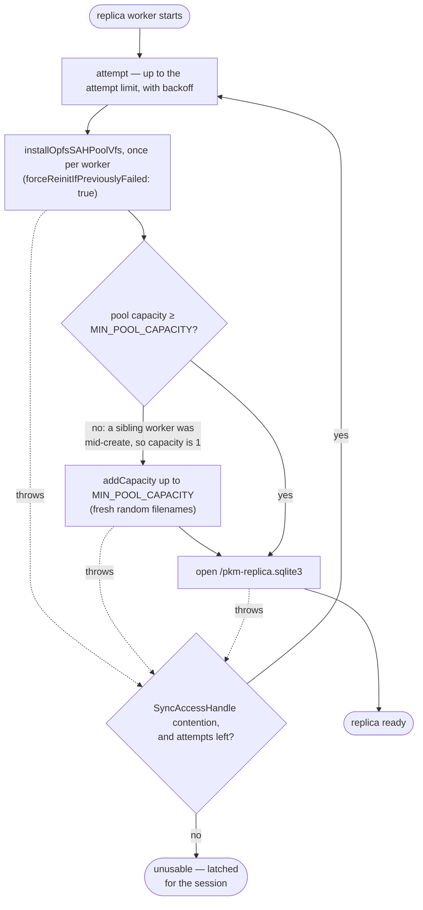
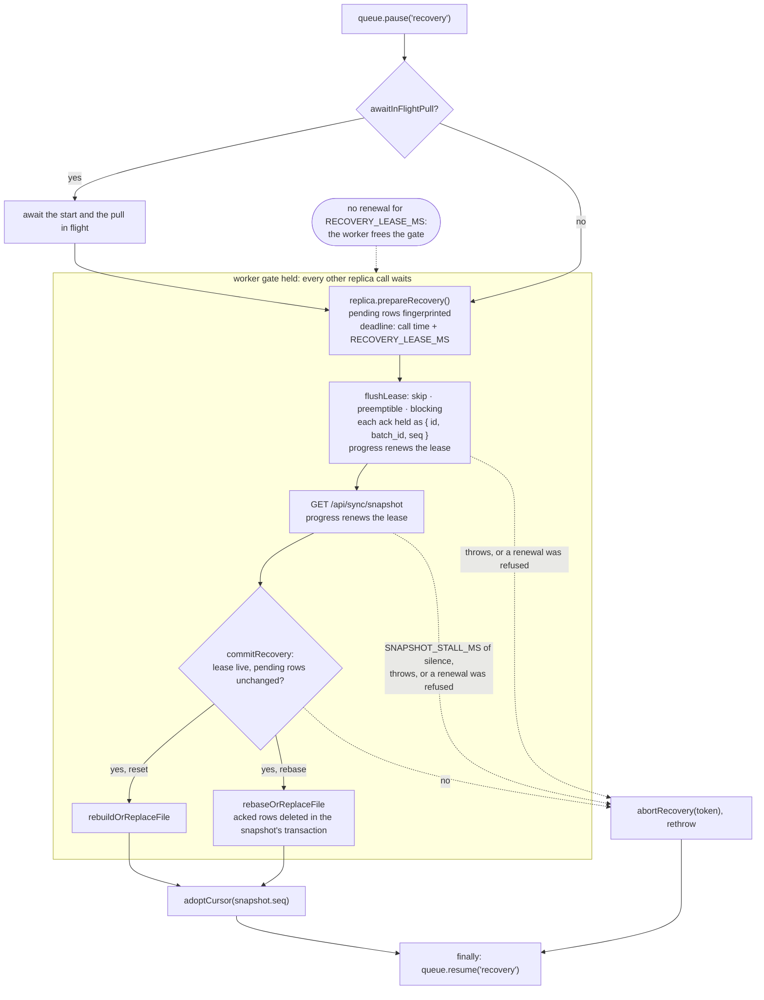

# Sync failure modes and recovery

This doc covers what each guard on the sync path does when a hop fails. The
normal path, including how a window is applied over pending edits, is in
[sync-and-offline.md](sync-and-offline.md). Every case and outcome the
property models encode sits under the same section names in
[contracts/sync-recovery.md](contracts/sync-recovery.md).

## Failure modes at a glance

| Failure | Response | Section |
|---|---|---|
| A replica write fails (`SQLITE_CANTOPEN`, `IOERR`, a dead worker) | The op is kept in the in-memory lane; only `ReplicaError.rejected` discards | [A local write fails](#a-local-write-fails) |
| Lane entries and durable rows are both waiting | `headPrecedes` orders them by batch identity | [The in-memory fallback lane](#the-in-memory-fallback-lane) |
| The OPFS file cannot be opened | Up to the attempt limit, then `unusable` for the session | [When the replica cannot be opened](#when-the-replica-cannot-be-opened) |
| The worker RPC breaks | `unreachable`: ops kept, barrier held; the next replica call sets mode `no-replica` | [Availability](#availability), [Replica mode](#replica-mode) |
| The replica opens, then fails every write | The offline banner says unsent changes exist only in memory | [What the UI shows](#what-the-ui-shows) |
| A window was read before an ack deleted its row | Refetched; `PullStarvedError` after the cap | [Windows and the pending queue](sync-and-offline.md#windows-and-the-pending-queue) |
| A pull or a first bootstrap keeps failing | Backoff; `stalled` after `STALL_AFTER_FAILURES` | [A pull that keeps failing](#a-pull-that-keeps-failing) |
| Two repairs or a recovery overlap | Each holds its own barrier owner and releases only that | [The recovery barrier](#the-recovery-barrier) |
| The server answers a terminal 4xx | Row poisoned, delivery paused, snapshot repair drops it | [A batch the server rejects](#a-batch-the-server-rejects) |
| Schema, generation, cursor, FK, title, corruption or repeated window failure | `reset` or `rebase` through `runRecovery` | [Rebootstrap triggers](#rebootstrap-triggers) |
| A rebuild meets page-level file damage, or `pending_ops` cannot be read | The file is replaced; the queue rides in the carry | [Reset, rebase and file replacement](#reset-rebase-and-file-replacement) |
| Pending rows change while recovery runs | Recovery aborts before anything is destroyed | [runRecovery](#runrecovery) |
| A recovery's snapshot download outlasts the lease, or goes silent | Progress renews the lease; a silent download is abandoned and frees the gate | [The recovery lease](#the-recovery-lease) |

## A local write fails

`opQueue` treats a failed replica RPC as a temporary local-persist failure
and keeps the op, unless the replica rejected the op itself
([contract](contracts/sync-recovery.md#a-local-write-fails)). The check is
that one-entry blocklist on `ReplicaError.rejected`, not the availability
type. A starved pool's `SQLITE_CANTOPEN` is neither `unusable`
nor `unreachable`, so a type check would let it reach `onDesync`, whose
repair (`outline/repairEpochs.ts`) wipes the active outline back to the
server's edit-less state. A full disk arrives the same way: the opfs-sahpool
VFS reports `QuotaExceededError` as a bare `SQLITE_IOERR`.

Kept ops join an ordered in-memory fallback lane.

### The in-memory fallback lane

Order between the lane and durable rows is decided by batch identity in one
predicate, `headPrecedes` (`sync/outbox.ts`)
([contract](contracts/sync-recovery.md#the-in-memory-fallback-lane)). Every
path that posts durable rows asks the queue first. A path that skips it can
post a move ahead of the create it depends on.

`opQueue.enqueue` sets the `follows` mark before the persist RPC, because a
reply that times out does not stop the worker storing the row later, and an
unmarked row would go ahead of the whole lane.

A reload destroys the lane, so `useUnloadGuard` arms from the lane's own
length. Its header gives the guard's limits, including the iOS standalone
PWA, where it does not hold.

## When the replica cannot be opened

Both failure paths are races between an outgoing worker and its replacement.
`openWithRetry` (`replica/openRetry.ts`) and `ensureMinimumCapacity`
(`replica/poolCapacity.ts`) hold the policies.

`forceReinitIfPreviouslyFailed` must stay in `SAH_POOL_INSTALL_OPTIONS`, and
the top-up to `MIN_POOL_CAPACITY` must run before the open; the comments on
both constants say why. `MIN_POOL_CAPACITY` covers `PEAK_POOL_FILES`, the
most a [file replacement](#reset-rebase-and-file-replacement) holds.

### Availability

The worker decides `ReplicaAvailability` and latches it. `db()` in
`workerHandlers.ts` wraps the first `openDb()` failure in a
`ReplicaUnusableError`, and every later handler call throws it. The latch
lasts the worker's life, because lifting the barrier would start a drain
against a reopened, unexamined database. Only the `close` handler re-arms it,
and only `dispose()` sends `close`, just before it terminates the worker.

| `ReplicaAvailability` | Evidence | Keep the op? | May lift the barrier? |
|---|---|---|---|
| `unusable` | the worker's own `openDb()` failed (`unusable: true` on the wire) | yes | yes |
| `unreachable` | the RPC broke (`RpcLifecycleError`) | yes | no |

A broken RPC tells the client nothing about poisoned rows, so `unreachable`
never lifts the barrier. `availabilityOf()` (`replica/errors.ts`) turns the wire
boolean and the client-side error into one type. `isSessionFatal()` says
whether a consumer may latch it: yes for everything but a bare timeout.

### What the UI shows

`bannerForMode` (`sync/syncState.ts`) folds each mode report into a banner.
Offline, `computeEditability` reads `recovery-failed` as read-only. The
`replica-unusable` banner's action is Reload, not Retry, because the failed
open or dead worker is latched for the session.

A poison problem without its repair outranks an outline one, because its
Retry is what lifts `poison`. With the replica gone, `transitionSync` ranks
the banners by whether their action still works
([contract](contracts/sync-recovery.md#what-the-ui-shows)).

`OfflineIndicator.tsx` holds the wording of the `replica-unusable` banner,
which must stay true of unsent work. `unsentInMemory` counts only the lane,
because a reload discards the lane and durable rows survive it.

## A pull that keeps failing

A failed pull, and a failed `start()` (init, schema recovery or the first
bootstrap), reach `noteFailure`. It retries from `RETRY_BASE_MS` doubling to
`RETRY_MAX_MS`, with no timer while offline; the retry runs whichever of the
two is still owed. A first bootstrap that fails with the socket up must not
wait for the next reconnect, which on a desktop can be hours away.
`isStallShaped` (`sync/syncFailures.ts`) decides whether it counts towards
`STALL_AFTER_FAILURES`:

| Failure | Counts? | Why |
|---|---|---|
| `ApiError`, `ReplicaError`, `PullStarvedError` | yes | the replica cannot make progress |
| `OfflineError`, a raw `fetch` rejection | no | the offline banner owns network-down |
| `StalledReadError` | no | the link went silent; the server refused nothing |
| anything `availabilityOf()` classifies | no | `stalled` would take editing from a session already known to have no replica |

`WINDOW_STRIKES` equals `STALL_AFTER_FAILURES` so that a window failing
identically rebases before the [`stalled`](#replica-mode) banner can show.

## Replica mode

`ReplicaState.mode` (`sync/replicaSync.ts`) is what `computeEditability` and
the offline gateway read
([contract](contracts/sync-recovery.md#replica-mode)).

**A session-fatal error ends replica mode for the session.** A dead worker
leaves its RPC client terminal and a failed open is latched, so every later
call fails the same way. `noteUnavailable` is the one writer of `no-replica`
and of `usable = false`. The queue's latch sees only the queue's own calls,
so `replicaSync` and `clientRuntime` report the death at theirs.

## The recovery barrier

The queue delivers nothing while its barrier has a holder. **Each owner
releases only its own claim**, so one repair finishing never lifts a barrier
another still needs. `BarrierOwner` (`sync/queueState.ts`) is a closed union,
and `pause(owner)` and `resume(owner)` take one. Who claims and releases
each, and which POSTs each holds back, is in the
[contract](contracts/sync-recovery.md#the-recovery-barrier).

A recovery's leased flush posts while `lane` holds. The claim only orders
the ordinary drain behind the outline repair, which touches the queue only
through `resume("lane")` and never cancels, rewrites or re-plans a queued
op. So a row's outcome is the same posted then or later; a repair that
changed queued ops would need the flush to stop for `lane` too. A leased
POST settles no ticket, so the repair still replays the write it covers.
`poison` stops the flush, because a rebase that posts nothing would replay
posted rows over its commit.

`OpQueue.holds(owner)` reports a claim, and `replicaSync` reads
`holds("poison")` as its `holdsPoison` dep
([below](#a-batch-the-server-rejects)). `OpQueue.onRelease` fires
synchronously inside `resume`.

The drain checks the barrier again after each `nextBatch()` read, since a
pause can land while the read waits on the worker's gate.

`onDesync` reports `{ error, lane }`. A local refusal (a text past a limit, a
`ReplicaError.rejected` op) also desyncs, but it paused nothing, so its outline
repair resumes nothing.

### Calls that arrive during a run

`coalesce` (`sync/coalesce.ts`, whose header states the rule) serves the
single-flight sites in the table: a call that arrives during a run joins it
while the site's `joinable()` holds, and is otherwise owed one run.

| Site | A late call joins until | Then owed | Decided by |
|---|---|---|---|
| `start` (`replicaSync.ts`) | always: the run's own pull follows | nothing | `joinable: () => true` |
| `pull` (`replicaSync.ts`) | never: a pass may be past its fetch | a pass of its own | `joinable` omitted |
| reconnect completion (`reconnectFlow.ts`) | the resync decision | a completion of its own | `deciding` |
| poison repair (`clientRuntime.ts`) | the delete loop reads its targets | a repair, with the events merged | `deleting` |
| outline repair (`outlineRepair.ts`) | `onStable`: a later run read too early | a run, under the latest error | `stable` |

The flag that decides must flip in the same step as the read it guards, or
a call can still land between the read and the flip. A site whose calls can
be owed checks its owner is still live at the top of its run, because an
owed run can start after the session is disposed. `opQueue.drain` keeps its
own rule (`drainAgain`), because it reruns only on some outcomes and never
over an armed retry.

## A batch the server rejects

`isTerminalRejection` (`sync/rejection.ts`) decides, at both delivery sites in
`opQueue.ts`, whether a failure means the batch itself is bad
([contract](contracts/sync-recovery.md#a-batch-the-server-rejects)).

A batch can meet a 400 its replica could not foresee, such as two devices'
edits stacking past the
[depth cap](write-path.md#work-bounds-under-the-write-lock); the rebase
below then drops its valid ops with the deep one.

A poisoned row pauses delivery, and `clientRuntime.ts` runs
`rebaseAuthoritative`: a `rebase` with flush `"skip"` over a fresh snapshot,
then deletes the poisoned row by id. It never resets, which would drop the
valid rows behind the poisoned one, and never posts them first. It gets past a
damaged file by [file replacement](#reset-rebase-and-file-replacement).

Since it posts nothing, no normal flush may post past the poisoned row, or the
rebase would replay those rows over their commits:

| Guard | Where |
|---|---|
| `rejectDurableBatch` pauses `poison` before the durable mark. The flush's `beforePost` reads `holdsPoison()` before every leased batch, and `deliverLeased` reads it again after the lane ahead | `opQueue.ts`, `replicaSync.ts` |
| Startup repairs poisoned rows left by an earlier page load before `replicaSync.start()` | `clientRuntime.ts` |

A failed repair usually failed offline, so every socket connect retries it
too. A drain observed while connected does not, so a repair that fails
again waits for the next connect instead of looping.

Mark intents live in `localStorage` (`sync/poisonIntentStore.ts`,
`pkm.poison-mark-intents.v1`), so they survive an unopenable database.

## Rebootstraps

A rebootstrap rebuilds the replica from a server snapshot through
`runRecovery`.

### Rebootstrap triggers

Each trigger, what detects it and whether it takes a `reset` or a `rebase`
is a row in the [contract](contracts/sync-recovery.md#rebootstrap-triggers).
Corruption takes a `reset`, because a rebase would replay through the same
corrupt FTS index. The poison repair and the user's Reset local data also
rebootstrap.

### runRecovery

`runRecovery` (`sync/replicaSync.ts`) is the single lifecycle behind every
rebootstrap:

| `RecoveryOptions` | schema / feed recovery | poison repair | manual reset |
|---|---|---|---|
| `flush` | `"preemptible"`: abandon if a poison mark claims recovery | `"skip"`: never post valid rows ahead of a refused batch | `"blocking"`: a failed flush raises `ResetBlockedError`, unless the lease was lost, since discarding the queue would not win it back; `"skip"` if the user discards pending changes |
| `reportReplicaFailure` | yes, mode `recovery-failed` | no | no |
| `awaitInFlightPull` | no | yes | yes |
| `forceReadyOnSuccess` | no | no | yes |

These guards keep a recovery from destroying an edit enqueued while it runs:

| Guard | Where |
|---|---|
| A worker-owned FIFO recovery gate that every database-mutating RPC passes, so no enqueue lands mid-rebuild. A lease that expires frees the gate, and its commit is refused | `recoveryGate.ts`, `workerHandlers.ts` |
| `prepareRecovery` fingerprints the durable pending rows; `commitRecovery` re-reads them before the destructive step and aborts if they changed | `workerHandlers.ts` |

A pull in flight must finish before the database is torn down, or its stale
window lands after the snapshot and moves the cursor back. Feed recovery cannot
await it, since `pullLoop` calls it from inside that pull; it runs through
`recover()`, which turns a `rebase` failing on fresh corruption into a
`reset`.

**Within a session, a rebase never replays a batch its flush got an ack for.**
The server's result can differ from the wire op. The next pull starts at the
snapshot's seq, so nothing would correct a replay of the wire text.
`flushBatches` holds each ack in `heldAcks` (`sync/opsAck.ts`), across runs
until a commit takes them. `splitAckedRows` (`replica/ackedRows.ts`) deletes
the matching rows in the snapshot's transaction. Held acks are memory only, so
after a reload the rows replay once and the stored ack deletes them.

### The recovery lease

The lease bounds the gate span in the diagram above
([contract](contracts/sync-recovery.md#the-recovery-lease)).

**The lease is renewed on progress, never on a timer.** A flush POST that
hangs is never aborted, so a heartbeat would hold the gate for as long as the
hung POST lasts.

A client abandons a stalled snapshot download within the lease, so a live
client gives the gate back before the worker has to. `replicaSync.test.ts`
pins that inequality, and `recoveryLease.props.test.ts` holds the lease call
cases.

An edit made during the gate span waits behind it. Its enqueue times out into
the [in-memory lane](#the-in-memory-fallback-lane), which the `recovery`
barrier also holds, so the edit exists only in memory until the gate frees.

### Reset, rebase and file replacement

A `reset` rebuilds the tables inside the file in one transaction. Damage to
the file itself survives that, so a corruption error replaces the file. A
`rebase` meets the same damage when its snapshot deletes rows, and takes the
same escape but keeps the queue. Each damage and its escape is a row in the
[contract](contracts/sync-recovery.md#reset-rebase-and-file-replacement).

**The carry commits before the damaged file is unlinked.** It keeps each
row's id and `poisoned` mark, because the runtime deletes the poisoned row
by id afterwards. It is discarded as soon as the new file has imported its
rows, because a carry kept past a failed snapshot would later bring back
batches acked since. `rebaseOrReplaceFile`'s docstring walks where the rows
are at each step.

Adoption of a leftover carry comes first in every queue handler, because
otherwise an edit reaching a restarted worker would take the carried ids, and
the by-id import would drop those rows. The recovery internals skip it,
because mid-replacement the carry is the rows' only copy.
`adoptLeftoverCarry`'s docstring covers adoption's failure cases.

An unreadable queue takes the same escape, because without it init,
`prepareRecovery` and the drain's `nextBatch` fail on every page load, and
neither Reset local data nor the lane gets past them.

Corruption must reach `isCorruptionError` with its own message, so
`wrapSqlite`'s `transaction` and `rollbackToSavepoint` (`replica/db.ts`) raise
the original error when SQLite has already rolled back. A masked message
looks like an unappliable window, which triggers a rebase over the same
damaged file.
