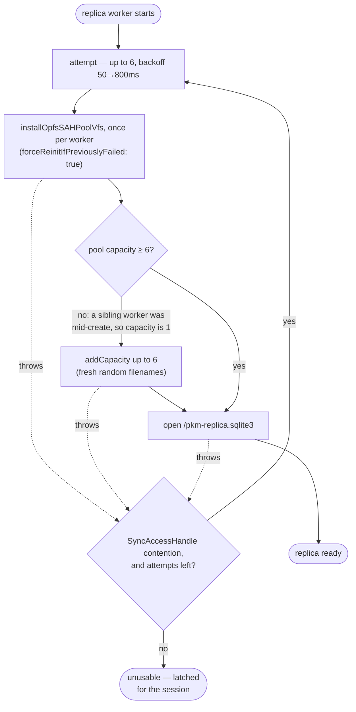
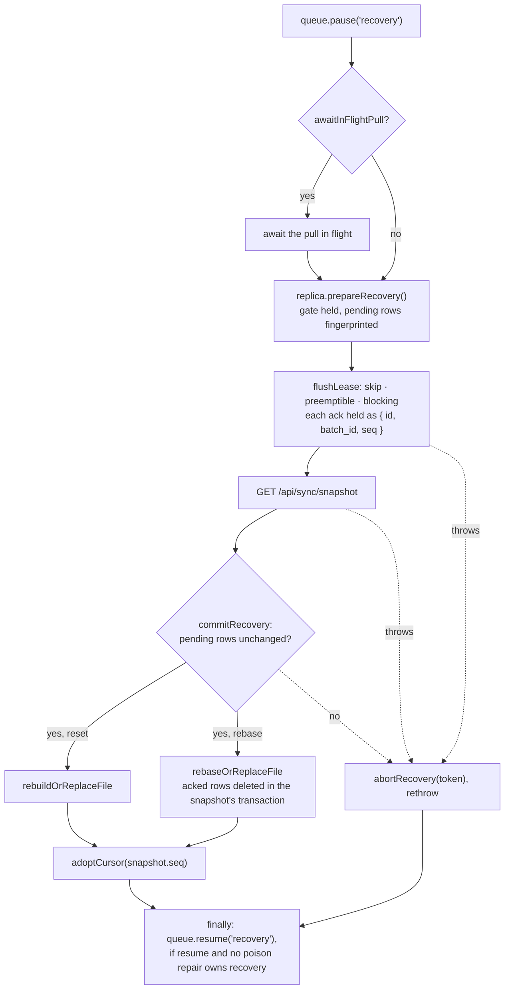

# Sync failure modes and recovery

This doc covers what each guard on the sync path does when a hop fails. The
normal path, including how a window is applied over pending edits, is in
[sync-and-offline.md](sync-and-offline.md). Failures are indexed by what
someone would observe in [troubleshooting.md](../troubleshooting.md).

Every guard here follows from one rule in
[sync-and-offline.md § The replica](sync-and-offline.md#the-replica): the
replica is a cache and the queue is the user's intent.

## Failure modes at a glance

| Failure | Response | Section |
|---|---|---|
| A replica write fails (`SQLITE_CANTOPEN`, `IOERR`, a dead worker) | The op is kept in the in-memory lane; only `ReplicaError.rejected` discards | [A local write fails](#a-local-write-fails) |
| Lane entries and durable rows are both waiting | `headPrecedes` orders them by batch identity | [The in-memory fallback lane](#the-in-memory-fallback-lane) |
| The OPFS file cannot be opened | Up to 6 attempts, then `unusable` for the session | [When the replica cannot be opened](#when-the-replica-cannot-be-opened) |
| The worker RPC breaks | `unreachable`: ops kept, barrier held | [Availability](#availability-two-values-one-owner) |
| The replica opens, then fails every write | The offline banner says unsent changes exist only in memory | [What the UI shows](#what-the-ui-shows) |
| A window was read before an ack deleted its row | Refetched; `PullStarvedError` after the cap | [Windows and the pending queue](sync-and-offline.md#windows-and-the-pending-queue) |
| The server answers a terminal 4xx | Row poisoned, delivery paused, snapshot repair drops it | [A batch the server rejects](#a-batch-the-server-rejects) |
| A pull keeps failing | Backoff; `stalled` after `STALL_AFTER_FAILURES` | [A pull that keeps failing](#a-pull-that-keeps-failing) |
| Schema, generation, cursor, FK, title, corruption or repeated window failure | `reset` or `rebase` through `runRecovery` | [Rebootstrap triggers](#rebootstrap-triggers) |
| A rebuild meets page-level file damage | The file is replaced; the queue rides in the carry | [Reset, rebase and file replacement](#reset-rebase-and-file-replacement) |
| Pending rows change while recovery runs | Recovery aborts before anything is destroyed | [Recovery never erases intent](#recovery-never-erases-intent) |

## A local write fails

A failed replica RPC means "could not persist locally right now". **`opQueue`
keeps the op unless the replica rejected the op itself.** The rule is a
blocklist with one entry, `ReplicaError.rejected`, not a check on the
availability type. A starved pool's `SQLITE_CANTOPEN` is neither `unusable` nor
`unreachable`, so a type check would let it reach `onDesync`. That repair
(`outline/repairEpochs.ts`) wipes the active outline back to the server's
edit-less state, and delivery resumes from its `onStable`. A full disk arrives
the same way: the opfs-sahpool VFS reports `QuotaExceededError` as a bare
`SQLITE_IOERR`.

Kept ops join an ordered in-memory fallback lane. Once `noteReplicaFailure`
latches a non-null `availability` from session-fatal evidence, the drain stops
calling `nextBatch()` and delivers only the lane. Durable rows persisted before
the latch wait for a later session, so they reach the server after newer lane
ops. No edit is lost: a deferred op still carries its base hash, so it lands as
a conflict or a [missing target](sync-and-offline.md#missing-and-overtaken-targets).

### The in-memory fallback lane

The lane drains under the same connectivity, backoff and recovery-barrier
policy as durable rows. Order between the two is decided by batch identity in
one predicate, `headPrecedes` (`sync/outbox.ts`):

| Durable batch | Goes |
|---|---|
| persisted while the lane held entries (a mark in `follows`) | after every lane entry appended before it |
| any other row: a previous session's, the shim's `create_page` | ahead of the lane |
| none left (`nextBatch()` returns null) | the lane goes |

**Every path that posts durable rows asks the queue first**, as the recovery
flush does with `deliverLaneAhead(batch_id)`. A path that skips it can post a
move ahead of the create it depends on.

`opQueue.enqueue` mints the `batch_id` before the persist RPC, so after a lost
reply the durable row and its lane copy share one id, and whichever arrives
second replays. The worker fills hashes into the durable copy only;
`batch_replay_hash` leaves those fields out, so the copies still match
([backend.md § The write path](backend.md#the-write-path)). A lane copy posts
without `seen_seq`, so it is never treated as stale.

A terminal 4xx discards a lane entry and runs `onDesync`'s outline repair
(`sync/legacyRepair.ts`).

A reload destroys the lane, so `useUnloadGuard` arms from `onUnsentInMemory`,
the lane's own length. Its `beforeunload` listener attaches only while the lane
is non-empty, because a permanent one opts the page out of the back/forward
cache. An iOS standalone PWA honours neither `beforeunload` nor
`window.confirm`.

## When the replica cannot be opened

Both failure paths are races between an outgoing worker and its replacement.
`openWithRetry` (`replica/openRetry.ts`) and `ensureMinimumCapacity`
(`replica/poolCapacity.ts`) hold the policies.

`forceReinitIfPreviouslyFailed` must stay in `SAH_POOL_INSTALL_OPTIONS`,
because sqlite-wasm memoises `installOpfsSAHPoolVfs` and otherwise re-awaits the
cached rejection. The top-up to `MIN_POOL_CAPACITY` must run before the open,
because nothing grows the pool later and every file SQLite keeps claims a slot.
The six slots cover the four `PEAK_POOL_FILES` (the replica, the carry and
their journals, the most a
[file replacement](#reset-rebase-and-file-replacement) holds) with two spare.

### Availability: two values, one owner

**The worker owns the answer and latches it until `close()`.** `db()` in
`workerHandlers.ts` wraps the first `openDb()` failure in a
`ReplicaUnusableError`, and every later handler call throws it. Only `close()`
re-arms it, because lifting the barrier starts a drain against a reopened,
unexamined database.

| `ReplicaAvailability` | Evidence | Keep the op? | May lift the barrier? |
|---|---|---|---|
| `unusable` | the worker's own `openDb()` failed (`unusable: true` on the wire) | yes | yes |
| `unreachable` | the RPC broke (`RpcLifecycleError`: `worker-error`, `message-error`, `disposed`, `timeout`) | yes | no |

No answer is not evidence that nothing is poisoned, so `unreachable` never
lifts the barrier. `availabilityOf()` (`replica/errors.ts`) turns the wire
boolean and the client-side error into one type. `isSessionFatal()` says
whether a consumer may latch it: yes for everything but a bare timeout.

### What the UI shows

An `unusable` replica raises `replica-unusable`, and `OfflineIndicator` renders
"Working online only — offline editing is unavailable for now." The second
sentence depends on connectivity:

| State | Second sentence | Why |
|---|---|---|
| Connected | "Your changes are still being saved to the server." | the queue retains every write |
| Offline, work pending | N unsent changes exist only in memory and a reload discards them | they live only in the lane |
| Offline, clean queue | none | nothing to lose |

Its action is Reload, not Retry, because the failed open is latched for the
session. A replica that opens and then fails every write has no availability
verdict, so no problem banner mounts. The offline `ConnectivityBanner` covers
it: it appends `memoryOnlySentence`'s output whenever `unsentInMemory > 0` and
the socket is not `connected`.

## A batch the server rejects

`isTerminalRejection` (`sync/rejection.ts`) decides, at both delivery sites in
`opQueue.ts`, whether a failure means the batch itself is bad:

| Answer | Terminal? | Outcome |
|---|---|---|
| 4xx other than 401, 403, 408, 429 | yes | durable row poisoned; lane entry discarded |
| 401, 403, 408, 429 | no | retained under backoff: a session expiry or a cleared cookie says nothing about the batch. `apiFetch` still redirects a 401 to `/login` |
| 5xx, network failure, `OfflineError` | no | retained under backoff |

A poisoned row pauses delivery, and `clientRuntime.ts` runs
`rebaseAuthoritative`: a `rebase` with flush `"skip"` over a fresh snapshot,
then deletes the poisoned row by id. It never resets, which would drop the
valid rows behind the poisoned one, and never posts them first. It gets past a
damaged file by [file replacement](#reset-rebase-and-file-replacement).

Since it posts nothing, no normal flush may post past the poisoned row, or the
rebase would replay those rows over their commits:

| Guard | Where |
|---|---|
| `onPoisonPending` sets `authoritativeRepair = "poison"` synchronously, before the durable mark, and `assertNormalRecoveryStillOwnsFlush` runs before every post | `replicaSync.ts`, `opQueue.ts::rejectDurableBatch` |
| Startup repairs poisoned rows left by an earlier page load before `replicaSync.start()` | `clientRuntime.ts` |

A failed repair keeps the barrier and a Retry banner. It usually failed
offline, so every socket connect retries it too:

| Repair | Retried by | Banner |
|---|---|---|
| Poison repair | Retry (`retryPolicy.ts::planRetry`'s `repair-targets`), and each connect's `clientRuntime.retryFailedRepair()` | rejected-batch |
| Lane batch's outline repair | Retry, and each connect's `legacyRepair.retryFailed()` | `legacy-rejected` |

Only a connect retries, never a drain observed while connected, so a repair
that fails again waits for the next connect instead of looping.

Mark intents live in `localStorage` (`sync/poisonIntentStore.ts`,
`pkm.poison-mark-intents.v1`), so they survive an unopenable database. A failed
`retryPoisonMarks()` keeps the barrier, with Retry and "Discard rejected
change" (`Sync.discardProblem()`).

`replicaSync`'s `authoritativeRepair` flag is the barrier's ownership claim:

| Ownership | When |
|---|---|
| Claimed | `rejectDurableBatch` emits `poisonPending`, before the durable mark |
| Released, repaired | a successful `markPoisoned` fires `onPoison`, whose repair succeeds |
| Released, unmatched | `markRetainedPoison`'s `markPoisoned` matches no row |
| Released, discarded | `Sync.discardProblem()` drops the intents |

A mark RPC that fails holds the claim, because the row is still unmarked.

## A pull that keeps failing

A pull failure reaches `noteFailure`, which retries from `RETRY_BASE_MS` (1 s)
doubling to `RETRY_MAX_MS` (60 s), with no timer while offline.
`isStallShaped` (`sync/syncFailures.ts`) decides whether it counts towards
`STALL_AFTER_FAILURES` (3):

| Failure | Counts? | Why |
|---|---|---|
| `ApiError`, `ReplicaError`, `PullStarvedError` | yes | the replica cannot make progress |
| `OfflineError`, a raw `fetch` rejection | no | the offline banner owns network-down |
| anything `availabilityOf()` classifies | no | `stalled` would take editing from a session already known to have no replica |

The third counted failure sets mode `stalled`: "Local sync is stuck", with
Reset local data. `WINDOW_STRIKES` equals `STALL_AFTER_FAILURES` so that a
window failing identically rebases before the banner can show.

## Rebootstraps

### Rebootstrap triggers

| Trigger | Detected by | Kind |
|---|---|---|
| A deploy changed the client schema | `SCHEMA_VERSION` (sha256 of base and client DDL) differs from the stored value | `reset` |
| The server DB was rebuilt or activation rotated the generation | `generation` mismatch in any payload | `rebase` |
| Cursor ahead of the journal | `reset: true` from the feed | `rebase` |
| The deferred FK check fails at COMMIT | `applyChanges` returns `needs-bootstrap` | `rebase` |
| A title stays parked after the upserts | `assertNoParkedTitles` throws `StaleTitleHolderError`, then `needs-bootstrap` | `rebase` |
| Corruption (`SQLITE_CORRUPT`, `SQLITE_CORRUPT_VTAB`) applying a window or snapshot | `isCorruptionError`, once per session, after posting `replica.diagnostics()` to `POST /api/client/diagnostics` | `reset`: a rebase would replay through the same corrupt FTS index |
| One cursor fails `WINDOW_STRIKES` times with one message | `isWindowFailure`, which counts only a `ReplicaError` that is neither corruption nor availability; posted as `window-unappliable` | `rebase`, which keeps the queue |

The authoritative repair and the user's Reset local data also rebootstrap.

### runRecovery

`runRecovery` (`sync/replicaSync.ts`) is the single lifecycle behind every
rebootstrap:

| `RecoveryOptions` | schema / feed recovery | poison repair | manual reset |
|---|---|---|---|
| `flush` | `"preemptible"`: abandon if a poison mark claims recovery | `"skip"`: never post valid rows ahead of a refused batch | `"blocking"`: a failed flush raises `ResetBlockedError`; `"skip"` if the user discards pending changes |
| `resume` | yes | no: the runtime resumes after deleting the row | yes |
| `reportReplicaFailure` | yes, mode `recovery-failed` | no | no |
| `awaitInFlightPull` | no | yes | yes |
| `forceReadyOnSuccess` | no | no | yes |

A pull in flight must finish before the database is torn down, or its stale
window lands after the snapshot and moves the cursor back. Feed recovery cannot
await it, since `pullLoop` calls it from inside that pull; it runs through
`recover()`, which turns a `rebase` failing on fresh corruption into a
`reset`.

**Within a session, a rebase never replays a batch its flush got an ack for.**
The server's result can differ from the wire op. The next pull starts at the
snapshot's seq, so nothing would correct a replay of the wire text.
`flushBatches` holds each ack in `heldAcks` (`sync/opsAck.ts`), across runs
until a commit takes them. `splitAckedRows` (`replica/ackedRows.ts`) deletes
the matching rows in the snapshot's transaction. Held acks are memory only, so
after a reload the rows replay once and the stored ack deletes them.

### Reset, rebase and file replacement

A `reset` rebuilds the tables inside the file in one transaction, so a failure
leaves the old database whole. Damage to the file itself, which `quick_check`
reports and the FTS checks do not, survives that. On a corruption error
`rebuildOrReplaceFile` (`replica/workerHandlers.ts`) calls `discardDbFile`,
which unlinks the file and its `-journal`, and rebuilds on a fresh file.

A `rebase` meets the same damage when its snapshot deletes rows.
`rebaseOrReplaceFile` takes the same escape but keeps the queue. **The carry
commits before the damaged file is unlinked.** The rows no ack covers travel
verbatim to `/pkm-replica-carry.sqlite3`, ids and `poisoned` included, because
the runtime deletes the poisoned row by id afterwards.

| Step | Action | If the worker dies here, the rows are in |
|---|---|---|
| 1 | `carry.write(remaining)` (`carryStore.ts`) | the damaged file |
| 2 | `discardDbFile` | the carry |
| 3 | `rebuildSchema`, then `importPendingRows` (`INSERT OR IGNORE` by id) | the carry |
| 4 | `carry.discard()` | the new file |
| 5 | The snapshot applies and pending replays | the new file |

The carry goes at step 4, not after the snapshot: a carry kept past a failed
snapshot would be adopted later and bring back batches acked since.

Every queue handler reaches the database through `queueDb`, which adopts a
leftover carry before serving. Adoption cannot wait for `init`: an edit can
reach a restarted worker first, take the carried ids, and the by-id import
would drop those rows. `diagnostics` alone uses `db()`, so an adoption failure
cannot sink its report.

| Adoption meets | Outcome | Why no row is lost |
|---|---|---|
| A carry that reads as `SQLITE_CORRUPT*` or `SQLITE_NOTADB` (`isUnreadableFileMessage`) | discarded with a warning | a cut-short carry write rolls back on open, so an unreadable carry is storage damage; until step 2 the replica holds the rows |
| A replica whose `installSchema` or `importPendingRows` throws | the carry's rows merge by id with every row the old file can still give (`mergeCarriedRows`, `carryMerge.ts`; the carry wins a clash), go back to the carry, and the file is replaced | rows are lost only if both files are damaged at once |
| Any other error | the handler fails and the carry is kept | the carry is the rows' sure copy |

**Corruption must reach `isCorruptionError` with its own message.** SQLite
rolls back by itself on `SQLITE_CORRUPT`, `IOERR` or `FULL`, and a later
`ROLLBACK` then fails with "no transaction is active". `wrapSqlite`'s
`transaction` and `rollbackToSavepoint` (`replica/db.ts`) raise the original
error instead. A masked message looks like an unappliable window, which earns
a rebase over the same damaged file.

## Recovery never erases intent

Two guards keep a recovery from destroying an edit enqueued while it runs:

| Guard | Where |
|---|---|
| A worker-owned FIFO recovery gate that every database-mutating RPC passes, so no enqueue lands mid-rebuild | `recoveryGate.ts`, `workerHandlers.ts` |
| `prepareRecovery` fingerprints the durable pending rows; `commitRecovery` re-reads them before the destructive step and aborts if they changed | `workerHandlers.ts` |

The other guards that keep intent are where their mechanism lives: the
blocklist in [A local write fails](#a-local-write-fails), the replay after
every window in
[sync-and-offline.md § The replay log](sync-and-offline.md#the-replay-log), and
the carry in [file replacement](#reset-rebase-and-file-replacement).
