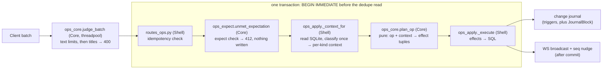

# The write path

This doc follows a write from `POST /api/ops` to its commit and the nudge
after it. It covers the ops a batch carries, the lock every write route takes,
how an op is planned, and what a batch meets when the tree changed after the
client planned it. The routes, the schema, the ref grammar, titles and auth
are in [backend.md](backend.md); how a client queues, pushes and pulls is in
[sync-and-offline.md](sync-and-offline.md). Failures are indexed by symptom in
[troubleshooting.md](../troubleshooting.md).

`POST /api/ops` applies an `OpBatch`. `OpBatch.expect`, which only the
assistant's approval card sets
([assistant.md](assistant.md#the-write-approval-card)), is checked after the
dedupe read and before any op runs: an entry that no longer holds refuses the
whole batch with 412. Checking after dedupe lets a retried batch that already
applied replay its ack instead of being refused by its own effect.

| Op | Does |
|---|---|
| `create` | insert a block, uncollapsed. `page_title` places a top-level create; a child lands on its parent's page |
| `update_text` | replace a block's text. `page_title` only labels a missing block's conflict header |
| `move` | reposition or reparent; a cross-page move re-pages the subtree. `page_title` places a top-level move |
| `delete` | remove a block and its subtree |
| `set_heading`, `set_view_type`, `set_collapsed` | set a block attribute; collapse is view state only |
| `create_page` | idempotently ensure a page exists |

## The write lock

The routes below take `BEGIN IMMEDIATE` before their first read, so no
concurrent commit lands between that read and the write it justifies. A new
route whose decision rests on what it reads joins them.

**Every one takes the lock through `pkm.server.db.write_txn`.** A lock the
busy timeout could not take is a 503 with `Retry-After`, and the nudge
follows the `with` block ([Post-commit nudges](#post-commit-nudges)).

A lock holder must never await the event loop before its commit. Another
request on the loop would wait in `BEGIN IMMEDIATE` for the busy timeout,
blocking the loop, while the holder cannot resume to commit; every write
would stall and then 503.

`test_write_txn.py` fails on a `begin_immediate` call outside the helper, a
`.commit()` in `pkm/server` outside it, and an `await`, `commit` or
`rollback` inside a `with write_txn` body. `upload_asset` alone is
allow-listed: `assets` is not journalled, so it skips `write_txn` (no
`BEGIN IMMEDIATE`) and has no busy branch. Its `INSERT` takes the lock
implicitly, and a lock held past `BUSY_TIMEOUT_MS` reaches the client as a
500. The route is `async`, so that wait also blocks the event loop. Only a
threadpool route can be the holder, since `post_ops` never yields the loop
while it holds the lock.

A read of several statements, such as a sync payload or the assistant's
card, takes one snapshot through `db.read_txn`, without the write lock, so
a write committed between its statements cannot reach half of the payload.
The same test file fails on a bare `BEGIN` in `pkm/server` or
`pkm/assistant` outside `db.py`, and on a write, commit or rollback inside
a `with read_txn` body.

| Route | Lock taken before |
|---|---|
| `POST /api/ops` | the dedupe read and every op's context read; the text and title judges run before it, in the threadpool |
| `POST /api/page/{title}/rename` | the snapshot of referencing blocks, so no batch commits an unrewritten `[[Old]]`; a title race cannot reach the `UPDATE` |
| `DELETE /api/page/{title}` | the snapshot of referencing blocks |
| `DELETE /api/assets/{sha256}` | the strip's read of each referencing block, or with `if_unreferenced=true` the reference check |
| `POST /api/journal/cleanup` | the emptiness and link checks, so a block created on the day cannot go with the page |
| `POST /api/sidebar` | the uniqueness check and `max(order_idx) + 1`, so a same-title race is a 409 |
| `PUT /api/sidebar` | the read of `existing_ids` the order is validated against, so an entry added or removed meanwhile cannot slip past the check |
| `DELETE /api/sidebar/{entry_id}`, `POST /api/pages` | the write itself |
| `GET /api/page/{title}` and `GET /api/journal` | on the miss path only: a read of today's page runs unlocked, and a miss takes the lock and reads again before creating |
| `POST /api/migrations/title-canonicalization` | the re-inventory |

`apply_batch` holds the lock on the event loop;
[Work bounds under the write lock](#work-bounds-under-the-write-lock)
states what bounds its work.

## Planning

`ops_core.plan_op` turns one op and its context into effect tuples.
`ops_apply._context_for` classifies each op once (`classify_skip`, and
`replay_core.classify_text_edit` for a hashed edit) and hands `plan_op` the
context type that classification calls for, such as `TextConflictContext`
or `StuckMoveContext`. `apply_batch` reads the ack's skip, and charges a
hashed edit's `TextEditOutcome`, off the same context. A context that does
not fit its op is an `AssertionError`: a 500 the client retries, never a
400, which would poison the client's queue over a server bug.

- **Ordering.** An insert or move emits `ShiftSiblings`, bumping every
  sibling at or above the target `order_idx`. Nothing renumbers the gaps this
  leaves. A move onto its own slot still bumps every later sibling, because
  `ShiftSiblings` cannot tell staying put from moving there.
- **Refs.** Every text change emits `ReindexRefs`
  (`store.reindex_refs_for_text`, the only way a server write path changes
  `refs`; the one-off `importer/migrate_mermaid_blocks.py` deletes its own
  rows). The schema's
  triggers keep `blocks_fts` and `changes` current but never `refs`, so a
  direct SQL `UPDATE blocks SET text` that adds or changes a link leaves
  backlinks stale. Edit linking text through the ops path (`pkm batch`).
- **Timestamps.** `blocks.updated_at` means last really changed, so
  `set_collapsed` stamps neither block nor page; the journal still carries
  the collapse.
- **Idempotency.** A retried `batch_id` with a matching hash replays the
  stored ack with no effects; with other ops it is a 409. `ops_hash.py`
  holds both hashes and the guard fields the stored `batch_replay_hash`
  leaves out. A change to what either hash covers re-hashes every stored
  batch of that kind, and a retry across the deploy then 409s.
  `op_hashes.json` pins both hashes for every op kind.
- **Well-formed text.** `WellFormedModel` turns lone surrogates into U+FFFD
  ([Hostile input](backend.md#hostile-input)). The rule is to normalise,
  never reject: SQLite cannot bind a surrogate, a 5xx is retried forever and
  a 4xx poisons the batch. `text_hash` hashes the well-formed form, as the
  web does.
- **Text limits.** `ops_core.judge_batch` judges every op's text against
  the [text limits](#work-bounds-under-the-write-lock), a skipped one
  included, before the title check, so `extract` never scans an over-long
  text. The route runs it in the threadpool before `BEGIN IMMEDIATE`, so
  the judges hold neither the single writer nor the event loop.
  `apply_batch` takes a `JudgedBatch`, and only `judge_batch` makes one, by
  convention: nothing checks it. A refused batch already in
  `applied_batches` replays its stored ack, so a deploy that tightens a
  limit never turns the retry of a batch whose ack was lost into a 400,
  which the client treats as terminal and discards. A client's text is
  refused whole, and server-made text never is
  ([Work bounds](#work-bounds-under-the-write-lock)).
- **Title reader.** `apply_batch` reads the title flag once
  (`title_reader`) and passes that one reader to every title the batch
  resolves, every replay and every landing. The replay must match titles
  as the rename or delete it replays did: under plain-space
  canonicalisation a `[[ Old ]]` the client added offline is the page
  `Old`, and left linked it re-creates it.

## Conflicts

Conflicts, missing targets, stale batches and concurrent structure edits are
what a batch meets when the tree changed after it was planned. None rejects
the batch.

`update_text` may carry `base_text_hash`, the sha256 of the text it was based
on; a hash, unlike a version counter, ignores structural change. On a
mismatch, or an edit to a gone block, the incoming edit wins and the losing
text, blank or not, lands under a `[[conflict]]` header on the daily page of
the batch's `now_ms`. A second conflict on a block the same day appends under
the same header.

| Case | Header text |
|---|---|
| Block exists, hash mismatch | `` [[conflict]] [[Page]] — overwritten by ((uid)) `` |
| Block gone, hint names an existing page | `` [[conflict]] [[Page]] — edit to a block the server no longer has `` |
| Block gone, hint names no current page | `` [[conflict]] `Page` (page not found) — edit to a block the server no longer has `` |
| Block gone, hint missing, blank or [refused](backend.md#refused-titles) | `` [[conflict]] (page unknown) — edit to a block the server no longer has `` |
| Block exists, move target gone or inside it, or a replayed edit over a text limit | `` [[conflict]] [[Page]] — ((uid)) `` |
| Guarded `delete` whose subtree changed | `` [[conflict]] [[Page]] — deleted while edited elsewhere `` |
| Any of these, when the page's name would put the header past a [text limit](#work-bounds-under-the-write-lock) | the name replaced by `(page title too long)` (`LONG_TITLE_LABEL`) |

The `page_title` hint never changes whether or where an op applies, and
`find_op_title_violation` never reads it. A header never links a page that
does not exist, or the ref indexer would create it (`conflict_notes.py`).
A page that exists is named by its stored title, never the hint's
spelling (`conflict_notes.existing_page_label`).

`replay_core.classify_text_edit` sorts a hashed `update_text` on a live block,
checking in this order:

| Situation | Outcome |
|---|---|
| `base_text_hash` matches a pre-rewrite snapshot of this block | The `block_rewrites` rows replay over the incoming text (`replay_core.replay`), which then meets the rows below |
| The replay would be over a text limit | The block keeps its text; the edit as sent lands under a conflict header, and the ack lists the op as skipped (`text_limit`) |
| Incoming text equals current | No-op, even with a stale hash |
| `hash(current) == base_text_hash` | Clean apply |
| Hashes differ | Incoming wins; the overwritten text lands under a conflict header |

The replay covers renames and, through `unlink.apply_delete_rewrite`, page
deletes. So a stale edit cannot re-create a renamed-away page, a link to a
deleted page, or a `((ref))` to a gone block. A hashless edit to a live block
is last-write-wins. A replay or stale unlink makes the written text differ
from the sent text, and the client hashes its next edit from what it sent.
So `ops_core.rewrite_effects` plans a `block_rewrites` chain
(`RecordRewrite`) from the sent text's hash to the written one. Each
replayed step is recorded whole, so that next edit replays all of it
(`replay_core.rewrite_chain`).

The stale-unlink rows name only titles whose own unlink changes the sent
text, found in one pass over the text rather than over the titles deleted
since `seen_seq`, whose number the client picks
(`replay_core.stale_titles_linked`). A row already stored under its base
hash is not written again (`ops_apply.BatchReplay.recorded`), or a
reposted stale edit would multiply its rows.

`delete` may carry `base_subtree_hash` over the uid and text of the block
and every descendant ([canonical form](sync-and-offline.md#conflicts-at-push-time)).
Order and nesting are not hashed, so a reorder does not diverge it. On a
mismatch the delete still wins, but first every descendant's text, blank
ones included, lands under the conflict header, nested, with fresh uids
(`ops_core.descendant_copy_effects`).

## Missing targets

An op whose block, or create or move parent, is gone never rejects its
batch: a batch is atomic, so one such op would take every valid op down with
a 400 and wedge the client's queue. `ops_core.classify_skip` sorts it before
its context is read. Every row is reported in the ack's `skipped`
(`ops_core.skip_report`), with `note_page` null where nothing landed.

| Op, situation | Outcome | `reason` | Journalled |
|---|---|---|---|
| `set_collapsed` / `delete`, block gone | no-op | `block_not_found` | `set_collapsed`'s uid, since a replica holds a ghost |
| `move` / `set_heading` / `set_view_type`, block gone | child `move skipped: block <uid> not found` (or `heading change` / `view type change`) under `(page unknown)` | `block_not_found` | the uid; a move also its destination siblings |
| `update_text`, block gone | text lands | `block_not_found` | the uid |
| `create`, parent gone | not created; text lands | `parent_not_found` | created uid with its page, and parent uid |
| `move`, parent gone | block stays; `move skipped: target parent <uid> not found` | `parent_not_found` | the parent uid, then the moved subtree |
| top-level `create` into a page deleted since `seen_seq` | not created; text lands under the deleted page's name | `page_deleted` | the created uid |
| top-level `move` onto such a page | block stays; a note naming the page | `page_deleted` | the moved subtree |

Where a row lands text, a blank text lands nothing; a conflict, by contrast,
keeps a blank losing text. A skipped op resolves no `page_title`, which
would create a page for an op that never applied. A later op in the batch
sees a diverted create's block as missing too, and a diverted subtree lands
flat.

`JournalBlock` writes the row a trigger would, straight into `changes`, so
FTS and refs stay untouched. It marks a uid with no block row `deleted`,
because the feed ships a block tombstone only from a delete row.

A skipped `create` or `move` shifted its destination siblings in the
client's optimistic apply but not on the server. Where nothing else re-ships
them, `ops_apply._destination_siblings` journals them. The replica's
[replay log](sync-and-offline.md#the-replay-log) does not rely on these rows.

Other planning errors stay 400s: an invalid or taken uid, and title syntax,
which `find_op_title_violation` checks before any op applies, in a
`create`, `create_page` or `move` `page_title` and in every ref a text
holds. A
skipped op whose own uid fails `UID_RE` is still a 400
(`ops_core.impossible_uid_reason`), which keeps arbitrary strings out of the
journal. So is the gone parent of a diverted create or of a move whose block
exists. A taken uid outranks a gone parent.

A `create` or `move` that would put a block past `MAX_OUTLINE_DEPTH` is a
400 as well. Server-made landings are never refused for depth, and never
land past the cap ([Work bounds](#work-bounds-under-the-write-lock)).

## Stale batches

An offline device that never pulled a page delete still holds edits against
the page. `apply_batch` asks `store.stale_titles` for `page_deletions` titles
with a `seq` above the batch's `seen_seq`; a batch without `seen_seq` pays no
query, and one beyond the journal head (a replaced database) treats every
deletion as newer.

| Op in a stale batch | Outcome |
|---|---|
| `create_page` for a stale title | dropped, not reported; the replica removes its page (`dropStrandedLocalPages`) |
| top-level `create` / `move` with a stale `page_title` | skipped as `stale_page` (a `SkipKind`), reported `page_deleted` (a `SkipReason`) ([above](#missing-targets)) |
| text linking a stale title | the links become plain text (`replay_core.unlink_stale_text`) |
| a leading `Title::` naming a stale title | fenced in place, `` `X`:: v `` (`unlink.defuse_attribute`), so it indexes no ref; the unlink replay defuses too. The backticks can carry a text at the cap past it ([Work bounds under the write lock](#work-bounds-under-the-write-lock)) |

`unlink_stale_refs` fences a link the unlink's passes leave, its title in
backticks inside its brackets (``[[`a[`]]``, `` #`T` ``): the link is gone,
and nothing the user wrote is removed.

A page re-created after its delete still matches until its row is pruned.

## Concurrent structure edits

| Op, situation | Outcome | Journalled |
|---|---|---|
| `create` under a live parent on another page than its `page_title` | created on the parent's page | the block |
| `move` under a parent no longer on the page `page_title` names | moved onto the parent's page | the subtree |
| `move` whose target is the block or its descendant | skipped as `move_cycle`, reported `cycle`; child `move skipped: would create a cycle` under the block's header | the moved subtree, root first |

## Page mutations and the sidebar

`store.py` page mutations never commit; routes own the transaction. Rename
rewrites every referencing block through `rename.py` and, with `allow_merge`,
merges by concatenating blocks. `DELETE /api/page/{title}` runs
`store.delete_page_unlinking`, which plans with `unlink.plan_page_delete`
before any write:

| Inbound reference | Delete does |
|---|---|
| `[[Title]]`, `#Title`, `#[[Title]]` | becomes plain text |
| `((uid))` to a block of the page | replaced by a copy of that block's text, without its task marker or leading attribute, newlines folded |
| a query macro naming the page | refused: 409 with `blockers` (`DeleteBlockerModel`), `reason` `query`; nothing changes |
| a leading `Title:: v` | refused, `used_as_attribute`: the block's next edit would recreate the page |
| the inlined copies would carry the block past a text limit | refused, `limit` |
| unlinking would change the leading attribute name (`[[Title]]:: v`) | refused, `attribute` |
| rewritten text still references the page | refused, `residual` |

`unlink_title_refs` repeats until the text is stable, because a nested
legacy link loses one layer per pass. A link the passes leave makes the
source `residual` (`unlink.unlink_settled`). The passes stop after the
text's `[[` depth plus `PASSES_PAST_DEPTH`, because a legacy title ending
in `[` re-forms a link after each one. An alias label is found by looking
back to the last `[` only (`unlink._alias_label`); a search from the
text's start makes the unlink quadratic in its links. Rewritten
blocks get `unlink` and `inline` rows and a reindex, and the title goes
into `page_deletions`.

A rewrite the server makes of stored text can grow it: a longer title per
link, a copy per `((uid))`, a stripped asset token that joins `[` to `[`.
[Work bounds under the write lock](#work-bounds-under-the-write-lock)
states how each path bounds it, and each refusal.

`cleanup_journal` spares any daily note with an incoming link, so a link to a
journal day cannot dangle. `POST /api/sidebar` is its own path under the
[write lock](#the-write-lock).

## Work bounds under the write lock

`apply_batch` runs on the event loop and holds the write lock until the
commit, so its work stalls every other request. Its work is a constant, plus
work linear in the request, plus work linear in the rows and subtrees of the
blocks the batch touches. What it derives from the server's history rather
than from the request is charged to the batch's replay budget.

| Bound | Constant | Judged in | Past it |
|---|---|---|---|
| a request body | `PRIVATE_BODY_MAX_BYTES` (`auth_gate_core.py`) | `auth_gate_core.private_body_cap`, in `AuthGateMiddleware` | 413 ([backend.md § Auth](backend.md#auth)) |
| ops in a batch | `MAX_OPS_PER_BATCH` (`contracts/ops.py`) | `OpBatch.ops`, as FastAPI validates the body | 422 |
| a client's block text | `MAX_BLOCK_TEXT_CHARS`, `MAX_LINK_NESTING` (`contracts/ops.py`) | `ops_core.find_op_text_limit_violation` over `text_limits.text_limit_violation`, from `judge_batch` ([Planning](#planning), Text limits) | the whole batch is a 400, unless already applied |
| a page title a `create`, `create_page` or `move` names, or a ref title in a text | `MAX_PAGE_TITLE_CHARS` (`contracts/titles.py`) | `refs.title_length_over`, from `ops_core.find_op_title_violation` in `judge_batch` | as for a block's text |
| where a client's create or move puts a block | `MAX_OUTLINE_DEPTH` (`contracts/ops.py`) | `ops_core._check_depth`, from `plan_op` | the whole batch is a 400 |
| where a conflict entry or a diverged delete's copy lands | `MAX_OUTLINE_DEPTH` | `ops_apply._conflict_landing`, `ops_core.descendant_copy_effects` | never refused; placed no deeper than the cap |
| a conflict header or skip note naming a page | `MAX_BLOCK_TEXT_CHARS`, `MAX_LINK_NESTING` | `conflict_notes._fitted` | the name becomes `LONG_TITLE_LABEL` |
| one replay step | `MAX_BLOCK_TEXT_CHARS`, `MAX_LINK_NESTING`, `MAX_UNLINK_WORK` (`text_limits.py`) | `replay_core._replay_step`, from the spans before it splices (`spans.spliced_length`, `text_limits.unlink_refused`); then `classify_text_edit` judges the result with `text_limit_violation` | the edit lands `over_limit` |
| a batch's replays | `MAX_BATCH_REPLAY_WORK`, `ROW_CHARS` (`replay_core.py`) | `ops_apply.BatchReplay._spend`, from `BatchReplay._read` and `BatchReplay.charge` | the edit lands `over_limit`, and its step spends what is left, so every later step of the batch stops before splicing |
| a route's rewrite of stored text: rename, merge, title migration, asset strip | `MAX_BLOCK_TEXT_CHARS`, `MAX_LINK_NESTING` | `text_limits.rewrite_text_limit_violation`, from `store.rewrite_snapshotted_blocks` (`RewriteTextLimitError`) and `routes_assets._strip_references` | before any block is written: 422 for a rename or merge, 409 for the migration, 409 `{message, blockers}` for the strip, each blocker `limit` ([files-and-assets.md](files-and-assets.md#assets-and-the-file-browser)) |
| a page delete's copies: one page block, a source with its copies in, the total over all sources | `MAX_BLOCK_TEXT_CHARS`, `MAX_LINK_NESTING`, `MAX_UNLINK_WORK`; the total, `MAX_DELETE_COPY_CHARS` (`unlink.py`) | `unlink._copy_length`, from `unlink.plan_page_delete` in source order | each source that would pass a bound is refused, blocker `limit`, on the delete and its preview alike |

The text limits exist because export holds a whole block in memory and the
web tokenizer recurses once per nested run. The depth cap exists because the
page, block and journal reads answer 500 on an outline 255 levels deep:
pydantic-core's serialiser has a fixed recursion guard, so one bound on
writes protects every reader.

A 400 is only ever over what the client sent. A client's own text, titles and
placements are refused whole. Text and placement the server makes are never
refused, because a 400 makes the client discard its whole offline batch over
something it did not send. That covers a replay, a stale unlink, a conflict
header and a diverged delete's copies. A header or note is `_fitted`. Text
copied from a stored row, an overwritten text or a diverged delete's copy,
is level with that row, so a row stored over a limit before the limits
existed is copied past it by its own excess. Other server-made text passes
a limit only by the two backticks of each fence an unlink adds
([Stale batches](#stale-batches),
`test_a_stale_defuse_at_the_cap_stores_at_most_two_more`).

A stored row over a limit may stay level or improve, never get worse. Only
the text an op sends is judged, so a move, `set_*` op or delete of such a row
goes through, and an edit is accepted only when its text is under the
limit. A server rewrite asks
`rewrite_text_limit_violation(before, after)`, and an unlink
`unlink_refused`; both allow level, so the page a legacy row links stays
renamable and deletable. Depth is stricter: a move is judged by where it
puts blocks, so one that leaves a legacy subtree past the cap is refused.

An `over_limit` edit lands as sent, with every title the replay's chain
deleted or renamed away made plain; left linked, it would re-create those
pages (`replay_core.over_limit_landing_text`).

The replay budget is counted in characters. A block can hold millions of
rows, so without it a batch of tiny edits could hold the write lock for
minutes. It charges, and leaves uncharged:

| Work | Charge |
|---|---|
| reading the rows from one base hash (`ops_apply._rewrites_within`) | each row's old and new text in bytes, plus `ROW_CHARS`, measured with `octet_length` through `idx_block_rewrites_uid` before any text loads (`test_the_charge_sizes_rows_without_reading_their_text`) |
| an unlink | what the capped unlink can read (`unlink.unlink_reads`) |
| a rename | the text it scans plus the text it splices, since a longer title grows every link |
| the [rows](#conflicts) an op records for a step that changed its text (`replay_core._charged`) | each row's old and new text, plus `ROW_CHARS`; an inline row's new text is its copy |
| a move or delete of a large subtree, which rewrites or hashes every descendant | nothing |
| the stale-title load (`store.stale_titles`), once per batch | nothing; it is linear in the pages deleted since the batch's `seen_seq`, which the client sends |

The uncharged costs grow with the server's data, not the request. A
request bounds only how many such ops it carries, so a batch can repeat
them; [SECURITY.md § Known limitations](../SECURITY.md#known-limitations)
states the consequence.

A step a cap or the budget stops pays for what it scanned or built
(`replay_core._spent`), or every later op of the batch would repeat it.
Nothing an op does beyond its charge may grow with the block's rows or a
step's titles: a block's rows are read one base hash at a time, as an
edit's walk reaches it (`BatchReplay.walk`), and a step already replayed is
looked up, not replayed again (`test_an_edit_pays_for_its_replay_once`).

A page delete judges a copy's projected length before building it, and
builds only the copies a source refers to (`unlink._Copies`,
`test_many_referrers_to_one_ref_heavy_block_cost_one_projection`). A source
is judged before unlinking
(`test_copies_joined_into_one_deep_link_are_refused_before_unlinking`), and
the passes can remove any amount of text, so a delete whose final text would
fit can still be refused: `MAX_DELETE_COPY_CHARS` trades such a delete for a
bound on the work. A projected `limit` comes ahead of `attribute` and
`residual`, so the delete dialog names the length first.

`plan_op` judges a create or move by the level of the deepest block it
places, with the batch's earlier ops applied (`ops_core._check_depth`). A
skipped op places none of the client's blocks, so it is not judged.

**Depth rejects the batch rather than skipping the op like `move_cycle`.**
A skip would need its own note, journal rows and replica mirror, for a case
only an outline near the cap reaches, far deeper than any in use. The cost,
accepted in the
[design](../superpowers/specs/2026-10-24-outline-depth-cap-design.md), is a
web offline batch [discarded](sync-recovery.md#a-batch-the-server-rejects)
when two devices' edits, each legal alone, stack past the cap. The web
refuses what it can see first
([frontend-editor.md](frontend-editor.md#rules-an-edit-must-not-break)).

Server-made landings are bounded instead, because left unbounded they
stack: a diverged delete copies its subtree one level deeper, under a new
header, and a client may send any `base_subtree_hash`, so deleting each new
header in turn adds a level per batch. At the cap no text is lost, only
nesting below it.

## Post-commit nudges

**Every route whose commit touches a journalled table (`blocks`, `pages`,
`sidebar_entries`) sends a WS `{type:"seq", seq}` nudge right after that
commit.** `seq` is the real journal maximum. A metadata or generation change
that may not advance `changes.seq` adds `force:true` and the new
`generation`, which makes a client pull at its own cursor without advancing
it. `POST /api/ops` also echoes the applied ops.

A route under [`write_txn`](#the-write-lock) nudges after its `with` block:
`notify.nudge_threadpool` from a sync-def route, `await nudge(request, db)`
from `post_ops`. No type or test discovers a new route:
`test_journal_advancing_contract.py` asserts the nudge for each route on its
hand-kept list, so a new journal-advancing route adds its own case there.

`Hub.broadcast()` (`ws.py`) never awaits a send, so a stalled client blocks
neither the write path nor other clients. Each connection's `_drain` task is
the sole consumer of its queue, and `broadcast()`'s loop has no `await`, so a
client receives frames in call order; a second consumer would break that
silently. Dropping a client at `QUEUE_SIZE` or `SEND_TIMEOUT` closes the
socket (`_safe_close`), or `onclose` never fires and the client never
resyncs.
