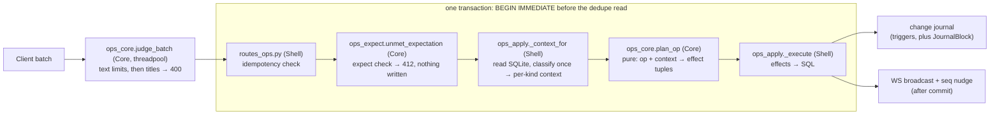

# The write path

A write's way from `POST /api/ops` to its commit and the nudge after it. It
covers the ops a batch carries, the lock every write route takes, how an op
is planned, and what a batch meets when the tree changed after the client
planned it. [backend.md](backend.md) owns the routes, the schema, the ref
grammar, titles and auth; [sync-and-offline.md](sync-and-offline.md) owns how
a client queues, pushes and pulls. Failures are indexed by symptom in
[troubleshooting.md](../troubleshooting.md).

`POST /api/ops` applies an `OpBatch` of 1–500 ops. `batch_id` is required (a
422 without it), because an id-less batch cannot be deduplicated.
`OpBatch.expect`, which only the assistant's approval card sets
([assistant.md](assistant.md#the-write-approval-card)), is checked after the
dedupe read and before any op runs: an entry that no longer holds refuses the
whole batch with 412. Checking after dedupe lets a retried batch that already
applied replay its ack instead of being refused by its own effect.

| Op | Does |
|---|---|
| `create` | insert a block, uncollapsed. `page_title` places a top-level create; a child lands on its parent's page |
| `update_text` | replace a block's text. `page_title` only labels a missing block's conflict header |
| `move` | reposition or reparent; a cross-page move re-pages the subtree. `page_title` places a top-level move |
| `delete` | remove a block and its subtree |
| `set_heading`, `set_view_type`, `set_collapsed` | set a block attribute; collapse is view state only |
| `create_page` | idempotently ensure a page exists |

## The write lock

The routes below take `BEGIN IMMEDIATE` before their first read, so no
concurrent commit lands between that read and the write it justifies. A new
route whose decision rests on what it reads joins them.

**Every one takes the lock through `pkm.server.db.write_txn`.** A lock the
busy timeout could not take is a 503 with `Retry-After`. The helper rolls
back on any raise and commits on a clean exit, a `return` included. The nudge follows the `with` block
([Post-commit nudges](#post-commit-nudges)). `test_write_txn.py` scans
`server/src` and fails on a `begin_immediate` call outside the helper, and on
a `.commit()` in `pkm/server` outside it (`upload_asset` alone is allow-listed:
`assets` is not journalled).

A read of several statements, such as a sync payload or the assistant's
card, takes one snapshot through `db.read_txn`, without the write lock. A
write committed between its statements then cannot reach half of the
payload. The same test file fails on a bare `BEGIN` in `pkm/server` or
`pkm/assistant` outside `db.py`, and on a write, commit or rollback inside a
`with read_txn` body.

| Route | Lock taken before |
|---|---|
| `POST /api/ops` | the dedupe read and every op's context read; the text and title judges run before it, in the threadpool |
| `POST /api/page/{title}/rename` | the snapshot of referencing blocks, so no batch commits an unrewritten `[[Old]]`; a title race cannot reach the `UPDATE` |
| `DELETE /api/page/{title}` | the snapshot of referencing blocks |
| `DELETE /api/assets/{sha256}` | the strip's read of each referencing block, or with `if_unreferenced=true` the reference check |
| `POST /api/journal/cleanup` | the emptiness and link checks, so a block created on the day cannot go with the page |
| `POST /api/sidebar` | the uniqueness check and `max(order_idx) + 1`, so a same-title race is a 409 |
| `PUT /api/sidebar` | the read of `existing_ids` the order is validated against, so an entry added or removed meanwhile cannot slip past the check |
| `DELETE /api/sidebar/{entry_id}`, `POST /api/pages` | the write itself |
| `GET /api/page/{title}` and `GET /api/journal` | on the miss path only: a read of today's page runs unlocked, and a miss takes the lock and reads again before creating |
| `POST /api/migrations/title-canonicalization` | the re-inventory |

A lock holder must never await the event loop before its commit. Another
request on the loop would wait in `BEGIN IMMEDIATE` for the busy timeout,
blocking the loop, while the holder cannot resume to commit; every write
would stall and then 503. The same scan fails on an `await` inside a
`with write_txn` body, and on a `commit` or `rollback` there, which the
helper owns.

`apply_batch` itself runs on the event loop and holds the lock until the
commit. Its work is a constant, plus work linear in the request, which
`PRIVATE_BODY_MAX_BYTES` ([Auth](backend.md#auth)) bounds, plus work linear in the rows
and subtrees of the blocks the batch touches. What it reads of the server's
rewrite history is charged to the batch's replay budget
([Planning](#planning), Replay budget). Two costs are not charged: a move or
delete of a large subtree, which rewrites or hashes every descendant, and the
stale-title load (`stale_titles`), which runs once per batch and is linear in
the pages deleted since the batch's `seen_seq`.

## Planning

Planning here is `ops_core.plan_op`: one op and its context in, effect
tuples out. `ops_apply._context_for` classifies each op once (`classify_skip`,
and `replay_core.classify_text_edit` for a hashed edit) and hands `plan_op`
the context type that classification calls for, such as
`TextConflictContext` or `StuckMoveContext`. `apply_batch` reads the ack's
skip off the same context. No context field has a default. A hashed
edit's context carries the whole `TextEditOutcome`, which `plan_op` plans
from and `apply_batch` charges. A context that does not fit its op, or an
outcome that does not fit its context, is an `AssertionError`. That is a
500 the client retries; it must never be a 400, which would poison the
client's queue over a server bug.

- **Ordering.** An insert or move emits `ShiftSiblings`, bumping every
  sibling at or above the target `order_idx`. Nothing renumbers the gaps this
  leaves. A move onto its own slot still bumps every later sibling, because
  `ShiftSiblings` cannot tell staying put from moving there.
- **Refs.** Every text change emits `ReindexRefs`, whose only implementation
  is `store.reindex_refs_for_text`; the rename rewrite and the asset-token
  strip call it too. It never commits. `importer/migrate_mermaid_blocks.py`
  skips it. The schema's
  triggers keep `blocks_fts` and `changes` current but never `refs`, so a
  direct SQL `UPDATE blocks SET text` that adds or changes a link leaves
  backlinks stale. Edit linking text through the ops path (`pkm batch`).
- **Timestamps.** `blocks.updated_at` means last really changed, so
  `set_collapsed` stamps neither block nor page; the journal still carries
  the collapse.
- **Idempotency.** A retried `batch_id` with a matching hash replays the
  stored ack with no effects; with other ops it is a 409. The stored
  `batch_replay_hash` (`ops_hash.py`) leaves out `base_text_hash`,
  `update_text`'s `page_title` and `base_subtree_hash`, which the worker may
  fill into only the durable copy of a batch. A change to what either hash
  covers re-hashes every stored batch of that kind, and a retry across the
  deploy then 409s. `op_hashes.json` pins both hashes for every op kind,
  and a new optional field must be left out of the hash while unset.
- **Well-formed text.** `WellFormedModel` turns lone surrogates into U+FFFD
  ([Hostile input](backend.md#hostile-input)). The rule is to normalise, never reject:
  SQLite cannot bind a surrogate, a 5xx is retried forever and a 4xx poisons
  the batch. `text_hash` hashes the well-formed form, as the web does.
- **Text limits.** A `create` or `update_text` whose text is longer than
  `MAX_BLOCK_TEXT_CHARS` code points, or nests `[[` past `MAX_LINK_NESTING`,
  makes the whole batch a 400 (`ops_core.find_op_text_limit_violation`,
  over `text_limits.text_limit_violation`). Export holds a whole block in
  memory, and the web tokenizer recurses once per nested run.
  `ops_core.judge_batch` judges every op, a skipped one included, before
  the title check, so `extract` never scans an over-long text. The route
  runs it in the threadpool before `BEGIN IMMEDIATE`: judging a large batch
  takes seconds, and the judges must hold neither the single writer nor the
  event loop. `apply_batch` takes a `JudgedBatch`, and only `judge_batch`
  makes one. That is a convention, not a check: the dataclass is public.
  A refused batch is looked up in `applied_batches`
  without the lock before its 400, and one already applied replays its
  stored ack. A deploy that tightens a limit can therefore never turn the
  retry of a batch whose ack was lost into a 400, which the client treats
  as terminal and discards. Length is judged before nesting, so the nesting
  measure never reads past the cap. Only the text an op sends
  is judged: a move, `set_*` op or delete of a row stored over a limit goes
  through, and an edit that brings it under is accepted. The links a
  [stale batch](#stale-batches) or an over-limit landing unlinks are not
  judged: an unlink only shortens the text, bar the two backticks a fenced
  attribute adds. So a text at the cap whose leading attribute names a
  deleted page is stored at `MAX_BLOCK_TEXT_CHARS` + 2. Every spelling that
  stops it indexing and keeps the user's text adds characters; the fence
  adds two. Refusing would discard the offline batch for text
  the client sent within the limit
  (`test_a_stale_defuse_at_the_cap_stores_at_most_two_more`).
- **Replayed text.** A stale edit replayed over a rename or page delete
  ([Conflicts](#conflicts)) is never stored past a limit, though nobody sent
  the text the replay makes. Each link grows by up to the title's growth
  (a title may be `MAX_PAGE_TITLE_CHARS` long, a legacy one longer), so the
  replayed text could be orders of magnitude past the cap.
  `replay_core._replay_step` stops a step before it builds text past
  `MAX_BLOCK_TEXT_CHARS`, or past `MAX_LINK_NESTING` or `MAX_UNLINK_WORK`
  beyond the text it was given, judging from the spans before it splices
  (`spans.spliced_length`, `text_limits.unlink_refused`). A link the
  step's unlink leaves when its passes run out is fenced, as on the
  [stale path](#stale-batches). `classify_text_edit` then judges the
  result with `text_limit_violation`. Either refusal is the `over_limit`
  outcome: the block keeps its text, and the edit lands as a conflict
  entry. A 400 would poison the client's queue over text it never sent.
  The entry is the edit as sent with every title the replay's chain deleted
  or renamed away made plain (`replay_core.over_limit_landing_text`), or
  its links would re-create those pages. The chain is walked past the step
  that stopped the replay, so a later step's titles count too.
- **Title reader.** `apply_batch` reads the title flag once
  (`title_reader`) and passes that one reader to every title the batch
  resolves, every replay and every landing. The replay must match titles
  as the rename or delete it replays did: under plain-space
  canonicalisation a `[[ Old ]]` the client added offline is the page
  `Old`, and left linked it re-creates it. A step derives its canonical
  titles once per batch, so asking it under a second reader is an
  `AssertionError` (`replay_core._derived`).
- **Replay budget.** A batch's replays share one budget,
  `replay_core.MAX_BATCH_REPLAY_WORK`, counted in characters. It bounds
  all the work a batch derives from the server's history rather than the
  request: the rows a replay reads, and the copies and titles it splices.
  A block can hold millions of rows, so without the budget a batch of tiny
  edits could hold the write lock for minutes. It is charged:

  | Work | Charge |
  |---|---|
  | reading the rows from one base hash (`ops_apply._rewrites_within`) | each row's old and new text in bytes, plus `replay_core.ROW_CHARS` |
  | an unlink | what the capped unlink can read (`unlink.unlink_reads`) |
  | a rename | the text it scans plus the text it splices, since a longer title grows every link |
  | the [rows](#conflicts) an op records for a step that changed its text (`replay_core._charged`) | each row's old and new text, plus `ROW_CHARS`; an inline row's new text is its copy |

  The allowance falls only in `ops_apply.BatchReplay._spend`. `_read`
  debits a hash's rows as a walk reaches them, and `BatchReplay.charge`
  debits each hashed edit's replay once `plan_op` has planned it, before
  its effects record rows. When a step would pass what is left, the edit
  lands `over_limit`, and that step spends the rest, so every later step
  stops before splicing. A step a cap stops pays for what it scanned or
  built (`replay_core._spent`). A stopped step is not kept, so a step that
  paid nothing would be done again by every op of the batch.

  Nothing an op does beyond its charge may grow with the block's rows or
  a step's titles. Otherwise one stale edit linking many deleted titles
  makes every later edit of the block pay for all of them. So a block's
  rows are read one base hash at a time, only when an edit's walk reaches
  that hash (`BatchReplay.walk`, `RewriteHistory.next_unread`).
  `_rewrites_within` reads them through `idx_block_rewrites_uid` and sizes
  them with `octet_length` before it loads any text. A hash too costly to
  read stops the walk blind: the edit lands as sent, with every link made
  plain, since any could name a page the unread chain deleted. The batch
  keeps what it read and what it records, so no hash is read twice. A
  replay runs each step once: the rewrite rows look up the
  classification's steps by what `_replay_step` depends on
  (`replay_core._step_key`) instead of replaying them again.

Conflicts, missing targets, stale batches and concurrent structure edits are
what a batch meets when the tree changed after it was planned. None rejects
the batch.

## Conflicts

`update_text` may carry `base_text_hash`, the sha256 of the text it was based
on; a hash, unlike a version counter, ignores structural change. On a
mismatch, or an edit to a gone block, the incoming edit wins and the losing
text, blank or not, lands under a `[[conflict]]` header on the daily page of
the batch's `now_ms`. The batch reads the clock once; `_conflict_landing`
never reads it. A second conflict on a block the same day appends under the
same header.

| Case | Header text |
|---|---|
| Block exists, hash mismatch | `` [[conflict]] [[Page]] — overwritten by ((uid)) `` |
| Block gone, hint names an existing page | `` [[conflict]] [[Page]] — edit to a block the server no longer has `` |
| Block gone, hint names no current page | `` [[conflict]] `Page` (page not found) — edit to a block the server no longer has `` |
| Block gone, hint missing, blank or [refused](backend.md#refused-titles) | `` [[conflict]] (page unknown) — edit to a block the server no longer has `` |
| Block exists, move target gone or inside it, or a replayed edit over a text limit | `` [[conflict]] [[Page]] — ((uid)) `` |
| Guarded `delete` whose subtree changed | `` [[conflict]] [[Page]] — deleted while edited elsewhere `` |
| Any of these, when the page's name would put the header past a [text limit](#planning) | the name replaced by `(page title too long)` (`LONG_TITLE_LABEL`) |

The `page_title` hint never changes whether or where an op applies, and
`find_op_title_violation` never reads it. A hint naming no current page is
inline code, which the ref extractor skips, so the header cannot re-create
the page (`ops_apply._hint_page`). An existing page is linked by its stored
title, only when `[[Page]]` reads back as it
(`conflict_notes.existing_page_label`). `contracts.ops.new_uid` starts uids
with an alphanumeric so the CLI can address them without `--`.

`replay_core.classify_text_edit` sorts a hashed `update_text` on a live block,
checking in this order:

| Situation | Outcome |
|---|---|
| `base_text_hash` matches a pre-rewrite snapshot of this block | The `block_rewrites` rows replay over the incoming text (`replay_core.replay`), which then meets the rows below |
| The replay would be over a text limit | The block keeps its text; the edit as sent lands under a conflict header, and the ack lists the op as skipped (`text_limit`) |
| Incoming text equals current | No-op, even with a stale hash |
| `hash(current) == base_text_hash` | Clean apply |
| Hashes differ | Incoming wins; the overwritten text lands under a conflict header |

The replay covers renames and, through `unlink.apply_delete_rewrite`, page
deletes. So a stale edit cannot re-create a renamed-away page, a link to a
deleted page, or a `((ref))` to a gone block. A hashless edit to a live block
is last-write-wins. A replay or stale unlink makes the written text differ
from the sent text, and the client hashes its next edit from what it sent.
So `ops_core.rewrite_effects` plans a `block_rewrites` chain
(`RecordRewrite`) from the sent text's hash to the written one.

The chain's stale-unlink rows name each stale title whose own unlink would
change the sent text. `replay_core.stale_titles_linked` finds them in one pass
that matches nothing and records every title the unlink asks about
(`unlink.linked_titles`). It then intersects those with the stale set,
which walks the text's titles, not the deletions. Probing each title with
its own unlink cost one pass per title deleted since `seen_seq`, and the
client picks that number. Recording what the full-set unlink matched would
instead name a title that only another's unlink exposes (`[[z [[y]]]]` with
`y` and `z y` deleted), which the rows must not.

A replayed step is recorded whole (`replay_core._step_records`): every
title, rename and copy it holds, not only what the sent text moved. The
client's next queued edit is hashed on the sent text and replays these
rows. A ref it adds back must still get its copy, and a link it adds back
must still be unlinked even in a batch without `seen_seq`, where no stale
unlink catches it. That makes recording a step of many titles cost each
edit it changes, so the rows are [charged](#planning) (Replay budget). A
row identical to one already stored under its base hash is not written
again (`ops_apply.BatchReplay.recorded`): one stale edit posted again
would otherwise multiply its rows. Under a hash too costly to read for
that comparison every row is written, since a row a later edit needs must
never be dropped.

`delete` may carry `base_subtree_hash` over the uid and text of the block
and every descendant ([canonical form](sync-and-offline.md#conflicts-at-push-time)).
Order and nesting are not hashed, so a reorder does not diverge it. On a
mismatch the delete still wins, but first every descendant's text, blank
ones included, lands under the conflict header, nested, with fresh uids
(`ops_core.descendant_copy_effects`). The header is never inside the subtree
being deleted (`_conflict_landing`'s `exclude`).

## Missing targets

An op whose block, or create or move parent, is gone never rejects its
batch: a batch is atomic, so one such op would take every valid op down with
a 400 and wedge the client's queue. `ops_core.classify_skip` sorts it before
its context is read. Each entry is grouped under the block's uid (a diverted
create's under its parent's), and every row is reported in the ack's
`skipped` (`ops_core.skip_report`), with `note_page` null where nothing
landed.

| Op, situation | Outcome | `reason` | Journalled |
|---|---|---|---|
| `set_collapsed` / `delete`, block gone | no-op | `block_not_found` | `set_collapsed`'s uid, since a replica holds a ghost |
| `move` / `set_heading` / `set_view_type`, block gone | child `move skipped: block <uid> not found` (or `heading change` / `view type change`) under `(page unknown)` | `block_not_found` | the uid; a move also its destination siblings |
| `update_text`, block gone | text lands | `block_not_found` | the uid |
| `create`, parent gone | not created; text lands | `parent_not_found` | created uid with its page, and parent uid |
| `move`, parent gone | block stays; `move skipped: target parent <uid> not found` | `parent_not_found` | the parent uid, then the moved subtree |
| top-level `create` into a page deleted since `seen_seq` | not created; text lands under the deleted page's name | `page_deleted` | the created uid |
| top-level `move` onto such a page | block stays; a note naming the page | `page_deleted` | the moved subtree |

Where a row lands text, a blank text lands nothing; a conflict, by contrast,
keeps a blank losing text. A skipped op resolves no `page_title`, which
would create a page for an op that never applied. A later op in the batch
sees a diverted create's block as missing too, and a diverted subtree lands
flat.

`JournalBlock` writes the row a trigger would, straight into `changes`, so
FTS and refs stay untouched. It marks a uid with no block row `deleted`,
because the feed ships a block tombstone only from a delete row. A move to a
missing parent journals the whole moved subtree: the ghost parent's
tombstone cascades the blocks a replica moved under it, and these rows
restore them.

A skipped `create` or `move` shifted its destination siblings in the
client's optimistic apply but not on the server. Where nothing else re-ships
them, `ops_apply._destination_siblings` journals them. The replica's
[replay log](sync-and-offline.md#the-replay-log) does not rely on these rows.

| Skip | Destination | Siblings journalled |
|---|---|---|
| move of a gone block | a live `parent_uid` | its children |
| move of a gone block | top level, `page_title` naming a page | that page's top-level blocks (never created) |
| move of a gone block | top level, no `page_title` | the top level of the page on its latest tombstone with a `changes.page_id` |
| any | a gone `parent_uid` | none: the parent's tombstone cascades them |
| `move_cycle` | the target's children | none: they lie inside the journalled subtree |

A block the server never created has no delete row, so a diverted create
writes its page onto its own tombstone (`ops_apply._diverted_create_page`):
the page its `page_title` names if one exists, else the page on the parent's
tombstone.

Other planning errors stay 400s: an invalid or taken uid, title syntax.
`find_op_title_violation` checks every `page_title` of a `create`,
`create_page` or `move` and every ref title in block text before any op
applies. A skipped op whose own uid fails `UID_RE` is still a 400
(`ops_core.impossible_uid_reason`), which keeps arbitrary strings out of the
journal. So is the gone parent of a diverted create or of a move whose block
exists. A move of a gone block never checks its parent uid. A taken uid outranks a gone parent.

A `create` or `move` that would put a block past `MAX_OUTLINE_DEPTH`
(`contracts/ops.py`; a top-level block is level 1) is a 400 as well. The
page, block and journal reads answer 500 on an outline 255 levels deep,
because pydantic-core's serialiser has a fixed recursion guard, so one
bound on writes protects every reader. `plan_op` judges a create by its
own level and a move by the level its subtree's deepest block lands at.
Each op sees the batch's earlier ops applied. A skipped op places none of
the client's blocks, so it is not judged. Only where an op puts blocks is
judged. Legacy rows past the cap stay readable below the readers'
255-level limit, and their text stays editable. A move that leaves them
past the cap is refused.

**Depth rejects the batch rather than skipping the op like `move_cycle`.**
A skip would need its own note, journal rows and replica mirror, for a case
that needs an outline near the cap, far deeper than any in use. The cost,
accepted in the [design](../superpowers/specs/2026-10-24-outline-depth-cap-design.md),
is a web offline batch [discarded](sync-recovery.md#a-batch-the-server-rejects)
when two devices' edits, each legal alone, stack past the cap. The web
refuses what it can see first ([frontend-editor.md](frontend-editor.md#rules-an-edit-must-not-break)).

Server-made landings are never refused, and never land past the cap. A
400 over a conflict note or a diverged delete's copies would discard a
batch for something the client did not send. Left unbounded, they stack:
a diverged delete of a top-level block copies its subtree one level
deeper, under a new header, and a client may send any
`base_subtree_hash`. Deleting each new header in turn then adds a level
per batch. The planner bounds them instead, and no text is lost, only
nesting below the cap:

| Landing | Bound |
|---|---|
| Conflict entry | `_conflict_landing` reuses today's header only above the cap. One at the cap or deeper gets a fresh top-level header. A client can move an emptied header to the cap; only a legacy row sits deeper |
| A diverged delete's copies | `descendant_copy_effects` keeps their shape down to the cap. A copy one level above the cap takes the rest of its copied subtree as children at the cap, in document order |
| Root copy at the cap, under a reused header | its copied descendants follow it under the header, in document order |

Nor is server-made text ever past a [text limit](#planning), bar the two
backticks a defused attribute adds and the two a fence adds to each link
a legacy title ending in `[` leaves ([Stale batches](#stale-batches)). A `page_title` hint is never
length-judged, and a title stored before `MAX_PAGE_TITLE_CHARS` may be
longer than the cap. So every header and note that names a page is
judged, and names it `LONG_TITLE_LABEL` when the name would not fit
(`conflict_notes._fitted`). Only the name is replaced, so a header for a
hint naming no page still says `(page not found)`. Text the planner copies
from a stored row, such as an overwritten edit or a diverged delete's
copies, is level with that row, so it is within the limits whenever its
source is.

## Stale batches

An offline device that never pulled a page delete still holds edits against
the page. `apply_batch` asks `store.stale_titles` for `page_deletions` titles
with a `seq` above the batch's `seen_seq`; a batch without `seen_seq` pays no
query, and one beyond the journal head (a replaced database) treats every
deletion as newer.

| Op in a stale batch | Outcome |
|---|---|
| `create_page` for a stale title | dropped, not reported; the replica removes its page (`dropStrandedLocalPages`) |
| top-level `create` / `move` with a stale `page_title` | skipped as `stale_page` (a `SkipKind`), reported `page_deleted` (a `SkipReason`) ([above](#missing-targets)) |
| text linking a stale title | the links become plain text (`replay_core.unlink_stale_text`) |
| a leading `Title::` naming a stale title | fenced in place, `` `X`:: v `` (`unlink.defuse_attribute`), so it indexes no ref; the unlink replay defuses too. A text at the cap is stored two characters past it ([Planning](#planning)) |

`unlink_stale_refs` fences what the unlink's passes leave: the title goes
in backticks inside its brackets (``[[`a[`]]``, `` #`T` ``). A run whose
title holds a backtick is no run, so the link is gone whatever the
backticks pair with, and nothing the user wrote is removed. Only a legacy
title ending in `[`, or a code span that moves as links go, leaves one.

A page re-created after its delete still matches until its row is pruned.

## Concurrent structure edits

| Op, situation | Outcome | Journalled |
|---|---|---|
| `create` under a live parent on another page than its `page_title` | created on the parent's page | the block |
| `move` under a parent no longer on the page `page_title` names | moved onto the parent's page | the subtree |
| `move` whose target is the block or its descendant | skipped as `move_cycle`, reported `cycle`; child `move skipped: would create a cycle` under the block's header | the moved subtree, root first |

`_context_for` resolves `page_title` only for a top-level create or move, so
a stale title never creates an empty page. The cycle skip journals no
tombstone, since nothing is gone. Its journalled subtree carries what the
replica's optimistic move touched: re-paged descendants and the target's
shifted children.

## Page mutations and the sidebar

`store.py` page mutations never commit; routes own the transaction. Rename
rewrites every referencing block through `rename.py` and, with `allow_merge`,
merges by concatenating blocks. `DELETE /api/page/{title}` runs
`store.delete_page_unlinking`, which plans with `unlink.plan_page_delete`
before any write:

| Inbound reference | Delete does |
|---|---|
| `[[Title]]`, `#Title`, `#[[Title]]` | becomes plain text |
| `((uid))` to a block of the page | replaced by a copy of that block's text, without its task marker or leading attribute, newlines folded |
| a query macro naming the page | refused: 409 with `blockers`, `reason` `query`; nothing changes |
| a leading `Title:: v` | refused, `used_as_attribute`: the block's next edit would recreate the page |
| the inlined copies would carry the block past a text limit | refused, `limit` |
| unlinking would change the leading attribute name (`[[Title]]:: v`) | refused, `attribute` |
| rewritten text still references the page | refused, `residual` |

`unlink_title_refs` repeats until the text is stable, because a nested legacy
link loses one layer per pass. It stops after the text's `[[` depth plus
two passes that change it (`unlink.unlink_settled`): the depth peels nested
links, and the two cover a tag an unlink exposes (`##[[T]]`,
`[[\n#T\n]]#T`). A title ending in `[` (legacy only), or a code span that
moves as links go, can need more. A delete then finds the link the passes
left and reports the source `residual`. A link's alias label is found by
looking back to the last `[` only (`unlink._alias_label`); a search from
the text's start per link made the unlink quadratic in its links. Rewritten blocks get `unlink` and `inline`
rows and a reindex, and the title goes into `page_deletions`. The replay of
an `unlink` row matches titles through the same `title_reader`, or a stale
padded `[[ Title ]]` would survive and recreate the page.

A rewrite the server makes of stored text can grow it: a longer title per
link, a copy per `((uid))`, a stripped asset token that joins `[` to `[`.
Those paths judge each block with
`text_limits.rewrite_text_limit_violation(before, after)`, before any write.
Each limit is judged on its own: `after` is refused when it is over the
length cap and longer than `before`, or nested past the cap and deeper than
`before`. **A row stored over a limit may stay level or improve, never get
worse,** so the page it links stays renamable and deletable. Client writes
keep the strict rule ([Planning](#planning)).

A page delete judges length before it builds anything. The copy work it
does under the write lock is bounded per delete. The rest grows with the
page's text, the referrers' own text and the copy text counted, times the
unlink's passes: at most the depth plus three per text, each text held to
`text_limits.MAX_UNLINK_WORK` in depth times length. It builds a page block's copy
only when a source refers to it (`unlink._Copies`). Every judgement counts a
copy at its projected length (`spans.spliced_length` of the refs it holds),
before deeper refs are blanked and links unlinked. A copy that blanks down
to `""` still costs that length to build. `_Copies.projected` sums a block's
spans once and keeps the length. Summed again per referrer, the work would
grow with the referrers while the budget counted nothing, since refs to an
empty block project to 0.

| Counted | Past the bound | Refused as `limit` |
|---|---|---|
| one copy | `MAX_BLOCK_TEXT_CHARS` | every source referring to it |
| one source's inlined text | `MAX_BLOCK_TEXT_CHARS`, and longer than the source | that source |
| copy text over all sources, in order | `MAX_DELETE_COPY_CHARS` | each source that would carry the total past it |
| one copy, spliced, before unlinking | nested past `MAX_LINK_NESTING` deeper than the block, or depth times length past `MAX_UNLINK_WORK` and the block's | every source referring to it |
| one source with its copies in, before unlinking | the same, against the source | that source |

Copies that each nest within the cap can join into one deep link: one block
opens 32 runs and another closes them, so a referrer citing each m times
inlines to `[[` × 32m around the title. The unlink peels one layer per pass
over the whole text, so the spliced text is judged before unlinking
(`text_limits.unlink_refused`), on each copy in `unlink._Copies.get` and on
each source in `plan_page_delete`. Within the nesting cap the same splice
can still wrap thousands of links 32 deep, each layer a pass over the whole
text, so `unlink_refused` also judges depth times length against
`MAX_UNLINK_WORK`. That is twice the length cap: any text within the length
cap nested twice passes. Level is allowed on both rules, so a legacy row
whose delete splices nothing in stays deletable. A source refused for its
depth keeps its copy text counted against `MAX_DELETE_COPY_CHARS`, since its
copies were built.

No copy is built for a source refused on its projected length. A source is
judged before unlinking, and the shortening passes can remove any amount of
text, so a delete whose final text would fit can still be refused.
`MAX_DELETE_COPY_CHARS` sits far above what a page written by hand needs;
it trades such a delete for a bound on the work. The source's `limit` comes ahead of `attribute` and
`residual`, so the delete dialog names the length first.

| Rewrite | Judged in | A refusal |
|---|---|---|
| rename, merge | `store.rewrite_snapshotted_blocks` (`RewriteTextLimitError`) | 422 `rename refused: block <uid> on <page>: …` |
| title migration | the same | 409 `title migration refused: …` |
| page delete, delete preview | `unlink.plan_page_delete` | blocker `limit` |
| asset delete | `routes_assets._strip_references` | 409 `{message, blockers}`, each `limit` ([files-and-assets.md](files-and-assets.md#assets-and-the-file-browser)) |

A blocker carries `excerpt`, the block's first `BLOCKER_EXCERPT_CHARS` code
points, and `text_length` in code points, never the whole text
(`DeleteBlockerModel.of`). A reader shows a cut excerpt as cut: the web's
`blockerExcerpt` appends `… (N characters)`.

`cleanup_journal` spares any daily note with an incoming link, so a link to a
journal day cannot dangle. `POST /api/sidebar` is its own path under the
[write lock](#the-write-lock).

## Post-commit nudges

**Every route whose commit touches a journalled table (`blocks`, `pages`,
`sidebar_entries`) sends a WS `{type:"seq", seq}` nudge right after that
commit.** `seq` is the real journal maximum. A metadata or generation change
that may not advance `changes.seq` adds `force:true` and the new
`generation`, which makes a client pull at its own cursor without advancing
it. `POST /api/ops` also echoes the applied ops.

A route under [`write_txn`](#the-write-lock) nudges after its `with` block:
`notify.nudge_threadpool` from a sync-def route, `await nudge(request, db)`
from `post_ops`. There is no other way to commit and nudge. `delete_asset` nudges because
it rewrites blocks; `cleanup_journal` only when it deleted something. No type
or test discovers a new route: `test_journal_advancing_contract.py` asserts
the nudge for each route on its hand-kept list, so a new journal-advancing
route adds its own case there.

`Hub.broadcast()` (`ws.py`) never awaits a send, so a stalled client blocks
neither the write path nor other clients. Each connection's `_drain` task is
the sole consumer of its `asyncio.Queue`, and `broadcast()`'s loop has no
`await`, so a client receives frames in `broadcast()` call order; a second
consumer or another queue would break that silently. A client is dropped at
`QUEUE_SIZE` queued frames or a send past `SEND_TIMEOUT`. Dropping closes the
socket (`_safe_close`), because otherwise `onclose` never fires and the
client never resyncs.
