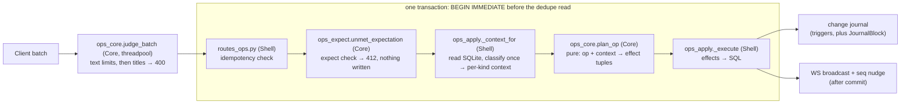
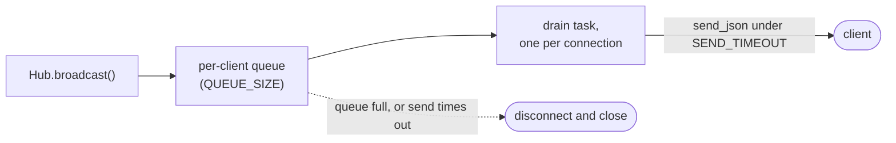

# The write path

This doc follows a write from `POST /api/ops` to its commit and the nudge
after it. It covers the ops a batch carries, the lock every write route takes,
how an op is planned, and what a batch meets when the tree changed after the
client planned it. The routes, the schema, the ref grammar, titles and auth
are in [backend.md](backend.md); how a client queues, pushes and pulls is in
[sync-and-offline.md](sync-and-offline.md). Every case, outcome and exact
string sits under the same section names in
[contracts/write-path.md](contracts/write-path.md), which the ops property
model is written from.

`POST /api/ops` applies an `OpBatch`. `OpBatch.expect`, which only the
assistant's approval card sets
([assistant.md](assistant.md#the-write-approval-card)), is checked after the
dedupe read and before any op runs. An entry that no longer holds refuses the
whole batch with 412. The dedupe comes first so that a retried batch that
already applied replays its ack, instead of failing a check its own apply made
false.

## Ops

| Op | Does |
|---|---|
| `create` | insert a block |
| `update_text` | replace a block's text. `page_title` only labels a missing block's conflict header |
| `move` | reposition or reparent |
| `delete` | remove a block and its subtree |
| `set_heading`, `set_view_type`, `set_collapsed` | set a block attribute; collapse is view state only |
| `create_page` | ensure a page exists, so that an empty page made offline reaches the server |

A batch applies whole or not at all, because a client keeps or discards it
whole. `page_title` names the page of a top-level `create` or `move`. A
blank one is filed under `UNTITLED_PAGE_TITLE` rather than refused, since a
400 would wedge an offline client's queue.
[contracts/write-path.md § Ops](contracts/write-path.md#ops) has each op's
cases.

## The write lock

The routes below take `BEGIN IMMEDIATE` before their first read, so no
concurrent commit lands between that read and the write it justifies. A new
route whose decision rests on what it reads joins them.

**Every one takes the lock through `pkm.server.db.write_txn`.** A lock the
busy timeout could not take is a 503 with `Retry-After`, and the nudge
follows the `with` block ([Post-commit nudges](#post-commit-nudges)).

A lock holder must never await the event loop before its commit. Another
request on the loop would wait in `BEGIN IMMEDIATE` for the busy timeout,
blocking the loop, while the holder cannot resume to commit; every write
would stall and then 503.

`test_write_txn.py` enforces both rules. It allow-lists only `upload_asset`:
`assets` is not journalled, so the route skips `write_txn` and has no busy
branch. Its `INSERT` takes the lock implicitly, so a lock held past
`BUSY_TIMEOUT_MS` reaches the upload as a 500, and the `async` route blocks
the event loop while it waits. The holder can only be a threadpool route,
because `post_ops` never yields the loop while it holds the lock.

A read of several statements, such as a sync payload or the assistant's
card, takes one snapshot through `db.read_txn`, without the write lock, so
a write committed between its statements cannot reach half of the payload.
The same test file keeps writes out of a `read_txn` body.

| Route | Lock taken before |
|---|---|
| `POST /api/ops` | the dedupe read and every op's context read; the text and title judges run before it, in the threadpool |
| `POST /api/page/{title}/rename` | the snapshot of referencing blocks, so no batch commits an unrewritten `[[Old]]`; a title race cannot reach the `UPDATE` |
| `DELETE /api/page/{title}` | the snapshot of referencing blocks |
| `DELETE /api/assets/{sha256}` | the strip's read of each referencing block, or with `if_unreferenced=true` the reference check |
| `POST /api/journal/cleanup` | the emptiness and link checks, so a block created on the day cannot go with the page |
| `POST /api/sidebar` | the uniqueness check and `max(order_idx) + 1`, so a same-title race is a 409 |
| `PUT /api/sidebar` | the read of `existing_ids` the order is validated against, so an entry added or removed meanwhile cannot slip past the check |
| `DELETE /api/sidebar/{entry_id}`, `POST /api/pages` | the write itself |
| `GET /api/page/{title}` and `GET /api/journal` | on the miss path only: a read of today's page runs unlocked, and a miss takes the lock and reads again before creating |
| `POST /api/migrations/title-canonicalization` | the re-inventory |

`apply_batch` holds the lock on the event loop;
[contracts/write-path.md § Work bounds under the write lock](contracts/write-path.md#work-bounds-under-the-write-lock)
states what bounds its work.

## Planning

`ops_core.plan_op` turns one op and its context into effect tuples.
`ops_apply._context_for` classifies each op once (`classify_skip`, and
`replay_core.classify_text_edit` for a hashed edit) and hands `plan_op` the
context type that classification calls for, such as `TextConflictContext`
or `StuckMoveContext`. `apply_batch` reads the ack's skip, and charges a
hashed edit's `TextEditOutcome`, off the same context. A context that does
not fit its op is an `AssertionError`, a 500 the client retries, never a 400
that would poison the client's queue over a server bug.

- **Ordering.** An insert or move emits `ShiftSiblings`, which makes room
  at the target `order_idx` and never closes gaps
  ([contract](contracts/write-path.md#ordering)).
- **Refs.** Every text change emits `ReindexRefs`
  (`store.reindex_refs_for_text`, the only way a server write path changes
  `refs`). The schema's
  triggers keep `blocks_fts` and `changes` current but never `refs`, so a
  direct SQL `UPDATE blocks SET text` that adds or changes a link leaves
  backlinks stale. Edit linking text through the ops path (`pkm batch`).
- **Timestamps.** `blocks.updated_at` means last changed, so
  `set_collapsed` stamps neither block nor page; the journal still carries
  the collapse.
- **Idempotency.** A retried `batch_id` with a matching hash replays the
  stored ack with no effects; with other ops it is a 409. `ops_hash.py`
  holds both hashes and the guard fields the stored `batch_replay_hash`
  leaves out. A change to what either hash covers re-hashes every stored
  batch of that kind, and a retry across the deploy then 409s.
  `op_hashes.json` pins both hashes for every op kind, on the server and the
  web, and its `replay_excluded` list names the fields the worker fills.
- **Well-formed text.** `WellFormedModel` turns lone surrogates into U+FFFD
  ([Hostile input](request-boundary.md#hostile-input)). The rule is to normalise,
  never reject: SQLite cannot bind a surrogate, a 5xx is retried forever and
  a 4xx poisons the batch. `text_hash` hashes the well-formed form, as the
  web does.
- **Text limits.** `ops_core.judge_batch` judges every op's text against
  the [text limits](#work-bounds-under-the-write-lock), a skipped op's
  included, before the title check, so `extract` never scans an over-long
  text. `post_ops` runs it in the threadpool before `BEGIN IMMEDIATE`, and
  a refused batch already in `applied_batches` replays its stored ack, so a
  tightened limit never 400s the retry of a batch whose ack was lost.
  `apply_batch` takes a `JudgedBatch`, which only `judge_batch` makes, by
  convention: nothing checks it.
- **Title reader.** `apply_batch` reads the title flag once
  (`title_reader`) and passes that one reader to every title the batch
  resolves, every replay and every landing. The replay must match titles
  as the rename or delete it replays did: under plain-space
  canonicalisation a `[[ Old ]]` the client added offline is the page
  `Old`, and left linked it re-creates it.

## Conflicts

Conflicts, missing targets, stale batches and concurrent structure edits are
what a batch meets when the tree changed after it was planned. None rejects
the batch.

`update_text` may carry `base_text_hash`, the sha256 of the text it was
based on. A hash, unlike a version counter, ignores structural change. When
the hash no longer matches, or the block is gone, the incoming edit wins and
the losing text lands under a `[[conflict]]` header on the day's daily page
([contract](contracts/write-path.md#conflicts)).

The `page_title` hint never changes whether or where an op applies, and
`find_op_title_violation` never reads it. A header never links a page that
does not exist, or the ref indexer would create it (`conflict_notes.py`).

A hashed edit made before a rename or page delete replays the server's
`block_rewrites` rows over its text. So a stale edit cannot re-create a
renamed-away page, a link to a deleted page, or a `((ref))` to a gone block.
The client hashes its next edit from the text it sent, not the text the
server wrote. So whenever the two differ the server records a rewrite chain
from one to the other, and the next edit replays all of it.

`delete` may carry `base_subtree_hash`. Order and nesting are not hashed,
so a reorder does not diverge it. On a mismatch the delete still wins, after
copying the subtree's text into a conflict entry.

## Missing targets

An op whose block, or create or move parent, is gone is skipped and reported
in the ack ([contract](contracts/write-path.md#missing-targets)). A batch is
atomic, so a 400 for one such op would take every valid op down and wedge the
client's queue. `ops_core.classify_skip` sorts it before its context is read.
A skipped op resolves no `page_title`, which would create a page for an op
that never applied. `UID_RE` still refuses a skipped op's malformed uid,
which keeps arbitrary strings out of the journal.

`JournalBlock` writes the row a trigger would, straight into `changes`, so
FTS and refs stay untouched. It marks a uid with no block row `deleted`,
because the feed ships a block tombstone only from a delete row.

A skipped `create` or `move` shifted its destination siblings in the
client's optimistic apply but not on the server, so the server journals them
to bring the client back.

## Stale batches

An offline device that never pulled a page delete still holds edits against
the page. `apply_batch` asks `store.stale_titles` for the titles deleted
after the batch's `seen_seq`; a batch without `seen_seq` pays no query.
Those edits apply with their links to the deleted titles made plain or
fenced, never resolved
([contract](contracts/write-path.md#stale-batches)). A fenced link stops
resolving, and every character the user wrote stays.

## Concurrent structure edits

A create or move under a live parent follows the parent's page, whatever
its `page_title` says. A move into its own subtree is skipped as a cycle
([contract](contracts/write-path.md#concurrent-structure-edits)).

## Page mutations and the sidebar

`store.py` page mutations never commit; routes own the transaction. Rename
rewrites every referencing block through `rename.py` and, with `allow_merge`,
merges by concatenating blocks. `DELETE /api/page/{title}` runs
`store.delete_page_unlinking`, which plans with `unlink.plan_page_delete`
before any write. Links to the page become plain text and `((uid))` refs to
its blocks become copies. A reference the delete cannot remove refuses it
whole, with `blockers`
([contract](contracts/write-path.md#page-mutations-and-the-sidebar)).
A leading `Title:: v` refuses, because the block's next edit would recreate
the page. `unlink_title_refs` runs several passes, since a nested legacy
link loses one layer per pass.

A server rewrite can grow stored text: a longer title per link, a copy per
`((uid))`, a stripped asset token that joins `[` to `[`.
[contracts/write-path.md § Work bounds under the write lock](contracts/write-path.md#work-bounds-under-the-write-lock)
states each bound and refusal.

`cleanup_journal` spares any daily note with an incoming link, so a link to a
journal day cannot dangle.

## Work bounds under the write lock

`apply_batch` runs on the event loop and holds the write lock until the
commit, so its work stalls every other request. That work is linear in the
request and in the rows and subtrees of the blocks the batch touches. What it
derives from the server's history is charged to the batch's replay budget.
Each bound, its constant, where it is judged and what happens past it is a
row in [contracts/write-path.md § Work bounds under the write lock](contracts/write-path.md#work-bounds-under-the-write-lock).

The text limits exist because export holds a whole block in memory and the
web tokenizer recurses once per nested run. The depth cap exists because the
page, block and journal reads answer 500 on an outline 255 levels deep:
pydantic-core's serialiser has a fixed recursion guard, so one bound on
writes protects every reader.

**A 400 is only ever over what the client sent.** A client's own text,
titles and placements are refused whole. Text and placement the server makes
(a replay, a stale unlink, a conflict header, a diverged delete's copies) are
never refused, because a 400 discards the client's whole offline batch.
Server-made text passes a limit only by copying a stored row that predates
the limits, or by the two backticks of an unlink's fence
([Stale batches](#stale-batches)).

An op may leave an over-limit stored row at its length or shorten it, never
lengthen it. Level is allowed so that the page a legacy row links stays
renamable and deletable.

The replay budget is counted in characters. A block can hold millions of
rows, and without the budget a batch of tiny edits could hold the write lock
for minutes.

| Work | Charge |
|---|---|
| reading the rows from one base hash (`ops_apply._rewrites_within`) | each row's old and new text in bytes, plus `ROW_CHARS`, sized before any text loads (`_CHARGED_REWRITES`) |
| an unlink | what the capped unlink can read (`unlink.unlink_reads`) |
| a rename | the text it scans plus the text it splices, since a longer title grows every link |
| the [rows](#conflicts) an op records for a step that changed its text (`replay_core._charged`) | each row's old and new text, plus `ROW_CHARS`; an inline row's new text is its copy |
| a move or delete of a large subtree, which rewrites or hashes every descendant | nothing |
| the stale-title load (`store.stale_titles`), once per batch | nothing; it is linear in the pages deleted since the batch's `seen_seq`, which the client sends |

The uncharged costs grow with stored data, and a batch can repeat them
([SECURITY.md § Known limitations](../SECURITY.md#known-limitations)).
Beyond its charge, no op's work may grow with the block's rows or a step's
titles. The docstrings of `replay_core._spent`, `replay_core._cached_step`
and `ops_apply.BatchReplay.walk` say how each step is charged once.

A page delete reports a projected `limit` ahead of `attribute` and
`residual`, so the delete dialog names the length first.

A depth violation is a 400 for the whole batch, not a skip like
`move_cycle` (`ops_core._check_depth` says why). The
[design](../superpowers/specs/2026-10-24-outline-depth-cap-design.md)
accepts the cost: a web offline batch is
[discarded](sync-recovery.md#a-batch-the-server-rejects) when two devices'
edits, each legal alone, stack past the cap. The web refuses what it can see
first ([frontend-editor.md](frontend-editor.md#rules-an-edit-must-not-break)).

## Post-commit nudges

**Every route whose commit touches a journalled table (`blocks`, `pages`,
`sidebar_entries`) sends a WS `{type:"seq", seq}` nudge right after that
commit.** `seq` is the real journal maximum. A metadata or generation change
that may not advance `changes.seq` adds `force:true` and the new
`generation`, which makes a client pull at its own cursor without advancing
it. `POST /api/ops` also echoes the applied ops.

A route under [`write_txn`](#the-write-lock) nudges after its `with` block:
`notify.nudge_threadpool` from a sync-def route, `await nudge(request, db)`
from `post_ops`. `test_journal_advancing_contract.py` asserts the nudge only
for the routes on its hand-kept list, so a new journal-advancing route adds
its own case there.

`Hub.broadcast()` (`ws.py`) never awaits a send, so a stalled client blocks
neither the write path nor other clients. A client receives frames in call
order only while its `_drain` task is the sole consumer of its queue.
Dropping a client closes the socket (`_safe_close`), or `onclose` never fires
and the client never resyncs.
